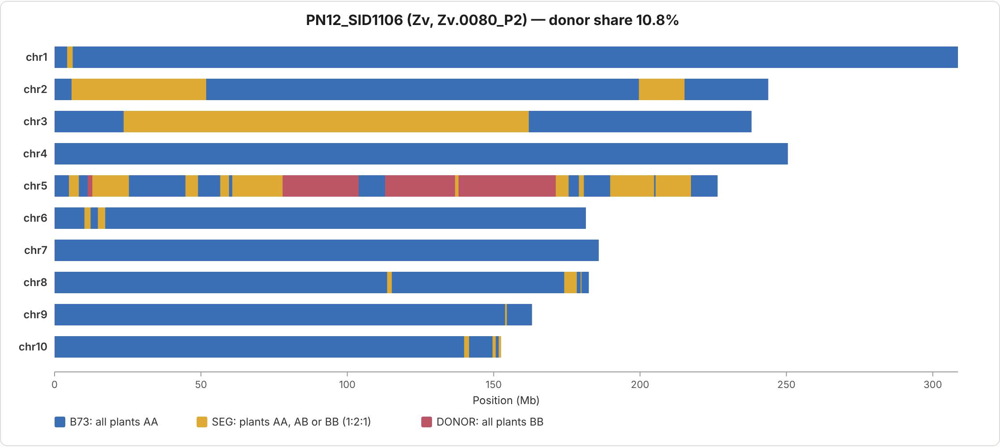
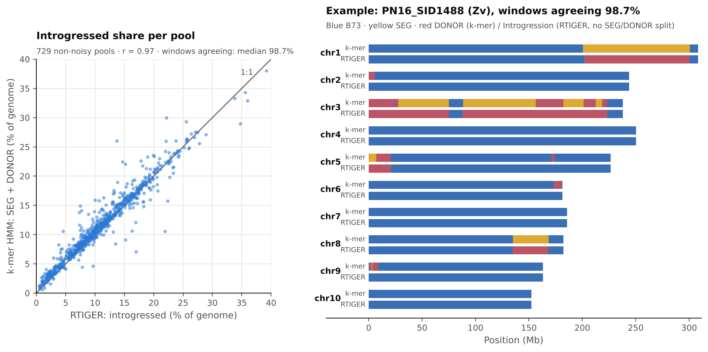

# BZea Analysis

This repository documents the end-to-end processing for **low-pass sequencing** data, starting from raw paired-end FASTQ files and proceeding through a reproducible genotype + ancestry + association workflow.

> **Pipeline:** [`final_script/`](final_script/README.md). Introgressions are called from **k-mers** (no read mapping) with an HMM on 100-kb windows (steps 16–21). The SNP route (ANGSD sites, read counts, GL-HMM; steps 01–15) is kept as a cross-check. Each sample is a pool of 6 plants from one BC2S3 plot. **Detailed analysis, every command and all statistics:** [`final_script/README.md`](final_script/README.md).

## BZea Breeding Scheme

B73 was crossed with teosinte, backcrossed twice to B73 and then selfed three times:

**B73 × teosinte → F1 → BC1 (× B73) → BC2 (× B73) → BC2S1 → BC2S2 → BC2S3**

- **Selfing, ear to row:** a plant is selfed, its progeny are planted, several are selfed, **one is selected** and advanced to the next generation, and so on. So each BC2S3 plot is grown from the seed of one BC2S2 mother (one selfed ear).
- **Sequenced sample:** one leaf each from 6 BC2S3 plants of a plot, pooled into one sample. The 6 plants are siblings: each got its own two gametes from the BC2S2 mother, so where the mother is heterozygous, each plant is AA, AB or BB with chance ¼, ½, ¼.
- **Pedigree names:** in `Zv.0200_P3_P2_P1.1.1.1`, `Zv.0200` is the teosinte accession, `P3` the F1 plant, `P2` the BC1 plant, `P1` the BC2 plant, and `.1.1.1` the selfed line. Pools that share `Zv.0200_P3` descend from one F1 plant (an **F1 family**: they all carry the same teosinte haplotype); pools that share `Zv.0200_P3_P2_P1` come from the same BC2 plant.

## Expected genotype proportions (per locus)

**Notation, used everywhere in this README and in `final_script/`:**
- **A** = the B73 allele, **B** = the teosinte (donor) allele
- **AA** = homozygous B73, **AB** = heterozygous, **BB** = homozygous teosinte

**Assumptions:** B73 is AA, the teosinte donor contributes one B allele to the F1, and there is no selection or segregation distortion. (In practice one plant was selected at each selfing step, so a departure from these numbers can point to selection; see [Results](#results).) These are the same for every donor taxon: Zd (*diploperennis*), Zh (*huehuetenangensis*), Zl (*luxurians*), Zv (*parviglumis*) and Zx (*mexicana*).

### Step 1 — Two backcrosses (BC2)

- F1 = B73 (AA) × teosinte (BB) → **100% AB**
- BC1 = F1 × AA → ½ AA, ½ AB
- BC2 = BC1 × AA → **¾ AA, ¼ AB**, 0 BB

Donor allele share at BC2: ¼ × ½ = **12.5%**. Selfing doesn't change allele shares, so 12.5% is the expectation at every later generation too.

### Step 2 — Selfing a heterozygote

Each self halves the heterozygotes; the rest become AA or BB in equal parts. Starting from AB, after *s* selfs:
- AB = (½)^s
- AA = BB = (1 − (½)^s) / 2

| Selfs | AA | AB | BB |
|---|---|---|---|
| 1 (BC2S1) | 1/4 | 1/2 | 1/4 |
| 2 (BC2S2) | 3/8 | 1/4 | 3/8 |
| 3 (BC2S3) | 7/16 | 1/8 | 7/16 |

### Step 3 — One BC2S3 plant (three selfs)

¾ of the genome is already AA at BC2 and stays AA. The ¼ that is AB goes through three selfs:

| Genotype | Calculation | Expected |
|---|---|---|
| AA | 0.75 + 0.25 × 7/16 | **85.94%** |
| AB | 0.25 × 1/8 | **3.13%** |
| BB | 0.25 × 7/16 | **10.94%** |
| Donor alleles | 10.94 + ½ × 3.13 | **12.5%** |

This is the expectation for **one plant**.

### Step 4 — One sequenced pool (6 BC2S3 siblings)

We don't sequence single plants. We sequence a pool of 6 siblings, so what we can see in a region is the genotype of their **BC2S2 mother** (two selfs), which sets what the 6 plants can be:

| BC2S2 mother | Calculation | Expected share | The 6 plants | Pool state (HMM) |
|---|---|---|---|---|
| AA | 0.75 + 0.25 × 3/8 | **84.38%** | all AA | **B73** |
| AB | 0.25 × 1/4 | **6.25%** | each AA, AB or BB (¼, ½, ¼) | **SEG** |
| BB | 0.25 × 3/8 | **9.38%** | all BB | **DONOR** |

**The two views agree.** Taking the plants inside the pool states:
- AA = B73 + ¼ SEG = 84.38 + 1.56 = **85.94%**
- AB = ½ SEG = **3.13%**
- BB = DONOR + ¼ SEG = 9.38 + 1.56 = **10.94%**
- Donor alleles = DONOR + ½ SEG = 9.38 + 3.13 = **12.5%**

So the HMM's pool states are compared with Step 4, and converted to plant genotypes with the formulas above to compare with Step 3. Both are shown in the results.

### Implication for low-pass pooled genotyping

- **Het is small:** only 3.1% of a plant's genome is expected to be AB. At 0.8x, single-site het calls are unreliable anyway, so we call pool states over 100-kb windows instead of genotypes at sites.
- **Most donor should be fixed:** of the 12.5% donor alleles, most should sit in DONOR regions (9.4%), where all 6 plants are BB. SEG regions (6.25%) hold the rest, as a 1:2:1 mix of plants.
- **What we found:** het matches the expectation (SEG 6.23%, AB 3.12%), but DONOR is only about half of it (5.0% vs 9.4%). See [Results](#results).

---

# General Overview of BZea genotyping, introgression and QTL analysis

## Genotyping

### 1) Demultiplexing by barcode (sabre)
- Split pooled FASTQs into per-sample FASTQs using barcode/index definitions using `sabre`.
- Outputs: `sample_R1.fastq.gz`, `sample_R2.fastq.gz` (+ reports/logs)

### 2) Adapter/primer trimming + quality filtering (Trimmomatic)
- Remove adapter/primer contamination and low-quality bases.
- Outputs: trimmed paired FASTQs (+ unpaired reads, trimming logs)

### 3) Alignment + BAM processing (required before GL calling)
- Align to the **B73 reference** (e.g., B73 Ref v5) using `bwa mem`.
- Post-processing:
  - sort BAM
  - mark duplicates
  - index BAM
  - basic QC (mapping %, coverage summaries)
- Outputs: `sample.sorted.markdup.bam` + `.bai` (+ QC summaries)

### 4) SNP sites and per-pool read counts (ANGSD)
- ANGSD SNP discovery, B73-polarized sites, per-pool B73/ALT read counts, site filters with a teosinte panel (`final_script/` steps 01–12).
- Used as a cross-check and for SNP-level work.

### 5) k-mer windows (KMC + KCFtools)
- For each pool, the B73 single-copy 31-mers seen in its reads, per 100-kb window (`final_script/` steps 16–19). No read mapping.

## HMM introgression analysis

### 6) HMM introgression analysis
We infer B73 / SEG / DONOR states along the genome for each pool with an HMM. It uses genetic-map transitions, ρ fitted by maximum likelihood, and emissions from the k-mer windows, with expected donor levels from teosinte assemblies, widened where our donor plants can differ from the assembly plants (`final_script/` steps 20–21).

**Inputs**
- k-mer window tables (step 17) and assembly-based donor levels (step 19)
- NAM genetic maps (cM positions per chromosome)

**Outputs**
- Per-pool state per window, tracts, summary statistics (`pool_summary.tsv`, `family_summary.tsv`), chromosome paintings (`blocks_<taxon>.pdf`)


##  QTL / Association Mapping
### 7) Mixed-model QTL scan on k-mer ancestry
- **Phenotypes:** SpATS spatially corrected BLUEs per year (2023, 2025), combined across years (`final_script/28_spats_blues.R`).
- **Genotypes:** teosinte ancestry dosage per 100-kb window from the k-mer HMM (0 B73, 1 SEG, 2 DONOR).
- **Model:** **GridLMM** (Runcie & Crawford 2019) with taxon as a fixed effect and a **LOCO (leave-one-chromosome-out) kinship** built from the same ancestry dosage, so the tested region is not absorbed by K; additive and dominance tests.
- **Threshold:** 5% genome-wide, from permutations within taxon. Regions and the B73 v5 genes in them from the GFF3.

(Details in Section 7)
 
 ---

## Software and packages

### Genotyping

- **sabre** — demultiplexing by barcode (FASTQ splitting)
- **Trimmomatic** — adapter/primer trimming + quality filtering
- **bwa-mem2** *(recommended)* or **bwa** — read alignment to reference genome
- **samtools** — BAM/SAM manipulation (sort, index, stats, depth)
- **picard** — duplicate marking
- **bcftools** — querying
- **ANGSD** — genotype likelihood estimation + SNP calling for low-pass data
- **vcftools**  — quick VCF filters / summaries
- **bgzip / tabix** *(htslib)* — compress + index VCF/BCF outputs

### Imputation and Variant handling

- **plink2** — variant QC, LD pruning, PCA, relationship matrices, LOCO kinship (`.rel/.rel.id`)
- **Beagle** (Java) — genotype imputation

### Introgression inference (k-mers + HMM)

- **KMC 3** (`kmc`, `kmc_tools`): k-mer counting
- **KCFtools**: k-mer counts per reference window
- **Python** (>= 3.8) with numpy, scipy, matplotlib: HMM and figures
- **R** (>= 4.1): QC and SNP-route summaries

### Phenotypes and QTL / association mapping

- **R** (>= 4.1) with **SpATS** (spatial BLUEs), dplyr, tidyr
- **GridLMM** R package (`github.com/deruncie/GridLMM`), data.table, ggplot2
- **Python** with pandas, numpy: inputs (dosage, LOCO kinship) and regions/genes

### Gene annotation resources

- **GFF3 annotation** for the reference build (we used v5 annotation - `Zm-B73-REFERENCE-NAM-5.0_Zm00001eb.1.gff3`)

---

## Section 1 — Demultiplex pooled FASTQs

**Goal:** Split pooled lane-level paired-end FASTQs into per-sample FASTQs using a barcode map.

### Inputs
- Pooled lane FASTQs:
  - `..._R1_001.fastq.gz`
  - `..._R2_001.fastq.gz`
- Barcode map file (`.txt`)

### Barcode file format
Tab-separated **2 columns**:

1. **BARCODE** (exact barcode sequence)
2. **OUTPUT_PREFIX** (sample name)

Example:

```txt
ACGTACGT    Sample_001
TGCATGCA    Sample_002
GATCTAGA    Sample_003
```

Unmatched reads are written to the `no_bc_match_*` files.

### Outputs
- Per-sample paired FASTQs written by sabre (based on column 2 of the barcode file)
- Unmatched reads:
  - `no_bc_match_S<...>_R1.fq.gz`
  - `no_bc_match_S<...>_R2.fq.gz`

### Run
```bash
bsub < scripts/01_demultiplex_sabre.tcsh
```

Script: [`scripts/01_demultiplex_sabre.sh`](scripts/01_demultiplex_sabre.sh)

---

## Section 2 — Trim adapters/primers + quality filter (Trimmomatic PE)

**Goal:** Remove adapters/primers

### Inputs
- Demultiplexed paired FASTQs:
  - `*_R1.fq.gz`
  - `*_R2.fq.gz`

### Outputs
- Paired reads (used for alignment):
  - `*_paired_R1.fq.gz`
  - `*_paired_R2.fq.gz`

### Parameters used
- `ILLUMINACLIP:<adapters.fa>:2:30:10`
- `LEADING:3`
- `TRAILING:3`
- `SLIDINGWINDOW:4:15`
- `MINLEN:36`


### Run
```bash
bsub < scripts/02_trim_trimmomatic.tcsh
```

Script: [`scripts/02_trim_trimmomatic.sh`](scripts/02_trim_trimmomatic.sh)

---

## Section 3 — BAM preprocessing (sort → mark/remove duplicates → index)

**Goal:** Ensure each sample BAM is **coordinate-sorted**, **deduplicated**, and **indexed** before genotype likelihood (GL) generation with `bcftools mpileup`.

Ensure the files are:
- sorted
- Mark/remove duplicates
- Index BAMs files

### Inputs
- Aligned BAMs (usually from BWA/BWA-MEM2), one per sample:
  - `PN*_SID*.bam`

### Outputs
For each input `PN*_SID*.bam`
- Sorted BAM: `PN*_SID*.sorted.bam`
- Deduplicated BAM (duplicates removed): `PN*_SID*.sorted.rmdup.bam`
- Metrics: `PN*_SID*.dedup_metrics.txt`
- Index: `PN*_SID*.sorted.rmdup.bam.bai`

### Run
```bash
bash scripts/03_bam_sort_dedup_index.sh
```

Script: [`scripts/03_bam_sort_dedup_index.sh`](scripts/03_bam_sort_dedup_index.sh)

---

## Sections 4–6 — Introgression calling

All code is in [`final_script/`](final_script/), numbered in run order. **The detailed analysis (every command, parameter, output, all statistics and the method history) is in [`final_script/README.md`](final_script/README.md).** This section explains what we do and why, and the main results.

### What a sample is

Each sequenced sample is a **pool of 6 BC2S3 plants from one plot**, sequenced at about **0.8x**, with no parental sequencing. B73 is the recurrent parent. Donors are teosinte:
- *mexicana* (Zx), *parviglumis* (Zv), *diploperennis* (Zd), *luxurians* (Zl), *huehuetenangensis* (Zh)
- landraces (Zm) are set aside for now

Because a sample is several sibling plants, each genome region in a pool is in one of three states. These are set by the genotype of the plot's BC2S2 mother:

| Pool state | Plants in the pool | Expected share of the genome |
|---|---|---|
| **B73** | all AA | 84.4% |
| **SEG** | the family still segregates: each plant is AA, AB or BB (1:2:1) | 6.25% |
| **DONOR** | all BB | 9.4% |

Both views give 12.5% donor alleles. Per single plant, the same expectation is 85.9% AA, 3.1% AB and 10.9% BB (see above).

**What SEG means.** SEG is a state of the *pool*, not of a plant, and it is **not the same as "het"**.
- In a SEG region, the family's BC2S2 parent was AB, so its BC2S3 offspring segregate 1:2:1. **Each of the 6 plants in the pool can be AA, AB or BB.**
- On average a SEG pool holds ¼ AA, ½ AB and ¼ BB plants. The exact mix differs from pool to pool (e.g. 2 AA, 3 AB, 1 BB), and the model allows for that.
- A SEG call says "this family is still segregating here". It does not say that any one plant is AB.
- **SEG vs "het" in SNP-based callers.** In a SEG region the pool's reads show both alleles, just like a het site in a single plant, so a diploid SNP genotyper would call it het. But in a pool, "both alleles present" only means the 6 plants are a mix: any combination of AA, AB and BB plants, as long as both alleles are there. That's why we call this state SEG, not het. (The pooled SNP HMM in step 14 also uses B73 / SEG / DONOR; a single-plant SNP model would label it het.)
- To get plant genotypes from pool states: **AA = B73 + SEG/4, AB = SEG/2, BB = DONOR + SEG/4**.

**How the pools were sampled, and why SEG looks the way it does.**
- BC2 plants were selfed three times: BC2 → BC2S1 → BC2S2 → BC2S3. Each plot is grown from the seed of one BC2S2 plant.
- One leaf each was taken from 6 different BC2S3 plants of the plot and pooled into one sample. These 6 plants are siblings, not copies of one plant: each got its own two gametes from the BC2S2 parent.
- Where the BC2S2 mother was AA, all 6 plants are AA (pool state **B73**). Where it was BB, all 6 are BB (**DONOR**). Where it was AB, each plant is independently AA, AB or BB with chance ¼, ½, ¼ (**SEG**).
- So in a SEG region the pool carries k donor copies out of 12 (6 plants × 2), with k ~ Binomial(12, ½). That is the mixture the HMM uses.

**Can we tell which plants are AA, AB or BB in a SEG region?** No, not from this data. The 6 leaves are ground into one sample, so a read doesn't say which plant it came from.
- **What the pool can tell:** roughly how many donor copies it carries, k out of 12. In principle k can be estimated per SEG tract, because a 10-Mb tract has about 100 windows. Right now the HMM averages over all possible k and doesn't report one.
- **Even an exact k doesn't give the genotypes.** For example, 6/12 could be 6 AB plants, or 3 AA + 3 BB, or 2 AA + 2 AB + 2 BB.
- **The estimate is only as good as the family's DONOR level d**, because r(SEG) = d + (1 − d)·g(k/12).
- **k can change inside a tract.** The 12 gametes recombine independently, so a plant can be AA at one end of a SEG tract and AB at the other.
- **Leaves are not equal.** Leaf size and DNA yield differ, so a plant's share of the reads isn't exactly 1/6. This adds noise to k.
- **To get plant genotypes:** genotype single plants, or seed of that family, e.g. with a few KASP markers inside the SEG tracts, or skim-sequence single plants from a subset of families.

**Words used below:**
- **Pool** or **sample:** one sequenced sample, i.e. 6 plants from one plot. Every result is per pool.
- **Window:** a 100-kb piece of the B73 genome. The HMM calls one state per pool per window.
- **Tract:** a run of neighbouring windows with the same state.
- **F1 family:** all pools that descend from one F1 plant (same accession and same first P in the name). Used to group pools in the statistics.

### The problem: mapping reads and calling SNPs at 0.8x in pools

We first did it the usual way (steps 01–15): map reads to B73, count each pool's reads at SNPs (ANGSD), then run an HMM. It found too little donor and too much SEG. Three things go wrong, and they hit DONOR and SEG (het) regions hardest:

1. **Donor reads are lost (reference bias).** In a known Zd DONOR tract (PN13_SID1199, chr2:22.1–25.3 Mb), only **~34%** of the expected reads map there at all, because much teosinte sequence is missing from or rearranged against B73. The usual filters (`-C 50`, BAQ, MAPQ ≥ 30) then remove most of the rest: only **~11%** of expected donor bases survive, against ~96% in B73 regions. The filters remove reads with mismatches, and a read carrying a teosinte allele has extra mismatches by definition. So ALT alleles are lost first: **DONOR (BB) shows mixed reads and is called SEG, and SEG loses its ALT reads and is called B73.** This comes from mapping to one reference; tuning filters can't fix it.
2. **Too few reads per site.** At 0.8x most SNPs have 0 or 1 read. One read shows one allele, so a het site looks homozygous, and a single error read looks like a het. Every call leans on the HMM and imputation.
3. **Pools aren't diploid.** A pool's ALT fraction can be anything from 0 to 1 (e.g. 5/12 in a SEG region). Genotype callers built for diploids (0 / ½ / 1) mislabel these mixtures.

### The solution: k-mers

**Prior work.** Finding introgressions by counting reference k-mers in genome windows, without mapping reads, has been developed in wheat previously:
- **IBSpy** (Uauy lab; Quiroz-Chávez 2023), used to find einkorn introgressions in bread wheat (Ahmed et al. 2023).
- **KCFtools** (Selvanayagam et al. 2026), a fast tool for k-mer introgression screening and k-mer GWAS. We use it for the per-window counts.

k-mers are counted with **KMC 3** (Kokot et al. 2017). The DONOR levels come from teosinte genome assemblies (PanAnd-1.0, Stitzer et al. 2025), downloaded from **MaizeGDB** (Portwood et al. 2019).

**What we added:** low-coverage *pools* instead of single plants, a three-state pool model (B73 / SEG / DONOR) with per-window DONOR levels from assemblies, and the HMM on the NAM genetic map.

### How it works


1. **B73 k-mer list (step 16).** The **B73 reference genome** (RefGen v5, `Zm-B73-REFERENCE-NAM-5.0`, the same reference used for mapping in the SNP route) is cut into every 31-letter word (k-mer), counted with KMC. Only the **single-copy** ones are kept: 680 M of 817 M. Repeats are dropped because they're in every genome, donor or not, and would hide the signal.
2. **Look them up in each sample (step 17).** All k-mers in a sample's raw reads (the pool of 6 plants) are counted, with no mapping. For each 100-kb B73 window, KCFtools counts how many of the window's single-copy B73 k-mers the sample has.
   - **B73 region:** essentially all of them are present, limited only by sequencing depth.
   - **Donor region:** every teosinte SNP or indel removes the B73 k-mers that overlap it, so the count drops.
3. **Score each window (step 20).** r = k-mers seen in the pool ÷ what a B73 pool of the same depth would see. That reference is a fit of the 10 B73 control pools, never including the pool itself.
   - B73 gives **r ≈ 1**, DONOR **r ≈ d**, and SEG falls between them.
   - d is the share of B73 k-mers a donor genome keeps. It's measured per window from teosinte genome assemblies (PanAnd-1.0 from MaizeGDB, step 19): Zd and Zl ≈ 0.26, Zh 0.34, Zx 0.37, Zv 0.43.
   - SEG: k-mers the donor lacks come only from the B73 plants in the pool. For 6 plants, the pool's donor fraction follows Binomial(12, ½).
4. **HMM along each chromosome (steps 20–21).** The windows' r values are read along each chromosome by a three-state hidden Markov model (B73 / SEG / DONOR). It uses the NAM genetic map, so a state change costs more where recombination is rare. Adjacent windows in the same state become tracts. **The model is explained step by step in [The HMM in detail](#the-hmm-in-detail) below.**
5. **Allow for our donor plants differing from the assembly plants (step 20).** Where the two assemblies of a taxon disagree on d, the model is told that the DONOR level there is uncertain, so it doesn't flip between SEG and DONOR on small differences (see τ_w under [Emissions](#emissions-how-well-does-r-fit-each-state)).
6. **Tests (step 22).** Observed vs expected BC2S3 proportions, with a bootstrap over F1 families. Pools of one F1 family share segments, so the F1 family is the unit.

### How r is calculated: a worked example

Take one 100-kb window. The numbers are rounded but realistic.

**Step 1: what B73 has.** B73's window contains **30,000** single-copy k-mers (step 16).

**Step 2: what a pure-B73 pool would find.** At 0.8x a pool doesn't see every k-mer, because many parts of the window aren't covered by any read. The 10 B73 control pools tell us how many a B73 pool of this depth finds in this window; say **13,000** (43% of 30,000). That's the expected count.

**Step 3: r = what our pool found ÷ the expected count.**

| Our pool in any given window is… | k-mers found | r |
|---|---|---|
| B73 (all plants AA) | ~13,000 | 13,000 / 13,000 ≈ **1.0** |
| DONOR (all plants BB, Zd) | ~3,500 | 3,500 / 13,000 ≈ **0.27** |
| SEG (about half B73, half donor) | ~9,000 | ≈ **0.69** (below) |

**Where the DONOR level comes from (step 19).** We take the complete Zd genome assemblies (Gigi and Momo, PanAnd-1.0 from MaizeGDB) and count how many of the window's 30,000 B73 k-mers appear anywhere in them. Say 8,100: 8,100 / 30,000 = **d = 0.27**, so Zd keeps 27% of B73's k-mers here. A pool that is all Zd in this window can only find that 27%, so its expected r is 0.27.

d is measured like this for every window and every taxon. Genome-wide it's Zd 0.27, Zl 0.26, Zh 0.34, Zx 0.37 and Zv 0.43; Zv is closest to maize, so it keeps the most. Sequencing the **actual donor parents** of our lines would have been better, because d would then be measured on the plants our lines came from. We don't have them, so we use the MaizeGDB assemblies of the same taxa.

**Why SEG falls in between.** In a SEG region the pool is a mix of B73 and donor chromosomes. Split the 30,000 k-mers in two:
- **Shared with the donor (27%):** every chromosome carries them, so they're found as often as in a B73 pool (ratio 1.0).
- **Missing from the donor (73%):** only the B73 chromosomes carry them, about half the chromosomes, so they get about half the reads. Half the reads doesn't mean half the k-mers found, because at low depth many k-mers are missed either way:
  - A B73 pool at full depth finds **43%** of the k-mers (13,000 of 30,000). From the coverage formula (the chance a k-mer is seen at coverage c is 1 − e^(−c)), that means a k-mer coverage of c = 0.57.
  - With half the reads (c = 0.28), it finds 1 − e^(−0.28) = **25%**.
  - So these k-mers are found 25 / 43 = **57%** as often as in a B73 pool. That ratio is **g**.

So r(SEG) = 0.27 × 1.0 + 0.73 × 0.57 ≈ **0.69**.

In general, r(SEG) = d + (1 − d) × g. The HMM doesn't assume exactly half donor. It averages over the possible donor fractions of a 6-plant pool (1/12 to 11/12), weighted by Binomial(12, ½), the 1:2:1 segregation summed over 6 plants.

**Then the HMM** compares each window's r with these three expected levels (B73 ≈ 1, SEG ≈ 0.6–0.7, DONOR ≈ d). It allows for each pool's noise and takes neighbouring windows into account, using the genetic map, to call the most likely state.

### The HMM in detail

A hidden Markov model (HMM) is used because we can't see a pool's true state directly. We only see a noisy score r in each window. But we know two things that help:
- each state gives r values in a typical range, and
- the state rarely changes from one window to the next, because introgressed segments are usually long (most are several Mb, though some are shorter, down to a few hundred kb).

The HMM combines both to find the most likely series of states along each chromosome. It has the same three-state structure as the SNP HMM in step 14 (`14_hmm_pooled.py`) and as standard HMMs for recombinant genomes, e.g. RTIGER (Campos-Martín et al. 2023); see Rabiner (1989) for HMMs in general. Only the observation is different: a k-mer score per window instead of SNP reads.

**The four parts of the model:**

| Part | What it is here |
|---|---|
| **Positions** | The 100-kb windows along one chromosome, in order. Each chromosome is run separately. Windows with fewer than 2,000 single-copy B73 k-mers, or where the B73 controls themselves see very few k-mers (repeats, gaps), are skipped. |
| **Hidden states** | The pool's state in the window: **B73** (all 6 plants AA), **SEG** (the family segregates: each plant AA, AB or BB), **DONOR** (all 6 plants BB). |
| **Observation** | r, the k-mer score of the window (≈ 1 for B73, ≈ d for DONOR, in between for SEG; see the worked example above). |
| **Emission** | For each state: how likely the observed r is if the pool really is in that state. |
| **Transition** | The chance that the state changes between one window and the next. |
| **Start / prior** | The share of the genome expected in each state: B73 84.4%, SEG 6.25%, DONOR 9.4% (BC2S3 expectation). |

#### Emissions: how well does r fit each state?

Each state expects r near a certain value, with some spread (noise). The spread σ_w is measured, not assumed:
- **Pool noise σ:** how much r scatters around 1 in the pool's B73 windows. It is a *robust* standard deviation:
  1. For every B73-like window, take how far r is from 1: |r − 1|.
  2. Take the median of those distances. This is the **MAD** (median absolute deviation).
  3. Multiply by 1.4826. For normally distributed noise, 1.4826 × MAD equals the ordinary SD.

  Unlike the ordinary SD, the MAD isn't inflated by the few introgressed or junk windows, because a median ignores extreme values. Good pools have σ ≈ 0.08–0.10. Pools with σ > 0.15 are flagged **NOISY**, which mostly means low depth.
- **Window factor:** windows where the 10 B73 controls disagree with each other are noisier in every pool, so σ_w = σ × (control spread in this window ÷ typical control spread), limited to 0.5–3.

| State | Expected r | Emission (probability of r) | In words |
|---|---|---|---|
| **B73** | 1 | Normal(1, σ_w) | r near 1, with the pool's noise |
| **DONOR** | a × d_w | Normal(a·d_w, √(σ_w² + (a·τ_w)²)) | r near the donor level, with the pool's noise plus the uncertainty of the donor level |
| **SEG** | between d_w and 1 | average of Normal(a·d_w + (1 − a·d_w)·g(k/12), √(σ_w² + ((1 − g)·a·τ_w)²)) over k = 1…11 donor copies, weighted by Binomial(12, ½) | for each possible number of donor copies k in the 6 plants, r near the matching in-between level; the k are weighted by how likely they are under 1:2:1 segregation |

What the terms mean:
- **d_w:** the share of the window's B73 k-mers that the donor genome keeps, measured from the teosinte assemblies (step 19). Each window has its own value.
- **τ_w (uncertainty of d_w):** our donor plants are not the assembly plants, so their real level can differ from d_w. Teosinte is outcrossing and very diverse, so two plants of the same taxon can differ a lot in a given window; even the two Zv assemblies differ by more than 0.2 in 28% of windows. τ_w is how much the taxon's two assemblies disagree in that window (their SD × √1.5, the expected spread of a new plant around the mean of two, averaged over ±5 windows). It adds to the noise of DONOR, and to SEG in proportion to how much SEG depends on d. Mean τ: Zv 0.18, Zx 0.16, Zd 0.06. Zh and Zl have only one assembly, so τ = 0 for them. The B73 controls get the widest τ (Zv) as a worst-case test. Why it was added: in a first run without τ_w, Zv and Zx tracts kept flipping between SEG and DONOR; τ_w halved that. Details: [`final_script/README.md`, section 5.7](final_script/README.md#57-method-history-family-donor-levels-then-donor-level-uncertainty-current).
- **a:** one scale factor per pool. It absorbs genome-wide differences between our donor plant and the assembly plants; for example, our plant may keep a few percent more B73 k-mers everywhere. **How it's fitted (maximum likelihood by grid search):**
  1. The whole HMM is run for the pool with each value of a: 0.5, 0.6, …, 1.4, 1.6, 1.8.
  2. Each run gives the **likelihood**: the probability of the pool's observed r values in all windows of all chromosomes under that model. The forward algorithm computes it.
  3. The a with the highest likelihood is kept. This is done for each ρ.

  The fitted a is mostly 0.9–1.0 in every taxon, so on average the assembly levels fit our lines well.
- **k/12:** the donor fraction of a SEG pool. 6 plants carry 12 chromosome copies. A SEG family segregates 1:2:1, so the number of donor copies k follows Binomial(12, ½). The model averages over all k instead of assuming exactly half (see [What SEG means](#what-a-sample-is)).
- **f and g(f):** f is the donor fraction of the pool's chromosomes in the window (f = k/12). g(f) is how often the pool still finds the B73 k-mers that the donor lacks, compared with a pure-B73 pool. Those k-mers sit only on the B73 chromosomes, a share (1 − f) of the pool, so they get only that share of the reads. From the coverage formula, g(f) = (1 − e^(−(1−f)λ)) / (1 − e^(−λ)), where λ is the pool's k-mer coverage (measured from the share of B73 k-mers it finds in B73 windows). In the worked example, f = ½ gives g = 0.57. g = 1 when the pool is all B73 (f = 0), and g = 0 when it's all donor (f = 1).
- **Outliers:** each state also has a 2% chance that the window is junk. A junk window's r is treated as equally likely anywhere from 0 to 2 (a uniform distribution). This is a standard robustness device, a "contamination" term in the emission. Without it, one odd window (e.g. a mis-assembled or duplicated region) could give near-certain evidence for a state just because it lies far out in a normal curve's tail.
  - **The 2% is a chosen value, not estimated from the data.** The B73 controls show it's on the safe side (44-pool test, 10 controls, about 21,000 windows each):
    - 0.77% of control windows are more than 3σ from 1, where a perfect normal would give 0.27%.
    - 0.10% are more than 4σ from 1, where a normal would give 0.006%.
  - So real outliers exist, but at well under 2%. A higher value makes the HMM more reluctant to switch on a few windows; a lower one makes it switch more readily.

**Example: one Zd window** (d = 0.27, σ = 0.09, a typical pool; Zd's τ is small, so it's left out here). For a given r, this is how well each state fits on its own, before neighbouring windows are considered:

| r | B73 | SEG | DONOR | Reading |
|---|---|---|---|---|
| 0.27 | 0% | 1% | **99%** | clearly DONOR |
| 0.45 | 1% | 53% | 46% | between SEG and DONOR: the neighbours decide |
| 0.69 | 1% | **99%** | 0% | clearly SEG (about half the plants' chromosomes donor) |
| 0.85 | 43% | 56% | 0% | B73 or SEG with few donor copies: the neighbours decide |
| 1.00 | **96%** | 4% | 0% | clearly B73 |

SEG covers a wide range (here 0.35–0.95) because a 6-plant pool can carry from 1 to 11 donor copies.

#### Transitions: how often can the state change?

Between two neighbouring windows, the chance of a state change is **s = ρ × θ**:
- **θ** is the recombination fraction between the two window centres, from the NAM genetic map (Haldane: θ = ½(1 − e^(−2·Morgans))). On average a 100-kb step is 0.075 cM, but it's near 0 around centromeres and higher near chromosome ends.
- **ρ** scales it. Our lines went through several meioses (BC1, BC2, three selfings), so segment ends are more frequent than one meiosis would give. ρ is not guessed: every pool is run with ρ = 0.25, 0.5, 1, 1.5, 2, 3, 4 and 8, and the value with the highest total likelihood over all donor pools (low-depth pools left out) is used. That is **ρ = 1.5**.
- **Where to:** if the state changes, it moves to one of the other two states in proportion to their prior (e.g. from B73, more often to DONOR (9.4%) than to SEG (6.25%)).

With ρ = 1.5, the chance of a change is about **0.1% per window** on average. The model stays in the same state unless several windows in a row clearly fit another state. I checked this with the model itself, on a Zd DONOR tract at average recombination. A SEG piece inside it is called only when about **4 windows in a row (400 kb)** clearly look SEG (r = 0.69); less clear windows (r = 0.55) need 6. One noisy window can't break a tract, because the 2% outlier term caps its evidence.

#### Calling the states

- **Forward–backward** computes, for every window, the probability of each state given the whole chromosome. The window gets the state with the highest probability.
- **Tracts:** adjacent windows with the same state are joined. Skipped windows take the state before them.
- **Plant genotypes** follow from the pool states: AA = B73 + SEG/4, AB = SEG/2, BB = DONOR + SEG/4.

#### What is fitted, and where

| Quantity | Fitted per | How | Code |
|---|---|---|---|
| r (k-mer score) | pool × window | pool count ÷ fit of the B73 controls | `20_kmer_hmm.py` |
| σ (noise) | pool, then × window factor | robust SD of r in B73 windows; control spread | `20_kmer_hmm.py` |
| λ (k-mer coverage) | pool | share of B73 k-mers seen | `20_kmer_hmm.py` |
| d_w (DONOR level) | donor taxon × window | MaizeGDB assemblies of that taxon | `19_kmer_donor_reference.sh` |
| τ_w (uncertainty of d_w) | donor taxon × window | disagreement of the taxon's two assemblies | `20_kmer_hmm.py` (`--d_spread`) |
| a (scale on d) | pool | best likelihood over 0.5–1.8 | `20_kmer_hmm.py` |
| ρ (switch rate) | whole data set | best total likelihood | `21_kmer_collect.py` |
| Prior | fixed | BC2S3 expectation | `config.sh` |
| Plants per pool | fixed | 6 | `config.sh` (`KMER_PLANTS`) |
| Outlier share | fixed | 2% | `20_kmer_hmm.py` (`--eps`) |

"Donor taxon" is the pool's teosinte (Zd, Zh, Zl, Zv or Zx, from the sample sheet). Every pool of that taxon uses the same d_w and τ_w, taken from the MaizeGDB assemblies of the taxon; nothing here comes from our BC1 or BC2 plants.

**Why the prior is fixed.** It only sets the state each chromosome starts in, and which state a switch goes to. It doesn't set how much of the genome ends up in each state: with about 2,000 windows per chromosome, the data decide. DONOR came out at 5.0% although the prior expects 9.4%, so the prior isn't forcing the result.

### How k-mers solve mapping bias, low depth and pooling

Back to the three problems of the SNP route ([above](#the-problem-mapping-reads-and-calling-snps-at-08x-in-pools)):

| Problem (above) | How the k-mer approach avoids it |
|---|---|
| **1. Donor reads are lost** | No mapping. A pool's raw reads are counted as k-mers, and only the presence of B73 k-mers is checked, so donor reads can't be filtered away. |
| **2. Too few reads per site** | No per-site calls. Each 100-kb window adds up ~30,000 k-mers, so its score r is measured precisely from thousands of positions at once. |
| **3. Pools aren't diploid** | The model is built for pools: DONOR = d, SEG = d + (1 − d)·g(f), averaged over the donor fractions a 6-plant family can have (Binomial(12, ½)). |

**Telling DONOR from SEG.** It no longer depends on allele ratios at single sites, which reference bias distorts. It depends on the window's **level**: in the Zd example above, DONOR ≈ 0.27 and SEG ≈ 0.69, with B73 = 1. The DONOR level is measured from teosinte genomes, not guessed.

**What we see in our data:**
- **SEG matches the expectation:** 6.23% observed vs 6.25% expected (family bootstrap p = 0.93).
- **Plant-level het matches Mendel:** AB 3.12% vs 3.13%. So the k-mer calls don't inflate het, which is the classic failure.
- **Fewer broken tracts:** the SNP route broke tracts into many short SEG pieces (44–69% of its SEG tracts were under 1 Mb) and turned DONOR into SEG when its donor-allele model drifted. In two Zd pools it reported 17% donor where the k-mers find 3–7%.

### Results

1,292 donor pools (the 93 low-depth pools are left out; see [Noisy pools](#noisy-pools-and-resequencing)).

| Taxon | Pools | Donor alleles | SEG (pool) | DONOR (pool) | AB (plant) | BB (plant) | AB/(AB+BB) |
|---|---|---|---|---|---|---|---|
| Zd | 227 | 5.6% | 5.1% | 3.0% | 2.6% | 4.3% | 37% |
| Zh | 61 | 8.2% | 5.7% | 5.3% | 2.9% | 6.7% | 30% |
| Zl | 98 | 7.2% | 6.8% | 3.8% | 3.4% | 5.5% | 38% |
| Zv | 333 | 8.4% | 6.5% | 5.1% | 3.2% | 6.8% | 32% |
| Zx | 573 | 9.0% | 6.5% | 5.8% | 3.2% | 7.4% | 30% |
| **All** | **1,292** | **8.1%** | **6.2%** | **5.0%** | **3.1%** | **6.5%** | **32%** |
| *Expected BC2S3* | | *12.5%* | *6.25%* | *9.4%* | *3.1%* | *10.9%* | *22%* |

> **What AB/(AB+BB) means.** Look only at plants that carry teosinte at a locus, i.e. plants that are AB or BB there. AB/(AB+BB) is the share of those plants that are **het**. It asks *how* the teosinte that is present is held (het or homozygous), not *how much* teosinte there is.
> - **Expected for BC2S3:** AB = 3.13% and BB = 10.94%, so AB/(AB+BB) = 3.13 / (3.13 + 10.94) = **22.2%**. Out of 100 teosinte-carrying plants at a locus, about 22 should be het and 78 homozygous teosinte.
> - **Observed:** AB = 3.12% and BB = 6.51%, so AB/(AB+BB) = 3.12 / (3.12 + 6.51) = **32.4%**: about 32 het and 68 homozygous out of 100.
> - **Why it's useful:** it doesn't depend on the total amount of donor. If lines simply lost teosinte at random (drift, or segments lost before BC2), AB and BB would drop together and the ratio would stay at 22%. It rises only if BB plants are lost more than AB plants, e.g. by selection against plants homozygous for teosinte segments.


The figure has three groups, because these numbers are different kinds of measures:
- **Pool states (SEG, DONOR):** what the HMM calls, per pool and window.
- **Plant genotypes (AB, BB):** what the pool states mean for single plants. They are **not measured** directly: a pool can't say which plant is AB. They are computed from the pool states using Mendel: a SEG region holds ¼ AA, ½ AB and ¼ BB plants, so **AB = SEG/2** and **BB = DONOR + SEG/4**. So AB lives inside SEG.
- **Donor alleles:** the total share of teosinte alleles, = DONOR + SEG/2.


Figures from step 24 (`24_kmer_figures.py`); the per-family values are in `final_script/figures/results_spread/family_values.tsv`.

**What this shows:**
- **Het is as expected:** SEG (6.23%) and AB (3.12%) match the BC2S3 expectation; the F1-family bootstrap finds no difference (p = 0.93).
- **Homozygous donor is about 60% of the expectation** (BB 6.5% vs 10.9%; p < 0.0002 in every taxon). That loss is the whole shortfall in donor alleles (8.1% vs 12.5%).
- **So a larger share of the remaining donor is het:** 32% of donor-carrying plants are AB, against 22% expected. This is not extra het: AB is exactly as expected (3.1% of the genome). The share goes up only because BB went down, so AB is a bigger part of a smaller total. This holds on every chromosome (29–35%).
- **A likely reason: selection during selfing.** At every selfing step one plant was selected and advanced (ear to row). Choosing vigorous, fertile, maize-like plants tends to select against teosinte alleles that hurt those traits, which lowers the donor share overall. Many such teosinte effects show mostly in plants homozygous for the teosinte allele (BB), while an AB plant still has a B73 copy. So selection removes BB more than AB, which is exactly what raises AB/(AB+BB). TeoNAM (Chen et al. 2019), a maize × teosinte population made the same way (backcross, then selfing), also reported more heterozygosity than expected, as did our lab's earlier lines.
- **F1 families:** only 2 of 98 F1 families reach the expected 12.5% donor alleles (Zx.0390_P2, Zx.0130_P1); most sit between 5% and 11%. AB/(AB+BB) is above 22% in most F1 families of every taxon.
- **Small taxa:** Zd (6 F1 families), Zl (5) and Zh (2) have few F1 families, so their intervals are less reliable. Zd's SEG (5.1%) is somewhat below the expectation (p = 0.0004).

**One sample, as an example** (PN12_SID1106, Zv). The state of each 100-kb window along the 10 chromosomes:



On such a plot there are only three colours, the three pool states. AB isn't drawn, because a pool can't show which plants are AB: inside a yellow (SEG) region about half the 6 plants are AB, a quarter AA and a quarter BB. All samples can be browsed in the [interactive viewer](#interactive-figures-step-23).

The full statistics, F1 family results and the method history are in [`final_script/README.md`](final_script/README.md).

### Validation

- **B73 controls are clean:** all 10 have ≤ 0.56% non-B73 windows (donor share ≤ 0.28%). This is a fair test, because the k-mer route never used the controls to filter sites.
- **Known tracts:** they are found with the expected levels. For example, a Zd DONOR tract on chr2 has r ≈ 0.20 against an assembly value of 0.26.
- **Agreement with the SNP route:** donor shares agree where the SNP route works. Where they differ, the cause is on the SNP side: lost donor reads, κ collapsing, or noisy pools.
- **Agreement with RTIGER** (SNP-based introgression calls made separately; B73 vs Introgression only, no SEG/DONOR split). 780 pools could be matched by name; 729 of them are not low-depth:
  - **Introgressed share per pool:** RTIGER 11.0%, k-mer 11.6% (SEG + DONOR); correlation r = 0.97 across pools.
  - **Same call in 98.2% of 100-kb windows** (median pool 98.7%). 95% of the k-mer introgression is also introgressed in RTIGER, and only 0.7% of k-mer B73 windows are introgressed in RTIGER.
  - **The one systematic difference: RTIGER has no tract shorter than 10 Mb** (its shortest is 10.0 Mb, median 33 Mb). About 11% of the k-mer introgressed sequence lies in tracts under 10 Mb, and RTIGER calls it B73. RTIGER also bridges short B73 gaps inside long tracts. If the k-mer calls are limited to tracts of at least 10 Mb, the agreement rises to 98.6%.
  - Two methods built on different data (mapped SNP reads vs k-mers, no mapping) agree on 98% of the genome. That supports both for the long tracts; for the short tracts, see [Limitations and future work](#limitations-and-future-work).



Per-pool numbers: `final_script/figures/rtiger_comparison/rtiger_vs_kmer_per_pool.tsv`.

### Noisy pools and resequencing

93 of the 1,385 donor pools are flagged **NOISY** (σ > 0.15). They are left out of the results above. Almost all of them are on three plates with low sequencing depth:

| Plate | Pools | NOISY | Median σ | Mean single-copy k-mers per pool | NOISY by taxon |
|---|---|---|---|---|---|
| PN2 | 3 | 0 | 0.118 | 189 M | — (rest of PN2 is Zm, skipped) |
| PN3 | 87 | 3 | 0.089 | 192 M | Zx 3 |
| PN4 | 93 | 0 | 0.081 | 211 M | — |
| PN5 | 92 | 0 | 0.097 | 170 M | — |
| PN6 | 94 | 2 | 0.112 | 145 M | Zx 1, Zd 1 |
| PN7 | 91 | 0 | 0.081 | 213 M | — |
| PN8 | 92 | 0 | 0.087 | 199 M | — |
| PN9 | 95 | 2 | 0.112 | 162 M | Zl 2 |
| PN10 | 94 | 0 | 0.086 | 245 M | — |
| **PN11** | **93** | **34** | **0.130** | **150 M** | **Zl 18, Zv 16** |
| PN12 | 95 | 4 | 0.095 | 211 M | Zv 4 |
| **PN13** | **88** | **23** | **0.140** | **115 M** | **Zd 18, Zv 5** |
| PN14 | 94 | 1 | 0.090 | 207 M | Zd 1 |
| **PN15** | **93** | **24** | **0.138** | **109 M** | **Zv 22, Zd 2** |
| PN16 | 95 | 0 | 0.084 | 214 M | — |
| PN17 | 96 | 0 | 0.082 | 217 M | — |

**Recommendation: resequence PN11, PN13 and PN15.**
- **Depth:** PN13 and PN15 have about half the k-mers of a typical plate (109–115 M vs ~200 M), and PN11 about 75%. On PN11, 37% of pools are NOISY.
- **Taxa:** the noisy pools are concentrated in a few taxa, so leaving them out takes a large bite out of those taxa:
  - Zl: 18 of its 20 noisy pools are on PN11.
  - Zd: 18 of 22 are on PN13.
  - Zv: 43 of 47 are on PN11, PN13 and PN15.

**Other samples to check.** Besides depth, a few samples look wrong for other reasons. They are kept in the results but flagged; together they change the main numbers by less than 0.1 percentage point.
- **Donor pools with almost no donor.** 5 pools are as clean as the B73 controls (donor share ≤ 0.11%): PN4_SID334 and PN4_SID335 (both from BC2 plant `Zx.0020_P3_P1_P2`), PN14_SID1313 and PN14_SID1314 (both from `Zd.0010_P2_P5_P4`), and PN7_SID649. Losing every donor segment by chance is very unlikely, and the two pairs each come from one BC2 plant. So these BC2 plants may have been B73 (an outcross or a seed mix-up), or the samples may be mislabelled B73 or check plants. Worth checking against the field and seed records.
- **Sample sheet.** PN13_SID1225 is listed twice, as `Zd.0020_P3_P1_P2.5.1.1` and as PurpleCheck; it is left out. The sheet also has 21 PurpleCheck and 13 B73 samples. The checks are not donor lines and are left out. 10 of the B73 samples are the controls; the other 3 (PN1_SID85, PN3_SID236, PN5_SID468) are not in the k-mer run and should be checked.

The full statistics and the per-plate table are in [`final_script/README.md`](final_script/README.md).

### Interactive figures (step 23)

[`final_script/figures/introgression_viewer_spread.html`](final_script/figures/introgression_viewer_spread.html) is one self-contained page with every pool's chromosome plot ([download it](https://raw.githubusercontent.com/nirwan1265/BZea_genotyping/main/final_script/figures/introgression_viewer_spread.html) and open it in a browser).
- **Drop-down menus:** taxon → F1 family → "All pools" or one pool. There is also a search box for a pool ID.
- **Family view:** each chromosome shows one track per pool of the F1 family, so the segments the pools share line up.
- **Pool view:** the 10 chromosomes of one pool.
- **Hover** a segment for its position, length and state. A table under the figure lists the F1 family's pools (σ, flag, donor share, SEG, DONOR, tracts).
- **Download SVG / PNG** saves the figure on screen, legend included, for papers and slides.
- **Colors are colorblind-safe:** B73 blue, SEG yellow, DONOR red. The pairs were checked for protan, deutan and tritan vision. The same colors are used in `blocks_<GROUP>.pdf`.

To view it, download the file and open it in a browser. GitHub shows HTML files as code, not as a page.

### Limitations and future work

**Short tracts aren't proven yet.** The k-mer HMM calls tracts down to a few hundred kb; RTIGER calls nothing under 10 Mb. RTIGER drops them because of its settings, not because the data show they are false. Some short k-mer tracts are probably real and some may be noise. This is the one place where the two methods truly differ, and neither has been checked there.

**SEG vs DONOR isn't checked directly either.** A SEG call says the family still segregates (plants AA, AB or BB). RTIGER can't separate SEG from DONOR, so it can't confirm this split. The split is what gives the main result (het as expected, homozygous donor about half), so it should be checked independently.

**The DONOR level depends on the assemblies.** The model needs to know how much of each window's B73 k-mers a teosinte genome keeps (d_w). The best source would have been **the actual donor parents** of our lines, sequenced. We don't have them, so we use teosinte assemblies from MaizeGDB (PanAnd). Those are other plants of the same taxa, so in diverse taxa they can differ from our donors:
- Zv and Zx still switch between SEG and DONOR about twice as often as the other taxa, even after allowing for this uncertainty.
- Zh and Zl have one assembly each, so the uncertainty can't be measured for them.
- Zm (landraces) can't be done yet, because it needs a maize-based donor level (e.g. from NAM founder assemblies).

**First check of the short tracts: relatives.** Pools from the same BC2 plant inherited their donor segments from that plant, so a real tract can show up at the same place in them. Noise is random and shouldn't line up. In the pedigree names, the part up to the last P marks the BC2 plant: `Zv.0200_P3_P2_P1.1.1.1`, `Zv.0200_P3_P2_P1.2.1.1` and `Zv.0200_P3_P2_P1.3.1.1` all come from BC2 plant `Zv.0200_P3_P2_P1`.

For each tract in a pool, how often does another pool have an introgression at the same place (1,292 pools; SEG and DONOR joined):

| The other pool | Short tracts (< 10 Mb) | Long tracts (≥ 10 Mb) |
|---|---|---|
| Same taxon, other accession (baseline) | 17.5% | 23.7% |
| Same accession, other F1 plant | 17.2% | 22.6% |
| Same F1 plant, other BC1 plant | 17.1% | 22.6% |
| Same BC1 plant, other BC2 plant | 17.4% | 24.4% |
| **Same BC2 plant** | **31.4%** | **43.8%** |

- Pools from the same BC2 plant share tracts about 1.8× as often as unrelated pools, and **short tracts show the same increase as long ones**. If the short tracts were noise, they would stay at the baseline. So most of the short tracts RTIGER drops are probably real.
- Pools of the same accession but another BC2 plant don't share more than the baseline. So the short tracts aren't an artifact of the accession's donor plant differing from the assemblies (that would be shared within an accession).
- **Open question:** pools from the same BC1 plant but different BC2 plants should also share more than the baseline, about half the increase seen for the same BC2 plant, since a BC2 plant inherits half of its BC1 parent's donor segments. They don't (24.4% vs 23.7%). Why is not known yet.
- The baseline is well above zero because introgressions are common and cluster in some regions; that's why it's the comparison.

**Future work:**
1. **Read check, with data we already have.** The SNP route (steps 01–12) counted each pool's B73 and teosinte reads at SNP sites. Those reads come from mapping, which loses many donor reads, but they still show which alleles are present:
   - **B73 regions:** almost only B73 reads.
   - **DONOR regions:** mostly teosinte reads.
   - **SEG regions:** a mix of both, because the pool holds both B73 and teosinte chromosomes.
   - **Short tracts:** if real, they should show teosinte reads like longer tracts of the same state; if noise, they look like the B73 around them.
2. **BC1 ancestors.** Every real tract in a pool must lie inside a teosinte region of the BC1 plant it descends from. This needs the link between each pool and its sequenced BC1 plant.
3. **Gold standard: KASP markers on single plants.** A few markers inside short tracts and inside SEG tracts, genotyped on single plants from the same plots:
   - **Short tract:** real if plants carry the teosinte allele there.
   - **SEG tract:** plants should be AA, AB and BB in about 1:2:1.
   - **DONOR tract:** all plants BB.
   - **B73 region:** all plants AA.
4. **Donor plants.** If seed or tissue of the donor parents (or of the same accessions) can be found, 10–20x short-read sequencing gives their own d_w directly. No assembly is needed.
5. **Noisy plates.** Resequence PN11, PN13 and PN15.

### References for this section

- Ahmed HI, et al. (2023) Einkorn genomics sheds light on history of the oldest domesticated wheat. *Nature* 620:830–838. (IBSpy used to find einkorn introgressions in bread wheat.)
- Quiroz-Chávez J (2023) Wheat haplotype diversity by a k-mer based approach. PhD thesis, University of East Anglia. (IBSpy.)
- Selvanayagam S, Quiroz-Chavez J, Ramirez-Gonzalez RH, Uauy C, Smit S, Schranz ME (2026) KCFtools: rapid alignment-free method for introgression screening and GWAS using k-mer profiles. *Bioinformatics*. doi:10.1093/bioinformatics/btag354
- Kokot M, Długosz M, Deorowicz S (2017) KMC 3: counting and manipulating k-mer statistics. *Bioinformatics* 33:2759–2761.
- Portwood JL 2nd, Woodhouse MR, Cannon EK, et al. (2019) MaizeGDB 2018: the maize multi-genome genetics and genomics database. *Nucleic Acids Res* 47:D1146–D1154. (Source of the teosinte assemblies.)
- Stitzer MC, Seetharam AS, et al., Hufford MB (2025) Extensive genome evolution distinguishes maize within a stable tribe of grasses. *bioRxiv* doi:10.1101/2025.01.22.633974. (PanAnd assemblies.)
- Lander ES, Waterman MS (1988) Genomic mapping by fingerprinting random clones: a mathematical analysis. *Genomics* 2:231–239. (Coverage formula behind g.)
- Haldane JBS (1919) The combination of linkage values and the calculation of distances between the loci of linked factors. *J Genet* 8:299–309.
- Campos-Martín R, et al. (2023) Reliable genotyping of recombinant genomes using a robust hidden Markov model. *Plant Physiology*. (RTIGER.)
- Rabiner LR (1989) A tutorial on hidden Markov models and selected applications in speech recognition. *Proc IEEE* 77:257–286.
- Chen Q, et al. (2019) TeoNAM: a nested association mapping population for domestication and agronomic trait analysis in maize. *Genetics* 213:1065–1078.

## Section 7 — QTL / Association Mapping

### What kind of analysis this is

The marker here is not a SNP. It is the **teosinte ancestry** of each plot in each 100-kb window, from the k-mer HMM (Sections 4–6): 0 = B73, 1 = SEG, 2 = DONOR copies per plant. Testing local ancestry against a phenotype is what human genetics calls **admixture mapping** (Smith & O'Brien 2005); in a backcross population it is **QTL mapping with a mixed model**.

- **The model is GWAS-style**: one test per window, a linear mixed model with a kinship matrix, a genome-wide threshold.
- **The resolution is QTL-style**: donor tracts are several Mb long, so neighbouring windows carry almost the same ancestry. A signal points to a region (support intervals of ~5–15 Mb), not to a gene. Genes in the region are candidates, not hits.

So we call it **QTL mapping by mixed-model association on k-mer ancestry**. "GWAS" is fine as shorthand for the scan, as long as the resolution is stated.

### Phenotypes

Field trials at Clayton, NC in **2023** (CLY23_D4: 3 reps, 4,432 plots, 1,329 lines) and **2025** (CLY25_B5: 2 reps, 2,898 plots, 1,410 lines); 1,316 lines in both. Each BC2S3 plot is grown from one BC2S2 mother; the sequenced pool is 6 plants of that plot.

BLUEs are two-stage (`final_script/28_spats_blues.R`; details in `final_script/README.md`, section 11):
1. **Per year and trait, SpATS** (Rodríguez-Álvarez et al. 2018): `y = Rep + Border + line (fixed) + 2-D P-spline surface(column, row) + random row + random column + e`. Border = plot next to a border (`B`) cell in the field map. Plots noted as no germination, hybrid, wrong line or sick are removed, plus one pass of outlier removal (|residual| > 3.5 robust SD). Heritability (H², Oakey et al. 2006) from the same model with line random.
2. **Across years**: the year effect from a weighted `lm(BLUE ~ line + year)` (weights 1/SE²), then the weighted mean of the year-adjusted BLUEs.

| Trait | H² 2023 | H² 2025 | r between years |
|---|---|---|---|
| DTS (days to silking) | 0.88 | 0.84 | 0.69 |
| DTA (days to anthesis) | 0.89 | 0.82 | 0.68 |
| ASI (DTS − DTA) | 0.61 | 0.57 | 0.43 |
| PH (plant height) | 0.86 | 0.86 | 0.74 |
| EH (ear height) | 0.78 | 0.74 | 0.63 |
| EN (ear number) | 0.68 | 0.42 | 0.33 |
| Prolif, NBR, SPAD | 0.49–0.61 | 0.47–0.55 | 0.19–0.34 |
| BW, BL, SL (2023 only) | 0.51, 0.56, 0.73 | | |

The 2023 DTS/DTA BLUEs agree with the earlier one-year file (r = 0.97). With both years, **1,284 plots** have a phenotype and k-mer calls (Zd 249, Zh 61, Zl 117, Zv 380, Zx 572); before, 829.

### Genotypes and kinship

- **Plots:** donor pools with a phenotype; low-depth (NOISY) pools are dropped.
- **Windows:** 21,309 of 21,330 100-kb windows with at least 20 plots carrying donor.
- **Additive predictor:** dosage 0 / 1 / 2 (B73 / SEG / DONOR). A SEG plot holds ¼ AA, ½ AB, ¼ BB plants, so its average is 1 teosinte copy per plant; the phenotype is a plot mean, so this is the right scale.
- **Dominance predictor:** SEG = 1 if the plot is SEG. With plot means B73 = 0, DONOR = 2a and SEG = ¼·0 + ½(a + d) + ¼·2a = a + d/2, the SEG coefficient c equals d/2 (c > 0: teosinte allele partly dominant). Tested only where a window has ≥ 5 SEG and ≥ 5 DONOR plots.
- **Kinship, leave-one-chromosome-out (LOCO):** for the chromosome being tested, K = Z Z′ / p from the centred dosage of all windows on the **other nine** chromosomes, scaled to mean diagonal 1. In BC2S3 lines on a B73 background, relatedness is mostly shared donor tracts, which the dosage captures directly; no SNP calls or imputation are needed.

### Why LOCO, and not one K for the whole genome

A kinship matrix that includes the tested region already "contains" the QTL: lines that share the donor tract at the QTL look related, and the random effect absorbs the QTL's effect. This is **proximal contamination** (Listgarten et al. 2012; Yang et al. 2014). LOCO removes it by leaving the tested chromosome out of K (also the default in R/qtl2, Broman et al. 2019).

In a backcross population this matters a lot, because tracts are long and few loci carry most of the donor relatedness. Same data, same model, only K changed (DTS, 1,284 plots, taxon fixed):

| K | λ_GC | Best window chr10 (ZmCCT10 region, 94–98 Mb) | Best window chr5 (~221.7 Mb) |
|---|---|---|---|
| **LOCO** | 3.97 | −log10 p **9.1**, +1.0 day per teosinte copy | **9.7** |
| Whole genome | 0.65 | 2.9 | 6.1 |

With the whole-genome K, the chr10 flowering signal almost disappears and λ_GC falls **below 1**: the model over-corrects. The SNP50K/RTIGER analysis of this population (below) found the same thing ("K … is collinear with the flowering QTL, so the mixed model absorbs the very signal it protects"). LOCO is the fix.

**λ_GC under LOCO (~4) is not a sign of false positives here.** λ_GC assumes most markers are null and independent. In this population each QTL is tagged by hundreds of linked windows (tracts of several Mb, and with LOCO the tested chromosome's own background is not in K), and the traits are polygenic, so the median test statistic is expected to be high (Yang et al. 2011). Significance is therefore set by **permutation**, not by λ_GC.

### Model

GridLMM (Runcie & Crawford 2019), maximum likelihood, one chromosome at a time with its LOCO K:

`y = taxon (fixed) + b · dosage_w + u + e`,  `u ~ N(0, σ²_g K_LOCO)`,  `e ~ N(0, σ²_e I)`

- b = effect per teosinte copy (trait units, e.g. days); likelihood-ratio test for b (1 df).
- Dominance: the same model plus c · SEG_w; likelihood-ratio test for c.
- GridLMM fits the variance proportion on a grid instead of re-optimising it for every window, which makes ~21,000 tests with a 1,284 × 1,284 K fast (~3 min per trait on 4 cores). The code started from `scripts/Analyze_QTL_Founder2.R`.

**Fixed effect: taxon, not F1 family.** Plots from the same F1 plant share many of their tracts (relatives check, Sections 4–6, Limitations). With F1 family (95 levels) as a fixed effect, a tract carried by a whole family is confounded with the family mean and absorbed, and 94 extra parameters raise the threshold. Family relatedness is already in K. For DTS (829 plots, one year): the peaks on chr7, chr8/9 and chr10 were similar either way, but the 5% threshold rose from 3.8 to 5.0 and the chr3 peak (4.4) was lost. The SNP50K/RTIGER analysis below also notes that its 82-accession family factor "likely over-corrects population structure and costs some power". F1 family as a fixed effect is kept as a check (`FIXED_COL=F1FAMILY`).

### Significance: permutations

For each trait, phenotypes are shuffled **within taxon** (keeping the taxon means), the whole genome scan is rerun, and the largest −log10 p in the genome is kept. The 95th percentile over the permutations is the **5% genome-wide (family-wise) threshold** (Churchill & Doerge 1994). This accounts for the strong correlation between neighbouring windows; Bonferroni over 21,309 windows (−log10 p = 5.63) would be far too strict.

### Regions and genes

Step 27 joins windows above the threshold into regions (gap < 5 Mb), keeps one region per locus, and gives each a support interval: the windows within 1.5 −log10 p of the top window (like a 1.5-LOD drop). Every B73 v5 gene overlapping the interval is listed from the GFF3. Output: `genes/regions_genes_<TRAIT>_ALL.tsv` (one row per gene, with the region's position, top −log10 p and effect).

### How to run

On the cluster: steps 25–27 (`final_script/README.md`, section 10). On a laptop:
```bash
bash final_script/run_assoc_local.sh DTS        # one terminal per trait
```

### Comparison with the SNP50K / RTIGER analysis of the same population

F. Rodríguez-Zapata's notebook "ZEAL DTA GWAS + JLM on the SNP50K panel" (zealhmm, 2026) analysed DTA in the same BC2S3 lines (1,403 lines, same two fields, SpATS BLUEs). Differences and results:

| | SNP50K / RTIGER (notebook) | k-mer / LOCO (this pipeline) |
|---|---|---|
| Genotype | 51,991 SNPs pileup-genotyped at ~0.4×; ancestry from RTIGER | B73 single-copy 31-mers in 100-kb windows; 3-state HMM (Sections 4–6) |
| Teosinte share recovered | 0.111 (RTIGER) | 0.081 donor alleles; 6.2% SEG, 5.0% DONOR windows |
| Kinship | one K (whole genome) | LOCO K from ancestry dosage |
| Fixed effect | 82 donor accessions | 5 taxa |
| λ_GC | 1.47 (DTA) | ~4 (DTS; see above) |
| Regions above the 5% permutation threshold (MLM) | 1: chr10 (ZmCCT10, −log10 p 5.0, threshold 4.56) | DTS, one year, 829 plots: chr7, chr8/9, chr10 (F1 family fixed, threshold 5.0); plus chr3 with taxon fixed. Two-year runs pending. |
| Joint linkage mapping (TASSEL stepwise, nested in taxon) | 2 QTL: near the chr8/chr9 boundary, chr10 | not run |

The k-mer/LOCO scan finds the two JLM QTL (near the chr8/chr9 boundary and on chr10) **and** additional regions (chr7, chr3; and chr5 in the first two-year DTS scan). The main reason is LOCO: with a whole-genome K, our own scan loses chr10 as well (table above). The comparison is not fully matched yet (different genotype callers, different K, and our first runs used one year and 829 plots); the two-year runs on 1,284 plots will give the matched comparison. A clean test would be to run the RTIGER genotypes through the LOCO model, and the k-mer genotypes through the notebook's model.

### What is new here, and what is not

**Not new (credited):**
- Linear mixed models for association and the GridLMM implementation: Runcie & Crawford (2019). Founder-based QTL mapping with GridLMM in multiparent populations: Odell et al. (2022).
- LOCO kinship: Lippert et al. (2011); Yang et al. (2014); Broman et al. (2019).
- Testing local ancestry (admixture mapping): Smith & O'Brien (2005). Joint linkage mapping of teosinte introgressions in maize: Chen et al. (2019, TeoNAM).
- k-mer GWAS, where each k-mer's presence or absence is the marker: Rahman et al. (2018, HAWK), Voichek & Weigel (2020); k-mer windows for introgression screening and GWAS: KCFtools (Selvanayagam et al. 2026); k-mer haplotype calls in wheat: IBSpy (Ahmed et al. 2023).
- Permutation thresholds: Churchill & Doerge (1994). Spatial correction: SpATS (Rodríguez-Álvarez et al. 2018).

**New in this work (as far as we know; to be checked against the literature before publication):**
- Local-ancestry calls (B73 / SEG / DONOR) from k-mers in **pooled, ultra-low-coverage** (~0.8×) BC2S3 samples, with an HMM that models the pool (Sections 4–6). k-mer GWAS methods above use k-mers as markers in deeply sequenced individuals; here k-mers are turned into ancestry first.
- Using those ancestry calls as the genotype **and** to build a LOCO kinship in a mixed-model scan, plus a dominance test from the SEG state.

The statistics are standard; the new part is the combination: k-mer ancestry from pooled skim-seq feeding a LOCO mixed model. It should be described that way, not as a new GWAS method.

### Limitations

- **Resolution** is set by tract length: regions are Mb wide, and genes inside them are candidates only.
- **λ_GC** is high under LOCO; the permutation threshold controls the genome-wide error, but linked windows on the same chromosome are not independent evidence, and two nearby peaks may be one QTL.
- **The pool is not the plot.** The genotype is 6 plants of a plot; the phenotype is the plot mean. For SEG plots, plants differ; the dosage of 1 is the expectation.
- **Donor reference.** DONOR levels come from MaizeGDB assemblies, not from our donor plants (Section 6, limitations).
- **Replication:** peaks should be checked in each year separately and within taxon.

### Results

*To be added when the two-year runs (all traits, 100 permutations each) finish.*

### References for this section

- Ahmed HI, et al. (2023) Einkorn genomics sheds light on history of the oldest domesticated wheat. *Nature* 620:830–838.
- Broman KW, Gatti DM, Simecek P, et al. (2019) R/qtl2: software for mapping quantitative trait loci with high-dimensional data and multiparent populations. *Genetics* 211:495–502.
- Chen Q, et al. (2019) TeoNAM: a nested association mapping population for domestication and agronomic trait analysis in maize. *Genetics* 213:1065–1078.
- Churchill GA, Doerge RW (1994) Empirical threshold values for quantitative trait mapping. *Genetics* 138:963–971.
- Lippert C, Listgarten J, Liu Y, Kadie CM, Davidson RI, Heckerman D (2011) FaST linear mixed models for genome-wide association studies. *Nat Methods* 8:833–835.
- Listgarten J, Lippert C, Kadie CM, Davidson RI, Eskin E, Heckerman D (2012) Improved linear mixed models for genome-wide association studies. *Nat Methods* 9:525–526.
- Oakey H, Verbyla A, Pitchford W, Cullis B, Kuchel H (2006) Joint modeling of additive and non-additive genetic line effects in single field trials. *Theor Appl Genet* 113:809–819.
- Odell SG, Hudson AI, Praud S, Dubreuil P, Tixier M-H, Ross-Ibarra J, Runcie DE (2022) Modeling allelic diversity of multiparent mapping populations affects detection of quantitative trait loci. *G3* 12:jkac011.
- Rahman A, Hallgrímsdóttir I, Eisen M, Pachter L (2018) Association mapping from sequencing reads using k-mers. *eLife* 7:e32920.
- Rodríguez-Álvarez MX, Boer MP, van Eeuwijk FA, Eilers PHC (2018) Correcting for spatial heterogeneity in plant breeding experiments with P-splines. *Spatial Statistics* 23:52–71.
- Rodríguez-Zapata F (2026) ZEAL DTA GWAS + JLM on the SNP50K panel — 1000-permutation FWER. Lab notebook (zealhmm).
- Runcie DE, Crawford L (2019) Fast and flexible linear mixed models for genome-wide genetics. *PLoS Genet* 15:e1007978.
- Selvanayagam S, et al. (2026) KCFtools: rapid alignment-free method for introgression screening and GWAS using k-mer profiles. *Bioinformatics*. doi:10.1093/bioinformatics/btag354
- Smith MW, O'Brien SJ (2005) Mapping by admixture linkage disequilibrium: advances, limitations and guidelines. *Nat Rev Genet* 6:623–632.
- Voichek Y, Weigel D (2020) Identifying genetic variants underlying phenotypic variation in plants without complete genomes. *Nat Genet* 52:534–540.
- Yang J, Weedon MN, Purcell S, et al. (2011) Genomic inflation factors under polygenic inheritance. *Eur J Hum Genet* 19:807–812.
- Yang J, Zaitlen NA, Goddard ME, Visscher PM, Price AL (2014) Advantages and pitfalls in the application of mixed-model association methods. *Nat Genet* 46:100–106.

---


## Section 8 — References

Viterbi decoding (your viterbi_standard)

Andrew J. Viterbi. Error bounds for convolutional codes and an asymptotically optimum decoding algorithm. IEEE Transactions on Information Theory (1967) 13(2):260–269.
Cite for: the Viterbi algorithm as the canonical DP decoding of the most likely state path.

Forward–backward / posterior probabilities (your forward_backward)

Leonard E. Baum et al. A maximization technique occurring in the statistical analysis of probabilistic functions of Markov chains. Annals of Mathematical Statistics (1970) 41(1):164–171.
Cite for: forward–backward foundations (Baum–Welch/related HMM inference), i.e. why computing posteriors per marker is standard.

General HMM reference everyone cites (nice because it’s explicitly “a tutorial”)

Lawrence R. Rabiner. A tutorial on hidden Markov models and selected applications in speech recognition. Proceedings of the IEEE (1989) 77(2):257–286.
Cite for: standard HMM definitions, log-space recursions, decoding vs posterior inference.

A shorter HMM intro that is already cited inside the RTIGER/robust-HMM ecosystem (and reviewers won’t complain about it)

Lawrence R. Rabiner & Juang. An introduction to hidden Markov models. IEEE ASSP Magazine (1986) 3(1):4–16. DOI: 10.1109/MASSP.1986.1165342.
Cite for: quick “what is an HMM” grounding (often used when your paper isn’t mainly about HMM theory).

Haldane mapping function (your haldane_theta)

J. B. S. Haldane. The combination of linkage values and the calculation of distances between the loci of linked factors. Journal of Genetics (1919).
Cite for: 
haldance function
 transition-from-distance model (exactly what you coded).

TIGER-style genotyping-by-sequencing for crossover localization

Benjamin A. Rowan et al. Rapid and inexpensive whole-genome genotyping-by-sequencing for crossover localization and fine-scale genetic mapping. G3: Genes|Genomes|Genetics (2015) 5(3):385–398. DOI: 10.1534/g3.114.016501.
Cite for: the broader “recombinant genome genotyping with noisy markers” tradition that RTIGER builds on.

ANGSD (if your emissions are fed by ANGSD genotype likelihoods)

Thorfinn Sand Korneliussen et al. ANGSD: Analysis of Next Generation Sequencing Data. BMC Bioinformatics (2014) 15:356. DOI: 10.1186/s12859-014-0356-4.
Cite for: the GL framework / using genotype likelihoods instead of hard genotype calls (which is exactly why your emissions are log-likelihoods).

Where your eta_hh_from_rh, eta_rr_from_rh, and rh_penalty fit (how to cite it cleanly)

If you’re describing those as “robustness knobs inspired by RTIGER/robust-HMM principles”, cite Campos-Martin et al. 2023 (and optionally Rowan et al. 2015) and say something like:
“We implemented an RTIGER-inspired robust-emission adjustment that allows ambiguous heterozygous-like observations to partially support adjacent ancestry/genotype states, improving stability under low-coverage noise.”
