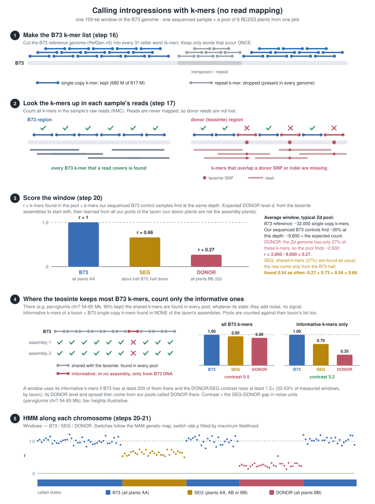

# BZea Analysis

This repository documents the end-to-end processing for **low-pass sequencing** data, starting from raw paired-end FASTQ files and proceeding through a reproducible genotype + ancestry + association workflow.

> **Current pipeline:** [`final_script/`](final_script/README.md). Introgressions are called from **k-mers** (no read mapping) with an HMM on 100-kb windows (steps 16–21). The SNP route (ANGSD sites, read counts, GL-HMM; steps 01–15) is kept as a cross-check. Each sample is a pool of 6 plants from one BC2S3 family.
>
> **Previous pipeline:** [`old_scripts/HMM_introgression/`](old_scripts/HMM_introgression/README.md). This is the old GL-based HMM workflow. It's kept for reference, and its outputs are superseded.

## BZea Breeding Scheme:

B73 was crossed with teosinte lines for 2 backcrosses and 3 selfs. (Need more details here)

## Expected genotype proportions after BC2 + 3 selfing generations (per locus)

We calcualte the **expected fraction of genotypes** at any SNP where the recurrent parent (B73) and the donor (teosinte) carry different alleles, assuming:
- B73 is homozygous **BB**
- the teosinte donor is homozygous **TT**
- random mating, no segregation distortion, no selection, and perfect marker informativeness.

This expectation applies **separately within each donor family** we used:
- **Zd** = *Zea diploperennis* (donor allele = T)
- **Zl** = *Zea luxurians* (donor allele = T)
- **Zx** = *Zea mexicana* (donor allele = T)
- **Zv** = *Zea parviglumis* (donor allele = T)

The Mendelian expectations shown below are the same for all families.

---

## Allelic scheme
B73 (BB) × Teo (TT) → **F1 = 100% BT**

Then:
- **BC1 = F1 × BB**
- **BC2 = BC1 × BB**
- then **three selfing generations**: S1 → S2 → S3

---

### Step 1 — After two backcrosses (BC2)

At a locus:

**BC1 (BT × BB):**
- 1/2 BB
- 1/2 BT

**BC2 (BC1 × BB):**
- P(BB) = 3/4
- P(BT) = 1/4
- P(TT) = 0

So at BC2:
- **BB = 0.75**
- **BT = 0.25**
- **TT = 0.00**

This also matches the ancestry expectation. Teosinte allele fraction is **12.5%** at BC2 (because BT loci carry one donor allele copy).

---

### Step 2 — Heterozygosity decay through selfing

After selfing a heterozygote **BT** for *s* generations, heterozygosity halves each generation as:

- **P(BT after s selfs) = (1/2)^s**
- The remaining probability becomes homozygous, split equally:
  - **P(BB) = (1 − (1/2)^s)/2**
  - **P(TT) = (1 − (1/2)^s)/2**

For **s = 3** (three selfs), starting from BT:
- BT = (1/2)^3 = **1/8 = 0.125**
- BB = TT = (1 − 1/8)/2 = **7/16 = 0.4375**


---

### Step 3 — Final genotype proportions after BC2 + 3 selfs

At BC2, only **25%** of loci are heterozygous (BT). The other **75%** are already BB and remain BB through selfing.

So final expectations:

- **P(BB) = 0.75 + 0.25×0.4375 = 0.859375 = 85.94%**
- **P(BT) = 0.25×0.125 = 0.03125 = 3.13%**
- **P(TT) = 0.25×0.4375 = 0.109375 = 10.94%**

- **Genome-wide at informative loci (BC2 → S3):**
- **~85.94% homozygous B73 (BB)**
- **~3.13% heterozygous (BT)**
- **~10.94% homozygous teosinte (TT)**

---

### Implication for low-pass genotyping
With low-pass depth, **heterozygotes are harder to call confidently**, and the expected heterozygote fraction after BC2+S3 is small (~3.1% of loci). Most donor ancestry is expected to appear as **homozygous TT** at loci where donor segments are fixed within a line, which is why imputation / probabilistic ancestry methods are helpful when coverage is low.

---

# General Overview of BZea genotyping, introgression and QTL analysis

## Genotyping

### 1) Demultiplexing by barcode (sabre)
- Split pooled FASTQs into per-sample FASTQs using barcode/index definitions using `sabre`.
- Outputs: `sample_R1.fastq.gz`, `sample_R2.fastq.gz` (+ reports/logs)

### 2) Adapter/primer trimming + quality filtering (Trimmomatic)
- Remove adapter/primer contamination and low-quality bases.
- Outputs: trimmed paired FASTQs (+ unpaired reads, trimming logs)

### 3) Alignment + BAM processing (required before GL calling)
- Align to the **B73 reference** (e.g., B73 Ref v5) using `bwa mem`.
- Post-processing:
  - sort BAM
  - mark duplicates
  - index BAM
  - basic QC (mapping %, coverage summaries)
- Outputs: `sample.sorted.markdup.bam` + `.bai` (+ QC summaries)

### 4) SNP sites and per-pool read counts (ANGSD)
- ANGSD SNP discovery, B73-polarized sites, per-pool B73/ALT read counts, site filters with a teosinte panel (`final_script/` steps 01–12).
- Used as a cross-check and for SNP-level work.

### 5) k-mer windows (KMC + KCFtools)
- For each pool, the B73 single-copy 31-mers seen in its reads, per 100-kb window (`final_script/` steps 16–19). No read mapping.

## HMM introgression analysis

### 6) HMM introgression analysis
We infer B73 / SEG / DONOR states along the genome for each pool with an HMM. It uses genetic-map transitions, ρ fitted by maximum likelihood, and emissions from the k-mer windows, with expected donor levels from teosinte assemblies (`final_script/` steps 20–21).

**Inputs**
- k-mer window tables (step 17) and assembly-based donor levels (step 19)
- NAM genetic maps (cM positions per chromosome)

**Outputs**
- Per-pool state per window, tracts, summary statistics (`pool_summary.tsv`, `family_summary.tsv`), chromosome paintings (`blocks_<taxon>.pdf`)


##  QTL / Association Mapping
We perform genome scans using **GridLMM** with **LOCO (leave-one-chromosome-out) kinship** to control relatedness while preserving power on the tested chromosome.

(Details in Section 10)
 
 ---

## Software and packages

### Genotyping

- **sabre** — demultiplexing by barcode (FASTQ splitting)
- **Trimmomatic** — adapter/primer trimming + quality filtering
- **bwa-mem2** *(recommended)* or **bwa** — read alignment to reference genome
- **samtools** — BAM/SAM manipulation (sort, index, stats, depth)
- **picard** — duplicate marking
- **bcftools** — querying
- **ANGSD** — genotype likelihood estimation + SNP calling for low-pass data
- **vcftools**  — quick VCF filters / summaries
- **bgzip / tabix** *(htslib)* — compress + index VCF/BCF outputs

### Imputation and Variant handling

- **plink2** — variant QC, LD pruning, PCA, relationship matrices, LOCO kinship (`.rel/.rel.id`)
- **Beagle** (Java) — genotype imputation

### Introgression inference (k-mers + HMM)

- **KMC 3** (`kmc`, `kmc_tools`): k-mer counting
- **KCFtools**: k-mer counts per reference window
- **Python** (>= 3.8) with numpy, scipy, matplotlib: HMM and figures
- **R** (>= 4.1): QC and SNP-route summaries

### QTL / association mapping

- **R**
- **GridLMM** R package
- **plink2** *(for LOCO kinship files)*:

### Gene annotation resources

- **GFF3 annotation** for the reference build (we used v5 annotation - `Zm-B73-REFERENCE-NAM-5.0_Zm00001eb.1.gff3`)

---

## Section 1 — Demultiplex pooled FASTQs

**Goal:** Split pooled lane-level paired-end FASTQs into per-sample FASTQs using a barcode map.

### Inputs
- Pooled lane FASTQs:
  - `..._R1_001.fastq.gz`
  - `..._R2_001.fastq.gz`
- Barcode map file (`.txt`)

### Barcode file format
Tab-separated **2 columns**:

1. **BARCODE** (exact barcode sequence)
2. **OUTPUT_PREFIX** (sample name)

Example:

```txt
ACGTACGT    Sample_001
TGCATGCA    Sample_002
GATCTAGA    Sample_003
```

Unmatched reads are written to the `no_bc_match_*` files.

### Outputs
- Per-sample paired FASTQs written by sabre (based on column 2 of the barcode file)
- Unmatched reads:
  - `no_bc_match_S<...>_R1.fq.gz`
  - `no_bc_match_S<...>_R2.fq.gz`

### Run
```bash
bsub < scripts/01_demultiplex_sabre.tcsh
```

Script: [`scripts/01_demultiplex_sabre.sh`](scripts/01_demultiplex_sabre.sh)

---

## Section 2 — Trim adapters/primers + quality filter (Trimmomatic PE)

**Goal:** Remove adapters/primers

### Inputs
- Demultiplexed paired FASTQs:
  - `*_R1.fq.gz`
  - `*_R2.fq.gz`

### Outputs
- Paired reads (used for alignment):
  - `*_paired_R1.fq.gz`
  - `*_paired_R2.fq.gz`

### Parameters used
- `ILLUMINACLIP:<adapters.fa>:2:30:10`
- `LEADING:3`
- `TRAILING:3`
- `SLIDINGWINDOW:4:15`
- `MINLEN:36`


### Run
```bash
bsub < scripts/02_trim_trimmomatic.tcsh
```

Script: [`scripts/02_trim_trimmomatic.sh`](scripts/02_trim_trimmomatic.sh)

---

## Section 3 — BAM preprocessing (sort → mark/remove duplicates → index)

**Goal:** Ensure each sample BAM is **coordinate-sorted**, **deduplicated**, and **indexed** before genotype likelihood (GL) generation with `bcftools mpileup`.

Ensure the files are:
- sorted
- Mark/remove duplicates
- Index BAMs files

### Inputs
- Aligned BAMs (usually from BWA/BWA-MEM2), one per sample:
  - `PN*_SID*.bam`

### Outputs
For each input `PN*_SID*.bam`
- Sorted BAM: `PN*_SID*.sorted.bam`
- Deduplicated BAM (duplicates removed): `PN*_SID*.sorted.rmdup.bam`
- Metrics: `PN*_SID*.dedup_metrics.txt`
- Index: `PN*_SID*.sorted.rmdup.bam.bai`

### Run
```bash
bash scripts/03_bam_sort_dedup_index.sh
```

Script: [`scripts/03_bam_sort_dedup_index.sh`](scripts/03_bam_sort_dedup_index.sh)

---

## Sections 4–6 — Introgression calling (current pipeline)

All code is in [`final_script/`](final_script/README.md), numbered in run order. That README has every command, parameter and output. This section explains what we do and why. The old ANGSD-GL → Beagle → GL-HMM workflow that used to be described here is in [`old_scripts/HMM_introgression/`](old_scripts/HMM_introgression/README.md), kept for reference.

### What a sample is

Each sequenced sample is a **pool of 6 BC2S3 plants from one plot (family)**, sequenced at about **0.8x**, with no parental sequencing. B73 is the recurrent parent. Donors are teosinte:
- *mexicana* (Zx), *parviglumis* (Zv), *diploperennis* (Zd), *luxurians* (Zl), *huehuetenangensis* (Zh)
- landraces (Zm) are set aside for now

Because a sample is a family, each genome region in a pool is in one of three states. These are set by the genotype of the family's BC2S2 parent:

| Pool state | Plants in the pool | Expected share of the genome |
|---|---|---|
| **B73** | all AA | 84.4% |
| **SEG** | the family still segregates 1:2:1 (AA, AB, BB) | 6.25% |
| **DONOR** | all BB | 9.4% |

Both views give 12.5% donor alleles. Per single plant, the same expectation is 85.9% AA, 3.1% AB and 10.9% BB (see above). SEG is **not** the same as "het": a SEG region holds ¼ AA, ½ AB and ¼ BB plants.

### Why not map reads and call SNPs?

We first did it the usual way: ANGSD on mapped reads, per-pool read counts at SNPs, then an HMM (steps 01–15). It found too little donor and too much SEG.

The reads in a known donor tract show why. Only **~34%** of the expected donor reads map there at all, because teosinte sequence is often missing from or rearranged against B73. The usual filters then remove most of the rest (`-C 50`, BAQ, MAPQ ≥ 30): only **~11%** of expected donor bases survive, against ~96% in B73 regions.

The filters remove reads with mismatches, and a read carrying a teosinte allele has extra mismatches by definition. So **donor alleles are lost preferentially**: DONOR regions look like SEG, and SEG regions look like B73. That is a property of mapping to a single reference, and tuning filters can't fix it.

### The k-mer approach



1. **B73 k-mer list (step 16).** Every 31-letter word (k-mer) in the B73 genome is counted with KMC, and only the **single-copy** ones are kept: 680 M of 817 M. Repeats are dropped because they're in every genome, donor or not, and would hide the signal.
2. **Look them up in each pool (step 17).** All k-mers in the pool's raw reads are counted, with no mapping. For each 100-kb B73 window, KCFtools counts how many of the window's single-copy B73 k-mers the pool has.
   - **B73 region:** essentially all of them are present, limited only by sequencing depth.
   - **Donor region:** every teosinte SNP or indel removes the B73 k-mers that overlap it, so the count drops.
3. **Score each window (step 20).** r = k-mers seen in the pool ÷ what a B73 pool of the same depth would see. That reference is a fit of the 10 B73 control pools, never including the pool itself.
   - B73 gives **r ≈ 1**, DONOR **r ≈ d**, and SEG falls between them.
   - d is the share of B73 k-mers a donor genome keeps. It's measured per window from teosinte genome assemblies (PanAnd, step 19): Zd and Zl ≈ 0.26, Zh 0.34, Zx 0.37, Zv 0.43.
   - SEG: k-mers the donor lacks come only from the B73 plants in the pool. For 6 plants, the pool's donor fraction follows Binomial(12, ½).
4. **HMM along each chromosome (steps 20–21).** The same three-state HMM as before. Transitions follow the NAM genetic map (Haldane), forward–backward gives each window's most likely state, and adjacent windows in the same state become tracts.
   - **ρ:** the switch rate is fitted by maximum likelihood over all pools, giving **1.5**. It plays the role of the number of generations in local-ancestry HMMs.
   - **Rigidity:** none is used. With ρ fitted, a rigidity of 3 windows changed no pool.
5. **Family DONOR levels (step 20b, rounds).** All pools of a BC1 family carry the same teosinte haplotype. So a family's real DONOR level is measured from its other pools that are DONOR in each window (leave-one-out), and the HMM is rerun. This fixes SEG/DONOR switching where a family's donor plant differs from the assembly plants (mainly Zv and Zx).
6. **Tests (step 22).** Observed vs expected BC2S3 proportions, with a bootstrap over families. Pools of one family share segments, so the family is the unit.

### Validation

- **B73 controls are clean:** all 10 have ≤ 0.15% non-B73 windows. This is a fair test, because the k-mer route never used the controls to filter sites.
- **Known tracts:** they are found with the expected levels. For example, a Zd DONOR tract on chr2 has r ≈ 0.20 against an assembly value of 0.26.
- **Agreement with the SNP route:** donor shares agree where the SNP route works. Where they differ, the cause is on the SNP side: lost donor reads, κ collapsing, or noisy pools.

### Results (round 0, 1,292 non-noisy donor pools)

| Taxon | Pools | Donor alleles | SEG (pool) | DONOR (pool) | AB (plant) | BB (plant) | AB/(AB+BB) |
|---|---|---|---|---|---|---|---|
| Zd | 227 | 5.5% | 5.2% | 3.0% | 2.6% | 4.3% | 38% |
| Zh | 61 | 8.2% | 5.7% | 5.3% | 2.9% | 6.7% | 30% |
| Zl | 98 | 7.2% | 6.8% | 3.8% | 3.4% | 5.5% | 38% |
| Zv | 333 | 8.0% | 6.8% | 4.6% | 3.4% | 6.3% | 35% |
| Zx | 573 | 8.7% | 6.7% | 5.3% | 3.4% | 7.0% | 32% |
| **All** | **1,292** | **7.8%** | **6.4%** | **4.6%** | **3.2%** | **6.2%** | **34%** |
| *Expected BC2S3* | | *12.5%* | *6.25%* | *9.4%* | *3.1%* | *10.9%* | *22%* |

**What this shows:**
- **Het is as expected:** SEG and AB match the BC2S3 expectation, and the family bootstrap finds no difference (p = 0.26).
- **Homozygous donor is about half the expectation** (BB 6.2% vs 10.9%; p < 0.0002 in every taxon). That loss is the whole shortfall in donor alleles (7.8% vs 12.5%).
- **The remaining donor is mostly het:** 34% of donor-carrying plants are AB, against 22% expected. This holds on every chromosome (31–37%).
- **Interpretation:** this fits selection against plants homozygous for teosinte segments during selfing, consistent with the excess heterozygosity reported in TeoNAM and in our lab's earlier lines.
- **Noisy pools:** 93 pools are flagged NOISY because of low depth, mostly plates PN11, PN13 and PN15, which we recommend resequencing.

The full statistics, per-plate table and family results are in [`final_script/README.md`](final_script/README.md).

## Section 7 — QTL / Association Mapping

(To be added)

---


## Section 8 — References

Viterbi decoding (your viterbi_standard)

Andrew J. Viterbi. Error bounds for convolutional codes and an asymptotically optimum decoding algorithm. IEEE Transactions on Information Theory (1967) 13(2):260–269.
Cite for: the Viterbi algorithm as the canonical DP decoding of the most likely state path.

Forward–backward / posterior probabilities (your forward_backward)

Leonard E. Baum et al. A maximization technique occurring in the statistical analysis of probabilistic functions of Markov chains. Annals of Mathematical Statistics (1970) 41(1):164–171.
Cite for: forward–backward foundations (Baum–Welch/related HMM inference), i.e. why computing posteriors per marker is standard.

General HMM reference everyone cites (nice because it’s explicitly “a tutorial”)

Lawrence R. Rabiner. A tutorial on hidden Markov models and selected applications in speech recognition. Proceedings of the IEEE (1989) 77(2):257–286.
Cite for: standard HMM definitions, log-space recursions, decoding vs posterior inference.

A shorter HMM intro that is already cited inside the RTIGER/robust-HMM ecosystem (and reviewers won’t complain about it)

Lawrence R. Rabiner & Juang. An introduction to hidden Markov models. IEEE ASSP Magazine (1986) 3(1):4–16. DOI: 10.1109/MASSP.1986.1165342.
Cite for: quick “what is an HMM” grounding (often used when your paper isn’t mainly about HMM theory).

Haldane mapping function (your haldane_theta)

J. B. S. Haldane. The combination of linkage values and the calculation of distances between the loci of linked factors. Journal of Genetics (1919).
Cite for: 
haldance function
 transition-from-distance model (exactly what you coded).

TIGER-style genotyping-by-sequencing for crossover localization

Benjamin A. Rowan et al. Rapid and inexpensive whole-genome genotyping-by-sequencing for crossover localization and fine-scale genetic mapping. G3: Genes|Genomes|Genetics (2015) 5(3):385–398. DOI: 10.1534/g3.114.016501.
Cite for: the broader “recombinant genome genotyping with noisy markers” tradition that RTIGER builds on.

ANGSD (if your emissions are fed by ANGSD genotype likelihoods)

Thorfinn Sand Korneliussen et al. ANGSD: Analysis of Next Generation Sequencing Data. BMC Bioinformatics (2014) 15:356. DOI: 10.1186/s12859-014-0356-4.
Cite for: the GL framework / using genotype likelihoods instead of hard genotype calls (which is exactly why your emissions are log-likelihoods).

Where your eta_hh_from_rh, eta_rr_from_rh, and rh_penalty fit (how to cite it cleanly)

If you’re describing those as “robustness knobs inspired by RTIGER/robust-HMM principles”, cite Campos-Martin et al. 2023 (and optionally Rowan et al. 2015) and say something like:
“We implemented an RTIGER-inspired robust-emission adjustment that allows ambiguous heterozygous-like observations to partially support adjacent ancestry/genotype states, improving stability under low-coverage noise.”
