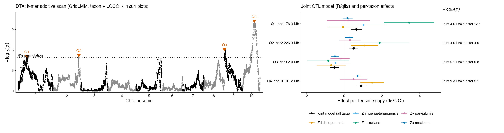
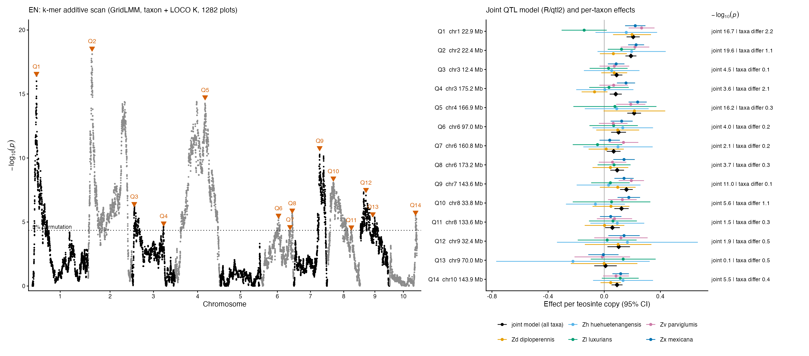
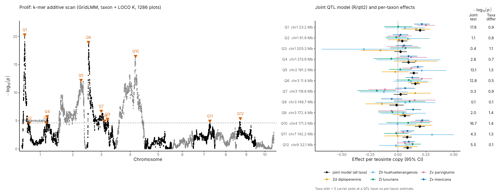
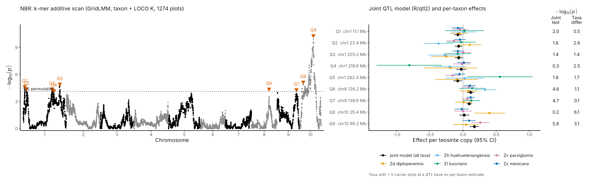
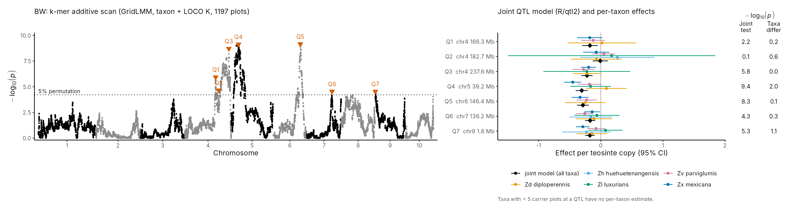
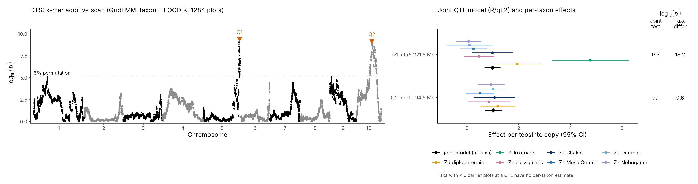

# BZea: k-mer introgression calling and QTL mapping in maize × teosinte BC2S3 pools

This repository goes from raw paired-end reads of **pooled, low-coverage (~0.8×)** BC2S3 samples to **teosinte introgression calls** and **QTL** for flowering, height, ear and leaf traits. B73 was crossed to 5 teosinte taxa, backcrossed twice to B73 and selfed three times; each sample is a pool of 6 plants from one BC2S3 plot.

- **Introgressions are called from k-mers**, not from mapped SNPs: for each pool, which B73 single-copy 31-mers its reads contain, per 100-kb window, decoded with an HMM that models the pool: each window is **B73** (all 6 plants AA), **DONOR** (all BB) or **SEG** (segregating: the plants are a mix of AA, AB and BB).
- **QTL are mapped on that k-mer ancestry**: a genome scan (k-mer ancestry GWAS, GridLMM with leave-one-chromosome-out kinship) finds the peaks, and a joint QTL model (R/qtl2) fits them together, with an effect for each teosinte taxon.

> **Pipeline and every command:** [`final_script/`](final_script/README.md). Results tables: [`data/introgression_spread/`](data/introgression_spread/). Figures: [`figures/`](figures/).

## Contents

- [Words used in this README](#words-used-in-this-readme)
- [The BZea population](#bzea-breeding-scheme): breeding scheme and expected genotype proportions
- [Overview](#overview) and [software](#software-and-packages)
- [Section 1 — Pre-processing](#section-1--pre-processing): demultiplexing, trimming, alignment
- [Section 2 — Introgression calling](#section-2--introgression-calling): the k-mer HMM, results, validation, population structure
- [Section 3 — k-mer ancestry GWAS and joint QTL mapping](#section-3--k-mer-ancestry-gwas-and-joint-qtl-mapping): phenotypes, methods, results for 17 traits (11 in detail), *mexicana* races, candidate genes
- [Section 4 — References](#section-4--references)

## Words used in this README

- **Pool** or **sample:** one sequenced sample, i.e. one leaf each from 6 plants of one plot. Every result is per pool.
- **Window:** a 100-kb piece of the B73 genome. The HMM calls one state per pool per window.
- **Tract:** a run of neighbouring windows with the same state.
- **F1 family:** all pools that descend from one F1 plant (same accession and same first P in the name, see below). Used to group pools in the statistics.

## BZea Breeding Scheme

B73 was crossed with teosinte, backcrossed twice to B73 and then selfed three times:

**B73 × teosinte → F1 → BC1 (× B73) → BC2 (× B73) → BC2S1 → BC2S2 → BC2S3**

- **Selfing, ear to row:** a plant is selfed, its progeny are planted, several are selfed, **one is selected** and advanced to the next generation, and so on. So each BC2S3 plot is grown from the seed of one BC2S2 mother (one selfed ear).
- **Sequenced sample:** one leaf each was taken from 6 different BC2S3 plants of the plot and pooled into one sample. These 6 plants are siblings, not copies of one plant: each got its own two gametes from the BC2S2 mother. So where the mother is heterozygous, each plant is AA, AB or BB with chance ¼, ½, ¼.
- **Pedigree names:** in `Zv.0200_P3_P2_P1.1.1.1`, `Zv.0200` is the teosinte accession, `P3` the F1 plant, `P2` the BC1 plant, `P1` the BC2 plant, and `.1.1.1` the selfed line. Pools that share `Zv.0200_P3` descend from one F1 plant (an **F1 family**: they all carry the same teosinte haplotype); pools that share `Zv.0200_P3_P2_P1` come from the same BC2 plant.

## Expected genotype proportions (per locus)

**Notation, used everywhere in this README and in `final_script/`:**
- **A** = the B73 allele, **B** = the teosinte (donor) allele
- **AA** = homozygous B73, **AB** = heterozygous, **BB** = homozygous teosinte

**Assumptions:** B73 is AA, the teosinte donor contributes one B allele to the F1, and there is no selection or segregation distortion. (In practice one plant was selected at each selfing step, so a departure from these numbers can point to selection; see [Results](#28-results).) These are the same for every donor taxon: Zd (*diploperennis*), Zh (*huehuetenangensis*), Zl (*luxurians*), Zv (*parviglumis*) and Zx (*mexicana*).

### Step 1 — Two backcrosses (BC2)

- F1 = B73 (AA) × teosinte (BB) → **100% AB**
- BC1 = F1 × AA → ½ AA, ½ AB
- BC2 = BC1 × AA → **¾ AA, ¼ AB**, 0 BB

Donor allele share at BC2: ¼ × ½ = **12.5%**. Selfing doesn't change allele shares, so 12.5% is the expectation at every later generation too.

### Step 2 — Selfing a heterozygote

Each self halves the heterozygotes; the rest become AA or BB in equal parts. Starting from AB, after *s* selfs:
- AB = (½)^s
- AA = BB = (1 − (½)^s) / 2

| Selfs | AA | AB | BB |
|---|---|---|---|
| 1 (BC2S1) | 1/4 | 1/2 | 1/4 |
| 2 (BC2S2) | 3/8 | 1/4 | 3/8 |
| 3 (BC2S3) | 7/16 | 1/8 | 7/16 |

### Two levels: plants and pools

Everything below is computed at two levels, and it helps to keep them apart:
- **Plant level:** the genotype of one BC2S3 plant at a locus, **AA**, **AB** or **BB**.
- **Pool level:** what the sequenced sample shows. A sample is a pool of 6 sibling BC2S3 plants, and the HMM gives each 100-kb window of a pool one of three **pool states**:
  - **B73:** all 6 plants are AA.
  - **DONOR:** all 6 plants are BB.
  - **SEG** (*segregating*): the plants differ. Their mother was AB, so each of the 6 plants is AA, AB or BB. A SEG pool is a **mix of plants**, not one heterozygous plant.

### Step 3 — One BC2S3 plant (three selfs)

Start from the BC2 numbers in Step 1: **¾ of the genome is AA** and **¼ is AB** (BC1 = ½ AA + ½ AB; crossing to B73 again turns the AA half into AA and splits the AB half into AA and AB, so BC2 = ½ + ¼ = ¾ AA and ¼ AB).

Then the BC2 plant is selfed three times (BC2S1, BC2S2, BC2S3):
- the **¾ that is AA** stays AA: selfing AA only gives AA.
- the **¼ that is AB** segregates, as in the **3 selfs** row of Step 2: of that ¼, 7/16 becomes AA, 1/8 stays AB and 7/16 becomes BB.

| Genotype | From the ¾ AA at BC2 | From the ¼ AB at BC2 | Expected |
|---|---|---|---|
| AA | ¾ | ¼ × 7/16 | 0.75 + 0.1094 = **85.94%** |
| AB | 0 | ¼ × 1/8 | **3.13%** |
| BB | 0 | ¼ × 7/16 | **10.94%** |
| Donor alleles | | BB + ½ × AB | 10.94 + 1.56 = **12.5%** |

### Step 4 — One pool (6 BC2S3 siblings)

The 6 plants in a pool are the selfed offspring of one **BC2S2 mother**, so the pool state at a locus is set by **her** genotype:
- mother **AA** → all her offspring are AA → pool state **B73**
- mother **BB** → all her offspring are BB → pool state **DONOR**
- mother **AB** → her offspring segregate 1 AA : 2 AB : 1 BB (Mendel, selfing a heterozygote), so each of the 6 plants is AA with chance ¼, AB with ½ and BB with ¼ → pool state **SEG**

The mother is a BC2S2 plant, i.e. **two** selfs after BC2. Same logic as Step 3, with the **2 selfs** row of Step 2: the ¾ of the genome that is AA at BC2 stays AA, and the ¼ that is AB at BC2 becomes 3/8 AA, 1/4 AB and 3/8 BB:

| BC2S2 mother | From the ¾ AA at BC2 | From the ¼ AB at BC2 | Expected share of the genome | The 6 plants | Pool state |
|---|---|---|---|---|---|
| AA | ¾ | ¼ × 3/8 | 0.75 + 0.0938 = **84.38%** | all AA | **B73** |
| AB | 0 | ¼ × 1/4 | **6.25%** | AA, AB or BB with chance ¼, ½, ¼ (1:2:1) | **SEG** |
| BB | 0 | ¼ × 3/8 | **9.38%** | all BB | **DONOR** |

### Step 5 — From pool states back to plants

Steps 3 and 4 describe the same plants, so one can be computed from the other. B73 pools contain only AA plants and DONOR pools only BB plants. SEG pools contain the 1:2:1 mix, so on average **¼ of a SEG region is AA in a plant, ½ is AB and ¼ is BB**. Adding up, with SEG = 6.25%:

| Plant genotype | From the pool states | Expected |
|---|---|---|
| AA | B73 + ¼ × SEG = 84.38 + 1.56 | **85.94%** |
| AB | ½ × SEG = ½ × 6.25 | **3.13%** |
| BB | DONOR + ¼ × SEG = 9.38 + 1.56 | **10.94%** |
| Donor alleles | DONOR + ½ × SEG = 9.38 + 3.13 | **12.5%** |

These are exactly the Step 3 numbers. This is how the HMM results are reported at both levels: the pool states as called (compared with Step 4), and converted to plant genotypes with this table (compared with Step 3). Heterozygosity (AB) can only be estimated this way, as half of SEG; no single plant is genotyped.

### Implication for low-pass pooled genotyping

- **Het is small:** only 3.1% of a plant's genome is expected to be AB (Step 3). At 0.8x, single-site het calls are unreliable anyway, so we call pool states over 100-kb windows instead of genotypes at sites.
- **Most donor should be fixed:** of the 12.5% donor alleles, most should sit in DONOR regions (9.38%), where all 6 plants are BB. SEG regions (6.25%) hold the rest, as a 1:2:1 mix of plants (Step 5).
- **What we found:** het matches the expectation (SEG 6.23%, AB 3.12%), but DONOR is only about half of it (5.0% vs 9.4%). See [Results](#28-results).

---

## Overview

### 1. Pre-processing (Section 1)
- **Demultiplexing** by barcode (`sabre`) into per-sample paired FASTQs.
- **Trimming** of adapters, primers and low-quality bases (Trimmomatic).
- **Alignment** to B73 RefGen v5 (BWA-MEM), sorting, duplicate removal, indexing; used by the SNP route only.

### 2. Introgression calling (Section 2)
- **k-mer windows** (KMC 3 + KCFtools): for each pool, the B73 single-copy 31-mers seen in its reads, per 100-kb window; no read mapping (`final_script/` steps 16–19).
- **Expected DONOR level** per window from the teosinte genome assemblies (MaizeGDB / PanAnd).
- **HMM** with three states, B73 / SEG / DONOR, genetic-map transitions and pool-aware emissions (steps 20–21). Outputs: per-pool state per window, tracts, `pool_summary.tsv`, `family_summary.tsv`, chromosome paintings, interactive figures.
- **Population structure from k-mers** (sourmash; step 32).
- **SNP route** (ANGSD sites and read counts, GL-HMM; steps 01–15), kept as a cross-check.

### 3. k-mer ancestry GWAS and joint QTL mapping (Section 3)
- **Phenotypes:** SpATS spatially corrected BLUEs per year (2023, 2025), combined across years (step 28).
- **k-mer ancestry GWAS:** GridLMM, taxon as fixed effect, **LOCO kinship** from the ancestry dosage, 5% genome-wide threshold from 1,000 permutations (steps 25–27); rerun with *mexicana* split by race.
- **Joint QTL model:** the peaks fitted together in R/qtl2: effect of each QTL adjusted for the others, its effect in each taxon, and a test that the taxa differ (step 29).
- **Genes and GO terms** in each QTL interval, side-by-side figures (steps 30–31).

## Software and packages

### Genotyping

- **sabre** — demultiplexing by barcode (FASTQ splitting)
- **Trimmomatic** — adapter/primer trimming + quality filtering
- **bwa-mem2** *(recommended)* or **bwa** — read alignment to reference genome
- **samtools** — BAM/SAM manipulation (sort, index, stats, depth)
- **picard** — duplicate marking
- **bcftools** — querying
- **ANGSD** — genotype likelihood estimation + SNP calling for low-pass data
- **vcftools**  — quick VCF filters / summaries
- **bgzip / tabix** *(htslib)* — compress + index VCF/BCF outputs

### Imputation and Variant handling

- **plink2** — variant QC, LD pruning, PCA, relationship matrices, LOCO kinship (`.rel/.rel.id`)
- **Beagle** (Java) — genotype imputation

### Introgression inference (k-mers + HMM)

- **KMC 3** (`kmc`, `kmc_tools`): k-mer counting
- **KCFtools**: k-mer counts per reference window
- **Python** (>= 3.8) with numpy, scipy, matplotlib: HMM and figures
- **R** (>= 4.1): QC and SNP-route summaries

### Phenotypes and QTL / association mapping

- **R** (>= 4.1) with **SpATS** (spatial BLUEs), dplyr, tidyr
- **GridLMM** R package (`github.com/deruncie/GridLMM`), data.table, ggplot2
- **Python** with pandas, numpy: inputs (dosage, LOCO kinship) and regions/genes

### Gene annotation resources

- **GFF3 annotation** for the reference build (we used v5 annotation - `Zm-B73-REFERENCE-NAM-5.0_Zm00001eb.1.gff3`)

---

## Section 1 — Pre-processing

The sequencing lanes hold many pooled samples. Pre-processing splits them into one pair of FASTQ files per sample, trims them, and (for the SNP route only) aligns them to B73. The two downstream routes use different products:

| Product | Used by |
|---|---|
| Trimmed paired reads, `filtered_S<plate>/<SAMPLE>/<SAMPLE>_paired_R{1,2}.fq.gz` | **k-mer route** (Section 2): k-mer counting (step 17) and k-mer sketches (step 32a). No alignment needed. |
| Sorted, deduplicated, indexed BAMs (`bam_list.txt`) | **SNP route** (cross-check): ANGSD site discovery and read counts (steps 01–12). |

Samples are named `PN<plate>_SID<number>` (e.g. `PN12_SID1106`); `name_change_final.txt` maps them to the pedigree names (Section 3).

### 1.1 Demultiplexing

Each lane's paired FASTQs (`..._R1_001.fastq.gz`, `..._R2_001.fastq.gz`) are split by the inline barcode at the start of read 1 with **sabre** (paired-end mode). The barcode file has two tab-separated columns, the barcode sequence and the sample name:

```txt
ACGTACGT    PN12_SID1106
TGCATGCA    PN12_SID1107
```

sabre writes one read pair per sample and puts reads whose barcode matches no sample into `no_bc_match_*_R1.fq.gz` / `_R2.fq.gz`; their share is a quick check of barcode quality per lane.

### 1.2 Trimming and quality filtering

**Trimmomatic** (paired-end mode) removes adapter and primer sequence and low-quality bases:

| Setting | What it does |
|---|---|
| `ILLUMINACLIP:<adapters.fa>:2:30:10` | removes adapter/primer matches (2 seed mismatches, palindrome score 30, simple score 10) |
| `LEADING:3`, `TRAILING:3` | trims bases below quality 3 at the read ends |
| `SLIDINGWINDOW:4:15` | cuts the read when the mean quality of 4 bases falls below 15 |
| `MINLEN:36` | drops reads shorter than 36 bp |

Only pairs in which both reads survive (`*_paired_R1.fq.gz`, `*_paired_R2.fq.gz`) are kept; these are the reads used by the k-mer route.

### 1.3 Alignment and BAM processing (SNP route)

The trimmed pairs are aligned to **B73 RefGen v5** with **BWA-MEM**. Each BAM is then coordinate-sorted, PCR duplicates are removed, and the BAM is indexed (SAMtools and Picard). The k-mer route does not use the BAMs; they feed the SNP route only, which is kept as a cross-check (Section 2, "The problem").

> **Scripts:** the pre-processing commands (sabre, Trimmomatic, BWA, BAM processing) are not yet in this repository; they will be added under `scripts/`. The outputs are at `/rsstu/users/r/rrellan/sara/BZea/filtered_S` (trimmed reads) and `/rsstu/users/r/rrellan/DOE_CAREER/BZea/dedup_filtered` (BAMs) on the NCSU cluster.

---

## Section 2 — Introgression calling

All code is in [`final_script/`](final_script/), numbered in run order. **The detailed analysis (every command, parameter, output, all statistics and the method history) is in [`final_script/README.md`](final_script/README.md).** This section explains what we do and why, and the main results.

### 2.1 What a sample is

Each sequenced sample is a **pool of 6 BC2S3 plants from one plot**, sequenced at about **0.8x**, with no parental sequencing. B73 is the recurrent parent. 1,385 donor pools were called, from 5 teosinte taxa (pools per race from `data/metadata_BZea.csv`):
- *mexicana* (Zx), 577 pools from four races:
  - **Chalco:** 14 accessions, 119 pools (the highland race, median 2,390 m)
  - **Mesa Central:** 16 accessions, 167 pools
  - **Durango:** 3 accessions, 146 pools
  - **Nobogame:** 2 accessions, 142 pools
  - 3 pools are from accessions with no race in the metadata.
- *parviglumis* (Zv): 380 pools from 36 accessions, all race Balsas.
- *diploperennis* (Zd): 249 pools from 4 accessions.
- *luxurians* (Zl): 118 pools from 5 accessions (Guatemala 4, Oaxaca 1).
- *huehuetenangensis* (Zh): 61 pools from 2 accessions.
- Landraces (Zm) are set aside for now.

The *mexicana* races are kept apart in Section 3 as an option (`SUBTAXON`), because they differ in origin and elevation.

Because a sample is several sibling plants, each genome region in a pool is in one of three states, set by the genotype of the plot's BC2S2 mother (B73, SEG or DONOR; see [Step 4](#step-4--one-pool-6-bc2s3-siblings)). The expected shares, at the pool level and for one plant:

| | Only B73 alleles | Both alleles | Only donor alleles | Donor alleles |
|---|---|---|---|---|
| **Pool state** (6 plants) | **B73** (all plants AA): 84.4% | **SEG** (plants AA, AB or BB, 1:2:1): 6.25% | **DONOR** (all plants BB): 9.4% | 12.5% |
| **One plant** | **AA:** 85.9% | **AB:** 3.1% | **BB:** 10.9% | 12.5% |

SEG is not the same as AB: a SEG pool holds a mix of AA, AB and BB plants, and only half of a SEG region is AB in an average plant (AB = ½ × 6.25% = 3.1%).

**What SEG means.** SEG is a state of the *pool*, not of a plant, and it is **not the same as "het"**.
- In a SEG region, the family's BC2S2 mother was AB, so its BC2S3 offspring segregate 1:2:1. **Each of the 6 plants in the pool can be AA, AB or BB.**
- On average a SEG pool holds ¼ AA, ½ AB and ¼ BB plants. The exact mix differs from pool to pool (e.g. 2 AA, 3 AB, 1 BB), and the model allows for that: the pool carries k donor copies out of 12 (6 plants × 2), with k ~ Binomial(12, ½).
- A SEG call says "this family is still segregating here". It does not say that any one plant is AB.
- **SEG vs "het" in SNP-based callers.** In a SEG region the pool's reads show both alleles, just like a het site in a single plant, so a diploid SNP genotyper would call it het. But in a pool, "both alleles present" only means the 6 plants are a mix: any combination of AA, AB and BB plants, as long as both alleles are there. That's why we call this state SEG, not het.
- To get plant genotypes from pool states: **AA = B73 + SEG/4, AB = SEG/2, BB = DONOR + SEG/4**.

**Can we tell which plants are AA, AB or BB in a SEG region?** No, not from this data. The 6 leaves are ground into one sample, so a read doesn't say which plant it came from.
- **What the pool can tell:** roughly how many donor copies it carries, k out of 12. In principle k can be estimated per SEG tract, because a 10-Mb tract has about 100 windows. Right now the HMM averages over all possible k and doesn't report one.
- **Even an exact k doesn't give the genotypes.** For example, 6/12 could be 6 AB plants, or 3 AA + 3 BB, or 2 AA + 2 AB + 2 BB.
- **The estimate is only as good as the family's DONOR level d**, because r(SEG) = d + (1 − d)·g(k/12) (section 2.5).
- **k can change inside a tract.** The 12 gametes recombine independently, so a plant can be AA at one end of a SEG tract and AB at the other.
- **Leaves are not equal.** Leaf size and DNA yield differ, so a plant's share of the reads isn't exactly 1/6. This adds noise to k.
- **To get plant genotypes:** genotype single plants, or seed of that family, e.g. with a few KASP markers inside the SEG tracts, or skim-sequence single plants from a subset of families.

### 2.2 The problem: mapping reads and calling SNPs at 0.8x in pools

We first did it the usual way (steps 01–15): map reads to B73, count each pool's reads at SNPs (ANGSD), then run an HMM. It found too little donor and too much het. Three things go wrong, and they hit donor (BB) and het regions hardest:

1. **Donor reads are lost (reference bias).** In a known Zd DONOR tract (PN13_SID1199, chr2:22.1–25.3 Mb), only **~34%** of the expected reads map there at all, because much teosinte sequence is missing from or rearranged against B73. The usual filters (`-C 50`, BAQ, MAPQ ≥ 30) then remove most of the rest: only **~11%** of expected donor bases survive, against ~96% in B73 regions. The filters remove reads with mismatches, and a read carrying a teosinte allele has extra mismatches by definition. So ALT alleles are lost first: **DONOR (BB) shows mixed reads and is called SEG, and SEG loses its ALT reads and is called B73.** This comes from mapping to one reference; tuning filters can't fix it.

   Read counts in that tract, compared with a B73 region of the same size and normalized with a B73 control sample:

   | What is kept in the donor tract | Share of the expected reads or bases |
   |---|---|
   | Reads that map there at all | 34% |
   | + MAPQ ≥ 30 | 30% |
   | Bases, MAPQ ≥ 30, no `-C 50`, no BAQ | 25% |
   | Bases with `-C 50` + BAQ (the ANGSD settings used) | **11%** |
   | Same filters in a B73 region | ~96% |

   The k-mer method (below) calls this tract DONOR, with r ≈ 0.20 (the Zd assemblies give 0.26 there).
2. **Too few reads per site.** At 0.8x most SNPs have 0 or 1 read. One read shows one allele, so a het site looks homozygous, and a single error read looks like a het. Every call leans on the HMM and imputation.
3. **Pools aren't diploid.** A pool's ALT fraction can be anything from 0 to 1 (e.g. 5/12 in a SEG region). Genotype callers built for diploids (0 / ½ / 1) mislabel these mixtures.

### 2.3 The solution: k-mers

Finding introgressions by counting reference k-mers in genome windows, without mapping reads, was developed in wheat: **IBSpy** (Uauy lab; Quiroz-Chávez 2023) was used to find einkorn introgressions in bread wheat (Ahmed et al. 2023), and **KCFtools** (Selvanayagam et al. 2026) is a fast tool for k-mer introgression screening and k-mer GWAS, which we use for the per-window counts. k-mers are counted with **KMC 3** (Kokot et al. 2017). The DONOR levels come from teosinte genome assemblies (PanAnd-1.0, Stitzer et al. 2025), downloaded from **MaizeGDB** (Portwood et al. 2019).

**What we added:** low-coverage *pools* instead of single plants, a three-state pool model (B73 / SEG / DONOR) with per-window DONOR levels from assemblies, and the HMM on the NAM genetic map.

### 2.4 How it works


1. **B73 k-mer list (step 16).** The **B73 reference genome** (RefGen v5, `Zm-B73-REFERENCE-NAM-5.0`, the same reference used for mapping in the SNP route) is cut into every 31-letter word (k-mer), counted with KMC. Only the **single-copy** ones are kept: 680 M of 817 M. Repeats are dropped because they're in every genome, donor or not, and would hide the signal. Spread over the genome's 21,330 windows of 100 kb, that is **about 32,000 single-copy k-mers per window** on average (it varies from window to window).
2. **Look them up in each sample (step 17).** All k-mers in a sample's raw reads (the pool of 6 plants) are counted, with no mapping. For each 100-kb B73 window, KCFtools counts how many of the window's single-copy B73 k-mers the sample has.
   - **B73 region:** essentially all of them are present, limited only by sequencing depth.
   - **Donor region:** every teosinte SNP or indel removes the B73 k-mers that overlap it, so the count drops.
3. **Score each window (step 20).** At 0.8x even a pure-B73 sample finds only part of the window's k-mers, so the pool's count is not compared with the reference's 32,000. It is compared with what **our own sequenced B73 samples** find:
   - **B73 control samples:** 10 samples of B73 itself, sequenced by us the same way as the BC2S3 pools. In each window they show how many of the reference k-mers a pure-B73 sample actually finds, rescaled to the depth of the pool being scored. A control is never used to score itself.
   - **r = k-mers found in the pool ÷ k-mers the B73 controls find** (at the pool's depth).
   - So two kinds of B73 are used: the **B73 reference genome** decides *which* k-mers are counted (step 1), and the **B73 control samples** say *how many* of them a B73 sample at this depth should find.
   - B73 gives **r ≈ 1**, DONOR **r ≈ d**, and SEG falls between them.
   - d is the share of B73 k-mers a donor genome keeps. It depends on the taxon and on the window, and is measured per window from teosinte genome assemblies (PanAnd-1.0 from MaizeGDB, step 19). Genome-wide: Zd 0.27, Zl 0.26, Zh 0.34, Zx 0.37, Zv 0.43.
   - SEG: k-mers the donor lacks come only from the B73 plants in the pool. For 6 plants, the pool's donor fraction follows Binomial(12, ½).
4. **HMM along each chromosome (steps 20–21).** The windows' r values are read along each chromosome by a three-state hidden Markov model (B73 / SEG / DONOR). It uses the NAM genetic map, so a state change costs more where recombination is rare. Adjacent windows in the same state become tracts. **The model is explained step by step in [The HMM in detail](#26-the-hmm-in-detail) below.**
5. **Allow for our donor plants differing from the assembly plants (step 20).** Where the two assemblies of a taxon disagree on d, the model is told that the DONOR level there is uncertain, so it doesn't flip between SEG and DONOR on small differences (see τ_w under [Emissions](#261-emissions-how-well-does-r-fit-each-state)).
6. **Tests (step 22).** Observed vs expected BC2S3 proportions, with a bootstrap over F1 families. Pools of one F1 family share segments, so the F1 family is the unit.

### 2.5 How r is calculated: a worked example

An average window in a typical Zd pool. The numbers are genome-wide averages from our data, rounded; real windows vary around them.

**Step 1: which k-mers are counted (B73 reference).** The B73 reference has 680 M single-copy k-mers in 21,330 windows, so an average window has **~32,000** (step 16). This is the same for every pool and every taxon.

**Step 2: how many a B73 sample at this depth finds (B73 controls).** At 0.8x many parts of the window are not covered by any read, so a sample finds only part of the 32,000. A typical pool contains about 200 M of the 680 M single-copy k-mers, i.e. **about 30%** (plate averages range from 109 M to 245 M; section 2.11). So in this window our B73 control samples, rescaled to the pool's depth, find about 30% × 32,000 ≈ **9,600**. That's the expected count. It depends on the pool's depth, not on its taxon.

**Step 3: r = what our pool found ÷ the expected count.**

| Our pool in this window is… | k-mers found | r |
|---|---|---|
| B73 (all plants AA) | ~9,600 | 9,600 / 9,600 ≈ **1.0** |
| DONOR (all plants BB, Zd) | ~2,600 | 2,600 / 9,600 ≈ **0.27** |
| SEG (about half B73, half donor) | ~6,300 | 6,300 / 9,600 ≈ **0.66** (below) |

**Where the DONOR level comes from (step 19).** We take the complete Zd genome assemblies (Gigi and Momo, PanAnd-1.0 from MaizeGDB) and count how many of the window's ~32,000 B73 k-mers appear anywhere in them. Genome-wide it's 27% (Gigi 0.26, Momo 0.28), i.e. about 8,600 of 32,000: **d = 0.27**. A pool that is all Zd in this window can only find that 27%, so it finds 0.27 × 9,600 ≈ 2,600 and its expected r is 0.27. A real example: the Zd tract of PN13_SID1199 (chr2:22–25 Mb, section 2.2) has r ≈ 0.20, where the Zd assemblies give 0.26.

d depends on the taxon and on the window:
- **Taxon:** genome-wide Zd 0.27, Zl 0.26, Zh 0.34, Zx 0.37 and Zv 0.43. Zv is closest to maize, so it keeps the most.
- **Window:** for Zd, the per-window median is 0.23, and 80% of windows are between 0.13 and 0.42. The HMM uses each window's own d.

Sequencing the **actual donor parents** of our lines would have been better, because d would then be measured on the plants our lines came from. We don't have them, so we use the MaizeGDB assemblies of the same taxa.

**Why SEG falls in between.** In a SEG region the pool is a mix of B73 and donor chromosomes. Split the window's k-mers in two:
- **Shared with the donor (27%):** every chromosome carries them, so they're found as often as in a B73 sample (ratio 1.0).
- **Missing from the donor (73%):** only the B73 chromosomes carry them, about half the chromosomes, so they get about half the reads. Half the reads doesn't mean half the k-mers found, because at low depth many k-mers are missed either way:
  - A B73 sample at this depth finds **30%** of the k-mers. From the coverage formula (the chance a k-mer is seen at coverage c is 1 − e^(−c)), that means a k-mer coverage of c = 0.36.
  - With half the reads (c = 0.18), it finds 1 − e^(−0.18) = **16%**.
  - So these k-mers are found 16.3 / 30 = **0.54** times as often as in a B73 sample. That ratio is **g**.

So r(SEG) = 0.27 × 1.0 + 0.73 × 0.54 ≈ **0.66**.

In general, r(SEG) = d + (1 − d) × g. g depends on the pool's depth, so each pool gets its own. The HMM doesn't assume exactly half donor. It averages over the possible donor fractions of a 6-plant pool (1/12 to 11/12), weighted by Binomial(12, ½), the 1:2:1 segregation summed over 6 plants.

**Then the HMM** compares each window's r with these three expected levels (B73 ≈ 1, SEG ≈ 0.66, DONOR ≈ d). It allows for each pool's noise and takes neighbouring windows into account, using the genetic map, to call the most likely state.

### 2.6 The HMM in detail

A hidden Markov model (HMM) is used because we can't see a pool's true state directly. We only see a noisy score r in each window. But we know two things that help:
- each state gives r values in a typical range, and
- the state rarely changes from one window to the next, because introgressed segments are long compared with a 100-kb window (median about 10 Mb in our pools; see [Tract lengths](#265-how-long-are-the-tracts) below).

The HMM combines both to find the most likely series of states along each chromosome. It has the same three-state structure as the SNP HMM in step 14 (`14_hmm_pooled.py`); see Rabiner (1989) for HMMs in general. Only the observation is different: a k-mer score per window instead of SNP reads.

**The four parts of the model:**

| Part | What it is here |
|---|---|
| **Positions** | The 100-kb windows along one chromosome, in order. Each chromosome is run separately. Windows with fewer than 2,000 single-copy B73 k-mers, or where the B73 controls themselves see very few k-mers (repeats, gaps), are skipped. |
| **Hidden states** | The pool's state in the window: **B73** (all 6 plants AA), **SEG** (the family segregates: each plant AA, AB or BB), **DONOR** (all 6 plants BB). |
| **Observation** | r, the k-mer score of the window (≈ 1 for B73, ≈ d for DONOR, in between for SEG; see the worked example above). |
| **Emission** | For each state: how likely the observed r is if the pool really is in that state. |
| **Transition** | The chance that the state changes between one window and the next. |
| **Start / prior** | The share of the genome expected in each state: B73 84.4%, SEG 6.25%, DONOR 9.4% (BC2S3 expectation). |

#### 2.6.1 Emissions: how well does r fit each state?

Each state expects r near a certain value, with some spread (noise). The spread σ_w is measured, not assumed:
- **Pool noise σ:** how much r scatters around 1 in the pool's B73 windows. It is a *robust* standard deviation:
  1. For every B73-like window, take how far r is from 1: |r − 1|.
  2. Take the median of those distances. This is the **MAD** (median absolute deviation).
  3. Multiply by 1.4826. For normally distributed noise, 1.4826 × MAD equals the ordinary SD.

  Unlike the ordinary SD, the MAD isn't inflated by the few introgressed or junk windows, because a median ignores extreme values. Good pools have σ ≈ 0.08–0.10. Pools with σ > 0.15 are flagged **NOISY**, which mostly means low depth.
- **Window factor:** windows where the 10 B73 controls disagree with each other are noisier in every pool, so σ_w = σ × (control spread in this window ÷ typical control spread), limited to 0.5–3.

| State | Expected r | Emission (probability of r) | In words |
|---|---|---|---|
| **B73** | 1 | Normal(1, σ_w) | r near 1, with the pool's noise |
| **DONOR** | a × d_w | Normal(a·d_w, √(σ_w² + (a·τ_w)²)) | r near the donor level, with the pool's noise plus the uncertainty of the donor level |
| **SEG** | between d_w and 1 | average of Normal(a·d_w + (1 − a·d_w)·g(k/12), √(σ_w² + ((1 − g)·a·τ_w)²)) over k = 1…11 donor copies, weighted by Binomial(12, ½) | for each possible number of donor copies k in the 6 plants, r near the matching in-between level; the k are weighted by how likely they are under 1:2:1 segregation |

What the terms mean:
- **d_w:** the share of the window's B73 k-mers that the donor genome keeps, measured from the teosinte assemblies (step 19). Each window has its own value.
- **τ_w (uncertainty of d_w):** our donor plants are not the assembly plants, so their real level can differ from d_w. Teosinte is outcrossing and very diverse, so two plants of the same taxon can differ a lot in a given window; even the two Zv assemblies differ by more than 0.2 in 28% of windows. τ_w is how much the taxon's two assemblies disagree in that window (their SD × √1.5, the expected spread of a new plant around the mean of two, averaged over ±5 windows). It adds to the noise of DONOR, and to SEG in proportion to how much SEG depends on d. Mean τ: Zv 0.18, Zx 0.16, Zd 0.06. Zh and Zl have only one assembly, so τ = 0 for them. The B73 controls get the widest τ (Zv) as a worst-case test. Why it was added: in a first run without τ_w, Zv and Zx tracts kept flipping between SEG and DONOR; τ_w halved that. Details: [`final_script/README.md`, section 5.7](final_script/README.md#57-method-history-family-donor-levels-then-donor-level-uncertainty-current).
- **a:** one scale factor per pool. It absorbs genome-wide differences between our donor plant and the assembly plants; for example, our plant may keep a few percent more B73 k-mers everywhere. **How it's fitted (maximum likelihood by grid search):**
  1. The whole HMM is run for the pool with each value of a: 0.5, 0.6, …, 1.4, 1.6, 1.8.
  2. Each run gives the **likelihood**: the probability of the pool's observed r values in all windows of all chromosomes under that model. The forward algorithm computes it.
  3. The a with the highest likelihood is kept.

  The same grid is repeated for every value of **ρ**, the switch rate of the transitions (how easily the state changes from one window to the next; see [Transitions](#262-transitions-how-often-can-the-state-change)). a and ρ both change the likelihood, so the best a is found separately for each ρ, and then the best ρ is chosen over all pools.

  The fitted a is mostly 0.9–1.0 in every taxon, so on average the assembly levels fit our lines well.
- **k/12:** the donor fraction of a SEG pool. 6 plants carry 12 chromosome copies. A SEG family segregates 1:2:1, so the number of donor copies k follows Binomial(12, ½). The model averages over all k instead of assuming exactly half (see [What SEG means](#21-what-a-sample-is)).
- **f and g(f):** f is the donor fraction of the pool's chromosomes in the window (f = k/12). g(f) is how often the pool still finds the B73 k-mers that the donor lacks, compared with a pure-B73 pool. Those k-mers sit only on the B73 chromosomes, a share (1 − f) of the pool, so they get only that share of the reads. From the coverage formula, g(f) = (1 − e^(−(1−f)λ)) / (1 − e^(−λ)), where λ is the pool's k-mer coverage (measured from the share of B73 k-mers it finds in B73 windows). In the worked example, f = ½ gives g = 0.54. g = 1 when the pool is all B73 (f = 0), and g = 0 when it's all donor (f = 1).
- **Outliers:** each state also has a 2% chance that the window is junk. A junk window's r is treated as equally likely anywhere from 0 to 2 (a uniform distribution). This is a standard robustness device, a "contamination" term in the emission. Without it, one odd window (e.g. a mis-assembled or duplicated region) could give near-certain evidence for a state just because it lies far out in a normal curve's tail.
  - **The 2% is a chosen value, not estimated from the data.** The B73 controls show it's on the safe side (44-pool test, 10 controls, about 21,000 windows each):
    - 0.77% of control windows are more than 3σ from 1, where a perfect normal would give 0.27%.
    - 0.10% are more than 4σ from 1, where a normal would give 0.006%.
  - So real outliers exist, but at well under 2%. A higher value makes the HMM more reluctant to switch on a few windows; a lower one makes it switch more readily.

**Example: one Zd window** (d = 0.27, σ = 0.09, a typical pool that finds 30% of the k-mers, as in section 2.5; Zd's τ is small, so it's left out here). For a given r, this is how well each state fits on its own, before neighbouring windows are considered:

| r | B73 | SEG | DONOR | Reading |
|---|---|---|---|---|
| 0.27 | 0% | 1% | **99%** | clearly DONOR |
| 0.45 | 1% | 59% | 41% | between SEG and DONOR: the neighbours decide |
| 0.66 | 1% | **99%** | 0% | clearly SEG (about half the plants' chromosomes donor) |
| 0.85 | 48% | 52% | 0% | B73 or SEG with few donor copies: the neighbours decide |
| 1.00 | **97%** | 3% | 0% | clearly B73 |

SEG covers a wide range (here 0.35–0.95) because a 6-plant pool can carry from 1 to 11 donor copies.

**τ_w and a are only needed because we don't have the donor parents.** Both correct for the same thing: d_w comes from assemblies of *other* plants of the same taxon, not from the plants our lines came from. τ_w allows for differences in single windows; a allows for a difference over the whole genome. Both can be switched off:
- **τ_w:** on with `SPREAD=1` (`20_kmer_hmm.py --d_spread`, the default), off with `SPREAD=0`.
- **a:** fitted over `--scale_grid`; `--scale_grid 1` fixes a = 1.

**If the donor parents are sequenced,** d_w can be measured on the parent itself, in the same way as for an assembly in step 19 (the share of the window's B73 k-mers the parent has). Then τ_w = 0 and a = 1, and the emissions are simply:
- **B73:** r ~ Normal(1, σ_w)
- **DONOR:** r ~ Normal(d_w, σ_w)
- **SEG:** r ~ Σ_k w_k × Normal(d_w + (1 − d_w)·g(k/12), σ_w), summed over k = 1…11 donor copies, with w_k = Binomial(12, ½) probabilities rescaled to sum to 1

Each state keeps the 2% outlier term: probability = 0.98 × the Normal above + 0.02 × Uniform(0, 2).

One caveat: a teosinte parent is an outcrossing, heterozygous plant, and the F1 got only one of its two chromosome sets (recombined). The parent's k-mers are the union of both sets, so where its two sets differ, the parent's d_w is a bit higher than that of the set our line carries. A small τ_w can still help there, so it stays an option rather than being removed. Reading d_w from a sequenced parent (a `--parent` input) is not in the code yet; for now d_w comes only from assemblies.

#### 2.6.2 Transitions: how often can the state change?

Between two neighbouring windows, the chance of a state change is **s = ρ × θ**:
- **θ** is the recombination fraction between the two window centres, from the NAM genetic map (Haldane: θ = ½(1 − e^(−2·Morgans))). On average a 100-kb step is 0.075 cM, but it's near 0 around centromeres and higher near chromosome ends.
- **ρ** scales it. Our lines went through several meioses (BC1, BC2, three selfings), so segment ends are more frequent than one meiosis would give. ρ is not guessed: every pool is run with ρ = 0.25, 0.5, 1, 1.5, 2, 3, 4 and 8, and the value with the highest total likelihood over all donor pools (low-depth pools left out) is used. That is **ρ = 1.5**.
- **Where to:** if the state changes, it moves to one of the other two states in proportion to their prior (e.g. from B73, more often to DONOR (9.4%) than to SEG (6.25%)).

With ρ = 1.5, the chance of a change is about **0.1% per window** on average. The model stays in the same state unless several windows in a row clearly fit another state. I checked this with the model itself, on a Zd DONOR tract at average recombination. A SEG piece inside it is called only when about **4 windows in a row (400 kb)** clearly look SEG (r = 0.66); less clear windows (r = 0.55) need 5. One noisy window can't break a tract, because the 2% outlier term caps its evidence.

#### 2.6.3 Calling the states

- **Forward–backward** computes, for every window, the probability of each state given the whole chromosome. The window gets the state with the highest probability.
- **Tracts:** adjacent windows with the same state are joined. Skipped windows take the state before them.
- **Plant genotypes** follow from the pool states: AA = B73 + SEG/4, AB = SEG/2, BB = DONOR + SEG/4.

#### 2.6.4 What is fitted, and where

| Quantity | Fitted per | How | Code |
|---|---|---|---|
| r (k-mer score) | pool × window | pool count ÷ fit of the B73 controls | `20_kmer_hmm.py` |
| σ (noise) | pool, then × window factor | robust SD of r in B73 windows; control spread | `20_kmer_hmm.py` |
| λ (k-mer coverage) | pool | share of B73 k-mers seen | `20_kmer_hmm.py` |
| d_w (DONOR level) | donor taxon × window | MaizeGDB assemblies of that taxon | `19_kmer_donor_reference.sh` |
| τ_w (uncertainty of d_w) | donor taxon × window | disagreement of the taxon's two assemblies | `20_kmer_hmm.py` (`--d_spread`) |
| a (scale on d) | pool | best likelihood over 0.5–1.8 | `20_kmer_hmm.py` |
| ρ (switch rate) | whole data set | best total likelihood | `21_kmer_collect.py` |
| Prior | fixed | BC2S3 expectation | `config.sh` |
| Plants per pool | fixed | 6 | `config.sh` (`KMER_PLANTS`) |
| Outlier share | fixed | 2% | `20_kmer_hmm.py` (`--eps`) |

"Donor taxon" is the pool's teosinte (Zd, Zh, Zl, Zv or Zx, from the sample sheet). Every pool of that taxon uses the same d_w and τ_w, taken from the MaizeGDB assemblies of the taxon; nothing here comes from our BC1 or BC2 plants.

**Why the prior is fixed.** It only sets the state each chromosome starts in, and which state a switch goes to. It doesn't set how much of the genome ends up in each state: with about 2,000 windows per chromosome, the data decide. DONOR came out at 5.0% although the prior expects 9.4%, so the prior isn't forcing the result.

#### 2.6.5 How long are the tracts?

Tract length depends on how many meioses broke the donor chromosome up: here the F1, BC1 and BC2 plants, then two rounds of selfing before the BC2S2 mother of each pool. Each crossover cuts a donor segment, so after these meioses most segments are many Mb long, but a few are short. Short ones come mostly from regions with high recombination (near chromosome ends, where 500 kb can be more than 1 cM) and from crossovers in different generations falling close together.

To check that short tracts are expected and not just a feature of our data, the crosses were simulated on the NAM genetic map (F1 → BC1 → BC2 → BC2S1 → BC2S2, crossovers placed at random along the map, 400 lines per chromosome, no selection), and the lengths of the introgressed tracts (SEG and DONOR joined) were compared with our calls (1,292 pools):

| Introgressed tracts | Median length | < 0.5 Mb | < 1 Mb | < 2 Mb | < 5 Mb |
|---|---|---|---|---|---|
| Simulated BC2S2 mothers (3,506 tracts) | 11.3 Mb | 4.4% | 8.4% | 15.3% | 30.8% |
| Our pools, k-mer HMM (12,662 tracts) | 9.8 Mb | 2.6% | 6.5% | 13.7% | 33.2% |

- **Short tracts are expected from the crossing scheme alone**, not only in our data: about 1 in 12 introgressed tracts should be under 1 Mb.
- We find slightly fewer under 1 Mb than the simulation. That fits the HMM's detection limit: a piece needs about 4 windows (400 kb) to be called ([Transitions](#262-transitions-how-often-can-the-state-change)), so the shortest tracts are missed.
- **Any single short tract can still be an error**, e.g. a window run where our donor plant differs from the assemblies, or a structural variant. They are a small part of the genome: tracts under 1 Mb hold 0.16% of the introgressed sequence (0.11% in the simulation). See [Limitations](#213-limitations-and-future-work) for how they can be checked.

The simulation does not include crossover interference (which makes two crossovers close together in one meiosis rarer) or selection, so it is a rough guide, not an exact expectation. Script: `final_script/tract_length_sim.py` (seed 1).

### 2.7 How k-mers solve mapping bias, low depth and pooling

Back to the three problems of the SNP route ([above](#22-the-problem-mapping-reads-and-calling-snps-at-08x-in-pools)):

| Problem (above) | How the k-mer approach avoids it |
|---|---|
| **1. Donor reads are lost** | No mapping. A pool's raw reads are counted as k-mers, and only the presence of B73 k-mers is checked, so donor reads can't be filtered away. |
| **2. Too few reads per site** | No per-site calls. Each 100-kb window adds up ~32,000 k-mers, so its score r is measured precisely from thousands of positions at once. |
| **3. Pools aren't diploid** | The model is built for pools: DONOR = d, SEG = d + (1 − d)·g(f), averaged over the donor fractions a 6-plant family can have (Binomial(12, ½)). |

**Telling DONOR from SEG.** It no longer depends on allele ratios at single sites, which reference bias distorts. It depends on the window's **level**: in the Zd example above, DONOR ≈ 0.27 and SEG ≈ 0.66, with B73 = 1. The DONOR level is measured from teosinte genomes, not guessed.

### 2.8 Results

1,292 donor pools (the 93 low-depth pools are left out; see [Noisy pools](#211-noisy-pools-and-resequencing)).

| Taxon | Pools | Donor alleles | SEG (pool) | DONOR (pool) | AB (plant) | BB (plant) | AB/(AB+BB) |
|---|---|---|---|---|---|---|---|
| Zd | 227 | 5.6% | 5.1% | 3.0% | 2.6% | 4.3% | 37% |
| Zh | 61 | 8.2% | 5.7% | 5.3% | 2.9% | 6.7% | 30% |
| Zl | 98 | 7.2% | 6.8% | 3.8% | 3.4% | 5.5% | 38% |
| Zv | 333 | 8.4% | 6.5% | 5.1% | 3.2% | 6.8% | 32% |
| Zx | 573 | 9.0% | 6.5% | 5.8% | 3.2% | 7.4% | 30% |
| **All** | **1,292** | **8.1%** | **6.2%** | **5.0%** | **3.1%** | **6.5%** | **32%** |
| *Expected BC2S3* | | *12.5%* | *6.25%* | *9.4%* | *3.1%* | *10.9%* | *22%* |

> **What AB/(AB+BB) means.** Take only the plants that carry at least one teosinte allele at a locus: these are the AB plants and the BB plants. AB/(AB+BB) is the fraction of them that are **AB** (heterozygous). The rest, BB/(AB+BB), are homozygous teosinte. Example: out of 100 plants that carry teosinte at a locus, how many are AB.
> - **Expected for BC2S3:** AB = 3.13% and BB = 10.94% of the genome, so AB/(AB+BB) = 3.13 / (3.13 + 10.94) = **22%**: about 22 AB and 78 BB plants out of 100.
> - **Observed:** AB = 3.12% and BB = 6.51%, so AB/(AB+BB) = 3.12 / (3.12 + 6.51) = **32%**: about 32 AB and 68 BB out of 100.
> - **Why it's useful:** it doesn't depend on how much teosinte there is in total. If lines lost teosinte at random (drift, or segments lost before BC2), AB and BB would drop by the same factor and the ratio would stay at 22%. It goes up only if BB plants are lost more than AB plants.


The figure has three groups, because these numbers are different kinds of measures:
- **Pool states (SEG, DONOR):** what the HMM calls, per pool and window.
- **Plant genotypes (AB, BB):** what the pool states mean for single plants. They are **not measured** directly: a pool can't say which plant is AB. They are computed from the pool states using Mendel: a SEG region holds ¼ AA, ½ AB and ¼ BB plants, so **AB = SEG/2** and **BB = DONOR + SEG/4**. So AB lives inside SEG.
- **Donor alleles:** the total share of teosinte alleles, = DONOR + SEG/2.


Figures from step 24 (`24_kmer_figures.py`); the per-family values are in `final_script/figures/results_spread/family_values.tsv`.

**What this shows:**
- **Het is as expected:** SEG (6.23%) and AB (3.12%) match the BC2S3 expectation; the F1-family bootstrap finds no difference (p = 0.93).
- **Homozygous donor is about 60% of the expectation** (BB 6.5% vs 10.9%; p < 0.0002 in every taxon). That loss is the whole shortfall in donor alleles (8.1% vs 12.5%).
- **So a larger share of the remaining donor is het:** 32% of donor-carrying plants are AB, against 22% expected. This is not extra het: AB is exactly as expected (3.1% of the genome). The share goes up only because BB went down, so AB is a bigger part of a smaller total. This holds on every chromosome (29–35%).
- **A likely reason: selection during selfing.** At every selfing step one plant per row was chosen and advanced (ear to row), and the plants with the best-looking ears were the ones kept. That selection works against BB more than against AB:
  - **Selecting against teosinte.** A plant homozygous for a teosinte segment (BB) shows the teosinte form of the traits that segment controls (e.g. smaller or harder ears), with no B73 copy to mask it. Such plants don't look as good as B73-like plants, so they are less often chosen. An AB plant still has a B73 copy, which often hides the teosinte effect, so it is chosen more often than a BB plant.
  - **Selecting for vigour, like hybrid vigour.** An AB plant is a small "hybrid" between B73 and teosinte at that segment, and AB plants can be more vigorous than either homozygote. Picking the best-looking ears is, in part, picking for that vigour, which keeps AB.
  - **Hidden harmful alleles.** Teosinte is outcrossing, so it carries recessive harmful alleles that do no harm in AB plants but show up in BB plants (the same reason maize inbreeding reduces vigour). This also removes BB plants.

  The result is fewer BB plants while AB stays as expected, which is exactly what raises AB/(AB+BB) and lowers the total donor share. TeoNAM (Chen et al. 2019), a maize × teosinte population made the same way (backcross, then selfing), also reported more heterozygosity than expected, as did our lab's earlier lines.
- **F1 families:** only 2 of 98 F1 families reach the expected 12.5% donor alleles (Zx.0390_P2, Zx.0130_P1); most sit between 5% and 11%. AB/(AB+BB) is above 22% in most F1 families of every taxon.
- **Small taxa:** Zd (6 F1 families), Zl (5) and Zh (2) have few F1 families, so their intervals are less reliable. Zd's SEG (5.1%) is somewhat below the expectation (p = 0.0004).

**One sample, as an example** (PN12_SID1106, Zv). The state of each 100-kb window along the 10 chromosomes:


On such a plot there are only three colours, the three pool states. AB isn't drawn, because a pool can't show which plants are AB: inside a yellow (SEG) region about half the 6 plants are AB, a quarter AA and a quarter BB. All samples can be browsed in the [interactive viewer](#212-interactive-figures-step-23).

The full statistics, F1 family results and the method history are in [`final_script/README.md`](final_script/README.md).

### 2.9 Validation

- **B73 controls are clean:** all 10 have ≤ 0.56% non-B73 windows (donor share ≤ 0.28%). This is a fair test, because the k-mer route never used the controls to filter sites.
- **Known tracts:** they are found with the expected levels. For example, a Zd DONOR tract on chr2 has r ≈ 0.20 against an assembly value of 0.26.
- **Agreement with the SNP route:** donor shares agree where the SNP route works. Where they differ, the cause is on the SNP side: lost donor reads, κ collapsing, or noisy pools.
### 2.10 Population structure from k-mers (step 32)

**Why the ancestry calls cannot do this.** The HMM calls say *whether* a window is teosinte, not *which* teosinte: they are built from B73 k-mers that are present or missing. A PCA of the ancestry dosage (1,286 pools × 21,309 windows) therefore does not separate the five taxa: taxon explains ≤ 2.5% of the variance of each of the first 10 PCs (F1 family ~10%). The PCs follow shared donor tracts, i.e. families.

**A k-mer profile that does.** The donor DNA carries k-mers that B73 does not have, and these differ between teosinte taxa. Following the idea of reading population structure from k-mer content without alignment (Hrytsenko et al. 2025), step 32 uses **sourmash** (Brown & Irber 2016; Irber et al. 2022) to compare every pool with the teosinte assemblies:
1. **Sketch** (32a): k = 31, FracMinHash with scaled = 1,000 (every k-mer whose hash is in the lowest 1/1,000 of the hash space; the same k-mers are kept in every sample, so sketches compare directly). One sketch for B73, one per assembly (Zd Gigi, Zd Momo, Zh RIMHU001, Zl RIL003, Zv TIL01, Zv TIL11, Zx TIL18, Zx TIL25), one per pool from its trimmed reads.
2. **Taxon-specific k-mers** (32b): for each assembly, its k-mers minus B73's; for each taxon, the union over its assemblies minus the k-mers of the other four taxa.
3. **Profile per pool** (32b): the share of each taxon's specific k-mers found in the pool's reads, f_taxon. Its largest value is the pool's **k-mer taxon**, which is checked against the pedigree taxon. The share of all teosinte k-mers found, f_teo, measures how much donor DNA the pool has, independently of the HMM.
4. **PCA** (32c): each pool's f values divided by their sum (depth and donor amount cancel; only *which* teosinte is left), centred log-ratio, `prcomp`. Points coloured by pedigree taxon; arrows = taxa.

On simulated pools (5 taxa, 6 pools each, 10% donor, 1× reads) the k-mer taxon matched the pedigree taxon in 30 of 30 pools and the PCA separated all five taxa (PC1–PC4). Real data: *to be added after the run*.

```bash
N=$(awk -F'\t' 'NR>1 && ($2=="control"||$2=="donor")' ${D11}/pools.tsv | wc -l)
J=$(sbatch --parsable --array=1-$(( 9 + (N + 9) / 10 ))%60 32a_sourmash_sketch.sh)   # needs: pip install sourmash
sbatch --dependency=afterok:$J 32b_kmer_taxon_profile.sh
```
Output in `${D32}`: `kmer_taxon_profile.tsv` (per pool: f per taxon, f_teo, containment per assembly, k-mer taxon, agreement), `pca/kmer_pca.png`, `pca/kmer_taxon_shares.png`, `pca/kmer_taxon_agreement.tsv`.

### 2.11 Noisy pools and resequencing

93 of the 1,385 donor pools are flagged **NOISY** (σ > 0.15). They are left out of the results above. Almost all of them are on three plates with low sequencing depth:

| Plate | Pools | NOISY | Median σ | Mean single-copy k-mers per pool | NOISY by taxon |
|---|---|---|---|---|---|
| PN2 | 3 | 0 | 0.118 | 189 M | — (rest of PN2 is Zm, skipped) |
| PN3 | 87 | 3 | 0.089 | 192 M | Zx 3 |
| PN4 | 93 | 0 | 0.081 | 211 M | — |
| PN5 | 92 | 0 | 0.097 | 170 M | — |
| PN6 | 94 | 2 | 0.112 | 145 M | Zx 1, Zd 1 |
| PN7 | 91 | 0 | 0.081 | 213 M | — |
| PN8 | 92 | 0 | 0.087 | 199 M | — |
| PN9 | 95 | 2 | 0.112 | 162 M | Zl 2 |
| PN10 | 94 | 0 | 0.086 | 245 M | — |
| **PN11** | **93** | **34** | **0.130** | **150 M** | **Zl 18, Zv 16** |
| PN12 | 95 | 4 | 0.095 | 211 M | Zv 4 |
| **PN13** | **88** | **23** | **0.140** | **115 M** | **Zd 18, Zv 5** |
| PN14 | 94 | 1 | 0.090 | 207 M | Zd 1 |
| **PN15** | **93** | **24** | **0.138** | **109 M** | **Zv 22, Zd 2** |
| PN16 | 95 | 0 | 0.084 | 214 M | — |
| PN17 | 96 | 0 | 0.082 | 217 M | — |

**Recommendation: resequence PN11, PN13 and PN15.**
- **Depth:** PN13 and PN15 have about half the k-mers of a typical plate (109–115 M vs ~200 M), and PN11 about 75%. On PN11, 37% of pools are NOISY.
- **Taxa:** the noisy pools are concentrated in a few taxa, so leaving them out takes a large bite out of those taxa:
  - Zl: 18 of its 20 noisy pools are on PN11.
  - Zd: 18 of 22 are on PN13.
  - Zv: 43 of 47 are on PN11, PN13 and PN15.

**Other samples to check.** Besides depth, a few samples look wrong for other reasons. They are kept in the results but flagged; together they change the main numbers by less than 0.1 percentage point.
- **Donor pools with almost no donor.** 5 pools are as clean as the B73 controls (donor share ≤ 0.11%): PN4_SID334 and PN4_SID335 (both from BC2 plant `Zx.0020_P3_P1_P2`), PN14_SID1313 and PN14_SID1314 (both from `Zd.0010_P2_P5_P4`), and PN7_SID649. Losing every donor segment by chance is very unlikely, and the two pairs each come from one BC2 plant. So these BC2 plants may have been B73 (an outcross or a seed mix-up), or the samples may be mislabelled B73 or check plants. Worth checking against the field and seed records.
- **Sample sheet.** PN13_SID1225 is listed twice, as `Zd.0020_P3_P1_P2.5.1.1` and as PurpleCheck; it is left out. The sheet also has 21 PurpleCheck and 13 B73 samples. The checks are not donor lines and are left out. 10 of the B73 samples are the controls; the other 3 (PN1_SID85, PN3_SID236, PN5_SID468) are not in the k-mer run and should be checked.

The full statistics and the per-plate table are in [`final_script/README.md`](final_script/README.md).

### 2.12 Interactive figures (step 23)

[`final_script/figures/introgression_viewer_spread.html`](final_script/figures/introgression_viewer_spread.html) is one self-contained page with every pool's chromosome plot ([download it](https://raw.githubusercontent.com/nirwan1265/BZea_genotyping/main/final_script/figures/introgression_viewer_spread.html) and open it in a browser).
- **Drop-down menus:** taxon → F1 family → "All pools" or one pool. There is also a search box for a pool ID.
- **Family view:** each chromosome shows one track per pool of the F1 family, so the segments the pools share line up.
- **Pool view:** the 10 chromosomes of one pool.
- **Hover** a segment for its position, length and state. A table under the figure lists the F1 family's pools (σ, flag, donor share, SEG, DONOR, tracts).
- **Download SVG / PNG** saves the figure on screen, legend included, for papers and slides.
- **Colors are colorblind-safe:** B73 blue, SEG yellow, DONOR red. The pairs were checked for protan, deutan and tritan vision. The same colors are used in `blocks_<GROUP>.pdf`.

To view it, download the file and open it in a browser. GitHub shows HTML files as code, not as a page.

### 2.13 Limitations and future work

**Short tracts aren't proven yet.** The k-mer HMM calls tracts down to about 400 kb. Short tracts are expected from the crossing scheme ([Tract lengths](#265-how-long-are-the-tracts)), so most are probably real, but single short calls haven't been checked with independent data.

**SEG vs DONOR isn't checked directly either.** A SEG call says the family still segregates (plants AA, AB or BB). No independent data has confirmed this split yet. The split is what gives the main result (het as expected, homozygous donor about half), so it should be checked independently.

**The DONOR level depends on the assemblies.** The model needs to know how much of each window's B73 k-mers a teosinte genome keeps (d_w). The best source would have been **the actual donor parents** of our lines, sequenced. We don't have them, so we use teosinte assemblies from MaizeGDB (PanAnd). Those are other plants of the same taxa, so in diverse taxa they can differ from our donors:
- Zv and Zx still switch between SEG and DONOR about twice as often as the other taxa, even after allowing for this uncertainty.
- Zh and Zl have one assembly each, so the uncertainty can't be measured for them.
- Zm (landraces) can't be done yet, because it needs a maize-based donor level (e.g. from NAM founder assemblies).

**First check of the short tracts: relatives.** Pools from the same BC2 plant inherited their donor segments from that plant, so a real tract can show up at the same place in them. Noise is random and shouldn't line up. In the pedigree names, the part up to the last P marks the BC2 plant: `Zv.0200_P3_P2_P1.1.1.1`, `Zv.0200_P3_P2_P1.2.1.1` and `Zv.0200_P3_P2_P1.3.1.1` all come from BC2 plant `Zv.0200_P3_P2_P1`.

For each tract in a pool, how often does another pool have an introgression at the same place (1,292 pools; SEG and DONOR joined):

| The other pool | Short tracts (< 10 Mb) | Long tracts (≥ 10 Mb) |
|---|---|---|
| Same taxon, other accession (baseline) | 17.5% | 23.7% |
| Same accession, other F1 plant | 17.2% | 22.6% |
| Same F1 plant, other BC1 plant | 17.1% | 22.6% |
| Same BC1 plant, other BC2 plant | 17.4% | 24.4% |
| **Same BC2 plant** | **31.4%** | **43.8%** |

- Pools from the same BC2 plant share tracts about 1.8× as often as unrelated pools, and **short tracts show the same increase as long ones**. If the short tracts were noise, they would stay at the baseline. So most short tracts are probably real.
- Pools of the same accession but another BC2 plant don't share more than the baseline. So the short tracts aren't an artifact of the accession's donor plant differing from the assemblies (that would be shared within an accession).
- **Open question:** pools from the same BC1 plant but different BC2 plants should also share more than the baseline, about half the increase seen for the same BC2 plant, since a BC2 plant inherits half of its BC1 parent's donor segments. They don't (24.4% vs 23.7%). Why is not known yet.
- The baseline is well above zero because introgressions are common and cluster in some regions; that's why it's the comparison.

**Future work:**
1. **Read check, with data we already have.** The SNP route (steps 01–12) counted each pool's B73 and teosinte reads at SNP sites. Those reads come from mapping, which loses many donor reads, but they still show which alleles are present:
   - **B73 regions:** almost only B73 reads.
   - **DONOR regions:** mostly teosinte reads.
   - **SEG regions:** a mix of both, because the pool holds both B73 and teosinte chromosomes.
   - **Short tracts:** if real, they should show teosinte reads like longer tracts of the same state; if noise, they look like the B73 around them.
2. **BC1 ancestors.** Every real tract in a pool must lie inside a teosinte region of the BC1 plant it descends from. This needs the link between each pool and its sequenced BC1 plant.
3. **Gold standard: KASP markers on single plants.** A few markers inside short tracts and inside SEG tracts, genotyped on single plants from the same plots:
   - **Short tract:** real if plants carry the teosinte allele there.
   - **SEG tract:** plants should be AA, AB and BB in about 1:2:1.
   - **DONOR tract:** all plants BB.
   - **B73 region:** all plants AA.
4. **Donor plants.** If seed or tissue of the donor parents (or of the same accessions) can be found, 10–20x short-read sequencing gives their own d_w directly. No assembly is needed.
5. **Noisy plates.** Resequence PN11, PN13 and PN15.

---

## Section 3 — k-mer ancestry GWAS and joint QTL mapping

We ran **two analyses** on the same genotypes (k-mer teosinte ancestry per 100-kb window, Section 2) and the same phenotypes (two-year SpATS BLUEs):

| | **Analysis 1: k-mer ancestry GWAS** (step 26, GridLMM) | **Analysis 2: joint QTL model** (step 29.2, R/qtl2) |
|---|---|---|
| Question | Where in the genome are the QTL? | How many separate QTL, how large is each, and does the effect differ between teosinte taxa? |
| What is tested | Every window, one at a time | Only the QTL found by Analysis 1, all fitted together |
| Effect | One effect per teosinte copy, shared by all taxa | The effect of each QTL adjusted for the others, and its effect within each taxon |
| Significance | 5% genome-wide threshold from permutations | Bonferroni over the QTL of that trait (no genome search, so no permutations needed) |
| Output | Manhattan plot, regions, genes in each region | QTL table, per-taxon effects, test that taxa differ |

Both use taxon as a fixed effect and a leave-one-chromosome-out (LOCO) kinship built from the same ancestry calls. At the same windows the two packages give the same answer (DTS: −log10 p 5.12 / 9.68 / 9.08 in GridLMM and 5.09 / 9.67 / 9.08 in R/qtl2), so Analysis 2 describes exactly the QTL of Analysis 1.

### 3.1 What kind of analysis this is

The marker is not a SNP. It is the **teosinte ancestry** of each plot in each 100-kb window, from the k-mer HMM (Section 2): 0 = B73, 1 = SEG, 2 = DONOR copies per plant. Testing local ancestry against a phenotype is what human genetics calls **admixture mapping** (Smith & O'Brien 2005).

We combine two steps, each doing what it is good at:
- **The k-mer ancestry GWAS finds the peaks.** It is GWAS-style: one mixed-model test per window across the whole genome, with a kinship matrix and a permutation threshold.
- **The joint QTL model describes them.** It fits the peaks together, as in QTL mapping, to tell which peaks are separate QTL, how large each is, and whether the teosinte taxa differ.

The resolution is that of QTL mapping: donor tracts are several Mb long, so neighbouring windows carry almost the same ancestry, and a signal points to a region (support intervals of ~0.3–15 Mb), not to a gene. Genes in the region are candidates.

### 3.2 Phenotypes

Field trials at Clayton, NC in **2023** (CLY23_D4: 3 reps, 4,432 plots, 1,329 lines) and **2025** (CLY25_B5: 2 reps, 2,898 plots, 1,410 lines); 1,316 lines in both. Each BC2S3 plot is grown from one BC2S2 mother; the sequenced pool is 6 plants of that plot.

BLUEs are two-stage (`final_script/28_spats_blues.R`; details in `final_script/README.md`, section 11):
1. **Per year and trait, SpATS** (Rodríguez-Álvarez et al. 2018): `y = Rep + Border + line (fixed) + 2-D P-spline surface(column, row) + random row + random column + e`. Border = plot next to a border (`B`) cell in the field map. Plots noted as no germination, hybrid, wrong line or sick are removed, plus one pass of outlier removal (|residual| > 3.5 robust SD). Heritability (H², Oakey et al. 2006) from the same model with line random.
2. **Across years**: the year effect from a weighted `lm(BLUE ~ line + year)` (weights 1/SE²), then the weighted mean of the year-adjusted BLUEs.

| Trait | H² 2023 | H² 2025 | r between years |
|---|---|---|---|
| DTS (days to silking) | 0.88 | 0.84 | 0.69 |
| DTA (days to anthesis) | 0.89 | 0.82 | 0.68 |
| ASI (DTS − DTA) | 0.61 | 0.57 | 0.43 |
| PH (plant height) | 0.86 | 0.86 | 0.74 |
| EH (ear height) | 0.78 | 0.74 | 0.63 |
| EN (ear number: nodes with ears) | 0.68 | 0.42 | 0.33 |
| Prolif (prolificacy: most ears on one node) | 0.61 | 0.55 | 0.21 |
| NBR (nodes with brace roots) | 0.52 | 0.47 | 0.34 |
| SPAD (leaf greenness) | 0.49 | 0.54 | 0.19 |
| BW (blade width), BL (blade length), SL (sheath length); 2023 only | 0.51, 0.56, 0.73 | | |

### 3.3 Analysis 1: k-mer ancestry GWAS

#### 3.3.1 Genotypes and kinship

- **Plots:** donor pools with a phenotype; low-depth (NOISY) pools are dropped.
- **Windows:** 21,309 of 21,330 100-kb windows with at least 20 plots carrying donor.
- **Additive predictor:** dosage 0 / 1 / 2 (B73 / SEG / DONOR). A SEG plot holds ¼ AA, ½ AB, ¼ BB plants, so its average is 1 teosinte copy per plant; the phenotype is a plot mean, so this is the right scale.
- **Dominance predictor:** SEG = 1 if the plot is SEG. With plot means B73 = 0, DONOR = 2a and SEG = ¼·0 + ½(a + d) + ¼·2a = a + d/2, the SEG coefficient c equals d/2 (c > 0: teosinte allele partly dominant). Tested only where a window has ≥ 5 SEG and ≥ 5 DONOR plots.
- **Kinship, leave-one-chromosome-out (LOCO):** for the chromosome being tested, K = Z Z′ / p from the centred dosage of all windows on the **other nine** chromosomes, scaled to mean diagonal 1. In BC2S3 lines on a B73 background, relatedness is mostly shared donor tracts, which the dosage captures directly; no SNP calls or imputation are needed.

#### 3.3.2 Why LOCO, and not one K for the whole genome

A kinship matrix that includes the tested region already "contains" the QTL: lines that share the donor tract at the QTL look related, and the random effect absorbs the QTL's effect. This is **proximal contamination** (Listgarten et al. 2012; Yang et al. 2014). LOCO removes it by leaving the tested chromosome out of K (also the default in R/qtl2, Broman et al. 2019).

In a backcross population this matters a lot, because tracts are long and few loci carry most of the donor relatedness. Same data, same model, only K changed (DTS, 1,284 plots, taxon fixed):

| K | λ_GC | Best window chr10 (ZmCCT10 region, 94–98 Mb) | Best window chr5 (~221.7 Mb) |
|---|---|---|---|
| **LOCO** | 3.97 | −log10 p **9.1**, +1.0 day per teosinte copy | **9.7** |
| Whole genome | 0.65 | 2.9 | 6.1 |

With the whole-genome K, the chr10 flowering signal almost disappears and λ_GC falls **below 1**: the model over-corrects. LOCO is the fix.

**λ_GC under LOCO (~4) is not a sign of false positives here.** λ_GC assumes most markers are null and independent. In this population each QTL is tagged by hundreds of linked windows (tracts of several Mb, and with LOCO the tested chromosome's own background is not in K), and the traits are polygenic, so the median test statistic is expected to be high (Yang et al. 2011). Significance is therefore set by **permutation**, not by λ_GC.

#### 3.3.3 Model

GridLMM (Runcie & Crawford 2019), maximum likelihood, one chromosome at a time with its LOCO K:

`y = taxon (fixed) + b · dosage_w + u + e`,  `u ~ N(0, σ²_g K_LOCO)`,  `e ~ N(0, σ²_e I)`

- b = effect per teosinte copy (trait units, e.g. days); likelihood-ratio test for b (1 df).
- Dominance: the same model plus c · SEG_w; likelihood-ratio test for c.
- GridLMM fits the variance proportion on a grid instead of re-optimising it for every window, which makes ~21,000 tests with a 1,284 × 1,284 K fast (~3 min per trait on 4 cores). The code started from `scripts/Analyze_QTL_Founder2.R`.

**Fixed effect: taxon, not F1 family.** Plots from the same F1 plant share many of their tracts (relatives check, Section 2, Limitations). With F1 family (95 levels) as a fixed effect, a tract carried by a whole family is confounded with the family mean and absorbed, and 94 extra parameters raise the threshold. Family relatedness is already in K. For DTS (829 plots, one year): the peaks on chr7, chr8/9 and chr10 were similar either way, but the 5% threshold rose from 3.8 to 5.0 and the chr3 peak (4.4) was lost. F1 family as a fixed effect is kept as a check (`FIXED_COL=F1FAMILY`).

#### 3.3.4 Significance: permutations

For each trait, phenotypes are shuffled **within taxon** (keeping the taxon means), the whole genome scan is rerun, and the largest −log10 p in the genome is kept. The 95th percentile over the permutations is the **5% genome-wide (family-wise) threshold** (Churchill & Doerge 1994). This accounts for the strong correlation between neighbouring windows; Bonferroni over 21,309 windows (−log10 p = 5.63) would be far too strict. The thresholds below come from **1,000 permutations** per trait (run on the cluster, 100 jobs of 10). With *mexicana* split by race (section 3.6.13), phenotypes are shuffled within race.

#### 3.3.5 Regions and genes

Step 27 joins windows above the threshold into regions (gap < 5 Mb), keeps one region per locus, and gives each a support interval: the windows within 1.5 −log10 p of the top window (like a 1.5-LOD drop). Every B73 v5 gene overlapping the interval is listed from the GFF3. Output: `genes/regions_genes_<TRAIT>_ALL.tsv` (one row per gene, with the region's position, top −log10 p and effect). Step 30 (`final_script/30_genes_go.R`) adds each gene's window −log10 p and effect and its GO terms: `data/introgression_spread/GO/genes_GO_all_<TRAIT>.tsv`.

### 3.4 Analysis 2: joint QTL model with per-taxon effects

The scan tests one window at a time, ignoring the others. Analysis 2 takes **the QTL found by the scan** (top window and support interval of each region, from `peaks_<TRAIT>_ALL.tsv`) and fits them in **R/qtl2** (Broman et al. 2019). Every statistical step is an R/qtl2 function; the script only converts the k-mer calls into R/qtl2's format.

- **Genotypes:** teosinte allele probability per window = dosage / 2 (B73 0, SEG 0.5, DONOR 1); kinship `calc_kinship(probs, "loco")`.
- **Joint effect:** each QTL is fitted with taxon and **all other QTL** as covariates (`fit1`). This gives its effect per teosinte copy adjusted for the others, and a conditional test. A QTL whose signal disappears once the others are in the model is a shadow of a linked QTL, not an independent one.
- **Per-taxon effects:** the same fit within each taxon (taxa with ≥ 5 carrier plots at that QTL).
- **Do the taxa differ?** LOD of the model with a separate QTL effect per taxon (`scan1` with `intcovar = taxon`) minus LOD of the model with one shared effect; likelihood-ratio test with (taxa − 1) df.
- **Effect per copy:** `fit1(..., contrasts = cbind(mu = c(1, 1), a = c(-1, 1)))`; the B73 allele mean is mu − a and the teosinte allele mean mu + a, so a is the effect of one teosinte copy.
- **Significance:** the joint model does not search the genome; it tests the k QTL of a trait, so a Bonferroni correction over k (−log10 p > −log10(0.05/k), e.g. 2.08 for 6 QTL) is used for both the joint test and "taxa differ".

#### 3.4.1 Why the joint model starts from the peaks, and not from all windows at once

A joint model needs a short list of QTL to fit together. It cannot take all 21,309 windows: that is far more predictors than the 1,284 plots, and neighbouring windows are nearly identical (one tract covers dozens of them), so their effects cannot be separated. The genome scan is the step that picks the list: one window per peak (the top window), with its support interval. The joint model then asks, for those few QTL together, which ones still matter once the others are in the model, how large each is, and in which taxa. This two-step design (scan, then fit the selected QTL jointly) is how QTL mapping is usually done; TeoNAM's joint linkage mapping chooses its QTL by stepwise selection instead (Chen et al. 2019). Using the scan's peaks keeps the two analyses on exactly the same QTL.

#### 3.4.2 Why some QTL show fewer taxa

A per-taxon effect needs carriers: plots of that taxon with the teosinte allele at the QTL. Taxa with fewer than 5 carrier plots at a QTL get no estimate. For example, DTS Q2 (chr10) has carriers from Zd (23), Zv (22) and Zx (62) but only 4 from *huehuetenangensis* and 2 from *luxurians*, so those two are not shown. Which taxa carry a tract depends on where the backcrosses happened to keep donor segments.

This is the mixed-model counterpart of TeoNAM's joint linkage mapping (Chen et al. 2019). Effects are estimated per taxon, not per accession: a typical window has ~90 carrier plots across 82 accessions, about one per accession. Details: `final_script/README.md`, section 12.

### 3.5 How to run

```bash
# Cluster: everything at once (inputs, scan, 1,000 permutations, peaks + genes, joint QTL),
# for taxon and for mexicana split by race; from final_script/, with the GWAS conda env active
bash submit_assoc_all.sh
# Laptop alternative for Analysis 1: one terminal per trait (100 permutations), then more with run_perm_local.sh
bash final_script/run_assoc_local.sh DTS
TOTAL=1000 bash final_script/run_perm_local.sh DTS
# genes + GO, and the side-by-side figures (laptop)
D=data/introgression_spread
Rscript final_script/30_genes_go.R $D/assoc_gridlmm_spats/genes $D/GO/GO_terms_all_candidates.txt $D/GO
Rscript final_script/31_joint_qtl_figures.R $D/assoc_gridlmm_spats $D/joint_qtl/noperm $D/joint_qtl/noperm/figures
```
All results are in `data/introgression_spread/`:
- `assoc_gridlmm_spats/`: scans, summaries, 1,000 permutations (`perm_<TRAIT>_seed<N>.tsv`), Manhattan plots, `genes/` (peaks and every gene in each region)
- `joint_qtl/noperm/`: joint QTL tables, per-taxon effects, genes per QTL, and the figures
- `GO/`: every gene in the regions with GO terms and its window's −log10 p (`genes_GO_all_<TRAIT>.tsv`)
- `assoc_gridlmm_spats_subtaxon/`, `joint_qtl/noperm_subtaxon/`, `GO_subtaxon/`: the same with *mexicana* split by race
- `laptop_100perm/`: the earlier laptop run with 100 permutations

### 3.6 Results

**Reading the figures.** Left: the k-mer ancestry GWAS; −log10 p per 100-kb window, dotted line = 5% permutation threshold, QTL numbered Q1, Q2 … by position. Middle: the same QTL in the joint model; effect per teosinte copy (trait units) with 95% CI, black = joint model across all taxa, colours = within each taxon (taxa with ≥ 5 carrier plots). Right: two columns of **−log10 p** (not effects): "Joint test" = is the QTL still significant with all other QTL in the model; "Taxa differ" = does its effect differ between taxa. For example, DTS Q1 "9.7 | 14.1" means p = 10⁻⁹·⁷ for the QTL and p = 10⁻¹⁴·¹ for the difference between taxa. Positive effect = the teosinte allele increases the trait (for DTS/DTA: later flowering).

**Overview (1,196–1,286 plots per trait; thresholds from 1,000 permutations, run on the cluster):**

| Trait | Plots | 5% threshold (−log10 p) | QTL | Hold in joint model | Strongest QTL |
|---|---|---|---|---|---|
| DTS | 1284 | 5.25 | 2 | 2 | chr5 221.8 Mb (−log10 p 9.7, +1.00 d per copy) |
| DTA | 1284 | 5.14 | 3 | 3 | chr10 94.5 Mb (−log10 p 9.3, +0.92 d per copy) |
| ASI | 1284 | 4.35 | 12 | 6 | chr7 165.6 Mb (−log10 p 13.7, -0.36 d per copy) |
| PH | 1283 | 4.19 | 16 | 8 | chr10 97.0 Mb (−log10 p 10.8, +5.64 cm per copy) |
| EH | 1282 | 4.27 | 18 | 7 | chr4 198.4 Mb (−log10 p 7.6, +3.00 cm per copy) |
| EN | 1282 | 4.57 | 19 | 11 | chr2 22.4 Mb (−log10 p 18.6, +0.17 per copy) |
| Prolif | 1286 | 4.55 | 12 | 7 | chr1 23.2 Mb (−log10 p 20.3, +0.20 per copy) |
| NBR | 1274 | 4.21 | 8 | 4 | chr10 98.2 Mb (−log10 p 10.3, +0.17 per copy) |
| SL | 1196 | 4.06 | 13 | 12 | chr7 141.7 Mb (−log10 p 9.2, -0.32 per copy) |
| BL | 1197 | 4.14 | 5 | 4 | chr2 39.8 Mb (−log10 p 12.0, -1.83 per copy) |
| BW | 1197 | 4.22 | 7 | 6 | chr6 146.4 Mb (−log10 p 9.2, -0.29 per copy) |

"Hold in joint model" = QTL whose joint −log10 p passes Bonferroni over that trait's QTL. The other six traits are in [3.6.14](#3614-other-traits).

**100 vs 1,000 permutations.** A threshold from 100 permutations is the 95th percentile of only 100 values, so it can be off by several tenths of −log10 p; 1,000 permutations pin it down. The genome scans are the same (except DTA, see below); only the thresholds moved:

| Trait | Threshold, 100 permutations | Threshold, 1,000 permutations | QTL (100) | QTL (1,000) |
|---|---|---|---|---|
| DTS | 4.53 | 5.25 | 6 | 2 |
| DTA | 4.90 | 5.14 | 4 | 3 |
| ASI | 4.47 | 4.35 | 13 | 12 |
| PH | 4.07 | 4.19 | 15 | 16 |
| EH | 4.69 | 4.27 | 14 | 18 |
| EN | 4.35 | 4.57 | 14 | 19 |
| Prolif | 4.61 | 4.55 | 12 | 12 |
| NBR | 4.13 | 4.21 | 9 | 8 |
| SL | 3.92 | 4.06 | 13 | 13 |
| BL | 4.25 | 4.14 | 6 | 5 |
| BW | 4.48 | 4.22 | 8 | 7 |

DTS lost four of its six QTL: its threshold rose from 4.53 to 5.25, and those four peaks were between 4.6 and 5.1. The earlier laptop results are kept in `data/introgression_spread/laptop_100perm/`.

#### 3.6.1 Days to silking (DTS)


Two QTL pass the 1,000-permutation threshold (−log10 p > 5.25), and both hold in the joint model (Bonferroni over 2 QTL: −log10 p > 1.60).

| QTL | Effect (joint) | Joint −log10 p | Taxa differ | What it says |
|---|---|---|---|---|
| **Q2 chr10 94.5 Mb** | +1.01 d | 8.9 | 1.0 (no) | Same effect in every taxon with carriers (Zd +1.2, Zv +0.8, Zx +0.9). This is the ZmCCT10 region: teosinte alleles delay flowering everywhere. |
| **Q1 chr5 221.8 Mb** | +1.00 d | 9.7 | 14.1 (yes) | Strong, but mostly *luxurians* (+4.8 d) and *diploperennis* (+1.9 d); Zv and Zx only about +0.5 d. |

**Peaks that were significant with 100 permutations but not with 1,000** (threshold 4.53 then, 5.25 now): chr1 85.8 Mb (−log10 p 5.1; mostly *luxurians*), chr9 10.9 Mb (4.9), chr5 206.4 Mb (4.9; holds *ZAG3*/*bde1*) and chr9 41.4 Mb (4.6). They are suggestive only. The scan itself did not change; only the threshold did. chr9 10.9 Mb is significant for DTA (below).

**Candidate genes (in the support intervals; candidates, not proven causal):**
- **Q2, chr10:** *ZmCCT10* (**Zm00001eb418700**, annotated "GHD7_2"; 96.18 Mb), the main teosinte photoperiod gene; teosinte alleles delay flowering under long days (Hung et al. 2012; Yang et al. 2013).
- **Q1, chr5:** **Zm00001eb257680**, annotated as **Protein HEADING DATE REPRESSOR 1** (SnRK1-interacting protein; GO "regulation of flower development"), in the top window (221.7–221.8 Mb, 8 genes). Its functional ortholog in rice, *HDR1* (*Heading Date Repressor 1*), is a nuclear protein that suppresses flowering under long days: it upregulates *Hd1* and downregulates *Ehd1*, which lowers the florigens *Hd3a* and *RFT1*; it interacts with the kinase OsK4, another long-day repressor (Sun et al. 2016). The *hdr1* mutant flowers early in long days only, i.e. HDR1 acts through the photoperiod pathway, which fits a teosinte allele that delays silking. Not characterised for flowering in maize. Orthology still to be confirmed with a gene tree. The same window is the DTA Q1 peak.
- **Suggestive, chr5 206.4 Mb:** *ZAG3* / *bearded-ear1* (*bde1*; **Zm00001eb250710**), an AGL6-like MADS-box gene needed for maize floral development (Thompson et al. 2009). Its Arabidopsis homolog *AGL6* promotes flowering: it represses the *FLC*/*MAF* floral repressors and raises *FT* (Yoo et al. 2011a), acts through the AGL6–ELF3–FT module (Lee et al. 2024), and affects the circadian clock through *ZEITLUPE* (Yoo et al. 2011b). The peak is below the 1,000-permutation threshold, so this stays a lead, not a result.

<details><summary>All DTS QTL with per-taxon effects and known genes in the interval</summary>

| QTL | Position | Interval (Mb) | Scan −log10 p | Effect per copy (joint) | Joint −log10 p | Taxa differ −log10 p | Per-taxon effects (carrier plots) | Known genes in interval |
|---|---|---|---|---|---|---|---|---|
| Q1 | chr5 221.8 Mb | 221.7–222.0 | 9.7 | +1.00 d ± 0.16 | **9.7** | **14.1** | Zd +1.94 (10), Zl +4.77 (13), Zv +0.46 (49), Zx +0.48 (50) | HDR1-like |
| Q2 | chr10 94.5 Mb | 92.8–102.3 | 9.1 | +1.01 d ± 0.17 | **8.9** | 1.0 | Zd +1.19 (23), Zv +0.84 (22), Zx +0.94 (62) | ZmCCT10 |

Bonferroni over the 2 QTL: −log10 p > 1.60 (bold).

</details>

#### 3.6.2 Days to anthesis (DTA)



Three QTL, all hold in the joint model (Bonferroni over 3: −log10 p > 1.78).

| QTL | Effect (joint) | Joint −log10 p | Taxa differ | What it says |
|---|---|---|---|---|
| **Q3 chr10 94.5 Mb** | +0.92 d | 9.1 | 1.4 (no) | The ZmCCT10 region again, the strongest DTA QTL; all taxa delay (Zd +1.3, Zv +0.7, Zx +0.7). |
| **Q2 chr9 10.9 Mb** | −0.54 d | 5.6 | 0.6 (no) | Teosinte flowers earlier, alike in all taxa (Zd −0.7, Zh −0.4, Zl −1.5, Zv −0.3, Zx −0.5). The same peak is suggestive for DTS (−log10 p 4.9). *MADS74* (Zm00001eb372960; JOINTLESS/SVP-like MADS-box; SVP-like genes repress flowering) is in the interval. |
| **Q1 chr5 221.8 Mb** | +0.65 d | 5.5 | 11.2 (yes) | The DTS Q1 window (HDR1-like gene), mostly *luxurians* (+3.7 d) and *diploperennis* (+1.5 d). It delays pollen shedding less than silking (DTS +1.00 d), so it also lengthens ASI. |

**This DTA scan differs from the earlier laptop run.** Every other trait gives the same scan on the laptop and on the cluster (differences < 10⁻⁷), but DTA differs by up to 1.7 −log10 p, with the same plots and genotypes. So the laptop DTA run used different DTA values, most likely an earlier version of the BLUE file. The cluster run uses the BLUEs in `data/phenotypes/BZea_spats_BLUEs_combined.csv`. The *luxurians* chr1 76 Mb peak and the chr2 226 Mb and chr9 2.0 Mb peaks of the laptop run are below the threshold now (−log10 p 4.5, 4.8 and 5.0, threshold 5.14).

<details><summary>All DTA QTL with per-taxon effects and known genes in the interval</summary>

| QTL | Position | Interval (Mb) | Scan −log10 p | Effect per copy (joint) | Joint −log10 p | Taxa differ −log10 p | Per-taxon effects (carrier plots) | Known genes in interval |
|---|---|---|---|---|---|---|---|---|
| Q1 | chr5 221.8 Mb | 221.7–222.3 | 5.5 | +0.65 d ± 0.14 | **5.5** | **11.2** | Zd +1.47 (10), Zl +3.67 (13), Zv +0.21 (50), Zx +0.19 (50) | HDR1-like |
| Q2 | chr9 10.9 Mb | 6.1–13.7 | 5.5 | -0.54 d ± 0.11 | **5.6** | 0.6 | Zd -0.69 (25), Zh -0.39 (8), Zl -1.51 (22), Zv -0.34 (57), Zx -0.48 (97) | MADS74 |
| Q3 | chr10 94.5 Mb | 92.8–105.9 | 9.3 | +0.92 d ± 0.15 | **9.1** | 1.4 | Zd +1.27 (23), Zv +0.72 (22), Zx +0.74 (62) | ZmCCT10 |

Bonferroni over the 3 QTL: −log10 p > 1.78 (bold).

</details>

#### 3.6.3 Anthesis–silking interval (ASI)


ASI = anthesis–silking interval, DTS − DTA. 12 regions, 6 hold in the joint model (Bonferroni over 12: −log10 p > 2.38). The strongest, **Q12 chr7 165.6 Mb** (−0.36 d, joint −log10 p 14.0), shortens the interval in all taxa (Zd −0.46, Zl −0.53, Zv −0.35, Zx −0.31 d). **Q11 chr5 218.3 Mb** (+0.35 d; *luxurians* +1.1) lengthens it; it lies next to the DTS/DTA chr5 QTL, which delays silking more than anthesis. **Q1 chr1 4.5 Mb** (+0.24 d) acts alike in all taxa. Q2 chr2 26.1 Mb, Q9 chr4 52.0 Mb and Q10 chr4 206.2 Mb also hold (all shorten ASI). Many other chr2 and chr3 peaks drop in the joint model: they share one signal through linked tracts. **Candidate genes:**
- **Q12, chr7 (the strongest ASI QTL):** *bhlh90* (**Zm00001eb323880**, bHLH transcription factor 90; 165.74 Mb, in a window with −log10 p 13.2 next to the top window). MaizeGDB annotates it as the ortholog of Arabidopsis *FLOWERING BHLH 4* (Neupane et al. 2025); Gramene lists Arabidopsis *FBH3* (AT1G51140) as its closest homolog and rice *OsFBH1* / *POH1* (Os08g0506700) as its closest rice gene. In Arabidopsis the four FBH proteins bind E-boxes in the *CONSTANS* promoter and activate *CO*: their overexpression causes early flowering regardless of photoperiod, and *CO* levels drop in the *fbh* quadruple mutant (Ito et al. 2012). In rice, POH1 forms a dimer with HBP1, both bind the *Hd1* promoter and activate *Hd1*; their overexpression delays flowering by suppressing *Ehd1*, *Hd3a* and *RFT1* (Yin et al. 2023). Not characterised for flowering in maize.
- Other genes in the intervals: *tga1* (Zm00001eb175150; Q9, chr4), ADAGIO3 (Zm00001eb201580; Q10, circadian), *MADS73* (Zm00001eb255670; Q11), *GA2ox2* (Zm00001eb077080) and *CKX8* (Zm00001eb076990) (Q2), *LNK2* (Zm00001eb132420; Q6, circadian; does not hold).

The chr3 95.8 Mb peak of the 100-permutation run (−log10 p 5.0) is still above the threshold, but now joins the chr3 108.3 Mb region (88.5–129.4 Mb), so it has no QTL of its own (see Limitations).

<details><summary>All ASI QTL with per-taxon effects and known genes in the interval</summary>

| QTL | Position | Interval (Mb) | Scan −log10 p | Effect per copy (joint) | Joint −log10 p | Taxa differ −log10 p | Per-taxon effects (carrier plots) | Known genes in interval |
|---|---|---|---|---|---|---|---|---|
| Q1 | chr1 4.5 Mb | 3.7–5.4 | 6.4 | +0.24 d ± 0.05 | **6.6** | 0.0 | Zd +0.19 (15), Zh +0.21 (10), Zl +0.14 (12), Zv +0.26 (42), Zx +0.24 (68) |  |
| Q2 | chr2 26.1 Mb | 24.8–29.4 | 7.4 | -0.16 d ± 0.04 | **3.6** | 0.1 | Zd -0.19 (35), Zh -0.46 (5), Zl -0.20 (21), Zv -0.19 (55), Zx -0.13 (105) | CKX8, GA2ox2 |
| Q3 | chr2 68.2 Mb | 60.7–77.1 | 5.3 | -0.12 d ± 0.07 | 1.0 | 0.0 | Zd -0.28 (33), Zh -0.14 (7), Zl -0.12 (15), Zv -0.05 (50), Zx -0.09 (87) |  |
| Q4 | chr2 146.7 Mb | 100.9–150.2 | 4.7 | +0.04 d ± 0.07 | 0.2 | 0.0 | Zd +0.17 (24), Zh -0.14 (6), Zl -0.18 (14), Zv -0.02 (55), Zx +0.04 (111) |  |
| Q5 | chr2 191.2 Mb | 185.7–193.2 | 5.2 | -0.14 d ± 0.05 | 2.2 | 0.2 | Zd -0.11 (17), Zh -0.22 (6), Zl -0.38 (16), Zv -0.16 (51), Zx -0.13 (112) |  |
| Q6 | chr3 69.5 Mb | 61.9–91.1 | 5.0 | -0.06 d ± 0.13 | 0.2 | 0.5 | Zd -0.42 (25), Zh -0.19 (13), Zl -0.50 (7), Zv -0.30 (29), Zx -0.01 (68) | LNK2 |
| Q7 | chr3 108.3 Mb | 106.5–121.4 | 5.2 | -0.17 d ± 0.13 | 0.7 | 0.5 | Zd -0.42 (24), Zh -0.17 (13), Zl -0.45 (8), Zv -0.32 (30), Zx -0.13 (73) |  |
| Q8 | chr4 19.8 Mb | 15.2–24.3 | 4.6 | -0.10 d ± 0.07 | 0.9 | 0.5 | Zd +0.15 (11), Zh +0.09 (7), Zl -0.03 (7), Zv -0.32 (32), Zx -0.09 (53) |  |
| Q9 | chr4 52.0 Mb | 46.5–52.4 | 7.5 | -0.24 d ± 0.07 | **3.0** | 0.1 | Zd -0.08 (6), Zh -0.54 (8), Zl -0.67 (6), Zv -0.20 (36), Zx -0.18 (48) | tga1 |
| Q10 | chr4 206.2 Mb | 202.3–225.3 | 5.4 | -0.21 d ± 0.05 | **4.7** | 0.3 | Zd -0.41 (17), Zh -0.38 (5), Zl +0.47 (6), Zv -0.26 (36), Zx -0.15 (77) | ADAGIO3 |
| Q11 | chr5 218.3 Mb | 217.4–218.6 | 9.4 | +0.35 d ± 0.06 | **8.8** | **4.1** | Zl +1.08 (11), Zv +0.24 (44), Zx +0.28 (40) | MADS73 |
| Q12 | chr7 165.6 Mb | 164.8–166.1 | 13.7 | -0.36 d ± 0.05 | **14.0** | 0.3 | Zd -0.46 (18), Zl -0.53 (14), Zv -0.35 (50), Zx -0.31 (78) | bhlh90 |

Bonferroni over the 12 QTL: −log10 p > 2.38 (bold).

</details>

#### 3.6.4 Plant height (PH)


16 regions, 8 hold in the joint model (Bonferroni over 16: −log10 p > 2.51); effects are in cm per teosinte copy and mostly **alike across taxa** (no "taxa differ" test passes). Strongest: **Q16 chr10 97.0 Mb** (+5.6 cm; the ZmCCT10 region: later flowering, taller plants), **Q15 chr9 139.8 Mb** (+4.7 cm), **Q14 chr7 139.1 Mb** (−5.0 cm), **Q3 chr3 12.8 Mb** (−3.8 cm; the interval holds *ramosa2*, Zm00001eb123060), **Q1 chr1 201.8 Mb** (−4.2 cm), Q2 chr2 2.5 Mb (−2.6 cm), Q4 chr4 198.4 Mb (+4.1 cm) and Q7 chr5 117.8 Mb (−3.6 cm). The chr6 peaks (Q8–Q13) and the new chr4 218.7 Mb, chr5 64.2 Mb (*td1*, Zm00001eb228140) and chr6 67.2 Mb peaks lose their signal in the joint model. The chr5 2.6 Mb QTL of the 100-permutation run (+3.2 cm) is now just below the threshold (−log10 p 4.18 vs 4.19).

<details><summary>All PH QTL with per-taxon effects and known genes in the interval</summary>

| QTL | Position | Interval (Mb) | Scan −log10 p | Effect per copy (joint) | Joint −log10 p | Taxa differ −log10 p | Per-taxon effects (carrier plots) | Known genes in interval |
|---|---|---|---|---|---|---|---|---|
| Q1 | chr1 201.8 Mb | 200.4–203.8 | 6.0 | -4.17 cm ± 0.85 | **6.1** | 0.1 | Zd -4.82 (12), Zl -1.55 (8), Zv -5.08 (26), Zx -3.29 (78) |  |
| Q2 | chr2 2.5 Mb | 0.0–3.6 | 4.7 | -2.59 cm ± 0.59 | **4.9** | 0.3 | Zd -3.78 (42), Zh -6.14 (8), Zl +0.01 (14), Zv -2.51 (67), Zx -2.04 (109) |  |
| Q3 | chr3 12.8 Mb | 12.4–13.7 | 7.0 | -3.77 cm ± 0.70 | **7.2** | 0.8 | Zd -5.16 (29), Zh +5.38 (14), Zl +0.26 (10), Zv -3.20 (32), Zx -4.30 (90) | ra2 |
| Q4 | chr4 198.4 Mb | 194.5–201.4 | 7.6 | +4.11 cm ± 1.29 | **2.9** | 0.1 | Zd +7.56 (17), Zh +10.21 (7), Zl +14.45 (6), Zv +5.63 (35), Zx +3.49 (75) |  |
| Q5 | chr4 218.7 Mb | 215.2–223.0 | 5.1 | +0.25 cm ± 1.38 | 0.1 | 0.1 | Zd -4.03 (15), Zl +14.45 (6), Zv -2.08 (34), Zx +0.93 (69) | ADAGIO3 |
| Q6 | chr5 64.2 Mb | 60.6–69.1 | 5.3 | -2.15 cm ± 1.17 | 1.2 | 0.1 | Zd -2.76 (9), Zl -4.58 (12), Zv -0.90 (39), Zx -3.41 (52) | td1 |
| Q7 | chr5 117.8 Mb | 113.8–122.7 | 6.8 | -3.60 cm ± 1.17 | **2.7** | 0.0 | Zd +0.14 (8), Zl -3.22 (8), Zv -5.14 (31), Zx -2.69 (51) |  |
| Q8 | chr6 19.9 Mb | 15.8–21.1 | 5.1 | +2.02 cm ± 1.47 | 0.8 | 0.0 | Zd -0.97 (15), Zh +14.39 (7), Zl +2.35 (24), Zv -1.19 (26), Zx +1.56 (51) |  |
| Q9 | chr6 34.0 Mb | 33.0–48.4 | 4.6 | +0.03 cm ± 1.62 | 0.0 | 0.6 | Zd +1.11 (15), Zh -10.16 (8), Zl -7.55 (12), Zv +3.54 (29), Zx +1.52 (54) |  |
| Q10 | chr6 50.5 Mb | 49.3–51.2 | 5.5 | +3.51 cm ± 2.13 | 1.0 | 0.4 | Zd +5.36 (14), Zh -11.57 (6), Zl +4.68 (10), Zv -5.38 (30), Zx +6.50 (42) |  |
| Q11 | chr6 67.2 Mb | 64.1–69.1 | 4.6 | -5.71 cm ± 2.57 | 1.6 | 0.5 | Zd +9.21 (13), Zh -10.79 (6), Zl +10.37 (10), Zv -2.67 (31), Zx -11.41 (51) |  |
| Q12 | chr6 77.7 Mb | 76.9–78.0 | 5.7 | +4.06 cm ± 1.97 | 1.4 | 0.9 | Zd -9.49 (13), Zh +8.02 (6), Zl +10.37 (10), Zv +2.52 (22), Zx +7.65 (49) |  |
| Q13 | chr6 101.8 Mb | 100.2–106.5 | 5.8 | +2.71 cm ± 1.23 | 1.6 | 2.0 | Zd +4.84 (11), Zh -6.28 (7), Zl -4.14 (7), Zv +7.75 (30), Zx +2.16 (46) |  |
| Q14 | chr7 139.1 Mb | 137.1–142.0 | 10.4 | -4.97 cm ± 0.78 | **9.8** | 0.1 | Zd -5.08 (13), Zh -6.45 (8), Zl -0.91 (9), Zv -4.47 (51), Zx -5.73 (69) |  |
| Q15 | chr9 139.8 Mb | 132.7–143.5 | 10.3 | +4.73 cm ± 0.70 | **10.9** | 0.6 | Zd +3.87 (26), Zl +1.83 (25), Zv +6.73 (43), Zx +4.18 (88) |  |
| Q16 | chr10 97.0 Mb | 91.8–100.0 | 10.8 | +5.64 cm ± 0.87 | **10.1** | 0.6 | Zd +4.49 (23), Zv +8.29 (26), Zx +5.11 (64) | ZmCCT10 |

Bonferroni over the 16 QTL: −log10 p > 2.51 (bold).

</details>

#### 3.6.5 Ear height (EH)


18 regions, 7 hold (Bonferroni over 18: −log10 p > 2.56). Ear height follows flowering: several QTL hold known flowering genes in their intervals: **Q11 chr8 126.2 Mb** (+2.4 cm; *ZCN8*, Zm00001eb353250, the maize florigen), **Q10 chr7 184.2 Mb** (+2.0 cm; *dlf1*, Zm00001eb331880, and a PRR37-like gene, Zm00001eb331630), and, just below the cut, Q13 chr9 116.8 Mb (+1.6 cm, joint −log10 p 2.4; *ZmCCT9*, Zm00001eb391230; Huang et al. 2018) and Q18 chr10 97.0 Mb (+2.4 cm, 2.5; *ZmCCT10*). **Q4 chr3 12.8 Mb** (−2.1 cm) is the same window as PH Q3 (*ra2*, plus a BZR1 homolog, Zm00001eb122520, and CYP734A6, Zm00001eb122680, for brassinosteroids); **Q1 chr2 25.8 Mb** (+2.0 cm) holds *GA2ox2* (Zm00001eb077080; gibberellin inactivation); Q5 chr4 198.4 Mb (+3.0 cm, the strongest) and Q6 chr5 2.5 Mb (+2.2 cm) are shared with PH and SL; Q9 chr7 124.0 Mb (−2.4 cm) is new with 1,000 permutations. Q8 chr6 105 Mb is the only QTL where taxa differ (Zv +6.5 cm, Zd +4.2, others ≈ 0 or negative).

<details><summary>All EH QTL with per-taxon effects and known genes in the interval</summary>

| QTL | Position | Interval (Mb) | Scan −log10 p | Effect per copy (joint) | Joint −log10 p | Taxa differ −log10 p | Per-taxon effects (carrier plots) | Known genes in interval |
|---|---|---|---|---|---|---|---|---|
| Q1 | chr2 25.8 Mb | 17.9–30.1 | 6.4 | +1.96 cm ± 0.47 | **4.6** | 1.1 | Zd -0.83 (33), Zh +2.58 (5), Zl +0.83 (21), Zv +1.93 (55), Zx +2.63 (106) | CKX8, GA2ox2 |
| Q2 | chr2 83.2 Mb | 79.5–94.5 | 5.0 | +0.60 cm ± 1.01 | 0.3 | 0.4 | Zd +0.94 (31), Zh +4.97 (7), Zl +3.65 (14), Zv +1.74 (48), Zx -0.21 (101) |  |
| Q3 | chr2 135.8 Mb | 130.9–148.8 | 5.1 | +1.00 cm ± 0.99 | 0.5 | 0.3 | Zd -0.48 (27), Zh +5.14 (6), Zl +3.60 (13), Zv +1.22 (50), Zx +1.18 (108) |  |
| Q4 | chr3 12.8 Mb | 10.5–19.8 | 5.0 | -2.06 cm ± 0.47 | **5.0** | 2.0 | Zd -5.48 (29), Zh +0.41 (14), Zl +0.67 (10), Zv -2.95 (32), Zx -1.25 (90) | BZR1-like, CYP734A6, ra2 |
| Q5 | chr4 198.4 Mb | 194.4–201.4 | 7.6 | +3.00 cm ± 0.52 | **8.1** | 0.1 | Zd +2.11 (17), Zh -1.06 (7), Zl +6.50 (6), Zv +2.52 (35), Zx +3.82 (75) |  |
| Q6 | chr5 2.5 Mb | 1.8–2.9 | 4.8 | +2.17 cm ± 0.50 | **5.0** | 0.6 | Zd +4.04 (33), Zh +3.01 (5), Zl +3.85 (11), Zv +1.05 (47), Zx +1.86 (75) |  |
| Q7 | chr6 77.7 Mb | 77.6–99.2 | 4.3 | +1.40 cm ± 0.73 | 1.3 | 0.7 | Zd -1.06 (13), Zh +1.17 (6), Zl +1.75 (10), Zv -0.92 (22), Zx +2.64 (49) |  |
| Q8 | chr6 105.0 Mb | 102.9–106.8 | 4.9 | +1.96 cm ± 0.75 | 2.0 | **3.5** | Zd +4.20 (10), Zh -0.54 (7), Zl -3.05 (8), Zv +6.52 (28), Zx -0.14 (44) |  |
| Q9 | chr7 124.0 Mb | 122.7–127.4 | 4.7 | -2.39 cm ± 0.56 | **4.8** | 0.5 | Zd -0.22 (11), Zh -6.32 (6), Zl -0.22 (6), Zv -1.35 (50), Zx -3.07 (60) |  |
| Q10 | chr7 184.2 Mb | 183.4–185.8 | 5.7 | +2.03 cm ± 0.45 | **5.3** | 0.5 | Zd +2.90 (32), Zl -0.78 (9), Zv +1.39 (53), Zx +2.34 (94) | PRR37-like, dlf1 |
| Q11 | chr8 126.2 Mb | 125.7–133.5 | 6.7 | +2.36 cm ± 0.69 | **3.2** | 0.1 | Zd -1.30 (24), Zh +4.32 (11), Zl +1.80 (9), Zv +1.03 (37), Zx +2.48 (61) | ZCN8 |
| Q12 | chr8 153.6 Mb | 148.8–166.1 | 4.4 | +0.94 cm ± 0.62 | 0.9 | 0.1 | Zd +4.67 (23), Zh +2.84 (7), Zl -0.91 (7), Zv +1.21 (45), Zx +0.83 (61) |  |
| Q13 | chr9 116.8 Mb | 114.8–122.2 | 5.3 | +1.63 cm ± 0.58 | 2.4 | 1.1 | Zd +3.11 (22), Zl -2.89 (21), Zv +1.79 (47), Zx +2.12 (89) | ZmCCT9 |
| Q14 | chr9 142.1 Mb | 131.3–145.8 | 4.7 | +1.21 cm ± 0.56 | 1.5 | 0.0 | Zd +2.51 (25), Zl +3.37 (27), Zv +0.34 (42), Zx +0.94 (82) | PRR73 |
| Q15 | chr10 6.8 Mb | 5.0–10.2 | 5.3 | +1.73 cm ± 0.64 | 2.2 | 1.8 | Zd +4.24 (23), Zh -4.77 (6), Zl +3.98 (11), Zv +2.07 (34), Zx +1.06 (61) |  |
| Q16 | chr10 31.4 Mb | 25.0–33.3 | 4.7 | +1.38 cm ± 1.62 | 0.4 | 0.6 | Zd +0.42 (22), Zl -1.04 (5), Zv +1.01 (23), Zx -1.09 (63) |  |
| Q17 | chr10 63.5 Mb | 55.1–67.9 | 4.5 | -1.70 cm ± 1.74 | 0.5 | 0.4 | Zd +1.11 (24), Zl -1.04 (5), Zv -1.76 (25), Zx -0.32 (56) |  |
| Q18 | chr10 97.0 Mb | 88.8–100.5 | 6.9 | +2.40 cm ± 0.81 | 2.5 | 0.8 | Zd -1.05 (23), Zv +3.96 (26), Zx +3.13 (65) | ZmCCT10 |

Bonferroni over the 18 QTL: −log10 p > 2.56 (bold).

</details>

#### 3.6.6 Ear number (EN; number of nodes with ears)



19 regions, 11 hold (Bonferroni over 19: −log10 p > 2.58). EN counts the stem nodes that bear an ear. **Every QTL that holds is positive: teosinte alleles add ear-bearing nodes**, as expected from teosinte, which bears ears at many nodes, and mostly alike across taxa. Strongest: **Q3 chr2 22.4 Mb** (+0.17 per copy, joint −log10 p 16.8), **Q8 chr4 166.9 Mb** (+0.21, 15.5), **Q1 chr1 22.9 Mb** (+0.20, 15.0; *ZmD14* (Zm00001eb007670), the strigolactone receptor, is in the interval), **Q4 chr2 202.3 Mb** (+0.14, 12.3) and **Q12 chr7 143.6 Mb** (+0.16, 11.1).

**chr2 202.3 Mb is not new.** In the 100-permutation run, the windows above the lower threshold joined most of chr2 (3.7–220 Mb) into one region, so this peak was hidden under the chr2 22.4 Mb region. With the higher threshold the two are separate. The same happens on other chromosomes: a region is a run of windows above the threshold, so how many regions a broad signal is split into depends on the threshold (see Limitations). Q4 is the one EN QTL where taxa differ: Zv +0.18 and Zx +0.16, but Zd −0.08.

Q5 chr3 12.4 Mb (+0.07) holds *ra2* (Zm00001eb123060) and Q14 chr8 133.6 Mb holds *Rap2.7* (Zm00001eb355240) and *lg4a* (Zm00001eb354880); neither holds in the joint model.

<details><summary>All EN QTL with per-taxon effects and known genes in the interval</summary>

| QTL | Position | Interval (Mb) | Scan −log10 p | Effect per copy (joint) | Joint −log10 p | Taxa differ −log10 p | Per-taxon effects (carrier plots) | Known genes in interval |
|---|---|---|---|---|---|---|---|---|
| Q1 | chr1 22.9 Mb | 22.6–23.6 | 16.6 | +0.20 ± 0.02 | **15.0** | 2.2 | Zd +0.19 (15), Zh +0.15 (10), Zl -0.13 (13), Zv +0.26 (35), Zx +0.20 (59) | ZmD14 |
| Q2 | chr1 81.3 Mb | 58.0–85.9 | 5.1 | +0.10 ± 0.03 | **3.3** | 2.0 | Zd +0.01 (13), Zh -0.03 (6), Zl -0.05 (9), Zv +0.15 (22), Zx +0.11 (63) | clock-coupling ZGT |
| Q3 | chr2 22.4 Mb | 22.1–23.0 | 18.6 | +0.17 ± 0.02 | **16.8** | 1.1 | Zd +0.06 (27), Zh +0.20 (5), Zl +0.14 (20), Zv +0.19 (49), Zx +0.20 (102) |  |
| Q4 | chr2 202.3 Mb | 201.6–205.0 | 14.4 | +0.14 ± 0.02 | **12.3** | **2.7** | Zd -0.08 (26), Zl +0.06 (11), Zv +0.18 (53), Zx +0.16 (106) |  |
| Q5 | chr3 12.4 Mb | 10.9–14.0 | 6.4 | +0.07 ± 0.03 | 2.2 | 0.1 | Zd +0.08 (29), Zh +0.07 (13), Zl +0.10 (10), Zv +0.06 (32), Zx +0.04 (93) | CYP734A6, ra2 |
| Q6 | chr3 37.0 Mb | 24.4–43.4 | 5.3 | +0.04 ± 0.03 | 0.9 | 0.8 | Zd -0.02 (24), Zh -0.05 (11), Zl -0.14 (8), Zv +0.05 (27), Zx +0.09 (74) |  |
| Q7 | chr3 175.2 Mb | 171.4–176.8 | 4.9 | +0.07 ± 0.02 | **2.6** | 2.1 | Zd -0.07 (24), Zh +0.01 (10), Zl +0.08 (14), Zv +0.03 (39), Zx +0.14 (76) |  |
| Q8 | chr4 166.9 Mb | 166.2–168.9 | 14.8 | +0.21 ± 0.03 | **15.5** | 0.3 | Zd +0.22 (7), Zh +0.10 (5), Zl +0.04 (5), Zv +0.19 (38), Zx +0.23 (68) |  |
| Q9 | chr6 97.0 Mb | 95.0–99.2 | 5.5 | +0.10 ± 0.03 | **3.8** | 0.2 | Zd +0.10 (10), Zh +0.13 (7), Zl +0.12 (7), Zv +0.06 (32), Zx +0.12 (45) |  |
| Q10 | chr6 160.8 Mb | 153.6–163.5 | 4.6 | +0.07 ± 0.03 | 2.1 | 0.2 | Zd +0.02 (17), Zh +0.12 (5), Zl -0.04 (6), Zv +0.15 (34), Zx +0.04 (57) |  |
| Q11 | chr6 173.2 Mb | 171.6–175.2 | 5.9 | +0.09 ± 0.03 | **3.6** | 0.3 | Zd +0.04 (16), Zl +0.07 (8), Zv +0.05 (43), Zx +0.13 (56) |  |
| Q12 | chr7 143.6 Mb | 142.8–144.4 | 10.8 | +0.16 ± 0.02 | **11.1** | 0.1 | Zd +0.09 (16), Zh +0.02 (8), Zl +0.05 (13), Zv +0.20 (49), Zx +0.14 (77) |  |
| Q13 | chr8 33.8 Mb | 29.5–37.7 | 8.4 | +0.12 ± 0.03 | **5.4** | 1.1 | Zd +0.03 (28), Zh -0.02 (11), Zl +0.04 (6), Zv +0.11 (54), Zx +0.17 (61) |  |
| Q14 | chr8 133.6 Mb | 127.8–139.6 | 4.6 | +0.06 ± 0.03 | 1.5 | 0.3 | Zd -0.00 (21), Zh +0.07 (11), Zl +0.06 (8), Zv +0.08 (34), Zx +0.04 (64) | lg4a, Rap2.7 |
| Q15 | chr9 32.4 Mb | 31.5–32.5 | 7.5 | +0.11 ± 0.04 | 2.1 | 0.5 | Zd +0.13 (24), Zh +0.21 (8), Zl -0.03 (22), Zv +0.09 (48), Zx +0.16 (94) |  |
| Q16 | chr9 70.0 Mb | 68.2–70.4 | 5.6 | +0.01 ± 0.07 | 0.1 | 0.5 | Zd +0.12 (23), Zh -0.31 (7), Zl +0.04 (21), Zv -0.03 (47), Zx +0.07 (92) |  |
| Q17 | chr9 80.0 Mb | 75.1–86.1 | 5.4 | +0.01 ± 0.07 | 0.1 | 1.1 | Zd +0.04 (26), Zh -0.38 (7), Zl +0.22 (21), Zv -0.08 (50), Zx +0.14 (84) |  |
| Q18 | chr9 92.5 Mb | 90.3–101.5 | 4.9 | -0.01 ± 0.05 | 0.1 | 0.8 | Zd -0.17 (21), Zh +0.04 (6), Zl +0.13 (19), Zv +0.08 (49), Zx -0.15 (98) |  |
| Q19 | chr10 143.9 Mb | 143.5–146.2 | 5.8 | +0.09 ± 0.02 | **5.2** | 0.4 | Zd +0.05 (42), Zh +0.15 (8), Zl +0.11 (12), Zv +0.09 (43), Zx +0.11 (79) |  |

Bonferroni over the 19 QTL: −log10 p > 2.58 (bold).

</details>

#### 3.6.7 Prolificacy (Prolif; most ears on one node)



12 regions, 7 hold (Bonferroni over 12: −log10 p > 2.38); the same QTL as with 100 permutations. Prolificacy is the largest number of ears on a single node (teosinte clusters several ears per node). **Largely the same loci as EN:** **Q1 chr1 23.2 Mb** (+0.20, joint −log10 p 17.8), **Q10 chr4 171.3 Mb** (+0.20, 16.7), **Q5 chr2 191.2 Mb** (+0.14, 13.1), **Q6 chr3 11.4 Mb** (+0.16, 12.8), Q12 chr9 32.1 Mb, Q11 chr7 142.2 Mb and Q4 chr1 213.9 Mb. The QTL that hold are all positive (teosinte adds ears per node) and alike across taxa: the same loci raise both the number of ear-bearing nodes and the number of ears per node. Q4 holds *CKX10* (Zm00001eb040280; cytokinin oxidase).

<details><summary>All Prolif QTL with per-taxon effects and known genes in the interval</summary>

| QTL | Position | Interval (Mb) | Scan −log10 p | Effect per copy (joint) | Joint −log10 p | Taxa differ −log10 p | Per-taxon effects (carrier plots) | Known genes in interval |
|---|---|---|---|---|---|---|---|---|
| Q1 | chr1 23.2 Mb | 22.9–23.3 | 20.3 | +0.20 ± 0.02 | **17.8** | 0.9 | Zd +0.16 (15), Zh +0.06 (10), Zl +0.00 (13), Zv +0.25 (33), Zx +0.21 (58) |  |
| Q2 | chr1 61.9 Mb | 56.1–64.5 | 4.6 | +0.04 ± 0.02 | 1.1 | 0.8 | Zd +0.01 (19), Zh +0.09 (10), Zl -0.01 (14), Zv +0.01 (27), Zx +0.02 (65) |  |
| Q3 | chr1 205.3 Mb | 203.8–206.6 | 4.7 | +0.02 ± 0.03 | 0.4 | 1.1 | Zd -0.16 (8), Zh -0.30 (5), Zl +0.07 (8), Zv +0.04 (33), Zx +0.06 (79) |  |
| Q4 | chr1 213.9 Mb | 211.3–218.3 | 5.8 | +0.10 ± 0.03 | **2.8** | 0.7 | Zd +0.16 (7), Zh +0.09 (7), Zl -0.06 (7), Zv +0.12 (33), Zx +0.10 (74) | CKX10 |
| Q5 | chr2 191.2 Mb | 185.7–192.0 | 12.2 | +0.14 ± 0.02 | **13.1** | 1.3 | Zd -0.02 (17), Zh +0.21 (6), Zl +0.02 (16), Zv +0.12 (51), Zx +0.18 (112) |  |
| Q6 | chr3 11.4 Mb | 10.9–11.7 | 19.0 | +0.16 ± 0.02 | **12.8** | 0.5 | Zd +0.18 (29), Zh +0.12 (13), Zl +0.10 (10), Zv +0.21 (36), Zx +0.13 (91) | CYP734A6 |
| Q7 | chr3 118.8 Mb | 113.5–121.7 | 6.8 | +0.02 ± 0.03 | 0.3 | 0.9 | Zd +0.15 (26), Zh -0.12 (13), Zl -0.19 (8), Zv -0.12 (28), Zx +0.07 (75) |  |
| Q8 | chr3 148.7 Mb | 146.7–154.3 | 5.0 | -0.01 ± 0.03 | 0.1 | 0.1 | Zd -0.14 (27), Zh +0.07 (13), Zl +0.10 (11), Zv +0.15 (29), Zx -0.06 (91) |  |
| Q9 | chr3 172.4 Mb | 166.7–177.1 | 5.3 | +0.06 ± 0.02 | 2.0 | 1.4 | Zd +0.04 (24), Zh +0.05 (12), Zl -0.05 (11), Zv -0.06 (36), Zx +0.14 (83) |  |
| Q10 | chr4 171.3 Mb | 167.6–171.9 | 16.5 | +0.20 ± 0.02 | **16.7** | 1.4 | Zd +0.19 (11), Zh -0.00 (5), Zl +0.09 (6), Zv +0.21 (31), Zx +0.22 (66) |  |
| Q11 | chr7 142.2 Mb | 141.6–147.9 | 5.0 | +0.08 ± 0.02 | **4.3** | 1.3 | Zd -0.00 (15), Zh +0.30 (8), Zl -0.01 (10), Zv +0.05 (48), Zx +0.09 (73) |  |
| Q12 | chr9 32.1 Mb | 25.4–32.7 | 5.4 | +0.09 ± 0.02 | **5.5** | 0.1 | Zd +0.08 (24), Zh -0.02 (8), Zl +0.13 (22), Zv +0.06 (48), Zx +0.10 (95) |  |

Bonferroni over the 12 QTL: −log10 p > 2.38 (bold).

</details>

#### 3.6.8 Nodes with brace roots (NBR)



Number of stem nodes that carry brace roots. 8 regions, 4 hold (Bonferroni over 8: −log10 p > 2.20): **Q8 chr10 98.2 Mb** (+0.17 nodes per copy; next to the ZmCCT10 region, so later-flowering plants with more nodes; taxa differ, Zv +0.26), **Q5 chr8 126.2 Mb** (+0.12; *ZCN8*, Zm00001eb353250), **Q6 chr9 139.9 Mb** (+0.09; *PRR73*, Zm00001eb397240; same region as PH Q15) and **Q4 chr1 262.4 Mb** (−0.09). The other chr1 peaks (negative effects) share their signal and do not hold individually; *ZmD14* (Zm00001eb007670) is in the Q2 interval. **Q7 chr10 25.4 Mb** has no overall effect (joint −log10 p 0.2) but the taxa differ strongly (6.1): only *diploperennis* carriers add brace-root nodes (+0.40).

<details><summary>All NBR QTL with per-taxon effects and known genes in the interval</summary>

| QTL | Position | Interval (Mb) | Scan −log10 p | Effect per copy (joint) | Joint −log10 p | Taxa differ −log10 p | Per-taxon effects (carrier plots) | Known genes in interval |
|---|---|---|---|---|---|---|---|---|
| Q1 | chr1 11.1 Mb | 9.3–13.0 | 4.7 | -0.08 ± 0.03 | 2.0 | 0.5 | Zd -0.06 (17), Zh +0.02 (11), Zl -0.03 (6), Zv -0.04 (37), Zx -0.08 (64) |  |
| Q2 | chr1 23.4 Mb | 21.9–25.6 | 4.4 | -0.07 ± 0.03 | 1.6 | **2.6** | Zd +0.10 (14), Zh -0.37 (10), Zl -0.08 (13), Zv -0.14 (33), Zx -0.04 (58) | ZmD14 |
| Q3 | chr1 205.3 Mb | 199.0–211.1 | 4.4 | -0.07 ± 0.03 | 2.2 | 1.4 | Zd -0.28 (8), Zh -0.28 (5), Zl +0.00 (8), Zv -0.00 (33), Zx -0.07 (78) |  |
| Q4 | chr1 262.4 Mb | 257.2–264.5 | 5.0 | -0.09 ± 0.03 | **3.1** | 1.7 | Zd -0.21 (13), Zh +0.01 (6), Zl -0.17 (8), Zv -0.16 (34), Zx -0.04 (77) |  |
| Q5 | chr8 126.2 Mb | 125.0–127.6 | 4.4 | +0.12 ± 0.03 | **4.6** | 1.1 | Zd +0.08 (23), Zh +0.33 (10), Zl +0.14 (9), Zv +0.09 (36), Zx +0.10 (61) | ZCN8 |
| Q6 | chr9 139.9 Mb | 131.3–145.4 | 4.3 | +0.09 ± 0.02 | **4.6** | 0.1 | Zd +0.01 (26), Zl +0.14 (25), Zv +0.07 (43), Zx +0.12 (88) | PRR73 |
| Q7 | chr10 25.4 Mb | 25.0–26.9 | 5.2 | +0.02 ± 0.04 | 0.2 | **6.1** | Zd +0.40 (22), Zv +0.00 (24), Zx -0.02 (57) |  |
| Q8 | chr10 98.2 Mb | 96.9–99.6 | 10.3 | +0.17 ± 0.04 | **5.7** | **3.1** | Zd +0.05 (23), Zv +0.26 (25), Zx +0.09 (64) |  |

Bonferroni over the 8 QTL: −log10 p > 2.20 (bold).

</details>

#### 3.6.9 Sheath length (SL; 2023 only)


13 regions, 12 hold (Bonferroni over 13: −log10 p > 2.41); unchanged from the 100-permutation run. Strongest: **Q9 chr7 141.7 Mb** (−0.32 per copy; same region as PH Q14), **Q2 chr2 6.2 Mb** (−0.24), **Q10 chr9 157.2 Mb** (−0.25), **Q3 chr4 200.6 Mb** (+0.28; same region as PH Q4 and EH Q5) and **Q4 chr5 2.5 Mb** (+0.26; same as EH Q6). Sheath length shares several regions with plant height, as expected: the sheath wraps the internode, and longer internodes make both taller plants and longer sheaths.

<details><summary>All SL QTL with per-taxon effects and known genes in the interval</summary>

| QTL | Position | Interval (Mb) | Scan −log10 p | Effect per copy (joint) | Joint −log10 p | Taxa differ −log10 p | Per-taxon effects (carrier plots) | Known genes in interval |
|---|---|---|---|---|---|---|---|---|
| Q1 | chr1 69.7 Mb | 67.6–71.1 | 5.2 | +0.28 ± 0.06 | **5.5** | 0.1 | Zd +0.26 (18), Zh +0.53 (10), Zl -0.22 (7), Zv +0.36 (19), Zx +0.24 (50) |  |
| Q2 | chr2 6.2 Mb | 5.8–7.4 | 7.4 | -0.24 ± 0.04 | **8.1** | 0.8 | Zd -0.40 (41), Zh -0.17 (11), Zl -0.55 (13), Zv -0.16 (56), Zx -0.17 (93) |  |
| Q3 | chr4 200.6 Mb | 197.7–207.2 | 6.5 | +0.28 ± 0.05 | **6.6** | 0.3 | Zd +0.12 (16), Zl +0.14 (5), Zv +0.19 (36), Zx +0.37 (66) |  |
| Q4 | chr5 2.5 Mb | 1.8–2.7 | 6.1 | +0.26 ± 0.05 | **6.8** | 1.1 | Zd +0.19 (31), Zh +0.88 (5), Zl -0.06 (11), Zv +0.20 (45), Zx +0.27 (70) |  |
| Q5 | chr5 48.6 Mb | 47.9–50.4 | 5.7 | -0.18 ± 0.08 | 1.7 | 1.7 | Zd -0.34 (10), Zl -0.20 (13), Zv -0.48 (33), Zx +0.03 (40) |  |
| Q6 | chr5 92.0 Mb | 91.8–92.5 | 8.0 | -0.26 ± 0.07 | **3.3** | 0.4 | Zd -0.38 (8), Zl -0.03 (9), Zv -0.04 (32), Zx -0.34 (46) |  |
| Q7 | chr6 116.0 Mb | 113.6–118.1 | 5.0 | -0.25 ± 0.06 | **4.8** | 0.7 | Zd -0.31 (12), Zh -0.53 (7), Zl -0.09 (9), Zv -0.19 (23), Zx -0.12 (39) |  |
| Q8 | chr6 167.2 Mb | 165.6–171.7 | 4.6 | -0.22 ± 0.06 | **4.0** | 0.2 | Zd -0.26 (17), Zh -0.47 (8), Zl -0.32 (8), Zv -0.17 (35), Zx -0.24 (45) |  |
| Q9 | chr7 141.7 Mb | 139.6–141.9 | 9.2 | -0.32 ± 0.05 | **9.6** | 0.9 | Zd -0.26 (12), Zh +0.07 (8), Zl -0.58 (9), Zv -0.30 (44), Zx -0.37 (70) |  |
| Q10 | chr9 157.2 Mb | 156.7–157.6 | 8.0 | -0.25 ± 0.04 | **8.0** | 2.2 | Zd -0.66 (21), Zh -0.13 (10), Zl -0.32 (14), Zv -0.29 (49), Zx -0.13 (93) |  |
| Q11 | chr10 25.6 Mb | 25.1–28.9 | 7.2 | +0.26 ± 0.07 | **3.8** | 1.7 | Zd +0.57 (22), Zv +0.18 (23), Zx +0.15 (53) |  |
| Q12 | chr10 129.7 Mb | 125.9–131.9 | 7.2 | +0.20 ± 0.06 | **3.2** | 0.2 | Zd +0.23 (32), Zh +0.43 (8), Zl -0.10 (5), Zv +0.18 (35), Zx +0.29 (61) |  |
| Q13 | chr10 151.3 Mb | 149.5–151.8 | 4.5 | -0.24 ± 0.05 | **6.3** | 0.9 | Zd -0.05 (31), Zl -0.23 (12), Zv -0.14 (43), Zx -0.36 (78) |  |

Bonferroni over the 13 QTL: −log10 p > 2.41 (bold).

</details>

#### 3.6.10 Blade length (BL; 2023 only)


5 regions, 4 hold (Bonferroni over 5: −log10 p > 2.00). **Q1 chr2 39.8 Mb** (−1.83 per teosinte copy, joint −log10 p 11.4) dominates; *FT-INTERACTING PROTEIN 1* (Zm00001eb079900) is in its interval. **Q4 chr4 197.1 Mb** (−1.72; the PH/EH/SL chr4 region), **Q5 chr7 185.2 Mb** (−1.19; *dlf1*, Zm00001eb331880, and a PRR37-like gene, Zm00001eb331630; the same region as EH Q10) and Q2 chr3 184.4 Mb (+0.92; *liguleless2*, Zm00001eb147220). Q3 chr3 203.2 Mb holds *ZCN12* (Zm00001eb153190) and *CCD8* (Zm00001eb153000) but is just below the cut (2.0). The chr4 238.3 Mb peak of the 100-permutation run (−log10 p 5.5) is still above the threshold, but now joins the chr4 197 Mb region (192–245 Mb), so it has no QTL of its own (see Limitations).

<details><summary>All BL QTL with per-taxon effects and known genes in the interval</summary>

| QTL | Position | Interval (Mb) | Scan −log10 p | Effect per copy (joint) | Joint −log10 p | Taxa differ −log10 p | Per-taxon effects (carrier plots) | Known genes in interval |
|---|---|---|---|---|---|---|---|---|
| Q1 | chr2 39.8 Mb | 37.6–41.0 | 12.0 | -1.83 ± 0.26 | **11.4** | 1.8 | Zd -0.84 (30), Zl +0.99 (14), Zv -2.11 (50), Zx -2.12 (91) | FTIP1 |
| Q2 | chr3 184.4 Mb | 181.1–187.0 | 4.7 | +0.92 ± 0.35 | **2.0** | 0.6 | Zd +1.23 (12), Zh -1.81 (6), Zl +0.47 (15), Zv +2.01 (29), Zx +0.69 (65) | lg2 |
| Q3 | chr3 203.2 Mb | 195.9–206.5 | 4.5 | +0.83 ± 0.33 | 2.0 | 0.3 | Zd +0.26 (20), Zh +0.50 (9), Zl +0.83 (15), Zv +0.57 (40), Zx +1.39 (55) | CCD8, ZCN12 |
| Q4 | chr4 197.1 Mb | 193.9–198.7 | 7.5 | -1.72 ± 0.31 | **7.6** | 0.0 | Zd -0.60 (16), Zh -2.62 (6), Zl -2.51 (5), Zv -1.79 (36), Zx -1.72 (69) |  |
| Q5 | chr7 185.2 Mb | 183.5–185.8 | 5.2 | -1.19 ± 0.26 | **5.2** | 1.1 | Zd +0.16 (30), Zl +0.09 (8), Zv -1.27 (44), Zx -1.75 (83) | PRR37-like, dlf1 |

Bonferroni over the 5 QTL: −log10 p > 2.00 (bold).

</details>

#### 3.6.11 Blade width (BW; 2023 only)



7 regions, 6 hold (Bonferroni over 7: −log10 p > 2.15). **All effects are negative: teosinte alleles make narrower leaf blades**, as expected from teosinte's narrow leaves. Strongest: **Q4 chr5 39.2 Mb** (−0.31 per copy, joint −log10 p 9.4), **Q5 chr6 146.4 Mb** (−0.29), **Q3 chr4 237.6 Mb** (−0.22), Q7 chr9 1.8 Mb (the DTA chr9 region), Q6 chr7 136.2 Mb and Q1 chr4 166.3 Mb (the EN/Prolif chr4 region). The chr6 133.1 Mb peak (*fea4*, Zm00001eb280500; −log10 p 4.85) of the 100-permutation run is still above the threshold, but now joins the chr6 146 Mb region (131.8–160.5 Mb), so it has no QTL of its own (see Limitations).

<details><summary>All BW QTL with per-taxon effects and known genes in the interval</summary>

| QTL | Position | Interval (Mb) | Scan −log10 p | Effect per copy (joint) | Joint −log10 p | Taxa differ −log10 p | Per-taxon effects (carrier plots) | Known genes in interval |
|---|---|---|---|---|---|---|---|---|
| Q1 | chr4 166.3 Mb | 165.1–167.9 | 5.9 | -0.17 ± 0.06 | **2.2** | 0.2 | Zd +0.02 (7), Zv -0.12 (34), Zx -0.18 (64) |  |
| Q2 | chr4 182.7 Mb | 178.9–183.7 | 4.7 | -0.01 ± 0.06 | 0.1 | 0.6 | Zd -0.07 (13), Zh +0.27 (8), Zl +0.17 (5), Zv +0.05 (38), Zx -0.07 (68) |  |
| Q3 | chr4 237.6 Mb | 237.0–238.4 | 8.7 | -0.22 ± 0.05 | **5.8** | 0.0 | Zd -0.22 (19), Zl -0.23 (6), Zv -0.28 (31), Zx -0.20 (63) |  |
| Q4 | chr5 39.2 Mb | 34.9–44.1 | 9.1 | -0.31 ± 0.05 | **9.4** | 2.0 | Zd +0.09 (12), Zl -0.16 (13), Zv -0.18 (30), Zx -0.45 (50) |  |
| Q5 | chr6 146.4 Mb | 144.6–148.7 | 9.2 | -0.29 ± 0.05 | **8.3** | 0.1 | Zd -0.25 (12), Zv -0.23 (29), Zx -0.33 (50) |  |
| Q6 | chr7 136.2 Mb | 130.9–138.6 | 4.5 | -0.17 ± 0.04 | **4.3** | 0.3 | Zd -0.11 (11), Zh -0.16 (8), Zl -0.06 (7), Zv -0.26 (50), Zx -0.14 (62) |  |
| Q7 | chr9 1.8 Mb | 0.9–7.1 | 4.5 | -0.17 ± 0.04 | **5.3** | 1.1 | Zd -0.14 (19), Zh -0.23 (9), Zl +0.08 (17), Zv -0.08 (43), Zx -0.29 (82) |  |

Bonferroni over the 7 QTL: −log10 p > 2.15 (bold).

</details>

#### 3.6.12 Regions shared between traits

| Region | Traits (sign of the teosinte effect) | Known genes in the intervals |
|---|---|---|
| chr10 ~92–106 Mb | DTS +, DTA +, PH +, EH + (just below the cut), NBR + | *ZmCCT10* |
| chr5 ~217–222 Mb | DTS +, DTA +, ASI + (mostly *luxurians*) | HDR1-like Zm00001eb257680, *MADS73* |
| chr9 ~1–14 Mb | DTA −, DTS − (suggestive), BW − | *MADS74* |
| chr1 ~22–24 Mb | EN +, Prolif +, NBR − | *ZmD14* |
| chr3 ~10–14 Mb | EN +, Prolif +, PH −, EH − | *ra2*, BZR1-like, CYP734A6 |
| chr4 ~165–172 Mb | EN +, Prolif +, BW − | |
| chr7 ~137–144 Mb | PH −, SL −, EN +, Prolif + | |
| chr4 ~194–207 Mb | PH +, EH +, SL +, BL −, ASI − | |
| chr5 ~2–3 Mb | EH +, SL +, PH + (just below the threshold) | |
| chr8 ~126 Mb | EH +, NBR + | *ZCN8* |
| chr7 ~183–186 Mb | EH +, BL − | *dlf1*, PRR37-like |
| chr9 ~131–145 Mb | PH +, NBR + | *PRR73* |
| chr2 ~18–30 Mb | ASI −, EH +, EN + | *GA2ox2*, *CKX8* |
| chr2 ~185–193 Mb | ASI −, Prolif + | |

All genes in every region, with their GO terms and the −log10 p of the window they lie in, are in `data/introgression_spread/GO/genes_GO_all_<TRAIT>.tsv` (one file per trait).

#### 3.6.13 *mexicana* split by race (SUBTAXON)

The same two analyses were rerun with *mexicana* split into its four races (Chalco, Mesa Central, Durango, Nobogame; section 2.1) instead of one Zx group: the fixed effect, the permutation strata and the per-taxon effects all use the race. Figures: `figures/subtaxon/kmerGWAS_joint_qtl_<TRAIT>.png`; tables: `data/introgression_spread/assoc_gridlmm_spats_subtaxon/` and `data/introgression_spread/joint_qtl/noperm_subtaxon/`.

| Trait | Threshold, taxon / race | QTL, taxon / race | Hold in joint model, taxon / race |
|---|---|---|---|
| DTS | 5.25 / 5.20 | 2 / 2 | 2 / 2 |
| DTA | 5.14 / 5.17 | 3 / 4 | 3 / 3 |
| ASI | 4.35 / 4.42 | 12 / 13 | 6 / 6 |
| PH | 4.19 / 4.26 | 16 / 19 | 8 / 7 |
| EH | 4.27 / 4.24 | 18 / 18 | 7 / 7 |
| EN | 4.57 / 4.47 | 19 / 16 | 11 / 10 |
| Prolif | 4.55 / 4.80 | 12 / 12 | 7 / 8 |
| NBR | 4.21 / 4.06 | 8 / 9 | 4 / 4 |
| SL | 4.06 / 4.14 | 13 / 13 | 12 / 12 |
| BL | 4.14 / 4.32 | 5 / 6 | 4 / 4 |
| BW | 4.22 / 4.26 | 7 / 7 | 6 / 5 |

**What changes:**
- **The QTL are essentially the same.** Most differences are a peak moving by one or two windows (e.g. PH chr7 139.1 → 141.7 Mb, ASI chr5 218.3 → 217.8 Mb) or a broad region being split differently at a slightly different threshold. So splitting *mexicana* does not create or remove signals; treating it as one taxon was not hiding race-specific QTL.
- **DTS / DTA chr5 221.8 Mb:** within *mexicana*, the effect comes from **Chalco** (+0.98 ± 0.41 d for DTS, 8 carrier plots); Mesa Central (+0.25), Durango (+0.09) and Nobogame (+0.06) are near zero. Chalco is the highland race (median 2,390 m). This is the same QTL where *luxurians* and *diploperennis* have the largest effects.
- **DTA chr9 10.9 Mb** (teosinte flowers earlier): Durango and Nobogame −0.66 d, Mesa Central −0.21, Chalco −0.03.
- **ZmCCT10 (chr10 94.5 Mb):** all four races delay flowering (DTS: Chalco +1.06, Durango +1.01, Nobogame +0.93, Mesa Central +0.50 d).
- **Caution:** a race has 6–40 carrier plots at a QTL, and Durango (3 accessions) and Nobogame (2) come from very few donor plants, so a race effect can be one accession's allele.

<details><summary>Figures with the races (DTS, DTA)</summary>




</details>

#### 3.6.14 Other traits

These six traits were scanned with the same pipeline; their figures are in `figures/kmerGWAS_joint_qtl_<TRAIT>.png` and their tables in the same folders as above.

| Trait | Plots | 5% threshold | QTL | Hold in joint model | Strongest QTL (−log10 p) |
|---|---|---|---|---|---|
| SPAD | 1286 | 4.29 | 4 | 4 | chr1 24.8 Mb (4.6) |
| SPAD2 | 1124 | 4.32 | 6 | 4 | chr1 148.6 Mb (6.0) |
| LAE | 1274 | 4.15 | 8 | 2 | chr2 34.5 Mb (9.3) |
| Kinki | 1140 | 4.33 | 6 | 4 | chr2 30.1 Mb (12.0) |
| StPu | 1286 | 6.96 | 1 | 1 | chr4 240.8 Mb (8.5) |
| StPi | 1286 | 4.77 | 7 | 4 | chr2 19.9 Mb (11.8) |

### 3.7 What is new here

- **Local ancestry from k-mers in pooled, ultra-low-coverage samples.** Each sample is a pool of 6 BC2S3 plants sequenced at ~0.8×. The k-mer HMM (Section 2) turns presence and absence of B73 single-copy k-mers into B73 / SEG / DONOR calls per window, with a pool-aware emission model. k-mer GWAS methods use k-mers directly as markers in deeply sequenced individuals; here k-mers are turned into ancestry first.
- **The same ancestry calls give the genotype and the kinship.** The LOCO kinship is built from the ancestry dosage, so relatedness is measured in shared donor tracts, with no SNP calling or imputation.
- **Scan and joint model on the same QTL.** A k-mer ancestry GWAS finds the peaks; a joint QTL model on those peaks gives each QTL's effect adjusted for the others, its effect in each teosinte taxon, and a test that the taxa differ. The dominance test comes from the SEG state.

The statistics themselves (mixed models, LOCO, permutations, R/qtl2) are standard and cited above; what is new is putting k-mer ancestry from pooled skim-seq into them. To be checked against the literature before publication.

### 3.8 Limitations

- **Resolution** is set by tract length: regions are Mb wide, and genes inside them are candidates only.
- **λ_GC** is high under LOCO; the permutation threshold controls the genome-wide error, but linked windows on the same chromosome are not independent evidence, and two nearby peaks may be one QTL.
- **The pool is not the plot.** The genotype is 6 plants of a plot; the phenotype is the plot mean. For SEG plots, plants differ; the dosage of 1 is the expectation.
- **Donor reference.** DONOR levels come from MaizeGDB assemblies, not from our donor plants (Section 2, Limitations).
- **Replication:** peaks should be checked in each year separately and within taxon.
- **Small taxa:** *luxurians* (Zl) and *huehuetenangensis* (Zh) have 5–25 carrier plots at most QTL, so their per-taxon effects have wide CIs. The large *luxurians*-specific effects (DTS/DTA chr5 221.8 Mb) should be checked against how many accessions and F1 families the carriers come from.
- **How peaks are split into regions.** A region is a run of windows above the threshold, joined when less than 5 Mb apart. With long tracts, whole chromosome arms can sit above the threshold, so separate peaks can end up in one region and get only one QTL in the joint model (e.g. BL chr4 197 and 238 Mb; BW chr6 133 and 146 Mb), and the split changes when the threshold moves (EN chr2 22 and 202 Mb were one region with 100 permutations). A peak-finding rule that also needs a drop in −log10 p between peaks (e.g. R/qtl2 `find_peaks(..., peakdrop = 1.5)`) would separate them; to be decided.
- **GO terms** come from a candidate-gene list made for the 100-permutation regions; genes in new regions (e.g. EH, EN) can have no GO terms yet.

---

## Section 4 — References

All references cited in this README, in alphabetical order.

- Ahmed HI, et al. (2023) Einkorn genomics sheds light on history of the oldest domesticated wheat. *Nature* 620:830–838. (IBSpy used to find einkorn introgressions in bread wheat.)
- Baum LE, Petrie T, Soules G, Weiss N (1970) A maximization technique occurring in the statistical analysis of probabilistic functions of Markov chains. *Ann Math Stat* 41:164–171.
- Bolger AM, Lohse M, Usadel B (2014) Trimmomatic: a flexible trimmer for Illumina sequence data. *Bioinformatics* 30:2114–2120.
- Broman KW, Gatti DM, Simecek P, et al. (2019) R/qtl2: software for mapping quantitative trait loci with high-dimensional data and multiparent populations. *Genetics* 211:495–502.
- Brown CT, Irber L (2016) sourmash: a library for MinHash sketching of DNA. *J Open Source Softw* 1:27.
- Chen Q, et al. (2019) TeoNAM: a nested association mapping population for domestication and agronomic trait analysis in maize. *Genetics* 213:1065–1078.
- Churchill GA, Doerge RW (1994) Empirical threshold values for quantitative trait mapping. *Genetics* 138:963–971.
- Danecek P, Bonfield JK, Liddle J, et al. (2021) Twelve years of SAMtools and BCFtools. *GigaScience* 10:giab008.
- Haldane JBS (1919) The combination of linkage values and the calculation of distances between the loci of linked factors. *J Genet* 8:299–309.
- Hrytsenko Y, Daniels NM, Schwartz RS (2025) Determining population structure from k-mer frequencies. *PeerJ* 13:e18939. doi:10.7717/peerj.18939
- Huang C, Sun H, Xu D, et al. (2018) ZmCCT9 enhances maize adaptation to higher latitudes. *PNAS* 115:E334–E341.
- Hung H-Y, Shannon LM, Tian F, et al. (2012) ZmCCT and the genetic basis of day-length adaptation underlying the postdomestication spread of maize. *PNAS* 109:E1913–E1921.
- Irber L, Brooks PT, Reiter T, et al. (2022) Lightweight compositional analysis of metagenomes with FracMinHash and minimum metagenome covers. *bioRxiv* doi:10.1101/2022.01.11.475838
- Ito S, Song YH, Josephson-Day AR, Miller RJ, Breton G, Olmstead RG, Imaizumi T (2012) FLOWERING BHLH transcriptional activators control expression of the photoperiodic flowering regulator CONSTANS in *Arabidopsis*. *PNAS* 109:3582–3587. doi:10.1073/pnas.1118876109
- Kokot M, Długosz M, Deorowicz S (2017) KMC 3: counting and manipulating k-mer statistics. *Bioinformatics* 33:2759–2761.
- Korneliussen TS, Albrechtsen A, Nielsen R (2014) ANGSD: Analysis of Next Generation Sequencing Data. *BMC Bioinformatics* 15:356. doi:10.1186/s12859-014-0356-4
- Lander ES, Waterman MS (1988) Genomic mapping by fingerprinting random clones: a mathematical analysis. *Genomics* 2:231–239. (Coverage formula behind g.)
- Lee K, Yoon H, Seo PJ (2024) The AGL6–ELF3–FT circuit controls flowering time in *Arabidopsis*. *Plant Signal Behav* 19:2358684. doi:10.1080/15592324.2024.2358684
- Li H (2013) Aligning sequence reads, clone sequences and assembly contigs with BWA-MEM. *arXiv* 1303.3997.
- Lippert C, Listgarten J, Liu Y, Kadie CM, Davidson RI, Heckerman D (2011) FaST linear mixed models for genome-wide association studies. *Nat Methods* 8:833–835.
- Listgarten J, Lippert C, Kadie CM, Davidson RI, Eskin E, Heckerman D (2012) Improved linear mixed models for genome-wide association studies. *Nat Methods* 9:525–526.
- Neupane SP, et al. (2025) Genetic basis of Fusarium ear rot resistance and productivity traits in a heterozygous multi-parent recombinant inbred intercross (RIX) maize population. *BMC Plant Biol* 25:639. (MaizeGDB annotation of *bhlh90*.)
- Oakey H, Verbyla A, Pitchford W, Cullis B, Kuchel H (2006) Joint modeling of additive and non-additive genetic line effects in single field trials. *Theor Appl Genet* 113:809–819.
- Odell SG, Hudson AI, Praud S, Dubreuil P, Tixier M-H, Ross-Ibarra J, Runcie DE (2022) Modeling allelic diversity of multiparent mapping populations affects detection of quantitative trait loci. *G3* 12:jkac011.
- Picard toolkit. Broad Institute. https://broadinstitute.github.io/picard/
- Portwood JL 2nd, Woodhouse MR, Cannon EK, et al. (2019) MaizeGDB 2018: the maize multi-genome genetics and genomics database. *Nucleic Acids Res* 47:D1146–D1154. (Source of the teosinte assemblies.)
- Quiroz-Chávez J (2023) Wheat haplotype diversity by a k-mer based approach. PhD thesis, University of East Anglia. (IBSpy.)
- Rabiner LR (1989) A tutorial on hidden Markov models and selected applications in speech recognition. *Proc IEEE* 77:257–286.
- Rahman A, Hallgrímsdóttir I, Eisen M, Pachter L (2018) Association mapping from sequencing reads using k-mers. *eLife* 7:e32920.
- Rodríguez-Álvarez MX, Boer MP, van Eeuwijk FA, Eilers PHC (2018) Correcting for spatial heterogeneity in plant breeding experiments with P-splines. *Spatial Statistics* 23:52–71.
- Rowan BA, Patel V, Weigel D, Schneeberger K (2015) Rapid and inexpensive whole-genome genotyping-by-sequencing for crossover localization and fine-scale genetic mapping. *G3* 5:385–398.
- Runcie DE, Crawford L (2019) Fast and flexible linear mixed models for genome-wide genetics. *PLoS Genet* 15:e1007978.
- sabre: barcode demultiplexing and trimming tool for FastQ files. https://github.com/najoshi/sabre
- Selvanayagam S, Quiroz-Chavez J, Ramirez-Gonzalez RH, Uauy C, Smit S, Schranz ME (2026) KCFtools: rapid alignment-free method for introgression screening and GWAS using k-mer profiles. *Bioinformatics*. doi:10.1093/bioinformatics/btag354
- Smith MW, O'Brien SJ (2005) Mapping by admixture linkage disequilibrium: advances, limitations and guidelines. *Nat Rev Genet* 6:623–632.
- Stitzer MC, Seetharam AS, et al., Hufford MB (2025) Extensive genome evolution distinguishes maize within a stable tribe of grasses. *bioRxiv* doi:10.1101/2025.01.22.633974. (PanAnd assemblies.)
- Sun X, Zhang Z, Wu J, Cui X, Feng D, Wang K, Xu M, Zhou L, Han X, Gu X, Lu T (2016) The *Oryza sativa* regulator HDR1 associates with the kinase OsK4 to control photoperiodic flowering. *PLoS Genet* 12:e1005927. doi:10.1371/journal.pgen.1005927
- Thompson BE, Bartling L, Whipple C, Hall DH, Sakai H, Schmidt R, Hake S (2009) *bearded-ear* encodes a MADS box transcription factor critical for maize floral development. *Plant Cell* 21:2578–2590.
- Viterbi AJ (1967) Error bounds for convolutional codes and an asymptotically optimum decoding algorithm. *IEEE Trans Inf Theory* 13:260–269.
- Voichek Y, Weigel D (2020) Identifying genetic variants underlying phenotypic variation in plants without complete genomes. *Nat Genet* 52:534–540.
- Yang J, Weedon MN, Purcell S, et al. (2011) Genomic inflation factors under polygenic inheritance. *Eur J Hum Genet* 19:807–812.
- Yang J, Zaitlen NA, Goddard ME, Visscher PM, Price AL (2014) Advantages and pitfalls in the application of mixed-model association methods. *Nat Genet* 46:100–106.
- Yang Q, Li Z, Li W, et al. (2013) CACTA-like transposable element in *ZmCCT* attenuated photoperiod sensitivity and accelerated the postdomestication spread of maize. *PNAS* 110:16969–16974.
- Yin Y, Yan Z, Guan J, Huo Y, Wang T, Li T, Cui Z, Ma W, Wang X, Chen W (2023) Two interacting basic helix-loop-helix transcription factors control flowering time in rice. *Plant Physiol* 192:205–221. doi:10.1093/plphys/kiad077
- Yoo SK, Wu X, Lee JS, Ahn JH (2011a) AGAMOUS-LIKE 6 is a floral promoter that negatively regulates the FLC/MAF clade genes and positively regulates FT in Arabidopsis. *Plant J* 65:62–76. doi:10.1111/j.1365-313X.2010.04402.x
- Yoo SK, Hong SM, Lee JS, Ahn JH (2011b) A genetic screen for leaf movement mutants identifies a potential role for AGAMOUS-LIKE 6 (AGL6) in circadian-clock control. *Mol Cells* 31. doi:10.1007/s10059-011-0035-5
