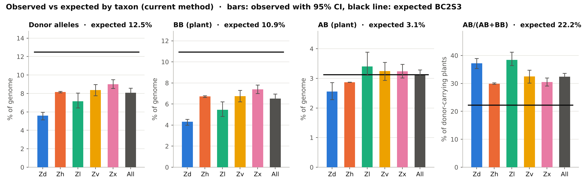
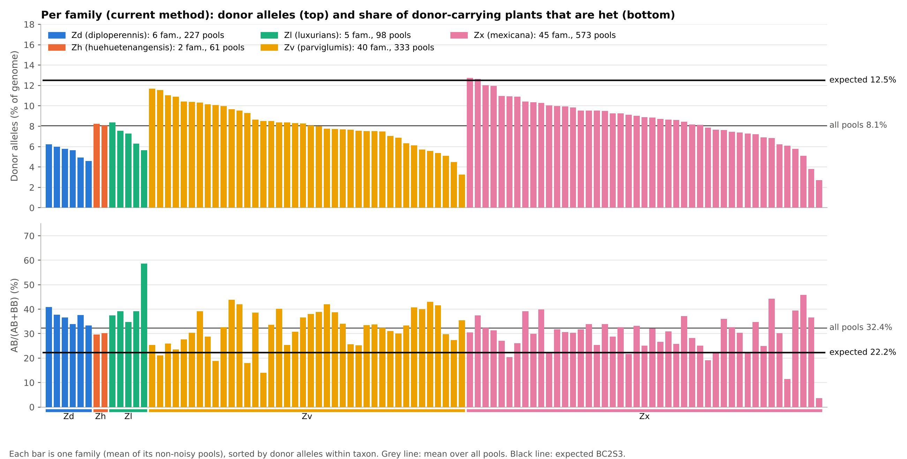
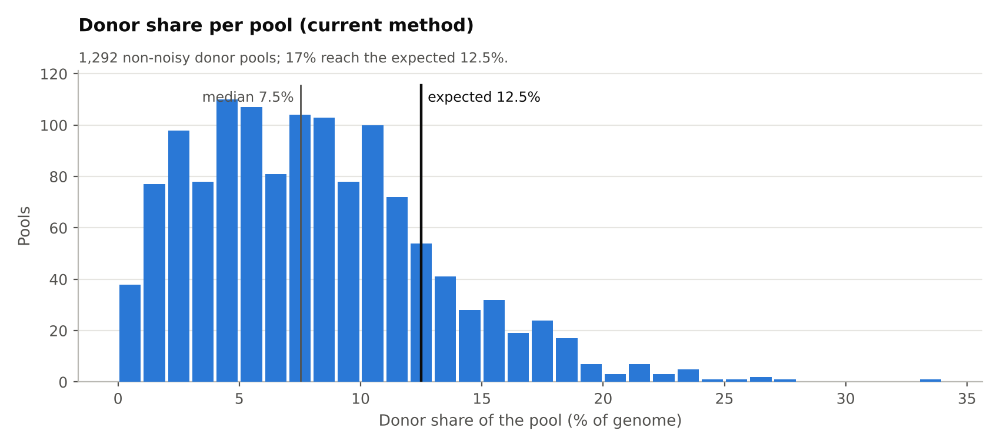
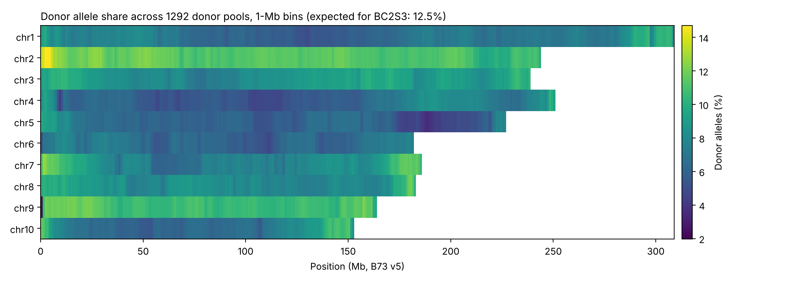
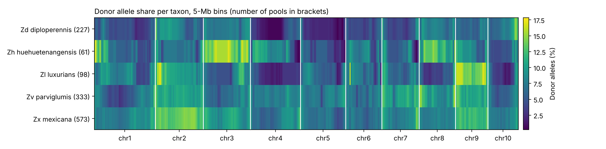
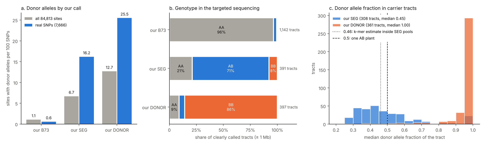
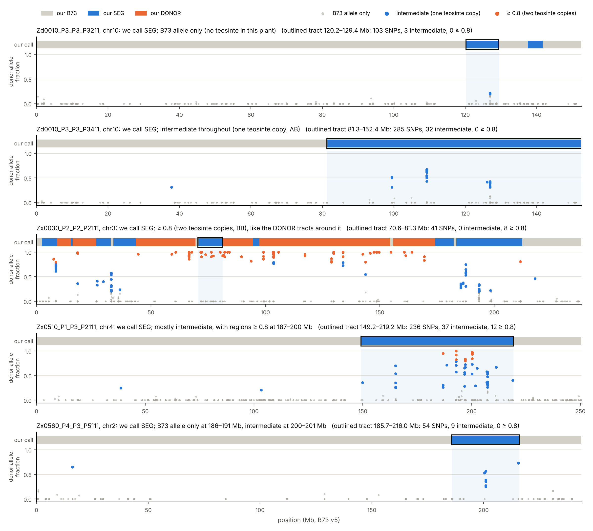
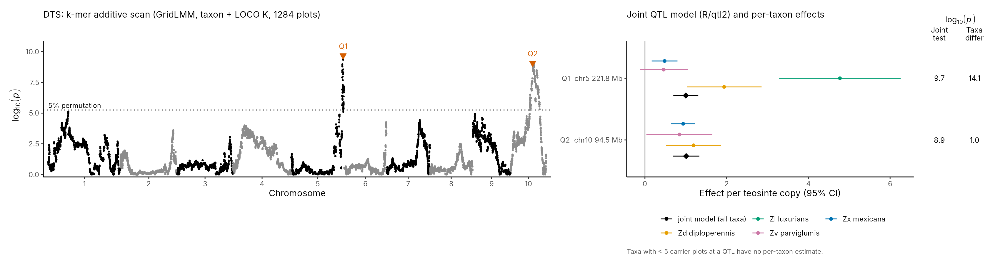
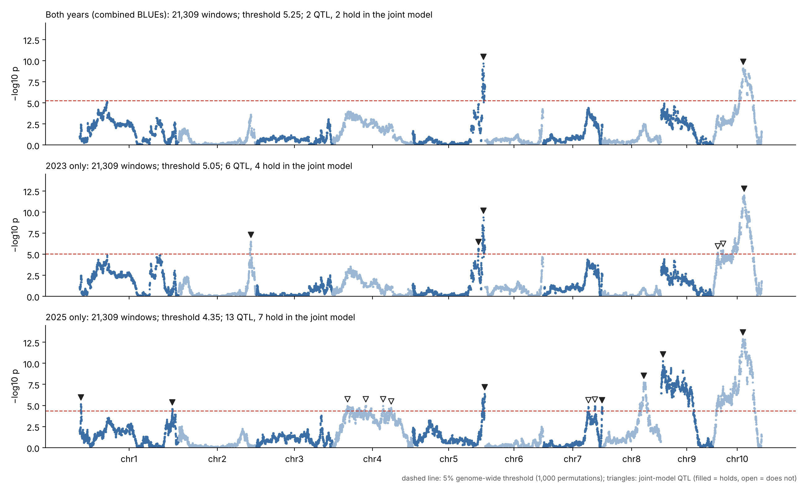
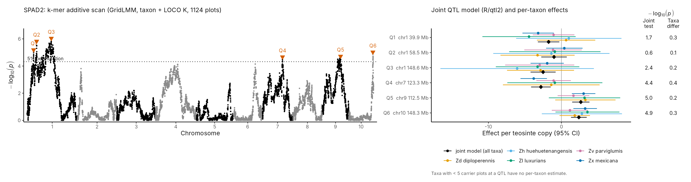

# BZea: k-mer introgression calling and QTL mapping in maize × teosinte BC2S3 pools

This repository goes from raw paired-end reads of **pooled, low-coverage (~0.8×)** BC2S3 samples to **teosinte introgression calls** and **QTL** for flowering, height, ear and leaf traits. B73 was crossed to 5 teosinte taxa, backcrossed twice to B73 and selfed three times; each sample is a pool of 6 plants from one BC2S3 plot.

- **Introgressions are called from k-mers**, not from mapped SNPs: for each pool, which B73 single-copy 31-mers its reads contain, per 100-kb window, decoded with an HMM that models the pool: each window is **B73** (all 6 plants AA), **DONOR** (all BB) or **SEG** (segregating: the plants are a mix of AA, AB and BB).
- **QTL are mapped on that k-mer ancestry**: a genome scan (k-mer ancestry GWAS, GridLMM with leave-one-chromosome-out kinship) finds the peaks, and a joint QTL model (R/qtl2) fits them together, with an effect for each teosinte taxon.

> **Pipeline and commands from the k-mer and SNP steps on:** [`final_script/`](final_script/README.md) (the pre-processing scripts are not in the repository yet; see Section 1). Results tables: [`data/introgression_spread/`](data/introgression_spread/). Figures: [`figures/`](figures/).

## Contents

- [Words used in this README](#words-used-in-this-readme)
- [The BZea population](#bzea-breeding-scheme): breeding scheme and expected genotype proportions
- [Overview](#overview) and [software](#software-and-packages)
- [Section 1 — Pre-processing](#section-1--pre-processing): demultiplexing, trimming, alignment
- [Section 2 — Introgression calling](#section-2--introgression-calling): the k-mer HMM, results, validation, population structure
- [Section 3 — k-mer ancestry GWAS and joint QTL mapping](#section-3--k-mer-ancestry-gwas-and-joint-qtl-mapping): phenotypes, methods, results for 17 traits (11 in detail), *mexicana* races, candidate genes
- [Section 4 — References](#section-4--references)

## Words used in this README

- **Pool** or **sample:** one sequenced sample, i.e. one leaf each from 6 plants of one plot. Every result is per pool.
- **Window:** a 100-kb piece of the B73 genome. The HMM calls one state per pool per window.
- **Tract:** a run of neighbouring windows with the same state.
- **F1 family:** all pools that descend from one F1 plant (same accession and same first P in the name, see below). Used to group pools in the statistics.

## BZea Breeding Scheme

B73 was crossed with teosinte, backcrossed twice to B73 and then selfed three times:

**B73 × teosinte → F1 → BC1 (× B73) → BC2 (× B73) → BC2S1 → BC2S2 → BC2S3**

- **Selfing, ear to row:** a plant is selfed, its progeny are planted, several are selfed, **one is selected** and advanced to the next generation, and so on. So each BC2S3 plot is grown from the seed of one BC2S2 mother (one selfed ear).
- **Sequenced sample:** one leaf each was taken from 6 different BC2S3 plants of the plot and pooled into one sample. The 6 plants were not random: the best-looking plants of the plot were chosen. These 6 plants are siblings, not copies of one plant: each got its own two gametes from the BC2S2 mother. So where the mother is heterozygous, each plant is AA, AB or BB with chance ¼, ½, ¼.
- **Pedigree names:** in `Zv.0200_P3_P2_P1.1.1.1`, `Zv.0200` is the teosinte accession, `P3` the F1 plant, `P2` the BC1 plant, `P1` the BC2 plant, and `.1.1.1` the selfed line. Pools that share `Zv.0200_P3` descend from one F1 plant (an **F1 family**: they all carry the same teosinte haplotype); pools that share `Zv.0200_P3_P2_P1` come from the same BC2 plant.

## Expected genotype proportions (per locus)

**Notation, used everywhere in this README and in `final_script/`:**
- **A** = the B73 allele, **B** = the teosinte (donor) allele
- **AA** = homozygous B73, **AB** = heterozygous, **BB** = homozygous teosinte

**Assumptions:** B73 is AA, the teosinte donor contributes one B allele to the F1, and there is no selection or segregation distortion. (In practice one plant was selected at each selfing step, so a departure from these numbers can point to selection, but also to segregation distortion, lower survival or fertility of some genotypes, or errors in the calls; see [Results](#28-results).) These are the same for every donor taxon: Zd (*diploperennis*), Zh (*huehuetenangensis*), Zl (*luxurians*), Zv (*parviglumis*) and Zx (*mexicana*).

### Step 1 — Two backcrosses (BC2)

- F1 = B73 (AA) × teosinte (BB) → **100% AB**
- BC1 = F1 × AA → ½ AA, ½ AB
- BC2 = BC1 × AA → **¾ AA, ¼ AB**, 0 BB

Donor allele share at BC2: ¼ × ½ = **12.5%**. Selfing doesn't change allele shares, so 12.5% is the expectation at every later generation too.

### Step 2 — Selfing a heterozygote

Each self halves the heterozygotes; the rest become AA or BB in equal parts. Starting from AB, after *s* selfs:
- AB = (½)^s
- AA = BB = (1 − (½)^s) / 2

| Selfs | AA | AB | BB |
|---|---|---|---|
| 1 (BC2S1) | 1/4 | 1/2 | 1/4 |
| 2 (BC2S2) | 3/8 | 1/4 | 3/8 |
| 3 (BC2S3) | 7/16 | 1/8 | 7/16 |

### Two levels: plants and pools

Everything below is computed at two levels, and it helps to keep them apart:
- **Plant level:** the genotype of one BC2S3 plant at a locus, **AA**, **AB** or **BB**.
- **Pool level:** what the sequenced sample shows. A sample is a pool of 6 sibling BC2S3 plants, and the HMM gives each 100-kb window of a pool one of three **pool states**:
  - **B73:** all 6 plants are AA.
  - **DONOR:** all 6 plants are BB.
  - **SEG** (*segregating*): the plants differ. Their mother was AB, so each of the 6 plants is AA, AB or BB. A SEG pool is a **mix of plants**, not one heterozygous plant.

### Step 3 — One BC2S3 plant (three selfs)

Start from the BC2 numbers in Step 1: **¾ of the genome is AA** and **¼ is AB** (BC1 = ½ AA + ½ AB; crossing to B73 again turns the AA half into AA and splits the AB half into AA and AB, so BC2 = ½ + ¼ = ¾ AA and ¼ AB).

Then the BC2 plant is selfed three times (BC2S1, BC2S2, BC2S3):
- the **¾ that is AA** stays AA: selfing AA only gives AA.
- the **¼ that is AB** segregates, as in the **3 selfs** row of Step 2: of that ¼, 7/16 becomes AA, 1/8 stays AB and 7/16 becomes BB.

| Genotype | From the ¾ AA at BC2 | From the ¼ AB at BC2 | Expected |
|---|---|---|---|
| AA | ¾ | ¼ × 7/16 | 0.75 + 0.1094 = **85.94%** |
| AB | 0 | ¼ × 1/8 | **3.13%** |
| BB | 0 | ¼ × 7/16 | **10.94%** |
| Donor alleles | | BB + ½ × AB | 10.94 + 1.56 = **12.5%** |

### Step 4 — One pool (6 BC2S3 siblings)

The 6 plants in a pool are the selfed offspring of one **BC2S2 mother**, so the pool state at a locus is set by **her** genotype:
- mother **AA** → all her offspring are AA → pool state **B73**
- mother **BB** → all her offspring are BB → pool state **DONOR**
- mother **AB** → her offspring segregate 1 AA : 2 AB : 1 BB (Mendel, selfing a heterozygote), so each of the 6 plants is AA with chance ¼, AB with ½ and BB with ¼ → pool state **SEG**

The mother is a BC2S2 plant, i.e. **two** selfs after BC2. Same logic as Step 3, with the **2 selfs** row of Step 2: the ¾ of the genome that is AA at BC2 stays AA, and the ¼ that is AB at BC2 becomes 3/8 AA, 1/4 AB and 3/8 BB:

| BC2S2 mother | From the ¾ AA at BC2 | From the ¼ AB at BC2 | Expected share of the genome | The 6 plants | Pool state |
|---|---|---|---|---|---|
| AA | ¾ | ¼ × 3/8 | 0.75 + 0.0938 = **84.38%** | all AA | **B73** |
| AB | 0 | ¼ × 1/4 | **6.25%** | AA, AB or BB with chance ¼, ½, ¼ (1:2:1) | **SEG** |
| BB | 0 | ¼ × 3/8 | **9.38%** | all BB | **DONOR** |

### Step 5 — From pool states back to plants

Steps 3 and 4 describe the same plants, so one can be computed from the other. B73 pools contain only AA plants and DONOR pools only BB plants. SEG pools contain the 1:2:1 mix, so on average **¼ of a SEG region is AA in a plant, ½ is AB and ¼ is BB**. Adding up, with SEG = 6.25%:

| Plant genotype | From the pool states | Expected |
|---|---|---|
| AA | B73 + ¼ × SEG = 84.38 + 1.56 | **85.94%** |
| AB | ½ × SEG = ½ × 6.25 | **3.13%** |
| BB | DONOR + ¼ × SEG = 9.38 + 1.56 | **10.94%** |
| Donor alleles | DONOR + ½ × SEG = 9.38 + 3.13 | **12.5%** |

These are exactly the Step 3 numbers. This is how the HMM results are reported at both levels: the pool states as called (compared with Step 4), and converted to plant genotypes with this table (compared with Step 3). Heterozygosity (AB) can only be estimated this way, as half of SEG; no single plant is genotyped. So AB, BB and AA in this README are **Mendelian estimates from the HMM pool states**, not measured plant genotypes, and AB always equals half of SEG by construction. (The HMM's SEG state leaves out pools in which all 12 gametes happened to carry the same allele, k = 0 or 12; under Mendel that is 2 × ½¹² = 0.05% of SEG windows, small enough to ignore.)

### Implication for low-pass pooled genotyping

- **Het is small:** only 3.1% of a plant's genome is expected to be AB (Step 3). At 0.8x, single-site het calls are unreliable anyway, so we call pool states over 100-kb windows instead of genotypes at sites.
- **Most donor should be fixed:** of the 12.5% donor alleles, most should sit in DONOR regions (9.38%), where all 6 plants are BB. SEG regions (6.25%) hold the rest, as a 1:2:1 mix of plants (Step 5).
- **What we found:** het matches the expectation (SEG 6.23%, AB 3.12%), but DONOR is only about half of it (5.0% vs 9.4%). See [Results](#28-results).

---

## Overview

### 1. Pre-processing (Section 1)
- **Demultiplexing** by barcode (`sabre`) into per-sample paired FASTQs.
- **Trimming** of adapters, primers and low-quality bases (Trimmomatic).
- **Alignment** to B73 RefGen v5 (BWA-MEM), sorting, duplicate removal, indexing; used by the SNP route only.

### 2. Introgression calling (Section 2)
- **k-mer windows** (KMC 3 + KCFtools): for each pool, the B73 single-copy 31-mers seen in its reads, per 100-kb window; no read mapping (`final_script/` steps 16–19).
- **Expected DONOR level** per window from the teosinte genome assemblies (MaizeGDB / PanAnd).
- **HMM** with three states, B73 / SEG / DONOR, genetic-map transitions and pool-aware emissions (steps 20–21). Outputs: per-pool state per window, tracts, `pool_summary.tsv`, `family_summary.tsv`, chromosome paintings, interactive figures.
- **Population structure from k-mers** (sourmash; step 32).
- **SNP route** (ANGSD sites and read counts, GL-HMM; steps 01–15), kept as a cross-check.

### 3. k-mer ancestry GWAS and joint QTL mapping (Section 3)
- **Phenotypes:** SpATS spatially corrected BLUEs per year (2023, 2025), combined across years (step 28).
- **k-mer ancestry GWAS:** GridLMM, taxon as fixed effect, **LOCO kinship** from the ancestry dosage, 5% genome-wide threshold from 1,000 permutations (steps 25–27); rerun with *mexicana* split by race.
- **Joint QTL model:** the peaks fitted together in R/qtl2: effect of each QTL adjusted for the others, its effect in each taxon, and a test that the taxa differ (step 29).
- **Genes and GO terms** in each QTL interval, side-by-side figures (steps 30–31).

## Software and packages

### Genotyping

- **sabre** — demultiplexing by barcode (FASTQ splitting)
- **Trimmomatic** — adapter/primer trimming + quality filtering
- **bwa-mem2** *(recommended)* or **bwa** — read alignment to reference genome
- **samtools** — BAM/SAM manipulation (sort, index, stats, depth)
- **picard** — duplicate marking
- **bcftools** — querying
- **ANGSD** — genotype likelihood estimation + SNP calling for low-pass data
- **vcftools**  — quick VCF filters / summaries
- **bgzip / tabix** *(htslib)* — compress + index VCF/BCF outputs

### Imputation and Variant handling

- **plink2** — variant QC, LD pruning, PCA, relationship matrices, LOCO kinship (`.rel/.rel.id`)
- **Beagle** (Java) — genotype imputation

### Introgression inference (k-mers + HMM)

- **KMC 3** (`kmc`, `kmc_tools`): k-mer counting
- **KCFtools**: k-mer counts per reference window
- **Python** (>= 3.8) with numpy, scipy, matplotlib: HMM and figures
- **R** (>= 4.1): QC and SNP-route summaries

### Phenotypes and QTL / association mapping

- **R** (>= 4.1) with **SpATS** (spatial BLUEs), dplyr, tidyr
- **GridLMM** R package (`github.com/deruncie/GridLMM`), data.table, ggplot2
- **Python** with pandas, numpy: inputs (dosage, LOCO kinship) and regions/genes

### Gene annotation resources

- **GFF3 annotation** for the reference build (we used v5 annotation - `Zm-B73-REFERENCE-NAM-5.0_Zm00001eb.1.gff3`)

---

## Section 1 — Pre-processing

The sequencing lanes hold many pooled samples. Pre-processing splits them into one pair of FASTQ files per sample, trims them, and (for the SNP route only) aligns them to B73. The two downstream routes use different products:

| Product | Used by |
|---|---|
| Trimmed paired reads, `filtered_S<plate>/<SAMPLE>/<SAMPLE>_paired_R{1,2}.fq.gz` | **k-mer route** (Section 2): k-mer counting (step 17) and k-mer sketches (step 32a). No alignment needed. |
| Sorted, deduplicated, indexed BAMs (`bam_list.txt`) | **SNP route** (cross-check): ANGSD site discovery and read counts (steps 01–12). |

Samples are named `PN<plate>_SID<number>` (e.g. `PN12_SID1106`); `name_change_final.txt` maps them to the pedigree names (Section 3).

### 1.1 Demultiplexing

Each lane's paired FASTQs (`..._R1_001.fastq.gz`, `..._R2_001.fastq.gz`) are split by the inline barcode at the start of read 1 with **sabre** (paired-end mode). The barcode file has two tab-separated columns, the barcode sequence and the sample name:

```txt
ACGTACGT    PN12_SID1106
TGCATGCA    PN12_SID1107
```

sabre writes one read pair per sample and puts reads whose barcode matches no sample into `no_bc_match_*_R1.fq.gz` / `_R2.fq.gz`; their share is a quick check of barcode quality per lane.

### 1.2 Trimming and quality filtering

**Trimmomatic** (paired-end mode) removes adapter and primer sequence and low-quality bases:

| Setting | What it does |
|---|---|
| `ILLUMINACLIP:<adapters.fa>:2:30:10` | removes adapter/primer matches (2 seed mismatches, palindrome score 30, simple score 10) |
| `LEADING:3`, `TRAILING:3` | trims bases below quality 3 at the read ends |
| `SLIDINGWINDOW:4:15` | cuts the read when the mean quality of 4 bases falls below 15 |
| `MINLEN:36` | drops reads shorter than 36 bp |

Only pairs in which both reads survive (`*_paired_R1.fq.gz`, `*_paired_R2.fq.gz`) are kept; these are the reads used by the k-mer route.

### 1.3 Alignment and BAM processing (SNP route)

The trimmed pairs are aligned to **B73 RefGen v5** with **BWA-MEM**. Each BAM is then coordinate-sorted, PCR duplicates are removed, and the BAM is indexed (SAMtools and Picard). The k-mer route does not use the BAMs; they feed the SNP route only, which is kept as a cross-check (Section 2, "The problem").

> **Scripts:** the pre-processing commands (sabre, Trimmomatic, BWA, BAM processing) are not yet in this repository; they will be added under `scripts/`. The outputs are at `/rsstu/users/r/rrellan/sara/BZea/filtered_S` (trimmed reads) and `/rsstu/users/r/rrellan/DOE_CAREER/BZea/dedup_filtered` (BAMs) on the NCSU cluster.

---

## Section 2 — Introgression calling

All code is in [`final_script/`](final_script/), numbered in run order. **The detailed analysis (every command, parameter, output, all statistics and the method history) is in [`final_script/README.md`](final_script/README.md).** This section explains what we do and why, and the main results.

### 2.1 What a sample is

Each sequenced sample is a **pool of 6 BC2S3 plants from one plot**, sequenced at about **0.8x**, with no parental sequencing. B73 is the recurrent parent. 1,385 donor pools were called, from 5 teosinte taxa (pools per race from `data/metadata_BZea.csv`):
- *mexicana* (Zx), 577 pools from four races:
  - **Chalco:** 14 accessions, 119 pools (the highland race, median 2,390 m)
  - **Mesa Central:** 16 accessions, 167 pools
  - **Durango:** 3 accessions, 146 pools
  - **Nobogame:** 2 accessions, 142 pools
  - 3 pools are from accessions with no race in the metadata.
- *parviglumis* (Zv): 380 pools from 36 accessions, all race Balsas.
- *diploperennis* (Zd): 249 pools from 4 accessions.
- *luxurians* (Zl): 118 pools from 5 accessions (Guatemala 4, Oaxaca 1).
- *huehuetenangensis* (Zh): 61 pools from 2 accessions.
- Landraces (Zm) are set aside for now.

The *mexicana* races are kept apart in Section 3 as an option (`SUBTAXON`), because they differ in origin and elevation.

Because a sample is several sibling plants, each genome region in a pool is in one of three states, set by the genotype of the plot's BC2S2 mother (B73, SEG or DONOR; see [Step 4](#step-4--one-pool-6-bc2s3-siblings)). The expected shares, at the pool level and for one plant:

| | Only B73 alleles | Both alleles | Only donor alleles | Donor alleles |
|---|---|---|---|---|
| **Pool state** (6 plants) | **B73** (all plants AA): 84.4% | **SEG** (plants AA, AB or BB, 1:2:1): 6.25% | **DONOR** (all plants BB): 9.4% | 12.5% |
| **One plant** | **AA:** 85.9% | **AB:** 3.1% | **BB:** 10.9% | 12.5% |

SEG is not the same as AB: a SEG pool holds a mix of AA, AB and BB plants, and only half of a SEG region is AB in an average plant (AB = ½ × 6.25% = 3.1%).

**What SEG means.** SEG is a state of the *pool*, not of a plant, and it is **not the same as "het"**.
- In a SEG region, the family's BC2S2 mother was AB, so its BC2S3 offspring segregate 1:2:1. **Each of the 6 plants in the pool can be AA, AB or BB.**
- On average a SEG pool holds ¼ AA, ½ AB and ¼ BB plants. The exact mix differs from pool to pool (e.g. 2 AA, 3 AB, 1 BB), and the model allows for that: the pool carries k donor copies out of 12 (6 plants × 2), with k ~ Binomial(12, ½).
- A SEG call says "this family is still segregating here". It does not say that any one plant is AB.
- **SEG vs "het" in SNP-based callers.** In a SEG region the pool's reads show both alleles, just like a het site in a single plant, so a diploid SNP genotyper would call it het. But in a pool, "both alleles present" only means the 6 plants are a mix: any combination of AA, AB and BB plants, as long as both alleles are there. That's why we call this state SEG, not het.
- To get plant genotypes from pool states: **AA = B73 + SEG/4, AB = SEG/2, BB = DONOR + SEG/4**.

**Can we tell which plants are AA, AB or BB in a SEG region?** No, not from this data. The 6 leaves are ground into one sample, so a read doesn't say which plant it came from.
- **What the pool can tell:** roughly how many donor copies it carries, k out of 12. In principle k can be estimated per SEG tract, because a 10-Mb tract has about 100 windows. Right now the HMM averages over all possible k and doesn't report one.
- **Even an exact k doesn't give the genotypes.** For example, 6/12 could be 6 AB plants, or 3 AA + 3 BB, or 2 AA + 2 AB + 2 BB.
- **The estimate is only as good as the family's DONOR level d**, because r(SEG) = d + (1 − d)·g(k/12) (section 2.5).
- **k can change inside a tract.** The 12 gametes recombine independently, so a plant can be AA at one end of a SEG tract and AB at the other.
- **Leaves are not equal.** Leaf size and DNA yield differ, so a plant's share of the reads isn't exactly 1/6. This adds noise to k.
- **To get plant genotypes:** genotype single plants, or seed of that family, e.g. with a few KASP markers inside the SEG tracts, or skim-sequence single plants from a subset of families.

### 2.2 The problem: mapping reads and calling SNPs at 0.8x in pools

We first did it the usual way (steps 01–15): map reads to B73, count each pool's reads at SNPs (ANGSD), then run an HMM. It found too little donor and too much het. Three things go wrong, and they hit donor (BB) and het regions hardest:

1. **Donor reads are lost (reference bias).** In a known Zd DONOR tract (PN13_SID1199, chr2:22.1–25.3 Mb), only **~34%** of the expected reads map there at all, because much teosinte sequence is missing from or rearranged against B73. The usual filters (`-C 50`, BAQ, MAPQ ≥ 30) then remove most of the rest: only **~11%** of expected donor bases survive, against ~96% in B73 regions. The filters remove reads with mismatches, and a read carrying a teosinte allele has extra mismatches by definition. So ALT alleles are lost first: **DONOR (BB) shows mixed reads and is called SEG, and SEG loses its ALT reads and is called B73.** This comes from mapping to one reference; tuning filters can't fix it.

   Read counts in that tract, compared with a B73 region of the same size and normalized with a B73 control sample:

   | What is kept in the donor tract | Share of the expected reads or bases |
   |---|---|
   | Reads that map there at all | 34% |
   | + MAPQ ≥ 30 | 30% |
   | Bases, MAPQ ≥ 30, no `-C 50`, no BAQ | 25% |
   | Bases with `-C 50` + BAQ (the ANGSD settings used) | **11%** |
   | Same filters in a B73 region | ~96% |

   The k-mer method (below) calls this tract DONOR, with r ≈ 0.20 (the Zd assemblies give 0.26 there).
2. **Too few reads per site.** At 0.8x most SNPs have 0 or 1 read. One read shows one allele, so a het site looks homozygous, and a single error read looks like a het. Every call leans on the HMM and imputation.
3. **Pools aren't diploid.** A pool's ALT fraction can be anything from 0 to 1 (e.g. 5/12 in a SEG region). Genotype callers built for diploids (0 / ½ / 1) mislabel these mixtures.

### 2.3 The solution: k-mers

Finding introgressions by counting reference k-mers in genome windows, without mapping reads, was developed in wheat: **IBSpy** (Uauy lab; Quiroz-Chávez 2023) was used to find einkorn introgressions in bread wheat (Ahmed et al. 2023), and **KCFtools** (Selvanayagam et al. 2026) is a fast tool for k-mer introgression screening and k-mer GWAS, which we use for the per-window counts. k-mers are counted with **KMC 3** (Kokot et al. 2017). The DONOR levels come from teosinte genome assemblies (PanAnd-1.0, Stitzer et al. 2025), downloaded from **MaizeGDB** (Portwood et al. 2019).

**What we added:** low-coverage *pools* instead of single plants, a three-state pool model (B73 / SEG / DONOR) with per-window DONOR levels from assemblies, and the HMM on the NAM genetic map.

### 2.4 How it works


1. **B73 k-mer list (step 16).** The **B73 reference genome** (RefGen v5, `Zm-B73-REFERENCE-NAM-5.0`, the same reference used for mapping in the SNP route) is cut into every 31-letter word (k-mer), counted with KMC. Only the **single-copy** ones are kept: 680 M of 817 M. Repeats are dropped because they're in every genome, donor or not, and would hide the signal. Spread over the genome's 21,330 windows of 100 kb, that is **about 32,000 single-copy k-mers per window** on average (it varies from window to window).
2. **Look them up in each sample (step 17).** All k-mers in a sample's raw reads (the pool of 6 plants) are counted, with no mapping. For each 100-kb B73 window, KCFtools counts how many of the window's single-copy B73 k-mers the sample has.
   - **B73 region:** essentially all of them are present, limited only by sequencing depth.
   - **Donor region:** every teosinte SNP or indel removes the B73 k-mers that overlap it, so the count drops.
3. **Score each window (step 20).** At 0.8x even a pure-B73 sample finds only part of the window's k-mers, so the pool's count is not compared with the reference's 32,000. It is compared with what **our own sequenced B73 samples** find:
   - **B73 control samples:** 10 samples of B73 itself, sequenced by us the same way as the BC2S3 pools. In each window they show how many of the reference k-mers a pure-B73 sample actually finds, rescaled to the depth of the pool being scored. A control is never used to score itself.
   - **r = k-mers found in the pool ÷ k-mers the B73 controls find** (at the pool's depth).
   - So two kinds of B73 are used: the **B73 reference genome** decides *which* k-mers are counted (step 1), and the **B73 control samples** say *how many* of them a B73 sample at this depth should find.
   - B73 gives **r ≈ 1**, DONOR **r ≈ d**, and SEG falls between them.
   - d is the share of B73 k-mers a donor genome keeps. It depends on the taxon and on the window, and is measured per window from teosinte genome assemblies (PanAnd-1.0 from MaizeGDB, step 19). Genome-wide: Zd 0.27, Zl 0.26, Zh 0.34, Zx 0.37, Zv 0.43.
   - SEG: k-mers the donor lacks come only from the B73 plants in the pool. For 6 plants, the pool's donor fraction follows Binomial(12, ½).
4. **HMM along each chromosome (steps 20–21).** The windows' r values are read along each chromosome by a three-state hidden Markov model (B73 / SEG / DONOR). It uses the NAM genetic map, so a state change costs more where recombination is rare. Adjacent windows in the same state become tracts. **The model is explained step by step in [The HMM in detail](#26-the-hmm-in-detail) below.**
5. **Allow for our donor plants differing from the assembly plants (step 20).** Where the two assemblies of a taxon disagree on d, the model is told that the DONOR level there is uncertain, so it doesn't flip between SEG and DONOR on small differences (see τ_w under [Emissions](#261-emissions-how-well-does-r-fit-each-state)).
6. **Tests (step 22).** Observed vs expected BC2S3 proportions, with a bootstrap over F1 families. Pools of one F1 family share segments, so the F1 family is the unit.

### 2.5 How r is calculated: a worked example

An average window in a typical Zd pool. The numbers are genome-wide averages from our data, rounded; real windows vary around them.

**Step 1: which k-mers are counted (B73 reference).** The B73 reference has 680 M single-copy k-mers in 21,330 windows, so an average window has **~32,000** (step 16). This is the same for every pool and every taxon.

**Step 2: how many a B73 sample at this depth finds (B73 controls).** At 0.8x many parts of the window are not covered by any read, so a sample finds only part of the 32,000. A typical pool contains about 200 M of the 680 M single-copy k-mers, i.e. **about 30%** (plate averages range from 109 M to 245 M; section 2.11). So in this window our B73 control samples, rescaled to the pool's depth, find about 30% × 32,000 ≈ **9,600**. That's the expected count. It depends on the pool's depth, not on its taxon.

**Step 3: r = what our pool found ÷ the expected count.**

| Our pool in this window is… | k-mers found | r |
|---|---|---|
| B73 (all plants AA) | ~9,600 | 9,600 / 9,600 ≈ **1.0** |
| DONOR (all plants BB, Zd) | ~2,600 | 2,600 / 9,600 ≈ **0.27** |
| SEG (about half B73, half donor) | ~6,300 | 6,300 / 9,600 ≈ **0.66** (below) |

**Where the DONOR level comes from (step 19).** We take the complete Zd genome assemblies (Gigi and Momo, PanAnd-1.0 from MaizeGDB) and count how many of the window's ~32,000 B73 k-mers appear anywhere in them. Genome-wide it's 27% (Gigi 0.26, Momo 0.28), i.e. about 8,600 of 32,000: **d = 0.27**. A pool that is all Zd in this window can only find that 27%, so it finds 0.27 × 9,600 ≈ 2,600 and its expected r is 0.27. A real example: the Zd tract of PN13_SID1199 (chr2:22–25 Mb, section 2.2) has r ≈ 0.20, where the Zd assemblies give 0.26.

d depends on the taxon and on the window:
- **Taxon:** genome-wide Zd 0.27, Zl 0.26, Zh 0.34, Zx 0.37 and Zv 0.43. Zv is closest to maize, so it keeps the most.
- **Window:** for Zd, the per-window median is 0.23, and 80% of windows are between 0.13 and 0.42. The HMM uses each window's own d.

Sequencing the **actual donor parents** of our lines would have been better, because d would then be measured on the plants our lines came from. We don't have them, so we use the MaizeGDB assemblies of the same taxa.

**Why SEG falls in between.** In a SEG region the pool is a mix of B73 and donor chromosomes. Split the window's k-mers in two:
- **Shared with the donor (27%):** every chromosome carries them, so they're found as often as in a B73 sample (ratio 1.0).
- **Missing from the donor (73%):** only the B73 chromosomes carry them, about half the chromosomes, so they get about half the reads. Half the reads doesn't mean half the k-mers found, because at low depth many k-mers are missed either way:
  - A B73 sample at this depth finds **30%** of the k-mers. From the coverage formula (the chance a k-mer is seen at coverage c is 1 − e^(−c)), that means a k-mer coverage of c = 0.36.
  - With half the reads (c = 0.18), it finds 1 − e^(−0.18) = **16%**.
  - So these k-mers are found 16.3 / 30 = **0.54** times as often as in a B73 sample. That ratio is **g**.

So r(SEG) = 0.27 × 1.0 + 0.73 × 0.54 ≈ **0.66**.

In general, r(SEG) = d + (1 − d) × g. g depends on the pool's depth, so each pool gets its own. The HMM doesn't assume exactly half donor. It averages over the possible donor fractions of a 6-plant pool (1/12 to 11/12), weighted by Binomial(12, ½), the 1:2:1 segregation summed over 6 plants.

**Then the HMM** compares each window's r with these three expected levels (B73 ≈ 1, SEG ≈ 0.66, DONOR ≈ d). It allows for each pool's noise and takes neighbouring windows into account, using the genetic map, to call the most likely state.

### 2.6 The HMM in detail

A hidden Markov model (HMM) is used because we can't see a pool's true state directly. We only see a noisy score r in each window. But we know two things that help:
- each state gives r values in a typical range, and
- the state rarely changes from one window to the next, because introgressed segments are long compared with a 100-kb window (median about 10 Mb in our pools; see [Tract lengths](#265-how-long-are-the-tracts) below).

The HMM combines both to find the most likely series of states along each chromosome. It has the same three-state structure as the SNP HMM in step 14 (`14_hmm_pooled.py`); see Rabiner (1989) for HMMs in general. Only the observation is different: a k-mer score per window instead of SNP reads. The design follows the HMM that Zhong et al. (2025) built to call introgressions in 888 maize near-isogenic lines with B73 as the recurrent parent: three states (homozygous B73, heterozygous, homozygous donor), starting frequencies set by the expected genotype frequencies of the generation, transitions from the average recombination rate over all generations of line development, and, after a change, a move to the other two states in proportion to their expected frequencies. Like theirs, our model does not need the donor's genotype, and its key parameter is chosen by a grid search (theirs: the non-informative rate and error rates, checked against SNP-chip calls on 24 lines; ours: the recombination scale ρ, chosen by likelihood). Their observations are GBS SNP calls on single lines; ours are k-mer scores of pools of six plants, which needs the pool-aware emissions below.

**The four parts of the model:**

| Part | What it is here |
|---|---|
| **Positions** | The 100-kb windows along one chromosome, in order. Each chromosome is run separately. Windows with fewer than 2,000 single-copy B73 k-mers, or where the B73 controls themselves see very few k-mers (repeats, gaps), are skipped. |
| **Hidden states** | The pool's state in the window: **B73** (all 6 plants AA), **SEG** (the family segregates: each plant AA, AB or BB), **DONOR** (all 6 plants BB). |
| **Observation** | r, the k-mer score of the window (≈ 1 for B73, ≈ d for DONOR, in between for SEG; see the worked example above). |
| **Emission** | For each state: how likely the observed r is if the pool really is in that state. |
| **Transition** | The chance that the state changes between one window and the next. |
| **Start / prior** | The share of the genome expected in each state: B73 84.4%, SEG 6.25%, DONOR 9.4% (BC2S3 expectation). |

#### 2.6.1 Emissions: how well does r fit each state?

Each state expects r near a certain value, with some spread (noise). The spread σ_w is measured, not assumed:
- **Pool noise σ:** how much r scatters around 1 in the pool's B73 windows. It is a *robust* standard deviation:
  1. For every B73-like window, take how far r is from 1: |r − 1|.
  2. Take the median of those distances. This is the **MAD** (median absolute deviation).
  3. Multiply by 1.4826. For normally distributed noise, 1.4826 × MAD equals the ordinary SD.

  Unlike the ordinary SD, the MAD isn't inflated by the few introgressed or junk windows, because a median ignores extreme values. Good pools have σ ≈ 0.08–0.10. Pools with σ > 0.15 are flagged **NOISY**, which mostly means low depth.
- **Window factor:** windows where the 10 B73 controls disagree with each other are noisier in every pool, so σ_w = σ × (control spread in this window ÷ typical control spread), limited to 0.5–3.

| State | Expected r | Emission (probability of r) | In words |
|---|---|---|---|
| **B73** | 1 | Normal(1, σ_w) | r near 1, with the pool's noise |
| **DONOR** | a × d_w | Normal(a·d_w, √(σ_w² + (a·τ_w)²)) | r near the donor level, with the pool's noise plus the uncertainty of the donor level |
| **SEG** | between d_w and 1 | average of Normal(a·d_w + (1 − a·d_w)·g(k/12), √(σ_w² + ((1 − g)·a·τ_w)²)) over k = 1…11 donor copies, weighted by Binomial(12, ½) | for each possible number of donor copies k in the 6 plants, r near the matching in-between level; the k are weighted by how likely they are under 1:2:1 segregation |

What the terms mean:
- **d_w:** the share of the window's B73 k-mers that the donor genome keeps, measured from the teosinte assemblies (step 19). Each window has its own value.
- **τ_w (uncertainty of d_w):** our donor plants are not the assembly plants, so their real level can differ from d_w. Teosinte is outcrossing and very diverse, so two plants of the same taxon can differ a lot in a given window; even the two Zv assemblies differ by more than 0.2 in 28% of windows. τ_w is how much the taxon's two assemblies disagree in that window (their SD × √1.5, the expected spread of a new plant around the mean of two, averaged over ±5 windows). It adds to the noise of DONOR, and to SEG in proportion to how much SEG depends on d. Mean τ: Zv 0.18, Zx 0.16, Zd 0.06. Zh and Zl have only one assembly, so τ = 0 for them. The B73 controls get the widest τ (Zv) as a worst-case test. Why it was added: in a first run without τ_w, Zv and Zx tracts kept flipping between SEG and DONOR; τ_w halved that. Details: [`final_script/README.md`, section 5.7](final_script/README.md#57-method-history-family-donor-levels-then-donor-level-uncertainty-current).
- **a:** one scale factor per pool. It absorbs genome-wide differences between our donor plant and the assembly plants; for example, our plant may keep a few percent more B73 k-mers everywhere. **How it's fitted (maximum likelihood by grid search):**
  1. The whole HMM is run for the pool with each value of a: 0.5, 0.6, …, 1.4, 1.6, 1.8.
  2. Each run gives the **likelihood**: the probability of the pool's observed r values in all windows of all chromosomes under that model. The forward algorithm computes it.
  3. The a with the highest likelihood is kept.

  The same grid is repeated for every value of **ρ**, the switch rate of the transitions (how easily the state changes from one window to the next; see [Transitions](#262-transitions-how-often-can-the-state-change)). a and ρ both change the likelihood, so the best a is found separately for each ρ, and then the best ρ is chosen over all pools.

  The fitted a is mostly 0.9–1.0 in every taxon, so on average the assembly levels fit our lines well.
- **k/12:** the donor fraction of a SEG pool. 6 plants carry 12 chromosome copies. A SEG family segregates 1:2:1, so the number of donor copies k follows Binomial(12, ½). The model averages over all k instead of assuming exactly half (see [What SEG means](#21-what-a-sample-is)).
- **f and g(f):** f is the donor fraction of the pool's chromosomes in the window (f = k/12). g(f) is how often the pool still finds the B73 k-mers that the donor lacks, compared with a pure-B73 pool. Those k-mers sit only on the B73 chromosomes, a share (1 − f) of the pool, so they get only that share of the reads. From the coverage formula, g(f) = (1 − e^(−(1−f)λ)) / (1 − e^(−λ)), where λ is the pool's k-mer coverage (measured from the share of B73 k-mers it finds in B73 windows). In the worked example, f = ½ gives g = 0.54. g = 1 when the pool is all B73 (f = 0), and g = 0 when it's all donor (f = 1).
- **Outliers:** each state also has a 2% chance that the window is junk. A junk window's r is treated as equally likely anywhere from 0 to 2 (a uniform distribution). This is a standard robustness device, a "contamination" term in the emission. Without it, one odd window (e.g. a mis-assembled or duplicated region) could give near-certain evidence for a state just because it lies far out in a normal curve's tail.
  - **The 2% is a chosen value, not estimated from the data.** The B73 controls show it's on the safe side (44-pool test, 10 controls, about 21,000 windows each):
    - 0.77% of control windows are more than 3σ from 1, where a perfect normal would give 0.27%.
    - 0.10% are more than 4σ from 1, where a normal would give 0.006%.
  - So real outliers exist, but at well under 2%. A higher value makes the HMM more reluctant to switch on a few windows; a lower one makes it switch more readily.

**Example: one Zd window** (d = 0.27, σ = 0.09, a typical pool that finds 30% of the k-mers, as in section 2.5; Zd's τ is small, so it's left out here). For a given r, this is how well each state fits on its own, before neighbouring windows are considered:

| r | B73 | SEG | DONOR | Reading |
|---|---|---|---|---|
| 0.27 | 0% | 1% | **99%** | clearly DONOR |
| 0.45 | 1% | 59% | 41% | between SEG and DONOR: the neighbours decide |
| 0.66 | 1% | **99%** | 0% | clearly SEG (about half the plants' chromosomes donor) |
| 0.85 | 48% | 52% | 0% | B73 or SEG with few donor copies: the neighbours decide |
| 1.00 | **97%** | 3% | 0% | clearly B73 |

SEG covers a wide range (here 0.35–0.95) because a 6-plant pool can carry from 1 to 11 donor copies.

**τ_w and a are only needed because we don't have the donor parents.** Both correct for the same thing: d_w comes from assemblies of *other* plants of the same taxon, not from the plants our lines came from. τ_w allows for differences in single windows; a allows for a difference over the whole genome. Both can be switched off:
- **τ_w:** on with `SPREAD=1` (`20_kmer_hmm.py --d_spread`, the default), off with `SPREAD=0`.
- **a:** fitted over `--scale_grid`; `--scale_grid 1` fixes a = 1.

**If the donor parents are sequenced,** d_w can be measured on the parent itself, in the same way as for an assembly in step 19 (the share of the window's B73 k-mers the parent has). Then τ_w = 0 and a = 1, and the emissions are simply:
- **B73:** r ~ Normal(1, σ_w)
- **DONOR:** r ~ Normal(d_w, σ_w)
- **SEG:** r ~ Σ_k w_k × Normal(d_w + (1 − d_w)·g(k/12), σ_w), summed over k = 1…11 donor copies, with w_k = Binomial(12, ½) probabilities rescaled to sum to 1

Each state keeps the 2% outlier term: probability = 0.98 × the Normal above + 0.02 × Uniform(0, 2).

One caveat: a teosinte parent is an outcrossing, heterozygous plant, and the F1 got only one of its two chromosome sets (recombined). The parent's k-mers are the union of both sets, so where its two sets differ, the parent's d_w is a bit higher than that of the set our line carries. A small τ_w can still help there, so it stays an option rather than being removed. Reading d_w from a sequenced parent (a `--parent` input) is not in the code yet; for now d_w comes only from assemblies.

#### 2.6.2 Transitions: how often can the state change?

Between two neighbouring windows, the chance of a state change is **s = ρ × θ**:
- **θ** is the recombination fraction between the two window centres, from the NAM genetic map (Haldane: θ = ½(1 − e^(−2·Morgans))). On average a 100-kb step is 0.075 cM, but it's near 0 around centromeres and higher near chromosome ends.
- **ρ** scales it. Our lines went through several meioses (BC1, BC2, three selfings), so segment ends are more frequent than one meiosis would give. ρ is not guessed: every pool is run with ρ = 0.25, 0.5, 1, 1.5, 2, 3, 4 and 8, and the value with the highest total likelihood over all donor pools (low-depth pools left out) is used. That is **ρ = 1.5**.
- **Where to:** if the state changes, it moves to one of the other two states in proportion to their prior (e.g. from B73, more often to DONOR (9.4%) than to SEG (6.25%)), as in Zhong et al. (2025).

With ρ = 1.5, the chance of a change is about **0.1% per window** on average. The model stays in the same state unless several windows in a row clearly fit another state. I checked this with the model itself, on a Zd DONOR tract at average recombination. A SEG piece inside it is called only when about **4 windows in a row (400 kb)** clearly look SEG (r = 0.66); less clear windows (r = 0.55) need 5. One noisy window can't break a tract, because the 2% outlier term caps its evidence.

#### 2.6.3 Calling the states

- **Forward–backward** computes, for every window, the probability of each state given the whole chromosome. The window gets the state with the highest probability.
- **Tracts:** adjacent windows with the same state are joined. Skipped windows take the state before them.
- **Plant genotypes** follow from the pool states: AA = B73 + SEG/4, AB = SEG/2, BB = DONOR + SEG/4.

#### 2.6.4 What is fitted, and where

| Quantity | Fitted per | How | Code |
|---|---|---|---|
| r (k-mer score) | pool × window | pool count ÷ fit of the B73 controls | `20_kmer_hmm.py` |
| σ (noise) | pool, then × window factor | robust SD of r in B73 windows; control spread | `20_kmer_hmm.py` |
| λ (k-mer coverage) | pool | share of B73 k-mers seen | `20_kmer_hmm.py` |
| d_w (DONOR level) | donor taxon × window | MaizeGDB assemblies of that taxon | `19_kmer_donor_reference.sh` |
| τ_w (uncertainty of d_w) | donor taxon × window | disagreement of the taxon's two assemblies | `20_kmer_hmm.py` (`--d_spread`) |
| a (scale on d) | pool | best likelihood over 0.5–1.8 | `20_kmer_hmm.py` |
| ρ (switch rate) | whole data set | best total likelihood | `21_kmer_collect.py` |
| Prior | fixed | BC2S3 expectation | `config.sh` |
| Plants per pool | fixed | 6 | `config.sh` (`KMER_PLANTS`) |
| Outlier share | fixed | 2% | `20_kmer_hmm.py` (`--eps`) |

"Donor taxon" is the pool's teosinte (Zd, Zh, Zl, Zv or Zx, from the sample sheet). Every pool of that taxon uses the same d_w and τ_w, taken from the MaizeGDB assemblies of the taxon; nothing here comes from our BC1 or BC2 plants.

**Why the prior is fixed.** It only sets the state each chromosome starts in, and which state a switch goes to. It doesn't set how much of the genome ends up in each state: with about 2,000 windows per chromosome, the data decide. DONOR came out at 5.0% although the prior expects 9.4%, so the prior isn't forcing the result.

#### 2.6.5 How long are the tracts?

Tract length depends on how many meioses broke the donor chromosome up: here the F1, BC1 and BC2 plants, then two rounds of selfing before the BC2S2 mother of each pool. Each crossover cuts a donor segment, so after these meioses most segments are many Mb long, but a few are short. Short ones come mostly from regions with high recombination (near chromosome ends, where 500 kb can be more than 1 cM) and from crossovers in different generations falling close together.

To check that short tracts are expected and not just a feature of our data, the crosses were simulated on the NAM genetic map (F1 → BC1 → BC2 → BC2S1 → BC2S2, crossovers placed at random along the map, 400 lines per chromosome, no selection), and the lengths of the introgressed tracts (SEG and DONOR joined) were compared with our calls (1,292 pools):

| Introgressed tracts | Median length | < 0.5 Mb | < 1 Mb | < 2 Mb | < 5 Mb |
|---|---|---|---|---|---|
| Simulated BC2S2 mothers (3,506 tracts) | 11.3 Mb | 4.4% | 8.4% | 15.3% | 30.8% |
| Our pools, k-mer HMM (12,662 tracts) | 9.8 Mb | 2.6% | 6.5% | 13.7% | 33.2% |

- **Short tracts are expected from the crossing scheme alone**, not only in our data: about 1 in 12 introgressed tracts should be under 1 Mb.
- We find slightly fewer under 1 Mb than the simulation. That fits the HMM's detection limit: a piece needs about 4 windows (400 kb) to be called ([Transitions](#262-transitions-how-often-can-the-state-change)), so the shortest tracts are missed.
- **Any single short tract can still be an error**, e.g. a window run where our donor plant differs from the assemblies, or a structural variant. They are a small part of the genome: tracts under 1 Mb hold 0.16% of the introgressed sequence (0.11% in the simulation). See [Limitations](#213-limitations-and-future-work) for how they can be checked.

The simulation does not include crossover interference (which makes two crossovers close together in one meiosis rarer) or selection, so it is a rough guide, not an exact expectation. Script: `final_script/tract_length_sim.py` (seed 1).

### 2.7 How k-mers solve mapping bias, low depth and pooling

Back to the three problems of the SNP route ([above](#22-the-problem-mapping-reads-and-calling-snps-at-08x-in-pools)):

| Problem (above) | How the k-mer approach avoids it |
|---|---|
| **1. Donor reads are lost** | No mapping. A pool's raw reads are counted as k-mers, and only the presence of B73 k-mers is checked, so donor reads can't be filtered away. |
| **2. Too few reads per site** | No per-site calls. Each 100-kb window adds up ~32,000 k-mers, so its score r is measured precisely from thousands of positions at once. |
| **3. Pools aren't diploid** | The model is built for pools: DONOR = d, SEG = d + (1 − d)·g(f), averaged over the donor fractions a 6-plant family can have (Binomial(12, ½)). |

**Telling DONOR from SEG.** It no longer depends on allele ratios at single sites, which reference bias distorts. It depends on the window's **level**: in the Zd example above, DONOR ≈ 0.27 and SEG ≈ 0.66, with B73 = 1. The DONOR level is measured from teosinte genomes, not guessed.

#### 2.7.1 Why not a SNP-based AA/AB/BB HMM (e.g. RTIGER)?

A common alternative is to call SNPs and run a three-state HMM whose states are plant genotypes, AA, AB and BB: for example RTIGER (Campos-Martin et al. 2023) or a basic three-state HMM. These are sound tools for what they were built for: **single plants** from a cross between **two known, sequenced parents**, where **every marker separates the two parents** (RTIGER was developed on segregants of two *Arabidopsis* accessions, and its markers are "differences between the two genotypes"). Our data break each of these assumptions:

1. **Pools are not plants.** AA/AB/BB describe one diploid plant. A pool from an AB mother carries k of 12 donor copies. With the donor share of 0.46 measured here (2.8.1), 84% of SEG pools sit at 4–8 of 12 copies, close enough to an "AB" level, but 12% sit at ≤ 3/12 and look like AA, and 4% sit at ≥ 9/12 and look like BB. More importantly, k changes **along** a SEG region, at every crossover of any of the six plants. A plant-genotype HMM reads each step as a possible state change, so one SEG region breaks into AB, AA and BB pieces: extra short tracts and breakpoints, less SEG, and false B73 inside SEG. Even where it is right, its "AB" means "the mother was AB" (our SEG), not heterozygous plants, so it cannot be read as plant heterozygosity.
2. **The markers do not separate the parents.** These models treat each SNP as diagnostic: reference allele = B73, alternative allele = donor. Our donors are outbred teosinte plants that were never sequenced. At many SNPs the donor carries the B73 allele or is heterozygous, and plants of one accession carry different haplotypes. Inside a real DONOR region these SNPs show B73 reads, which the model takes as AA or AB evidence, so DONOR is pulled towards AB. The targeted sequencing shows how common this is: even inside our DONOR tracts and at high depth, only about 1 real SNP in 4 carries a donor allele (25.5 per 100 SNPs; [2.9.1](#291-independent-check-targeted-sequencing-of-85-plots)). The k-mer model expects this: a DONOR window keeps a share d_w of its B73 k-mers, measured from teosinte assemblies (2.6.1).
3. **One read per site, and donor reads lost.** At 0.8x most SNPs have 0 or 1 read, so a single site cannot tell AB from AA or BB. The calls then rest on how "sticky" the HMM is (in RTIGER, the rigidity: the minimum number of consecutive markers that must support a change of state) and change when it is tuned. On top of that, mapping and its filters remove donor reads first: in a known DONOR tract only ~11% of the expected donor bases survive ([2.2](#22-the-problem-mapping-reads-and-calling-snps-at-08x-in-pools)), which pushes DONOR towards AB and AB towards AA.
4. **Priors and transitions of another population.** Unless they are set to BC2S3 expectations, the starting frequencies and switch rates are those of the population type the tool assumes (three states for an F2-like outcross, or two states for a backcross), not those of BC2S3 families.

**What this predicts.** Problems 2 and 3 pull DONOR towards AB (too little BB, AB inside true DONOR), and problem 1 breaks SEG regions into pieces (too many short tracts and breakpoints); the results also move with the stickiness setting. A deficit of homozygous donor or an excess of heterozygosity found this way can therefore be partly made by the method. The k-mer calls were checked against independent high-depth data instead (2.9.1): our B73 tracts are clean (96.5%), our DONOR tracts are homozygous teosinte (86%) and our SEG tracts are intermediate (donor allele fraction 0.45), so the deficit we report (2.8.1) is not a calling artefact.

**Testing a SNP-based call set.** The same check works for any call set on these pools: rename AA/AB/BB to B73/SEG/DONOR (they are then mother states) and run step 34d against the targeted sequencing.

### 2.8 Results

1,292 donor pools (the 93 low-depth pools are left out; see [Noisy pools](#211-noisy-pools-and-resequencing)).

| Taxon | Pools | Donor alleles | SEG (pool) | DONOR (pool) | AB (plant) | BB (plant) | AB/(AB+BB) |
|---|---|---|---|---|---|---|---|
| Zd | 227 | 5.6% | 5.1% | 3.0% | 2.6% | 4.3% | 37% |
| Zh | 61 | 8.2% | 5.7% | 5.3% | 2.9% | 6.7% | 30% |
| Zl | 98 | 7.2% | 6.8% | 3.8% | 3.4% | 5.5% | 38% |
| Zv | 333 | 8.4% | 6.5% | 5.1% | 3.2% | 6.8% | 32% |
| Zx | 573 | 9.0% | 6.5% | 5.8% | 3.2% | 7.4% | 30% |
| **All** | **1,292** | **8.1%** | **6.2%** | **5.0%** | **3.1%** | **6.5%** | **32%** |
| *Expected BC2S3* | | *12.5%* | *6.25%* | *9.4%* | *3.1%* | *10.9%* | *22%* |

> **What AB/(AB+BB) means.** Take only the plants that carry at least one teosinte allele at a locus: these are the AB plants and the BB plants. AB/(AB+BB) is the fraction of them that are **AB** (heterozygous). The rest, BB/(AB+BB), are homozygous teosinte. Example: out of 100 plants that carry teosinte at a locus, how many are AB.
> - **Expected for BC2S3:** AB = 3.13% and BB = 10.94% of the genome, so AB/(AB+BB) = 3.13 / (3.13 + 10.94) = **22%**: about 22 AB and 78 BB plants out of 100.
> - **Observed:** AB = 3.12% and BB = 6.51%, so AB/(AB+BB) = 3.12 / (3.12 + 6.51) = **32%**: about 32 AB and 68 BB out of 100.
> - **Why it's useful:** it doesn't depend on how much teosinte there is in total. If lines lost teosinte at random (drift, or segments lost before BC2), AB and BB would drop by the same factor and the ratio would stay at 22%. It goes up only if BB plants are lost more than AB plants.


The figure has three groups, because these numbers are different kinds of measures:
- **Pool states (SEG, DONOR):** what the HMM calls, per pool and window.
- **Plant genotypes (AB, BB):** what the pool states mean for single plants. They are **not measured** directly: a pool can't say which plant is AB. They are computed from the pool states using Mendel: a SEG region holds ¼ AA, ½ AB and ¼ BB plants, so **AB = SEG/2** and **BB = DONOR + SEG/4**. So AB lives inside SEG.
- **Donor alleles:** the total share of teosinte alleles, = DONOR + SEG/2.








Figures from step 24 (`24_kmer_figures.py`); the per-family values are in `final_script/figures/results_spread/family_values.tsv`.

**What this shows:**
- **SEG is as expected:** the HMM calls 6.23% of the genome SEG, against 6.25% expected for BC2S3; the F1-family bootstrap finds no difference (p = 0.93). The AB estimate (3.12%) is half of SEG by construction, so it is the same result, not a second one.
- **DONOR is about half of the expectation** (4.95% vs 9.38% of the genome; estimated BB 6.5% vs 10.9%; p < 0.0002 in every taxon). That deficit is the whole shortfall in donor alleles (8.1% vs 12.5%).
- **So a larger share of the remaining donor is estimated to be het:** 32% of donor-carrying plants are AB, against 22% expected. This is not extra het: SEG, and so AB, is as expected. The share goes up only because DONOR went down, so AB is a bigger part of a smaller total. This holds on every chromosome (29–35%).
- **Why is DONOR low?** See [Why is there less donor DNA than expected?](#281-why-is-there-less-donor-dna-than-expected) below.
- **F1 families:** only 2 of 98 F1 families reach the expected 12.5% donor alleles (Zx.0390_P2, Zx.0130_P1); most sit between 5% and 11%. AB/(AB+BB) is above 22% in most F1 families of every taxon.
- **Small taxa:** Zd (6 F1 families), Zl (5) and Zh (2) have few F1 families, so their intervals are less reliable. Zd's SEG (5.1%) is somewhat below the expectation (p = 0.0004).

**Where in the genome the introgressions are.** Each pool's calls were put on a 100-kb grid (B73 = 0, SEG = 0.5, DONOR = 1: the share of donor alleles among the pool's plants), then averaged over all 1,292 donor pools and over 1-Mb bins. Each row is a chromosome; the colour is the share of donor alleles in that bin (8.1% on average, 12.5% expected for BC2S3):



- **Most of the genome carries a similar amount of teosinte:** the median 1-Mb bin has 7.7% donor alleles, and 90% of bins lie between 5.3% and 11.6%. Only 13 of the 2,138 bins reach the BC2S3 expectation of 12.5% (12 on chr2, one on chr7).
- **More teosinte:** chr2 (11.3% on average over the chromosome) and chr9 (10.8%). The most is at the start of chr2 (0–8 Mb: 13.8%), and it is high there in every large taxon (*diploperennis*, *parviglumis* and *mexicana* 14.3–14.5%).
- **Less teosinte:** chr5 (6.1%), chr4 and chr6 (6.5% each). The least is near the end of chr5 (185–193 Mb: 4.0%, down to 3.6% in single bins) and in the middle of chr4 (100–120 Mb: 4.8%).

The same per taxon, in 5-Mb bins along the whole genome:



- The taxa differ in where they carry teosinte. For example, *luxurians* has much more than average on chr9 (10–40 Mb: 16.2%), *huehuetenangensis* on chr3 (14.5% over the chromosome, against 8.8% in all pools), while *diploperennis* has almost none in chr5 185–193 Mb (0.3%) and chr4 100–120 Mb (0.5%), two regions where *parviglumis* still has about 7%.
- The small taxa come from few F1 families (*huehuetenangensis* 2, *luxurians* 5, *diploperennis* 6), so a block of colour in their rows can be one family's tract carried by many pools, not a property of the taxon.
- A region with little teosinte in every taxon could mean selection or distortion against teosinte alleles there, or a region where DONOR is hard to call; we have not tested this.

**Number and length of tracts per taxon.** A tract is a run of 100-kb windows in the same state. Introgressed tracts join adjacent SEG and DONOR tracts into one piece of donor DNA (as in [Tract lengths](#265-how-long-are-the-tracts)).

| Taxon | Pools | SEG tracts (per pool) | SEG median length | DONOR tracts (per pool) | DONOR median length | Introgressed tracts per pool | Introgressed median length |
|---|---|---|---|---|---|---|---|
| Zd | 227 | 1,122 (4.9) | 7.2 Mb | 788 (3.5) | 7.7 Mb | 6.2 | 10.3 Mb |
| Zh | 61 | 323 (5.3) | 7.9 Mb | 288 (4.7) | 8.4 Mb | 6.8 | 12.7 Mb |
| Zl | 98 | 588 (6.0) | 8.5 Mb | 370 (3.8) | 9.4 Mb | 7.2 | 12.2 Mb |
| Zv | 333 | 3,090 (9.3) | 5.6 Mb | 2,456 (7.4) | 7.9 Mb | 11.3 | 9.4 Mb |
| Zx | 573 | 5,311 (9.3) | 4.6 Mb | 4,538 (7.9) | 7.4 Mb | 11.1 | 9.4 Mb |
| **All** | **1,292** | **10,434 (8.1)** | **5.4 Mb** | **8,440 (6.5)** | **7.7 Mb** | **9.8** | **9.8 Mb** |

- A pool carries about 10 pieces of donor DNA, with a median length of about 10 Mb.
- *parviglumis* and *mexicana* pools carry nearly twice as many tracts as *diploperennis*, *huehuetenangensis* and *luxurians* pools (about 11 vs 6–7 introgressed tracts), and their SEG tracts are shorter (4.6–5.6 vs 7.2–8.5 Mb). Their donor allele share is not twice as high (table above), so they carry more, shorter pieces. We have not yet looked into why.

Figures and tables from `final_script/24b_introgression_landscape.py` (`introgression_landscape_bins.tsv`, `tract_stats_by_taxon.tsv` in `final_script/figures/results_spread/`). Single samples can be browsed in the [interactive viewer](#212-interactive-figures-step-23).

The full statistics, F1 family results and the method history are in [`final_script/README.md`](final_script/README.md).

#### 2.8.1 Why is there less donor DNA than expected?

The lines carry 8.1% donor alleles instead of 12.5%. All of the shortfall is in DONOR (4.95% of the genome vs 9.38% expected), while SEG is as expected (6.23% vs 6.25%). Three things can lower the donor share, and the data can tell them apart in part:
- **Selection.** At every selfing step one plant per row was advanced (ear to row), and the plants with the best-looking ears were kept. The 6 plants pooled for sequencing were also the best-looking plants of their plot.
- **Segregation distortion or lower survival** of seeds and seedlings carrying teosinte alleles.
- **Errors in the calls.** The DONOR level comes from assemblies of other teosinte plants (section 2.13), so DONOR windows could be called B73 where the donor keeps most of B73's k-mers (d_w close to 1). This would lower DONOR without changing SEG.

**Check 1: how many donor copies do SEG pools carry?** A SEG pool comes from an AB mother. Under Mendel, half of its plants' 12 gene copies are teosinte (donor allele share p = ½). The SEG level of r depends on p: more donor copies means fewer B73 k-mers (r = d_w + (1 − d_w) g(f), section 2.6.1). For each pool, p was found so that the mean r expected over its SEG windows matches the mean r observed (method of moments, with the pool's own d_w, scale a and k-mer coverage). Three checks come with it: a simulation of SEG windows at p = ½ with each pool's noise (the method should return ½), the mean r in DONOR windows against a·d_w, and the mean r in B73 windows against 1.

| Taxon | Pools | Donor allele share in SEG pools, median (95% CI) | DONOR level: r − a·d_w | B73 level: r − 1 | Simulation at p = ½ |
|---|---|---|---|---|---|
| Zd | 223 | 0.461 (0.449–0.476) | −0.005 | 0.000 | 0.500 |
| Zh | 61 | 0.478 (0.445–0.495) | +0.005 | +0.002 | 0.501 |
| Zl | 96 | 0.453 (0.439–0.466) | −0.006 | +0.002 | 0.500 |
| Zv | 333 | 0.455 (0.444–0.462) | +0.019 | +0.003 | 0.499 |
| Zx | 565 | 0.461 (0.453–0.466) | +0.010 | 0.000 | 0.499 |
| **All** | **1,278** | **0.459 (0.454–0.463)** | **+0.008** | **+0.001** | **0.500** |

- **The method works:** the simulation returns ½, and the B73 and DONOR levels are where the model puts them (offsets ≤ 0.02).
- **It is not an edge effect.** Near the ends of a SEG tract, stretches with 10–11 donor copies could be called DONOR and stretches with 1–2 copies B73, which would move the estimate. Rerun on the middle of long SEG tracts only (tracts ≥ 5 Mb, 1 Mb trimmed at each end; 1,239 pools, 1.36 million windows; `--core_mb 5`), it is unchanged: 0.460 (0.455–0.464) overall and 0.453–0.481 per taxon.
- **SEG pools carry 46% donor alleles, not 50%,** alike in all five taxa. A small part of this can come from the DONOR offset (a DONOR r slightly above a·d_w pulls the estimate down by about 0.01 overall, 0.03 in Zv), but Zd and Zl have negative offsets and are still at 0.45–0.46.
- **This fits the choice of the best-looking plants.** Within a SEG plot the plants are AA, AB and BB; choosing the best-looking ones for the pool favours plants without the teosinte form of a trait, i.e. fewer BB, so fewer donor copies. Seeds or seedlings with teosinte alleles doing worse would give the same result; the two can't be told apart here.

**Check 2: what would a loss like this do over the whole crossing scheme?** If every generation passed on teosinte alleles at 0.46 instead of 0.5 (F1 → BC1 → BC2 → two selfings to the BC2S2 mother):

| | SEG | DONOR | Donor alleles |
|---|---|---|---|
| Mendel (0.5) | 6.25% | 9.38% | 12.5% |
| Transmission 0.46 in every generation | 5.22% | 6.70% | 9.10% |
| **Observed** | **6.23%** | **4.95%** | **8.1%** |

- A loss of this size explains most of the missing donor alleles (about 3.4 of the 4.4 points).
- But it gets the split wrong: it should lower SEG too (to about 5.2%), while SEG is on expectation and DONOR is even lower. So something acts **against BB more than against AB**.
- That is what choosing the best-looking plant to advance does, if teosinte effects are mostly recessive:
  - **Selecting against teosinte.** A BB plant shows the teosinte form of the traits its segment controls (e.g. smaller or harder ears), with no B73 copy to mask it, so it is less often chosen. An AB plant still has a B73 copy, which often hides the teosinte effect.
  - **Selecting for vigour.** An AB plant is a small "hybrid" between B73 and teosinte at that segment and can be more vigorous than either homozygote; picking the best-looking ears is in part picking for that vigour.
  - **Hidden harmful alleles.** Teosinte is outcrossing, so it carries recessive harmful alleles that do no harm in AB plants but show up in BB plants (the same reason maize inbreeding reduces vigour).

**Check 3: comparison with TeoNAM.** TeoNAM (Chen et al. 2019; 1,257 BC1S4 lines) is a maize × teosinte population made the same way (backcross, then selfing). It also kept less teosinte than Mendel predicts: 15% of SNP calls were homozygous teosinte (14.2–16.2% across its five subpopulations) against 23.4% expected, and 8.1% were heterozygous against 3.1% expected. The authors' explanation is the one we reach above: "unconscious selection for more heterozygous plants", and, at the region with the highest heterozygosity near *tga1*, selection against plants homozygous for the teosinte allele, which "have poor ear and kernel quality". Our lab's earlier lines also showed more heterozygosity than expected.

TeoNAM is independent support, not a yardstick: its numbers cannot be compared directly with ours.
- **Low-coverage method.** TeoNAM lines were genotyped by GBS (low-coverage sequencing at selected SNP sites), and missing calls were filled in by imputation (FSFHap in TASSEL5), which assumed a heterozygosity of 3.125%. We did not call SNPs or impute: each 100-kb window gets its state from its own k-mer counts, and the HMM links neighbouring windows.
- **Not a genome share.** Their 8.1% heterozygous figure is "across all SNP sites", and those sites are not spread evenly over the genome. Ours are shares of the genome (100-kb windows along every chromosome).
- **Uncertain heterozygous calls.** At low depth a heterozygous site often shows reads from only one allele (heterozygotes missed), while sequencing errors and repeats can create false ones, so their heterozygous share is uncertain in both directions.
- **Different population.** W22 instead of B73, inbred teosinte instead of outbred teosinte plants (which may carry more harmful recessive alleles), and BC1S4 single lines instead of BC2S3 pools.

To still ask what TeoNAM's numbers would mean for our pools, a calculation note from our lab (18 November 2026) fits a simple model to them. The model has three numbers, each 0.5 under Mendel:
- t: the share of the genome that is heterozygous after a backcross;
- k: the share of heterozygous genome that stays heterozygous after one selfing;
- q: of the heterozygous genome that becomes fixed, the share fixed for teosinte.

Two observed values cannot set three numbers, so one is kept at 0.5 in turn. This gives two bounding cases: **selection during selfing** (t = 0.5, k = 0.63, q = 0.36) and **selection at the backcross** (t = 0.38, k = 0.68, q = 0.5). For a pool, the expected donor share inside a heterozygous (SEG) segment is (1 − k)·q + k/2; it falls below ½ only when q < ½, i.e. when selfing fixes B73 more often than teosinte.

| Expected for our BC2S3 pools | DONOR (homozygous) | SEG (heterozygous) | Donor alleles | Donor share inside SEG pools |
|---|---|---|---|---|
| Mendel | 9.38% | 6.25% | 12.5% | 0.500 |
| From TeoNAM, selection during selfing | 5.4% | 10.0% | 9.8% | 0.447 |
| From TeoNAM, selection at the backcross | 3.9% | 6.6% | 7.2% | 0.500 |
| **Observed** | **4.95%** | **6.23%** | **8.1%** | **0.459** |

- DONOR and the donor allele share fall inside the range from TeoNAM.
- The SEG range rests almost entirely on TeoNAM's 8.1% heterozygous figure, the least certain of its numbers. If their true heterozygosity were lower, the range would move down to ours:

  | TeoNAM heterozygosity used | Expected SEG for our pools |
  |---|---|
  | 8% (as reported) | 6.6–10.0% |
  | 6% | 5.3–8.7% |
  | 5% | 4.6–7.9% |
  | **Observed** | **6.23%** |

- The donor share inside SEG pools (0.459) is closer to the "selection during selfing" case (0.447) than to the "selection at the backcross" case (0.500). The model uses one average for the whole genome; the truth is probably a mix of the two cases.

**Check 4: are the calls right?** Independent data say yes. 85 of our plots were also genotyped by high-depth targeted sequencing, and every tract of ours (≥ 1 Mb) was compared with it (details in [2.9.1](#291-independent-check-targeted-sequencing-of-85-plots)). **96.5% of our B73 tracts carry no teosinte, and only 0.6% are homozygous teosinte**; 86% of our DONOR tracts are homozygous teosinte. So the low DONOR share is not DONOR called as B73: the teosinte really is missing. Inside our SEG tracts the targeted sequencing gives a median donor allele fraction of 0.45, close to the 0.46 of Check 1.

**So:** selection for good-looking plants, at two levels, explains the pattern: choosing the plant to advance removes BB mothers (low DONOR), and choosing the best-looking plants for the pool lowers the donor share inside SEG pools (0.46). TeoNAM's authors explained their excess of heterozygous and maize genome the same way, and the targeted sequencing (Check 4) rules out calling errors as the cause. Lower survival of teosinte-carrying seeds and seedlings may add to it.

**Caveats.**
- The transmission calculation assumes the same loss in every generation and in both sexes; it is a rough guide.
- Call errors (DONOR called B73) are ruled out for tracts of 1 Mb or more (Check 4); shorter tracts were not checked.
- Because the pooled plants were chosen, a SEG pool's donor copies are not exactly Binomial(12, ½) as the HMM assumes. The shift (0.46 vs 0.5) is small compared with the spread the SEG emission already allows.

Script: `final_script/22b_seg_donor_copies.py` (Slurm: `22b_seg_donor_copies.sh`; per-pool and per-taxon tables in `data/introgression_spread/seg_donor_copies/`).

### 2.9 Validation

- **B73 controls are clean:** all 10 have ≤ 0.56% non-B73 windows (donor share ≤ 0.28%). This is a fair test, because the k-mer route never used the controls to filter sites.
- **Known tracts:** they are found with the expected levels. For example, a Zd DONOR tract on chr2 has r ≈ 0.20 against an assembly value of 0.26.
- **Agreement with the SNP route:** donor shares agree where the SNP route works. Where they differ, the cause is on the SNP side: lost donor reads, κ collapsing, or noisy pools.
- **A second k-mer measure (section 2.10):** teosinte-specific k-mers in the reads give the pool's donor taxon (matches the pedigree in 93.9% of pools, 99.7% when the assignment is clear) and its donor share, which agrees with the HMM's across pools (Spearman ρ 0.91–0.98 within taxa). It uses other k-mers (teosinte k-mers present, not B73 k-mers missing) but the same reads, so it is complementary, not fully independent. It checks the total donor share, not the SEG/DONOR split.

- **Targeted sequencing of 85 plots (section 2.9.1):** an independent, high-depth genotype for the same plots agrees with our calls: 96.5% of our B73 tracts carry no teosinte, 86% of our DONOR tracts are homozygous teosinte, and our SEG tracts are intermediate.

#### 2.9.1 Independent check: targeted sequencing of 85 plots

**Data.** 96 of our plots were also genotyped by targeted sequencing: a fixed panel of SNP regions, sequenced at high depth (paired-end reads; median 23 reads per SNP in our comparison). The samples are named after the plot (e.g. `Zd0010_P3_P3_P3211` = plot `Zd.0010_P3_P3_P3.2.1.1`), and all 96 match a plot of ours. 95 samples had both read files, 94 aligned, 88 belong to a pool with k-mer calls, and **85** had enough SNPs to compare. The DNA is thought to come from one plant of each plot, but this is not yet confirmed (see "One plant or a bulk?" below).

**Methods.**
1. **Reads to SNPs** (steps 34, 34b). Adapters trimmed (fastp), reads aligned to B73 v5 (bwa mem; duplicates kept, since the panel may be amplicon-based), and variable sites found in all samples together (bcftools mpileup with mapping and base quality ≥ 20, multi-sample call, biallelic SNPs with QUAL ≥ 30): 656,483 SNPs. Kept: sites with ≥ 10 reads in ≥ 20 samples, and not carrying the alternative allele in more than half of the samples (at any one place most pools are B73, so such sites are paralogs or places where our B73 differs from the reference): **84,813 sites**.
2. **Donor allele fraction.** At each site, a sample's donor allele fraction is alt reads / all reads; the reference is B73, so the alternative allele is the non-B73 one. The donor genotypes are not needed. A site counts as **carrying donor alleles** if it has ≥ 3 alt reads and a fraction ≥ 0.2.
3. **Real SNPs only.** Most of the 84,813 sites are not real SNPs (see Results 1). A site is used for a sample only if it is homozygous for the alternative allele (fraction ≥ 0.9, ≥ 10 reads) in at least one *other* sample. Leaving the sample out means its own reads do not decide which of its sites are used. **7,666 real SNPs** remain.
4. **Our call at each site** (step 34c): the k-mer state (B73 / SEG / DONOR) of the sample's pool at that position.
5. **Tract comparison** (step 34d). Each tract of ours of 1 Mb or more is compared with the targeted-sequencing reads inside it. The sample's own noise (sites carrying donor alleles inside our B73 tracts; median 0.41 per 100 real SNPs) sets what counts as signal:
   - **carrier:** at least 2 sites carry donor alleles, and more than the noise allows (Poisson, p < 0.001); then **BB** if their median fraction is ≥ 0.8, **AB** if it is 0.25–0.75;
   - **AA:** not a carrier, with at least 15 sites covered;
   - **unclear:** otherwise (too few sites).

   A DONOR region whose teosinte carries the B73 allele at most panel SNPs can look AA; the AA share of our DONOR tracts measures this.
6. **Missed introgressions.** Inside our B73 tracts, 2-Mb windows (1-Mb steps) with more donor-carrying sites than the sample's noise allows (Poisson, p < 0.001).

**Results.**



*a: sites carrying donor alleles per 100 SNPs, inside our B73, SEG and DONOR calls, for all sites and for real SNPs only. b: genotype of our tracts in the targeted sequencing. c: median donor allele fraction of each tract that carries donor alleles.*

| Our call | Tracts ≥ 1 Mb | Clearly called | AA (no teosinte) | AB (intermediate) | BB (homozygous teosinte) |
|---|---|---|---|---|---|
| **B73** | 1,503 | 1,142 | **96.5%** (97.7% of Mb) | 2.9% | 0.6% |
| **SEG** | 733 | 391 | 21.2% | **71.1%** | 7.7% |
| **DONOR** | 749 | 397 | 9.1% | 5.0% | **85.9%** (89.2% of Mb) |

1. **91% of the targeted-sequencing "SNPs" were amplification errors.** Of the 84,813 sites, only 7,666 are homozygous for the alternative allele in any sample. The others carry the alternative allele at a fraction of about 0.3, at random sites, in single samples; they are not shared by relatives and do not come from another sample in the batch. This fits errors made early in the amplification, which are then copied. On all sites, about 1 in 100 sites inside our B73 tracts looked like donor alleles, and a first comparison called 74% of our B73 tracts "AB". On real SNPs the contrast is clean: donor alleles at 0.6 per 100 SNPs in our B73 tracts, 16.2 in SEG and 25.5 in DONOR (figure, a).
2. **Our B73 calls are right.** 96.5% of our B73 tracts (97.7% of their length) show no teosinte, and 0.6% are homozygous teosinte. So DONOR is not being called B73, and the low DONOR share (section 2.8.1) is real.
3. **Our DONOR calls are right.** 86% of our DONOR tracts (89% of their length) are homozygous teosinte, with a median donor allele fraction of **1.00** in the carrier tracts (figure, c); the targeted sequencing has no bias towards the B73 allele. The 9% that look AA are mostly regions where the teosinte carries the B73 allele at the panel SNPs; half of them (18 of 36) come from the two swapped samples in point 6.
4. **Our SEG calls are intermediate.** 71% of our SEG tracts are AB, with a median donor allele fraction of **0.45** (308 carrier tracts; figure, c). This is close to the 0.46 measured from the k-mers inside SEG pools (Check 1 in 2.8.1), so two independent methods give the same number.
5. **Missed introgressions are rare.** Inside our B73 tracts, 195 of 22,505 windows of 2 Mb (in 61 samples) carry more donor alleles than noise allows, against about 23 expected by chance. That is under 1% of the B73-called genome. Their median donor allele fraction is 0.36, so they are short intermediate (SEG-like) pieces at most, not missed DONOR.
6. **Three samples are bad and explain most mismatches:**
   - `Zv0480_P3_P2_P1211` is **contaminated**: 53% of its stray donor alleles (inside our B73 tracts) are homozygous-donor sites of `Zx0550_P4_P3_P5311`, a *mexicana* sample. This explains why its DONOR regions show intermediate fractions (mean 0.33).
   - `Zx0090_P2_P5_P1111` and `Zx0160_P2_P4_P1111` look like **sample swaps or wrong plants**: 8 and 10 of their DONOR tracts show no teosinte at all. Their targeted-sequencing DNA does not seem to come from the pool we sequenced.
7. **An error of our HMM: short SEG tracts between two DONOR tracts are often DONOR.** In the targeted sequencing, SEG tracts that lie between two DONOR tracts are BB in **47%** of cases (18 of 38 clearly called), against 6.7% for SEG tracts next to one DONOR tract and **1.4%** for SEG tracts with no DONOR neighbour (3 of 216). This happens almost only in *parviglumis* (45%) and *mexicana* (54%); for *diploperennis*, *huehuetenangensis* and *luxurians* none of these tracts is BB. The likely cause is the DONOR level (d_w): where our donor plant keeps more of the B73 k-mers than the assemblies used for d_w, a DONOR window reads too high and looks SEG. These are the two taxa that already switch between SEG and DONOR most often (2.13). **Size:** such sandwiched SEG tracts are 0.38% of the genome (6.2% of all SEG; median 2.3 Mb). If about half of them are DONOR, DONOR rises from 4.94% to about 5.1% and SEG falls from 6.22% to about 6.0%, which does not change the DONOR deficit in 2.8.1 (expected 9.38%).

**Examples: our calls against the targeted sequencing.** Each panel is one sample and one chromosome, in three rows:
- **k-mer call (pool):** our HMM call of the 6-plant pool, from the 0.8x skim-seq;
- **targeted seq. call:** the call of the targeted sequencing for each targeted region (SNPs within 200 kb of each other): **AB** (blue) if its donor-carrying SNPs sit below 0.8, **BB** (orange) if at 0.8 or above. A short light tick means no donor allele was seen there: either the plant is AA, or the teosinte carries the B73 allele at those SNPs, so the region says nothing;
- **targeted seq. SNPs:** the donor allele fraction at each real SNP, which is the raw data behind the second row.

The outlined tract is the one in the title.



1. **We call SEG; the targeted sequencing says AB. They agree** (`Zd0010_P3_P3_P3411`, chr10 81–152 Mb; 32 SNPs at 0.3–0.7, none at 0.8 or above).
2. **The whole chromosome agrees, except one tract** (`Zx0030_P2_P2_P2111`, chr3). Our DONOR tracts are BB, our SEG tracts (0–40 and 175–210 Mb) are AB, and our B73 tracts show no donor allele. The exception is the outlined **SEG tract between two DONOR tracts** (71–81 Mb): the targeted sequencing says BB there, like the DONOR on both sides. **This is very likely our error: DONOR called SEG** (see point 7 below).
3. **We call SEG; the targeted sequencing says AB with a BB stretch at 192–200 Mb** (`Zx0510_P1_P3_P2111`, chr4). A plant of a segregating family can be AB in one part and BB in another, where it recombined.
4. **We call SEG; the targeted sequencing sees no donor allele** (`Zd0010_P3_P3_P3211`, chr10 120–129 Mb; 103 SNPs in 7 regions, 3 near 0.2). Either the plant sequenced is AA here, or our SEG call is wrong.
5. **We call SEG; no donor allele at 186–191 Mb, AB at 200–201 Mb** (`Zx0560_P4_P3_P5111`, chr2). For one plant this is a crossover between 191 and 200 Mb.

Panels 3–5 are what a SEG family's plants can look like: AA, AB or BB, changing where they recombined. Whether they also count as agreement depends on whether the targeted-sequencing DNA is one plant (see "One plant or a bulk?" below). **How to read the SNPs:** they come in clusters (one targeted region each, often 5–30 SNPs), so points stack at one position; and SNPs of one region can differ (for example 0.3 and 0.95 at chr4 186.9 Mb), probably from amplification bias. So a region is read from all its SNPs together, and a tract from its median (as in the table).

**One plant or a bulk?** This matters only for the SEG row, and it waits for confirmation of what DNA was sequenced:
- **If it is one plant of the plot,** a SEG plot's plant should be AA : AB : BB = 25 : 50 : 25 (child of an AB mother). We see 21 : 71 : 8 among the clearly called tracts, which would mean BB plants are strongly depleted, as in the selection we infer in 2.8.1. An AB plant's donor allele fraction should also centre on 0.5; we see 0.45 (middle half of the well-covered tracts 0.37–0.51).
- **If it is a bulk of several plants,** the SEG fraction should be about 0.46, which is what we see, and most SEG tracts would look intermediate (AB), which is also what we see.
- The data lean towards a bulk, but the B73 and DONOR rows hold either way: they are the validation.

**Limits.** Only tracts of 1 Mb or more were compared, so short tracts are still unchecked; many tracts had too few panel SNPs for a clear call (24–47% unclear); and two samples were not aligned (one had only an R2 file, one job ran out of time) and were not rerun.

Scripts: `final_script/34_targseq_align.sh`, `34b_targseq_call.sh`, `34c_targseq_compare.py` (site-level comparison), `34d_targseq_tracts.py` (tracts), `34e_targseq_figure.py` (summary figure), `34f_targseq_examples.py` (example panels). Results: `data/introgression_spread/targseq/` (`tract_summary.tsv`, `tracts_targseq.tsv`, `hidden_b73_windows.tsv`, `per_sample.tsv`, `sites_used.tsv.gz`).

### 2.10 Population structure from k-mers (step 32)

The HMM calls say *whether* a window carries teosinte, but not *which* teosinte, because they are built only from B73 k-mers that are present or missing. A PCA of the ancestry calls therefore does not separate the five taxa (taxon explains ≤ 2.5% of the variance of each of the first 10 PCs; the PCs follow tracts shared within families).

To see which teosinte each pool carries, we used the k-mers that the donor DNA brings in and B73 does not have, which differ between teosinte taxa. Following the idea of reading population structure from k-mer content without alignment (Hrytsenko et al. 2025), step 32 uses **sourmash** (Brown & Irber 2016; Irber et al. 2022) to compare every pool with the teosinte assemblies:
1. **Sketch** (32a): k = 31, FracMinHash with scaled = 1,000 (every k-mer whose hash is in the lowest 1/1,000 of the hash space; the same k-mers are kept in every sample, so sketches compare directly). One sketch for B73, one per assembly (Zd Gigi, Zd Momo, Zh RIMHU001, Zl RIL003, Zv TIL01, Zv TIL11, Zx TIL18, Zx TIL25), one per pool from its trimmed reads.
2. **Taxon-specific k-mers** (32b): for each assembly, its k-mers minus B73's; for each taxon, the union over its assemblies minus the k-mers of the other four taxa.
3. **Profile per pool** (32b): the share of each taxon's specific k-mers found in the pool's reads, f_taxon. Its largest value is the pool's **k-mer taxon**, which is checked against the pedigree taxon. The share of all teosinte k-mers found, f_teo, measures how much donor DNA the pool has, independently of the HMM.
4. **PCA** (32c): each pool's f values divided by their sum (depth and donor amount cancel; only *which* teosinte is left), centred log-ratio, `prcomp`. Points coloured by pedigree taxon; arrows = taxa.

The results below are for the 1,385 teosinte donor pools; the 29 landrace pools are left out.


- **The k-mer content separates the taxa.** PC1 and PC2 (79% of the variance) pull *diploperennis* and *luxurians* apart from the rest; PC3 separates *huehuetenangensis*; PC4 separates *parviglumis* from *mexicana*, which overlap most, as expected for the two closest subspecies.
- **The k-mer taxon matches the pedigree taxon in 1,300 of 1,385 pools (93.9%).**

  | Pedigree taxon | Pools | Same k-mer taxon | Other k-mer taxon |
  |---|---|---|---|
  | Zd *diploperennis* | 249 | 216 (86.7%) | Zx 19, Zv 14 |
  | Zh *huehuetenangensis* | 61 | 61 (100%) | |
  | Zl *luxurians* | 118 | 114 (96.6%) | Zv 2, Zx 2 |
  | Zv *parviglumis* | 380 | 340 (89.5%) | Zx 40 |
  | Zx *mexicana* | 577 | 569 (98.6%) | Zv 7, Zd 1 |

- **The mismatches are mostly weak assignments.** `ratio` = the pool's largest f_taxon ÷ its second largest. Pools that disagree have a median ratio of 1.08, i.e. two taxa are nearly tied, against 1.70 for pools that agree. Among pools with a clear assignment (ratio ≥ 1.5), 859 of 862 agree (99.7%). Pools that disagree also carry less donor DNA (HMM donor share, median 5.4% vs 7.8%).
- **The *parviglumis* pools that look like *mexicana* come from high-elevation accessions.** Of the 40, 34 are from accessions above 1,400 m, and the share rises with elevation (Spearman ρ = 0.60 across the 36 Zv accessions, p = 10⁻⁴):

  | Zv accessions at | Pools with k-mer taxon Zx |
  |---|---|
  | < 1,000 m (12 accessions) | 0 of 120 |
  | 1,000–1,400 m (13) | 6 of 130 (5%) |
  | 1,400–1,600 m (7) | 10 of 86 (12%) |
  | 1,600–2,000 m (4) | 24 of 44 (55%) |

  > **Worth noting: three *parviglumis* accessions look like *mexicana* in most of their pools.**
  > - Zv.0200 (Cerro Nananchi, Morelos, 1,400 m): 6 of 6 pools
  > - Zv.0250 (Ruinas de Malinalco, México, 1,901 m): 10 of 11 pools
  > - Zv.0270 (Amatlán de Quetzalcóatl, Morelos, 1,654 m): 9 of 12 pools
  >
  > This could reflect the known gene flow between the two subspecies (Aguirre-Liguori et al. 2019), or how well the two Zv and two Zx assemblies represent each taxon; it is a hypothesis, not evidence of *mexicana* introgression into these accessions: higher-elevation *parviglumis* is closer to the elevation range of *mexicana*. They are also close to *mexicana* on the map: 23, 25 and 45 km from the nearest Chalco collection site, among the five closest of the 36 *parviglumis* accessions (median 97 km). A labelling error would more likely affect single pools than most pools of an accession. These three are worth checking against the seed records. In the k-mer HMM, these pools also fit a lower DONOR level than the Zv assemblies give (scale factor a: median 0.8, against 0.9 for the other Zv pools), as expected if their donor DNA is partly *mexicana*-like (Zx keeps fewer B73 k-mers than Zv: d = 0.37 vs 0.43).
  >
  > One other explanation should be ruled out first. The taxon-specific k-mers come from only two assemblies per taxon. If the two *parviglumis* assemblies (TIL01, TIL11) were collected far from these accessions, these accessions would share fewer of their specific k-mers and look relatively more *mexicana*-like even without gene flow. Where TIL01, TIL11, TIL18 and TIL25 were collected should be checked.
- **In *diploperennis*,** the mismatches come mostly from Zd.0030 and Zd.0040 (both from Milpillas, 1,390 m, listed as race "Zea-diploperennis-Na"): their assignments are weaker (median ratio 1.8 and 1.5, against 3.0 and 3.5 for Zd.0010 and Zd.0020), so they are less like the two Zd assemblies.


Next, we asked whether this *mexicana*-like signal follows elevation across all *parviglumis* accessions, not only in the pools that were assigned to the wrong taxon. For this, each pool got a ***mexicana* index**: of the taxon-specific k-mers it shares with either *mexicana* or *parviglumis*, the fraction that are *mexicana*, f_Zx / (f_Zx + f_Zv). An index near 0 means the pool looks like *parviglumis*, near 1 like *mexicana*. We took the median over the pools of each accession and plotted it against the accession's elevation (right panel below; the left and middle panels are the PCA coloured by elevation).
- **Within *parviglumis*, the index rises with elevation** (Spearman ρ = 0.49, 36 accessions, p = 0.003), and the highest accessions reach the values of *mexicana*. So the two subspecies form a continuous gradient, not two separate groups.
- **The index also rises from west to east** (with longitude, ρ = 0.73). Elevation still adds to it once longitude is accounted for (partial ρ = 0.45, p = 0.006), but with 36 accessions, geography and elevation cannot be fully separated.
- **Within *mexicana*, the index does not change with elevation** (ρ = 0.12, 37 accessions).
- **How much teosinte DNA a pool carries does not depend on its donor's elevation** (HMM donor share, ρ = 0.00), so the gradient is about *which* teosinte, not how much.


We then looked within *mexicana*, at its four races: Chalco, Mesa Central, Durango and Nobogame (section 2.1). The taxon-level profile cannot separate them, since all four are *mexicana*. Instead, we used each pool's share of the k-mers of each of the 8 assemblies separately, and compared the two *mexicana* assemblies, TIL18 and TIL25 (figure below; collection sites from `data/metadata_BZea.csv`, where 75 of the 126 teosinte longitudes lack the minus sign; the scripts correct this, since all sites are in Mexico and Guatemala):
- **A, collection sites:** Chalco comes from the Valley of Mexico in the southeast of the range, Mesa Central from the central plateau to its west, and Durango and Nobogame from the north.
- **B, PCA of the 577 *mexicana* pools:** Chalco separates from the other races along PC2, and Mesa Central lies between Chalco and the northern races.
- **C, TIL18 vs TIL25:** Chalco pools share relatively more k-mers with TIL18 (median log ratio +0.20), while Mesa Central (−0.07), Durango (−0.18) and Nobogame (−0.16) are closer to TIL25.
- **D, *mexicana* index along elevation:** the *mexicana* races and the *parviglumis* accessions on one axis.

So Chalco differs from the other three races in its k-mer content, as expected from geography. It is also the race that carries the late-flowering allele at chr5 221.8 Mb (section 3.6.14). Which collections TIL18 and TIL25 come from should be checked before reading more into the direction of panel C.


Finally, the k-mer profile gives a second measure of the HMM's donor share. The HMM measures the donor share from *B73* k-mers that are missing; sourmash measures it from *teosinte* k-mers that are present (f_teo). They use different k-mers from the same reads, so the check is complementary rather than fully independent. After correcting f_teo for sequencing depth (residual of log f_teo on log sketch size, within taxon), the two agree closely across pools: Spearman ρ = 0.91 (Zd), 0.98 (Zh), 0.97 (Zl), 0.94 (Zv) and 0.97 (Zx) (1,292 pools, NOISY pools left out).


Per-pool shares of each taxon's k-mers: `data/introgression_spread/sourmash/pca/kmer_taxon_shares.png`. Tables: `kmer_taxon_profile.tsv` (per pool), `pca/kmer_taxon_agreement.tsv`, `pca/kmer_accession_agreement.tsv` (per accession, with elevation), `pca/kmer_vs_hmm.tsv`, `pca/kmer_pca_scores.tsv`.

```bash
N=$(awk -F'\t' 'NR>1 && ($2=="control"||$2=="donor")' ${D11}/pools.tsv | wc -l)
J=$(sbatch --parsable --array=1-$(( 9 + (N + 9) / 10 ))%60 32a_sourmash_sketch.sh)   # needs: pip install sourmash
sbatch --dependency=afterok:$J 32b_kmer_taxon_profile.sh
```
Output in `${D32}` (copied to `data/introgression_spread/sourmash/`): `kmer_taxon_profile.tsv` (per pool: f per taxon, f_teo, containment per assembly, k-mer taxon, agreement) and `pca/`. The PCA step alone, on a laptop: `POOL_SUMMARY=<pool_summary.tsv> Rscript final_script/32c_kmer_pca.R kmer_taxon_profile.tsv pca data/metadata_BZea.csv` (needs R with data.table, ggplot2, patchwork).

### 2.11 Noisy pools and resequencing

93 of the 1,385 donor pools are flagged **NOISY** (σ > 0.15). They are left out of the results above. Almost all of them are on three plates with low sequencing depth:

| Plate | Pools | NOISY | Median σ | Mean single-copy k-mers per pool | NOISY by taxon |
|---|---|---|---|---|---|
| PN2 | 3 | 0 | 0.118 | 189 M | — (rest of PN2 is Zm, skipped) |
| PN3 | 87 | 3 | 0.089 | 192 M | Zx 3 |
| PN4 | 93 | 0 | 0.081 | 211 M | — |
| PN5 | 92 | 0 | 0.097 | 170 M | — |
| PN6 | 94 | 2 | 0.112 | 145 M | Zx 1, Zd 1 |
| PN7 | 91 | 0 | 0.081 | 213 M | — |
| PN8 | 92 | 0 | 0.087 | 199 M | — |
| PN9 | 95 | 2 | 0.112 | 162 M | Zl 2 |
| PN10 | 94 | 0 | 0.086 | 245 M | — |
| **PN11** | **93** | **34** | **0.130** | **150 M** | **Zl 18, Zv 16** |
| PN12 | 95 | 4 | 0.095 | 211 M | Zv 4 |
| **PN13** | **88** | **23** | **0.140** | **115 M** | **Zd 18, Zv 5** |
| PN14 | 94 | 1 | 0.090 | 207 M | Zd 1 |
| **PN15** | **93** | **24** | **0.138** | **109 M** | **Zv 22, Zd 2** |
| PN16 | 95 | 0 | 0.084 | 214 M | — |
| PN17 | 96 | 0 | 0.082 | 217 M | — |

**Recommendation: resequence PN11, PN13 and PN15.**
- **Depth:** PN13 and PN15 have about half the k-mers of a typical plate (109–115 M vs ~200 M), and PN11 about 75%. On PN11, 37% of pools are NOISY.
- **Taxa:** the noisy pools are concentrated in a few taxa, so leaving them out takes a large bite out of those taxa:
  - Zl: 18 of its 20 noisy pools are on PN11.
  - Zd: 18 of 22 are on PN13.
  - Zv: 43 of 47 are on PN11, PN13 and PN15.

**Other samples to check.** Besides depth, a few samples look wrong for other reasons. They are kept in the results but flagged; together they change the main numbers by less than 0.1 percentage point.
- **Donor pools with almost no donor.** 5 pools are as clean as the B73 controls (donor share ≤ 0.11%): PN4_SID334 and PN4_SID335 (both from BC2 plant `Zx.0020_P3_P1_P2`), PN14_SID1313 and PN14_SID1314 (both from `Zd.0010_P2_P5_P4`), and PN7_SID649. Losing every donor segment by chance is very unlikely, and the two pairs each come from one BC2 plant. So these BC2 plants may have been B73 (an outcross or a seed mix-up), or the samples may be mislabelled B73 or check plants. Worth checking against the field and seed records.
- **Sample sheet.** PN13_SID1225 is listed twice, as `Zd.0020_P3_P1_P2.5.1.1` and as PurpleCheck; it is left out. The sheet also has 21 PurpleCheck and 13 B73 samples. The checks are not donor lines and are left out. 10 of the B73 samples are the controls; the other 3 (PN1_SID85, PN3_SID236, PN5_SID468) are not in the k-mer run and should be checked.

The full statistics and the per-plate table are in [`final_script/README.md`](final_script/README.md).

### 2.12 Interactive figures (step 23)

[`final_script/figures/introgression_viewer_spread.html`](final_script/figures/introgression_viewer_spread.html) is one self-contained page with every pool's chromosome plot ([download it](https://raw.githubusercontent.com/nirwan1265/BZea_genotyping/main/final_script/figures/introgression_viewer_spread.html) and open it in a browser).
- **Drop-down menus:** taxon → F1 family → "All pools" or one pool. There is also a search box for a pool ID.
- **Family view:** each chromosome shows one track per pool of the F1 family, so the segments the pools share line up.
- **Pool view:** the 10 chromosomes of one pool.
- **Hover** a segment for its position, length and state. A table under the figure lists the F1 family's pools (σ, flag, donor share, SEG, DONOR, tracts).
- **Download SVG / PNG** saves the figure on screen, legend included, for papers and slides.
- B73 is blue, SEG yellow and DONOR red, the same colors as in `blocks_<GROUP>.pdf`.

To view it, download the file and open it in a browser. GitHub shows HTML files as code, not as a page.

### 2.13 Limitations and future work

**Short tracts aren't proven yet.** The k-mer HMM calls tracts down to about 400 kb. Short tracts are expected from the crossing scheme ([Tract lengths](#265-how-long-are-the-tracts)), and they are shared by relatives as often as long tracts (below), but single short calls haven't been checked with independent data.

**SEG vs DONOR is now checked with targeted sequencing** ([2.9.1](#291-independent-check-targeted-sequencing-of-85-plots)): our DONOR tracts are homozygous teosinte (86%), our SEG tracts intermediate (71% AB, donor allele fraction 0.45) and our B73 tracts clean (96.5%). What is still open is whether the targeted-sequencing DNA is one plant or a bulk, which decides how the SEG row is read, and tracts shorter than 1 Mb, which were not compared. The check also found one systematic error: in *parviglumis* and *mexicana*, short SEG tracts between two DONOR tracts are often DONOR (2.9.1, point 7), probably from the assembly-based DONOR level. A fix would be a family- or pool-specific DONOR level, or a rule that a short SEG tract between two DONOR tracts needs stronger evidence than the transitions now ask for.

**The DONOR level depends on the assemblies.** The model needs to know how much of each window's B73 k-mers a teosinte genome keeps (d_w). The best source would have been **the actual donor parents** of our lines, sequenced. We don't have them, so we use teosinte assemblies from MaizeGDB (PanAnd). Those are other plants of the same taxa, so in diverse taxa they can differ from our donors:
- Zv and Zx still switch between SEG and DONOR about twice as often as the other taxa, even after allowing for this uncertainty.
- Zh and Zl have one assembly each, so the uncertainty can't be measured for them.
- Zm (landraces) can't be done yet, because it needs a maize-based donor level (e.g. from NAM founder assemblies).

A first check of whether the short tracts are real uses **relatives**. A real introgression is inherited: pools that descend from the same plant received their donor segments from that plant, so a real tract in one pool should often be found at the same place in its relatives. A false tract (noise) appears at random places, so it should be found in relatives no more often than in unrelated pools.

The relatives are read from the pedigree name. For example, in `Zv.0200_P3_P2_P1.1.1.1`:
- `Zv.0200` is the accession (the teosinte donor);
- `P3` is the F1 plant, `P2` the BC1 plant and `P1` the BC2 plant;
- `.1.1.1` are the three rounds of selfing that led to this plot.

So `Zv.0200_P3_P2_P1.1.1.1`, `Zv.0200_P3_P2_P1.2.1.1` and `Zv.0200_P3_P2_P1.3.1.1` all descend from the same BC2 plant, `Zv.0200_P3_P2_P1`, through different selfed lines.

The check works like this (1,292 pools; SEG and DONOR counted together as "introgression"):
1. Take one tract in one pool.
2. Take a group of other pools with a given relationship to it, e.g. all pools from the same BC2 plant.
3. Count how many of those pools also have an introgression at the position of the tract.
4. Repeat for every tract in every pool, separately for short (< 10 Mb) and long (≥ 10 Mb) tracts.

The table gives the result as a percentage: for example, 31.4% means that for a short tract in one pool, on average 31.4% of the other pools from the same BC2 plant have an introgression at the same place.

| The other pools | Short tracts (< 10 Mb) | Long tracts (≥ 10 Mb) |
|---|---|---|
| Same taxon, other accession (unrelated: the baseline) | 17.5% | 23.7% |
| Same accession, other F1 plant | 17.2% | 22.6% |
| Same F1 plant, other BC1 plant | 17.1% | 22.6% |
| Same BC1 plant, other BC2 plant | 17.4% | 24.4% |
| **Same BC2 plant** | **31.4%** | **43.8%** |

- **The baseline is not zero.** Introgressions are common and some genome regions carry them in many pools, so even unrelated pools share some by chance. That's why every row is compared with the baseline, not with zero.
- **Pools from the same BC2 plant share tracts about 1.8 times as often as unrelated pools** (31.4% vs 17.5% for short tracts, 43.8% vs 23.7% for long tracts).
- **Short tracts rise by the same factor as long tracts.** If the short tracts were mostly noise, they would not be inherited, and their sharing would stay at the baseline even among close relatives. Since they rise like the long tracts, the short tracts are inherited like the long ones. This is pedigree-consistency evidence, not proof that each call is right: it doesn't tell how many calls are false, or how genome position and donor–assembly similarity affect sharing.
- **Pools from the same accession but a different BC2 plant do not share more than the baseline.** If the short tracts were an artifact of the accession's donor plant being different from the teosinte assemblies, they would appear at the same places in every pool of that accession. They don't, so that artifact is not what makes them.
- **Open question:** pools from the same BC1 plant but different BC2 plants should also share more than the baseline, about half the increase seen for the same BC2 plant, because each BC2 plant inherits about half of its BC1 parent's donor segments. They don't (24.4% vs 23.7% for long tracts). Why is not known yet.

**Future work:**
1. **Read check, with data we already have.** The SNP route (steps 01–12) counted each pool's B73 and teosinte reads at SNP sites. Those reads come from mapping, which loses many donor reads, but they still show which alleles are present:
   - **B73 regions:** almost only B73 reads.
   - **DONOR regions:** mostly teosinte reads.
   - **SEG regions:** a mix of both, because the pool holds both B73 and teosinte chromosomes.
   - **Short tracts:** if real, they should show teosinte reads like longer tracts of the same state; if noise, they look like the B73 around them.
2. **BC1 ancestors.** Every real tract in a pool must lie inside a teosinte region of the BC1 plant it descends from. This needs the link between each pool and its sequenced BC1 plant.
3. **Gold standard: KASP markers on single plants.** A few markers inside short tracts and inside SEG tracts, genotyped on single plants from the same plots:
   - **Short tract:** real if plants carry the teosinte allele there.
   - **SEG tract:** plants should be AA, AB and BB in about 1:2:1.
   - **DONOR tract:** all plants BB.
   - **B73 region:** all plants AA.
4. **Donor plants.** If seed or tissue of the donor parents (or of the same accessions) can be found, 10–20x short-read sequencing gives their own d_w directly. No assembly is needed.
5. **Noisy plates.** Resequence PN11, PN13 and PN15.

---

## Section 3 — k-mer ancestry GWAS and joint QTL mapping

We ran **two analyses** on the same genotypes (k-mer teosinte ancestry per 100-kb window, Section 2) and the same phenotypes (two-year SpATS BLUEs):

| | **Analysis 1: k-mer ancestry GWAS** (step 26, GridLMM) | **Analysis 2: joint QTL model** (step 29.2, R/qtl2) |
|---|---|---|
| Question | Where in the genome are the QTL? | How many separate QTL, how large is each, and does the effect differ between teosinte taxa? |
| What is tested | Every window, one at a time | The QTL found by Analysis 1, plus any second QTL that a conditional scan finds inside one of its regions; all fitted together |
| Effect | One effect per teosinte copy, shared by all taxa | The effect of each QTL adjusted for the others, and its effect within each taxon |
| Significance | 5% genome-wide threshold from permutations | Bonferroni over the QTL of that trait; the QTL were chosen from the same data, so this characterizes the scan's signals rather than confirming them |
| Output | Manhattan plot, regions, genes in each region | QTL table, per-taxon effects, test that taxa differ |

Both use taxon as a fixed effect and a leave-one-chromosome-out (LOCO) kinship built from the same ancestry calls. At the same windows the two packages give the same answer (DTS: −log10 p 5.12 / 9.68 / 9.08 in GridLMM and 5.09 / 9.67 / 9.08 in R/qtl2), so Analysis 2 describes exactly the QTL of Analysis 1.

### 3.1 Combining a k-mer ancestry GWAS with joint QTL mapping

The marker is not a SNP. It is the **teosinte ancestry** of each plot in each 100-kb window, from the k-mer HMM (Section 2): 0 = B73, 1 = SEG, 2 = DONOR copies per plant. Testing local ancestry against a phenotype is what human genetics calls **admixture mapping** (Smith & O'Brien 2005).

We combine two steps, each doing what it is good at:
- **The k-mer ancestry GWAS finds the peaks.** It is GWAS-style: one mixed-model test per window across the whole genome, with a kinship matrix and a permutation threshold.
- **The joint QTL model describes them.** It fits the peaks together, as in QTL mapping, to tell which peaks are separate QTL, how large each is, and whether the teosinte taxa differ.

Neither analysis can point to a single gene, and the joint model does not narrow the regions. The limit is the length of the donor tracts. A tract is several Mb long (median about 10 Mb, section 2.6.5), so within a plot, all the windows inside one tract have the same ancestry. When the scan tests those windows, it sees almost the same genotypes in each, so they all get similar p-values, and the peak is a broad hill rather than a sharp spike. The scan reports the hill as a region with a support interval (the windows within 1.5 −log10 p of the top window), which here spans about 0.3 to 15 Mb. What the joint model adds is not a narrower region, but the answer to whether two hills are two separate QTL or one QTL seen twice through linked tracts. The genes inside a support interval are therefore candidates, not the identified cause.

### 3.2 Phenotypes

Field trials at Clayton, NC in **2023** (CLY23_D4: 3 reps, 4,432 plots, 1,329 lines) and **2025** (CLY25_B5: 2 reps, 2,898 plots, 1,410 lines); 1,316 lines in both. Each BC2S3 plot is grown from one BC2S2 mother.

BLUEs are two-stage (`final_script/28_spats_blues.R`; details in `final_script/README.md`, section 11):
1. **Per year and trait, SpATS** (Rodríguez-Álvarez et al. 2018): `y = Rep + Border + line (fixed) + 2-D P-spline surface(column, row) + random row + random column + e`. Border = plot next to a border (`B`) cell in the field map. Plots noted as no germination, hybrid, wrong line or sick are removed, plus one pass of outlier removal (|residual| > 3.5 robust SD). Heritability (H², Oakey et al. 2006) from the same model with line random.
2. **Across years**: the year effect from a weighted `lm(BLUE ~ line + year)` (weights 1/SE²), then the weighted mean of the year-adjusted BLUEs.

| Trait | H² 2023 | H² 2025 | r between years |
|---|---|---|---|
| DTS (days to silking) | 0.88 | 0.84 | 0.69 |
| DTA (days to anthesis) | 0.89 | 0.82 | 0.68 |
| ASI (DTS − DTA) | 0.61 | 0.57 | 0.43 |
| PH (plant height) | 0.86 | 0.86 | 0.74 |
| EH (ear height) | 0.78 | 0.74 | 0.63 |
| EN (ear number: nodes with ears) | 0.68 | 0.42 | 0.33 |
| Prolif (prolificacy: most ears on one node) | 0.61 | 0.55 | 0.21 |
| NBR (nodes with brace roots) | 0.52 | 0.47 | 0.34 |
| SPAD (leaf greenness, SPAD meter, 36 days after silking); 2023 only | 0.40 | | |
| LAE (leaves above the ear); 2025 only | | 0.40 | |
| Kinki (how much the stem bends, score 0–2); 2023 only | 0.29 | | |
| StPu (stem pubescence), StPi (stem pigmentation); present/absent, line means | | | 0.16, 0.09 |
| BW (blade width), BL (blade length), SL (sheath length); 2023 only | 0.51, 0.56, 0.73 | | |

### 3.3 Analysis 1: k-mer ancestry GWAS

#### 3.3.1 Genotypes and kinship

- **Plots:** donor pools with a phenotype; low-depth (NOISY) pools are dropped.
- **Windows:** 21,309 of 21,330 100-kb windows with at least 20 plots carrying donor.
- **Additive predictor:** dosage 0 / 1 / 2 (B73 / SEG / DONOR). A SEG plot holds ¼ AA, ½ AB, ¼ BB plants, so its average is 1 teosinte copy per plant; the phenotype is a plot mean, so this is the right scale.
- **Dominance predictor:** SEG = 1 if the plot is SEG, else 0. The additive predictor assumes that a heterozygous plant (AB) is exactly halfway between AA and BB. Dominance means it is not: the teosinte allele can act more strongly (dominant) or more weakly (recessive) when there is only one copy. The SEG plots are the only plots with heterozygous plants, so they carry this information:
  - On the plot-mean scale, with a = the additive effect per teosinte copy and d = the dominance deviation of an AB plant, a B73 plot averages 0, a DONOR plot 2a, and a SEG plot (¼ AA, ½ AB, ¼ BB plants) ¼·0 + ½(a + d) + ¼·2a = a + d/2.
  - So adding SEG to the model with coefficient c gives c = d/2: c > 0 means the teosinte allele is partly dominant, c < 0 partly recessive, c = 0 purely additive.
  - It is tested only where a window has ≥ 5 SEG and ≥ 5 DONOR plots.
  - **Result:** at none of the 120 QTL of the 11 traits does the dominance term stand out (largest −log10 p = 1.95; Bonferroni over 120 QTL would need 3.38). 15 of the 120 have p < 0.05, where 6 are expected by chance. So the QTL behave additively as far as we can tell.
  - **Why the power is low:** only about 75 plots per QTL window are SEG, and in a SEG plot only half the plants are AB, so the heterozygote is diluted. A small dominance effect would not be detected. The permutations were run for the additive test only, so there is no genome-wide threshold for dominance, and the dominance scan is not used to find QTL.
- **Kinship, leave-one-chromosome-out (LOCO):** for the chromosome being tested, K = Z Z′ / p from the centred dosage of all windows on the **other nine** chromosomes, scaled to mean diagonal 1. In BC2S3 lines on a B73 background, relatedness is mostly shared donor tracts, which the dosage captures directly; no SNP calls or imputation are needed.

#### 3.3.2 Why LOCO, and not one K for the whole genome

A kinship matrix that includes the tested region already "contains" the QTL: lines that share the donor tract at the QTL look related, and the random effect absorbs the QTL's effect. This is **proximal contamination** (Listgarten et al. 2012; Yang et al. 2014). LOCO removes it by leaving the tested chromosome out of K (also the default in R/qtl2, Broman et al. 2019).

In a backcross population this matters a lot, because tracts are long and few loci carry most of the donor relatedness.

The table compares the two choices of K on the same data (DTS, 1,284 plots, taxon fixed), using **λ_GC** (the genomic inflation factor; Devlin & Roeder 1999). λ_GC is the median test statistic over all windows divided by the median expected if no window had any effect. λ_GC = 1 means the test statistics look as expected under no effect; above 1, they are larger than expected (inflated); below 1, smaller (deflated, the model is too conservative). In most GWAS a λ_GC well above 1 is read as a warning of uncorrected population structure.

| K | λ_GC | Best window chr10 (ZmCCT10 region, 94–98 Mb) | Best window chr5 (~221.7 Mb) |
|---|---|---|---|
| **LOCO** | 3.97 | −log10 p **9.1**, +1.0 day per teosinte copy | **9.7** |
| Whole genome | 0.65 | 2.9 | 6.1 |

With the whole-genome K, the chr10 flowering signal almost disappears and λ_GC falls **below 1**: the model over-corrects. LOCO is the fix.

**λ_GC under LOCO (~4) needs checking.** λ_GC assumes most markers are null and independent. In this population each QTL is tagged by hundreds of linked windows (tracts of several Mb, and with LOCO the tested chromosome's own background is not in K), and the traits are polygenic, so a high median test statistic is expected even without false positives (Yang et al. 2011). But a high λ_GC can also mean the test is miscalibrated, so this explanation is not proven. Significance is set by **permutation** (next section), and whether that threshold holds when lines are related is still to be checked.

#### 3.3.3 Model

GridLMM (Runcie & Crawford 2019), maximum likelihood, one chromosome at a time with its LOCO K:

`y = taxon (fixed) + b · dosage_w + u + e`,  `u ~ N(0, σ²_g K_LOCO)`,  `e ~ N(0, σ²_e I)`

- b = effect per teosinte copy (trait units, e.g. days); likelihood-ratio test for b (1 df).
- Dominance: the same model plus c · SEG_w; likelihood-ratio test for c.
- GridLMM fits the variance proportion on a grid instead of re-optimising it for every window, which makes ~21,000 tests with a 1,284 × 1,284 K fast (~3 min per trait on 4 cores). The code started from `scripts/Analyze_QTL_Founder2.R`.

We used **taxon** (5 levels: Zd, Zh, Zl, Zv, Zx) as the fixed effect, not the **F1 family**. An F1 family is all the plots that descend from one F1 plant (one teosinte plant × B73); the 1,284 plots come from 95 F1 families of 82 accessions. Plots of the same F1 family share many of their tracts (relatives check, Section 2, Limitations). With F1 family (95 levels) as a fixed effect, a tract carried by a whole family is confounded with the family mean and absorbed, and 94 extra parameters raise the threshold. Family relatedness is already in K. For DTS (829 plots, one year): the peaks on chr7, chr8/9 and chr10 were similar either way, but the 5% threshold rose from 3.8 to 5.0 and the chr3 peak (4.4) was lost. F1 family as a fixed effect is kept as a check (`FIXED_COL=F1FAMILY`).

#### 3.3.4 Significance: permutations

For each trait, phenotypes are shuffled **within taxon** (keeping the taxon means), the whole genome scan is rerun, and the largest −log10 p in the genome is kept. The 95th percentile of these 1,000 genome-wide maxima is the threshold. It controls the **family-wise error rate (FWER) at 5% across the whole genome**: if the trait had no QTL, a scan would put any window above it in only 5% of cases (Churchill & Doerge 1994). Because each permutation keeps the real correlation between neighbouring windows, the threshold accounts for it; Bonferroni over 21,309 windows (−log10 p = 5.63) would treat them as independent and be too strict. The thresholds come from **1,000 permutations** per trait. With *mexicana* split by race (section 3.6.14), phenotypes are shuffled within race.

**Caveat: the plots are related.** Permutation assumes the phenotypes can be swapped between plots. Plots from the same F1 family share tracts and phenotypes, so shuffling within taxon also breaks that family structure, and the threshold may not give exactly 5% FWER. A check that keeps the relatedness is planned: simulate phenotypes with no QTL from the fitted model (taxon effects + u ~ N(0, σ²_g K) + e), run the whole scan on each, and count how often any window passes the threshold (it should be about 5%). The strongest QTL (e.g. ZmCCT10, −log10 p 9–14) are far above any plausible threshold; QTL close to the threshold are the ones the check could change.

#### 3.3.5 Regions and genes

Step 27 joins windows above the threshold into regions (gap < 5 Mb), keeps one region per locus, and gives each a support interval: the windows within 1.5 −log10 p of the top window. This is a drop in −log10 p, not in LOD, so it is not the usual 1.5-LOD interval, and how often it contains the causal gene has not been calibrated. Every B73 v5 gene overlapping the interval is listed from the GFF3. Output: `genes/regions_genes_<TRAIT>_ALL.tsv` (one row per gene, with the region's position, top −log10 p and effect). Step 30 (`final_script/30_genes_go.R`) adds each gene's window −log10 p and effect and its GO terms: `data/introgression_spread/GO/genes_GO_all_<TRAIT>.tsv`.

### 3.4 Analysis 2: joint QTL model with per-taxon effects

The scan in Analysis 1 tests each window on its own. A peak can therefore be a real QTL, or a "shadow" of a stronger QTL elsewhere on the chromosome that it shares tracts with. Analysis 2 takes the QTL from the scan and tests them **together**, to answer three questions for each one: is it still significant when the other QTL are in the model, how large is its effect, and is the effect the same in all teosinte taxa? It uses the package R/qtl2 (Broman et al. 2019), with the same plots, phenotypes, taxon and LOCO kinship as Analysis 1 (`final_script/29_joint_qtl.R`).

**Input QTL.** For each region of the scan, the top window and its support interval (`peaks_<TRAIT>_ALL.tsv`, step 27).

**Genotypes.** At each window, a plot's teosinte allele frequency p = dosage / 2 (B73 0, SEG 0.5, DONOR 1). R/qtl2 takes this as the probability of the teosinte allele (B73 allele: 1 − p). The kinship is LOCO, from the same values (`calc_kinship(probs, "loco")`).

**Step 1: more than one QTL in a region? (conditional scans)** A region of the scan is a run of windows above the threshold. With long tracts, one region can span tens of Mb and could hold two QTL. To check, the whole genome is scanned again with taxon and all QTL found so far as covariates:

`y = taxon + Σ_i γ_i · p_i + β · p_w + u + e` (for every window w; i = the QTL already in the model)

If the best window is still above the genome-wide threshold of Analysis 1, it is a QTL that the others do not explain: it is added to the list, and the scan is repeated, until no window passes. Two rules stop it from adding the wrong things: a window must be significant in the ordinary scan too (so this can split a region, but never create a new one), and it must not be in strong LD with a QTL already in the model (r² ≤ 0.5), since two nearly identical predictors give unstable, opposite effects. This is forward selection by conditional scans (Broman & Sen 2009), which uses the main scan's threshold, as is standard; the conditional scan has its own null distribution, so this threshold is approximate. Close peaks with no independent signal stay one QTL. Added QTL are listed in `qtl2_<TRAIT>_added.tsv` and drawn as open triangles in the figures.

**Step 2: joint test and effect of each QTL.** Each QTL j is then fitted with taxon and **all the other QTL** as covariates (`fit1`):

`y = taxon + Σ_{i≠j} γ_i · p_i + μ + a_j · (2 p_j − 1) + u + e`,  `u ~ N(0, σ²_g K_LOCO)`,  `e ~ N(0, σ²_e I)`

- a_j is the **effect per teosinte copy**: going from B73 (p = 0) to DONOR (p = 1) changes the fitted value by 2a_j, i.e. a_j per copy (set with `contrasts = cbind(mu = c(1, 1), a = c(-1, 1))`), with its standard error.
- The **joint test** compares this model with the same model without QTL j: LOD = log10 of the likelihood ratio, converted to −log10 p with 1 df (χ² = 2 ln(10) · LOD).
- If QTL j's signal disappears once the others are in the model, it was a shadow of another QTL, not a separate one.

**Step 3: effect within each taxon.** The same model as step 2 (without the taxon term), fitted only to the plots of one taxon, gives that taxon's effect per copy. It is estimated only where the taxon has ≥ 5 carrier plots (plots with SEG or DONOR at the QTL).

**Step 4: do the taxa differ?** At the QTL window, the model with a separate effect for each taxon (`scan1(..., intcovar = taxon)`)

`y = taxon + μ + Σ_t a_t · 1[taxon = t] · (2 p − 1) + u + e`

is compared with the model with one shared effect a. The LOD difference is converted to −log10 p with (number of taxa − 1) df. A significant result means the teosinte allele at that QTL has a different effect depending on the taxon it came from.

**Significance.** The joint model does not search the genome: for a trait with k QTL it makes k joint tests and k "taxa differ" tests. Each is significant if −log10 p > −log10(0.05 / k) (Bonferroni over the k QTL of that trait; e.g. 2.08 for 6 QTL). Bonferroni controls the family-wise error rate over a fixed set of k tests. Here the k QTL were picked from the scan of the same phenotypes, so the joint p-values are not an independent confirmation, and the effects of QTL found this way tend to be overestimated (winner's curse). The joint model is best read as **characterizing** the scan's signals: which of them remain once the others are fitted, how large each is, and whether the taxa differ. "Hold" in the tables below means the QTL passes this test; independent data would be needed to confirm a QTL.

Every statistical step is an R/qtl2 function; the script only converts the k-mer calls into R/qtl2's format.

#### 3.4.1 Why the joint model starts from the peaks, and not from all windows at once

A joint model needs a short list of QTL to fit together. It cannot take all 21,309 windows: that is far more predictors than the 1,284 plots, and neighbouring windows are nearly identical (one tract covers dozens of them), so their effects cannot be separated. The genome scan is the step that picks the list: one window per peak (the top window), with its support interval. The joint model then asks, for those few QTL together, which ones still matter once the others are in the model, how large each is, and in which taxa. This two-step design (scan, then fit the selected QTL jointly) is how QTL mapping is usually done; TeoNAM's joint linkage mapping chooses its QTL by stepwise selection instead (Chen et al. 2019). Using the scan's peaks keeps the two analyses on exactly the same QTL.

#### 3.4.2 Why some QTL show fewer taxa

A per-taxon effect needs carriers: plots of that taxon with the teosinte allele at the QTL. Taxa with fewer than 5 carrier plots at a QTL get no estimate. For example, DTS Q2 (chr10) has carriers from Zd (23), Zv (22) and Zx (62) but only 4 from *huehuetenangensis* and 2 from *luxurians*, so those two are not shown. Which taxa carry a tract depends on where the backcrosses happened to keep donor segments.

This is the mixed-model counterpart of TeoNAM's joint linkage mapping (Chen et al. 2019). Effects are estimated per taxon, not per accession: a typical window has ~90 carrier plots across 82 accessions, about one per accession. Details: `final_script/README.md`, section 12.

#### 3.4.3 Fine-mapping inside the support interval: how likely is each window?

The support interval (the windows within 1.5 −log10 p of the peak) says where a QTL could be, but treats every window in it the same. To rank the windows, each QTL's support interval was fine-mapped with **SuSiE** ("sum of single effects"; Wang et al. 2020; R package `susieR`). SuSiE fits all windows of the interval together and returns:
- **PIP** (posterior inclusion probability) of each window: the probability that the window holds the causal variant. With one QTL in the interval, the PIPs add up to about 1.
- **95% credible set:** the fewest windows that hold the QTL with at least 95% probability. SuSiE gives one set per independent effect, so two QTL in one interval give two sets.
- **Top windows** (our summary of the PIPs): the fewest windows that hold half of the QTL's probability.

**Model.** The same as in the scan and the joint model: y = taxon + the trait's other QTL (their top windows) + polygenic background (LOCO kinship) + the windows of the interval + error. The polygenic heritability is estimated by REML without the interval; y, the windows and the covariates are then transformed so that the residuals are independent, the covariates are removed, and SuSiE (up to 10 effects; residual and effect variances estimated by `susieR`) is fitted to the result.

**What limits the resolution.** Windows that lie inside the same tract in every pool have the same dosage in every pool, so no method can split them: they share the probability equally. The resolution is set by where the tracts of different pools end inside the interval, not by the 100-kb window size. Calling SNPs instead of counting k-mers would not change this, because every SNP inside a tract carries the same information as its window.

**Result for the 78 QTL that hold in the joint model** (medians):

| | Width | Genes |
|---|---|---|
| Support interval | 4.65 Mb | 120 |
| 95% credible set | 3.65 Mb | 101 |
| Top windows (half of the probability) | 1.2 Mb | 30 |

- **The credible sets are only a little narrower than the support intervals.** The intervals were not too wide: for most QTL, neighbouring windows really cannot be told apart in this population.
- **One QTL per interval.** 76 of the 78 QTL have one credible set. Prolif Q5 (chr2, 29.1-Mb interval) has two, and the second one is Prolif Q6, whose peak lies inside Q5's interval. BL Q1 (chr2 9.5 Mb) has none: its probability is spread over the whole interval.
- **For some QTL the probability falls on a few windows** (held QTL whose top windows hold 10 genes or fewer):

| QTL | Support interval (genes) | Top windows (genes) | Best window PIP | Candidate named in 3.6, and where it falls |
|---|---|---|---|---|
| Prolif Q8 | chr3 10.9–11.7 Mb (13) | 11.1–11.4 Mb (1) | 0.25 | Zm00001eb122680 (CYP734A6) |
| SL Q6 | chr5 91.8–92.5 Mb (6) | 91.9–92.4 Mb (3) | 0.17 | — |
| PH Q3 | chr3 12.4–13.7 Mb (41) | 12.6–13.0 Mb (3) | 0.16 | Zm00001eb123060 (*ra2*) |
| Prolif Q1 | chr1 22.9–23.3 Mb (12) | 23.1–23.3 Mb (4) | 0.45 | — |
| ASI Q12 | chr7 164.8–166.1 Mb (42) | 165.5–165.7 Mb (4) | 0.29 | Zm00001eb323880 (*bhlh90*): outside the top windows (PIP 0.08) |
| SL Q9 | chr7 139.6–141.9 Mb (38) | 141.6–141.8 Mb (7) | 0.33 | — |
| DTS Q1 | chr5 221.7–222.0 Mb (16) | 221.7–221.8 Mb (8) | 0.65 | Zm00001eb257680 (HDR1-like) |
| SL Q1 | chr1 67.6–71.1 Mb (74) | 69.6–70.4 Mb (9) | 0.10 | — |
| EH Q9 | chr7 122.7–127.4 Mb (97) | 123.8–125.1 Mb (9) | 0.10 | — |
| DTA Q1 | chr5 221.7–222.3 Mb (26) | 221.7–221.9 Mb (10) | 0.41 | Zm00001eb257680 (HDR1-like) |
| EN Q1 | chr1 22.6–23.6 Mb (33) | 22.9–23.2 Mb (10) | 0.20 | Zm00001eb007670 (*ZmD14*): outside the top windows (PIP 0.06) |

- **How to use it.** A gene in the top windows is better supported by our data than a gene elsewhere in the interval, but PIP ranks windows, it does not identify the gene: most top windows still hold several genes.
- **A low PIP does not make a gene a poor candidate.** It means our data do not single out its window, for several reasons:
  - PIP compares windows only by how well their dosage pattern across the pools fits the phenotype. Within one interval the patterns differ in a few pools only (where tracts end), so a small amount of noise moves probability from one window to another, especially when the effect is small.
  - The tract ends come from the HMM and are placed to within a few windows; a causal window can lose probability to its neighbour because a few tract ends are slightly off.
  - 5% of the probability lies outside the 95% credible set by definition, and when the probability is spread thinly (highest window ≤ 0.03), fine-mapping says nothing about which gene it is.
  - Evidence on what a gene does (mutants, expression, other mapping studies) is independent of PIP. A gene with a known role and a low PIP can still be the better candidate than an unknown gene with a high one.

  So in the write-ups below, PIP is given for each named candidate as one more piece of evidence, next to the biology, not as a verdict. Each gene's PIP is in the gene tables (`qtl_genes/<TRAIT>_qtl_genes.tsv`: `window_pip`, `in_credible_set`, `in_top_windows`), and the trait tables in 3.6 give the top windows of every QTL.

Scripts: `final_script/33_susie_finemap.R` (per trait, ~15 s on a laptop) and `33b_pip_to_gene_tables.py`; results in `data/introgression_spread/finemap_susie/` (`susie_<TRAIT>_{qtl,cs,pip,genes}.tsv`).

### 3.5 How to run

```bash
# Cluster: everything at once (inputs, scan, 1,000 permutations, peaks + genes, joint QTL),
# for taxon and for mexicana split by race; from final_script/, with the GWAS conda env active
bash submit_assoc_all.sh
# Laptop alternative for Analysis 1: one terminal per trait (scan + first 100 permutations), then up to 1,000
bash final_script/run_assoc_local.sh DTS
TOTAL=1000 bash final_script/run_perm_local.sh DTS
# Check: the same analysis on each year's BLUEs separately (default DTS; folders *_y2023, *_y2025)
bash submit_year_check.sh
python final_script/31b_year_compare.py --trait DTS --out figures/DTS_by_year.png   # laptop, after copying
# genes + GO, and the side-by-side figures (laptop)
D=data/introgression_spread
Rscript final_script/30_genes_go.R $D/assoc_gridlmm_spats/genes $D/GO/GO_terms_all_candidates.txt $D/GO
Rscript final_script/31_joint_qtl_figures.R $D/assoc_gridlmm_spats $D/joint_qtl/noperm $D/joint_qtl/noperm/figures
# fine-mapping inside each support interval (SuSiE; needs the step-25 inputs), then the PIPs into the gene tables
for T in DTS DTA ASI NBR SPAD2 PH EH EN Prolif SL BL BW; do
  Rscript final_script/33_susie_finemap.R <step-25 dir> $T $D/joint_qtl/noperm/qtl2_${T}_qtl.tsv $D/finemap_susie qtl_genes/${T}_qtl_genes.tsv
done
python final_script/33b_pip_to_gene_tables.py --susie $D/finemap_susie --genes qtl_genes
```
All results are in `data/introgression_spread/`:
- `assoc_gridlmm_spats/`: scans, summaries, 1,000 permutations (`perm_<TRAIT>_seed<N>.tsv`), Manhattan plots, `genes/` (peaks and every gene in each region)
- `joint_qtl/noperm/`: joint QTL tables, per-taxon effects, genes per QTL, and the figures
- `finemap_susie/`: SuSiE fine-mapping per QTL (credible sets, PIP per window, top windows and their genes)
- `GO/`: every gene in the regions with GO terms and its window's −log10 p (`genes_GO_all_<TRAIT>.tsv`)
- `assoc_gridlmm_spats_subtaxon/`, `joint_qtl/noperm_subtaxon/`, `GO_subtaxon/`: the same with *mexicana* split by race

### 3.6 Results

**Overview (1,196–1,286 plots per trait; thresholds from 1,000 permutations):**

| Trait | Plots | 5% threshold (−log10 p) | QTL | Hold in joint model | Strongest QTL |
|---|---|---|---|---|---|
| DTS | 1284 | 5.25 | 2 | 2 | chr5 221.8 Mb (−log10 p 9.7, +1.00 d per copy) |
| DTA | 1284 | 5.14 | 3 | 3 | chr10 94.5 Mb (−log10 p 9.3, +0.92 d per copy) |
| ASI | 1284 | 4.35 | 12 | 6 | chr7 165.6 Mb (−log10 p 13.7, -0.36 d per copy) |
| NBR | 1274 | 4.21 | 8 | 4 | chr10 98.2 Mb (−log10 p 10.3, +0.17 per copy) |
| SPAD | 1124 | 4.32 | 6 | 4 | chr1 148.6 Mb (−log10 p 6.0, -2.51 per copy) |
| PH | 1283 | 4.19 | 16 | 8 | chr10 97.0 Mb (−log10 p 10.8, +5.64 cm per copy) |
| EH | 1282 | 4.27 | 18 | 7 | chr4 198.4 Mb (−log10 p 7.6, +3.00 cm per copy) |
| EN | 1282 | 4.57 | 20 | 11 | chr2 22.4 Mb (−log10 p 18.6, +0.17 per copy) |
| Prolif | 1286 | 4.55 | 15 | 10 | chr1 23.2 Mb (−log10 p 20.3, +0.20 per copy) |
| SL | 1196 | 4.06 | 13 | 12 | chr7 141.7 Mb (−log10 p 9.2, -0.32 per copy) |
| BL | 1197 | 4.14 | 6 | 5 | chr2 39.8 Mb (−log10 p 12.0, -1.58 per copy) |
| BW | 1197 | 4.22 | 7 | 6 | chr6 146.4 Mb (−log10 p 9.2, -0.29 per copy) |

"Hold in joint model" = QTL whose joint −log10 p passes Bonferroni over that trait's QTL. The other five traits are in [3.6.15](#3615-other-traits).

**Reading the figures.** Left: the k-mer ancestry GWAS; −log10 p per 100-kb window, dotted line = 5% permutation threshold, QTL numbered Q1, Q2 … by position; an open triangle marks a QTL added by the conditional scans (a second QTL inside a significant region, section 3.4). Middle: the same QTL in the joint model; effect per teosinte copy (trait units) with 95% CI, black = joint model across all taxa, colours = within each taxon (taxa with ≥ 5 carrier plots). Right: two columns of **−log10 p** (not effects): "Joint test" = is the QTL still significant with all other QTL in the model; "Taxa differ" = does its effect differ between taxa. For example, DTS Q1 "9.7 | 14.1" means p = 10⁻⁹·⁷ for the QTL and p = 10⁻¹⁴·¹ for the difference between taxa. Positive effect = the teosinte allele increases the trait (for DTS/DTA: later flowering). **Fine-mapping PIP** (section 3.4.3): the probability of the window holding each known gene, in the order the genes are listed; **top** = in the top windows (the fewest windows holding half of the QTL's probability), CS = in the 95% credible set but outside the top windows, outside CS = outside the 95% credible set, flat = the probability is spread over the whole interval (highest window ≤ 0.03), so fine-mapping does not separate its genes. A low PIP does not rule a gene out (3.4.3).

#### 3.6.1 Days to silking (DTS)



Two QTL pass the 1,000-permutation threshold (−log10 p > 5.25), and both hold in the joint model (Bonferroni over 2 QTL: −log10 p > 1.60).

| QTL | Known genes | Fine-mapping PIP | Effect (joint) | Joint −log10 p | Taxa differ | What it says |
|---|---|---|---|---|---|---|
| **Q1 chr5 221.8 Mb** | Zm00001eb257680 (HDR1-like) | 0.646 (**top**) | +1.00 d | 9.7 | 14.1 (yes) | Differs between taxa (Zd +1.94, Zl +4.77, Zv +0.46, Zx +0.48). Strong, but mostly *luxurians* and *diploperennis*; Zv and Zx only about +0.5 d. |
| **Q2 chr10 94.5 Mb** | Zm00001eb418700 (ZmCCT10) | 0.010 (flat) | +1.01 d | 8.9 | 1.0 (no) | No significant difference between taxa (Zd +1.19, Zv +0.84, Zx +0.94). The ZmCCT10 (Zm00001eb418700) region: teosinte alleles delay flowering everywhere. |

**Suggestive peaks** (above −log10 p 4.5 but below the 5.25 threshold): chr1 85.8 Mb (5.1; mostly *luxurians*), chr9 10.9 Mb (4.9), chr5 206.4 Mb (4.9; holds Zm00001eb250710, *ZAG3*/*bde1*) and chr9 41.4 Mb (4.6). chr9 10.9 Mb is significant for DTA (below).

**Candidate genes:**
- **Q2, chr10:** *ZmCCT10* (**Zm00001eb418700**, annotated "GHD7_2"; 96.18 Mb), the main teosinte photoperiod gene; teosinte alleles delay flowering under long days (Hung et al. 2012; Yang et al. 2013). *Fine-mapping (3.4.3): PIP 0.010; the probability is flat over the interval (highest window 0.03), so fine-mapping does not separate its genes.*
- **Q1, chr5:** **Zm00001eb257680**, annotated as **Protein HEADING DATE REPRESSOR 1** (SnRK1-interacting protein; GO "regulation of flower development"), in the top window (221.7–221.8 Mb, 8 genes). Its functional ortholog in rice, *HDR1* (*Heading Date Repressor 1*), is a nuclear protein that suppresses flowering under long days: it upregulates *Hd1* and downregulates *Ehd1*, which lowers the florigens *Hd3a* and *RFT1*; it interacts with the kinase OsK4, another long-day repressor (Sun et al. 2016). The *hdr1* mutant flowers early in long days only, i.e. HDR1 acts through the photoperiod pathway, which fits a teosinte allele that delays silking. Not characterised for flowering in maize. Orthology still to be confirmed with a gene tree. The same window is the DTA Q1 peak. *Fine-mapping (3.4.3): PIP 0.646 (the highest in the interval); in the top windows (8 genes).*

<details><summary>All DTS QTL with per-taxon effects and all genes in the interval</summary>

| QTL | Position | Interval (Mb) | Scan −log10 p | Effect per copy (joint) | Joint −log10 p | Taxa differ −log10 p | Per-taxon effects (carrier plots) | Genes in interval | Top windows, Mb (genes) | Best window PIP |
|---|---|---|---|---|---|---|---|---|---|---|
| Q1 | chr5 221.8 Mb | 221.7–222.0 | 9.7 | +1.00 d ± 0.16 | **9.7** | **14.1** | Zd +1.94 (10), Zl +4.77 (13), Zv +0.46 (49), Zx +0.48 (50) | [16 genes](qtl_genes/DTS_qtl_genes.tsv) | 221.7–221.8 (8) | 0.65 |
| Q2 | chr10 94.5 Mb | 92.8–102.3 | 9.1 | +1.01 d ± 0.17 | **8.9** | 1.0 | Zd +1.19 (23), Zv +0.84 (22), Zx +0.94 (62) | [145 genes](qtl_genes/DTS_qtl_genes.tsv) | 93.0–100.5 (33) | 0.03 |

Bonferroni over the 2 QTL: −log10 p > 1.60 (bold). Top windows: the fewest windows holding half of the QTL's fine-mapping probability (section 3.4.3), shown from the first to the last (they need not be next to each other). Every gene in each interval, with its GO annotation, the k-mer GWAS −log10 p of its window and its window's PIP: [`qtl_genes/DTS_qtl_genes.tsv`](qtl_genes/DTS_qtl_genes.tsv).

</details>

<details><summary>Check: DTS in each year separately (2023 and 2025)</summary>

To see whether the DTS QTL hold up in each year, the whole analysis (inputs, LOCO GridLMM scan, 1,000 permutations, joint QTL model) was rerun on each year's SpATS BLUEs alone (`submit_year_check.sh`). The DTS BLUEs of the two years correlate at r = 0.69.



GridLMM −log10 p of the window (effect per teosinte copy, days); \* = above that run's threshold within 2 Mb. The joint-model column says where the locus holds (Bonferroni over that run's QTL).

| Locus | Both years | 2023 only | 2025 only | Holds in the joint model |
|---|---|---|---|---|
| **chr10 94.5–97.8 Mb (*ZmCCT10*)** | 9.1 (+1.02)\* | 11.8 (+1.37)\* | 12.7 (+0.84)\* | both years, 2023, 2025 |
| **chr5 221.8 Mb** | 9.7 (+1.00)\* | 9.4 (+1.15)\* | 4.9 (+0.47)\* | both years, 2023; 2025 at 225.4 Mb |
| chr9 7.3 Mb | 4.4 (−0.52) | 3.9 (−0.59) | 10.3 (−0.56)\* | 2025 |
| chr8 129.2 Mb | 2.5 (+0.47) | 1.0 (+0.32) | 7.7 (+0.61)\* | 2025 |
| chr7 184.6 Mb (*dlf1*) | 2.4 (+0.37) | 2.6 (+0.45) | 4.8 (+0.37)\* | 2025 (taxa differ, −log10 p 3.1) |
| chr1 3.8 Mb | 2.4 (+0.41) | 2.4 (+0.49) | 5.2 (+0.43)\* | 2025 |
| chr1 289.6 Mb | 1.6 (−0.30) | 0.9 (−0.25) | 4.6 (−0.38)\* | 2025 |
| chr2 226.8 Mb | 3.6 (+0.49) | 6.5 (+0.80)\* | 0.0 (+0.01) | 2023 |
| chr5 205.8 Mb | 4.8 (+0.83) | 5.7 (+1.08)\* | 1.3 (+0.26) | 2023 |

- **Both QTL of the combined analysis are found in each year.** *ZmCCT10* is significant in both years, with the teosinte allele flowering later in both (+1.37 d in 2023, +0.84 d in 2025). The chr5 221.8 Mb QTL is strong in 2023 and above the threshold in 2025, but its effect is smaller in 2025 (+0.47 vs +1.15 d), and the 2025 joint model places the chr5 QTL 3.6 Mb away, at 225.4 Mb, where the taxa no longer differ.
- **Other QTL are found in one year only.** The strongest, chr9 7.3 Mb (2025), has the same direction in 2023 (teosinte earlier by about half a day) but is not significant there. The 2025 QTL at chr7 184.6 Mb holds *dlf1* (*delayed flowering1*, Zm00001eb331880, 184.53 Mb), and the one at chr8 129.2 Mb lies 2.5 Mb from the florigen gene *ZCN8* (Zm00001eb353250, 126.68 Mb; outside the interval 127.8–135.1 Mb).
- **Why single years find more QTL than the combined BLUEs:** each run has its own threshold, and 2025's is lower (4.35, against 5.05 and 5.25). The 2025 scan is also more inflated (λ_GC 6.7, against 3.8 in 2023 and 4.0 combined). Effects that differ between years (genotype × year) partly cancel in the combined BLUEs. So QTL seen in one year only are weaker evidence than the two seen in every run.

Results: `data/introgression_spread/assoc_gridlmm_spats_y2023`, `_y2025` and `joint_qtl/noperm_y2023`, `_y2025`. Figure: `final_script/31b_year_compare.py`.

</details>

#### 3.6.2 Days to anthesis (DTA)


Three QTL, all hold in the joint model (Bonferroni over 3: −log10 p > 1.78).

| QTL | Known genes | Fine-mapping PIP | Effect (joint) | Joint −log10 p | Taxa differ | What it says |
|---|---|---|---|---|---|---|
| **Q3 chr10 94.5 Mb** | Zm00001eb418700 (ZmCCT10) | 0.008 (flat) | +0.92 d | 9.1 | 1.4 (no) | No significant difference between taxa (Zd +1.27, Zv +0.72, Zx +0.74). Same QTL as DTS Q2 (ZmCCT10, Zm00001eb418700), the strongest DTA QTL; all taxa delay. |
| **Q2 chr9 10.9 Mb** | Zm00001eb372960 (MADS74) | 0.006 (CS) | -0.54 d | 5.6 | 0.6 (no) | No significant difference between taxa (Zd -0.69, Zh -0.39, Zl -1.51, Zv -0.34, Zx -0.48). Teosinte flowers earlier. Suggestive for DTS (−log10 p 4.9). |
| **Q1 chr5 221.8 Mb** | Zm00001eb257680 (HDR1-like) | 0.409 (**top**) | +0.65 d | 5.5 | 11.2 (yes) | Differs between taxa (Zd +1.47, Zl +3.67, Zv +0.21, Zx +0.19). Same QTL as DTS Q1 (Zm00001eb257680), mostly *luxurians* and *diploperennis*. It delays pollen shedding less than silking (DTS +1.00 d), so it also lengthens ASI. |

**Candidate genes:**
- **Q1, chr5 221.8 Mb, shared with DTS Q1:** Zm00001eb257680, the ortholog of rice *HEADING DATE REPRESSOR 1* (see DTS). *Fine-mapping (3.4.3): PIP 0.409 (the highest in the interval); in the top windows (10 genes).*
- **Q3, chr10 94.5 Mb, shared with DTS Q2:** Zm00001eb418700, *ZmCCT10* (see DTS). *Fine-mapping (3.4.3): PIP 0.008; the probability is flat over the interval (highest window 0.02), so fine-mapping does not separate its genes.*
- **Q2, chr9 10.9 Mb (significant for DTA, suggestive for DTS):** Zm00001eb372960 (*MADS74*; 8.36 Mb, inside the support interval 6.1–13.7 Mb). Here the teosinte allele makes plants shed pollen earlier (−0.54 d per copy), alike in every taxon. *MADS74* is an *SVP*-like MADS-box transcription factor: its Arabidopsis relative in the Gramene gene tree is *SHORT VEGETATIVE PHASE* (*SVP*, AT2G22540), and its annotation names the rice SVP-like MADS-box transcription factors 22 and 55. *SVP* is a flowering repressor, so an earlier-flowering teosinte allele fits a weaker repressor: *Fine-mapping (3.4.3): PIP 0.006 (highest window 0.05); in the 95% credible set, but outside the top windows (9.50–11.10 Mb, 32 genes).*
  - SVP delays flowering by repressing the florigen gene *FT*, binding directly to the CArG motifs in its sequence. It also links flowering to temperature: plants flower later at 16 °C than at 23 °C, but *svp* mutants flower at almost the same time at both (Lee et al. 2007). At 16 °C, SVP switches on a second repressor, *TEMPRANILLO2*, which also represses *FT* and *TWIN SISTER OF FT* (Marín-González et al. 2015).
  - Natural alleles of *SVP* change flowering time: the Arabidopsis flowering QTL *FAQ1* is *SVP*, where one amino-acid change makes a loss-of-function, early-flowering allele, and how large its effect is depends on the genetic background (Méndez-Vigo et al. 2013).
  - *mads73* (ASI Q11, chr5 218.3 Mb) is a second *SVP*-like gene among our QTL.

<details><summary>All DTA QTL with per-taxon effects and all genes in the interval</summary>

| QTL | Position | Interval (Mb) | Scan −log10 p | Effect per copy (joint) | Joint −log10 p | Taxa differ −log10 p | Per-taxon effects (carrier plots) | Genes in interval | Top windows, Mb (genes) | Best window PIP |
|---|---|---|---|---|---|---|---|---|---|---|
| Q1 | chr5 221.8 Mb | 221.7–222.3 | 5.5 | +0.65 d ± 0.14 | **5.5** | **11.2** | Zd +1.47 (10), Zl +3.67 (13), Zv +0.21 (50), Zx +0.19 (50) | [26 genes](qtl_genes/DTA_qtl_genes.tsv) | 221.7–221.9 (10) | 0.41 |
| Q2 | chr9 10.9 Mb | 6.1–13.7 | 5.5 | -0.54 d ± 0.11 | **5.6** | 0.6 | Zd -0.69 (25), Zh -0.39 (8), Zl -1.51 (22), Zv -0.34 (57), Zx -0.48 (97) | [203 genes](qtl_genes/DTA_qtl_genes.tsv) | 9.5–11.1 (32) | 0.05 |
| Q3 | chr10 94.5 Mb | 92.8–105.9 | 9.3 | +0.92 d ± 0.15 | **9.1** | 1.4 | Zd +1.27 (23), Zv +0.72 (22), Zx +0.74 (62) | [197 genes](qtl_genes/DTA_qtl_genes.tsv) | 93.0–101.3 (40) | 0.02 |

Bonferroni over the 3 QTL: −log10 p > 1.78 (bold). Top windows: the fewest windows holding half of the QTL's fine-mapping probability (section 3.4.3), shown from the first to the last (they need not be next to each other). Every gene in each interval, with its GO annotation, the k-mer GWAS −log10 p of its window and its window's PIP: [`qtl_genes/DTA_qtl_genes.tsv`](qtl_genes/DTA_qtl_genes.tsv).

</details>

#### 3.6.3 Anthesis–silking interval (ASI)


ASI = anthesis–silking interval, DTS − DTA. 12 regions, 6 hold in the joint model (Bonferroni over 12: −log10 p > 2.38). Many other chr2 and chr3 peaks drop in the joint model: they share one signal through linked tracts.

| QTL | Known genes | Fine-mapping PIP | Effect (joint) | Joint −log10 p | Taxa differ | What it says |
|---|---|---|---|---|---|---|
| **Q12 chr7 165.6 Mb** | Zm00001eb323880 (bhlh90) | 0.080 (CS) | -0.36 d | 14.0 | 0.3 (no) | No significant difference between taxa (Zd -0.46, Zl -0.53, Zv -0.35, Zx -0.31). The strongest ASI QTL: teosinte shortens the interval. |
| **Q11 chr5 218.3 Mb** | Zm00001eb255670 (mads73) | 0.136 (**top**) | +0.35 d | 8.8 | 4.1 (yes) | Differs between taxa (Zl +1.08, Zv +0.24, Zx +0.28). Lengthens ASI, mostly *luxurians*; next to the DTS/DTA chr5 221.8 Mb QTL. |
| **Q1 chr1 4.5 Mb** | Zm00001eb001510 (remorin) | 0.102 (**top**) | +0.24 d | 6.6 | 0.0 (no) | No significant difference between taxa (Zd +0.19, Zh +0.21, Zl +0.14, Zv +0.26, Zx +0.24). Lengthens ASI. |
| **Q10 chr4 206.2 Mb** | Zm00001eb201580 (ZmFKF1b) | 0.007 (flat) | -0.21 d | 4.7 | 0.3 (no) | No significant difference between taxa (Zd -0.41, Zh -0.38, Zl +0.47, Zv -0.26, Zx -0.15). Shortens ASI. |
| **Q2 chr2 26.1 Mb** | Zm00001eb076990 (ckx12); Zm00001eb077080 (GA2ox2) | 0.019 (CS); 0.018 (CS) | -0.16 d | 3.6 | 0.1 (no) | No significant difference between taxa (Zd -0.19, Zh -0.46, Zl -0.20, Zv -0.19, Zx -0.13). Shortens ASI. |
| **Q9 chr4 52.0 Mb** | Zm00001eb175150 (tga1) | 0.019 (CS) | -0.24 d | 3.0 | 0.1 (no) | No significant difference between taxa (Zd -0.08, Zh -0.54, Zl -0.67, Zv -0.20, Zx -0.18). Shortens ASI. |

**Candidate genes:**
- **Q12, chr7 165.6 Mb (the strongest ASI QTL):** Zm00001eb323880 (*bhlh90*, bHLH transcription factor 90; 165.74 Mb, in a window with −log10 p 13.2 next to the top window). MaizeGDB annotates it as the ortholog of Arabidopsis *FLOWERING BHLH 4* (Neupane et al. 2025); Gramene lists Arabidopsis *FBH3* (AT1G51140) as its closest homolog and rice *OsFBH1* / *POH1* (Os08g0506700) as its closest rice gene. In Arabidopsis the four FBH proteins bind E-boxes in the *CONSTANS* promoter and activate *CO*: their overexpression causes early flowering regardless of photoperiod, and *CO* levels drop in the *fbh* quadruple mutant (Ito et al. 2012). In rice, POH1 forms a dimer with HBP1, both bind the *Hd1* promoter and activate *Hd1*; their overexpression delays flowering by suppressing *Ehd1*, *Hd3a* and *RFT1* (Yin et al. 2023). *Fine-mapping (3.4.3): PIP 0.080 (highest window 0.29); in the 95% credible set, but outside the top windows (165.50–165.70 Mb, 4 genes).*
- **Q11, chr5 218.3 Mb:** Zm00001eb255670 (*mads73*, MADS-box transcription factor; 217.89 Mb, in a window with −log10 p 9.4). In its Gramene gene tree, the Arabidopsis gene is *SHORT VEGETATIVE PHASE* (*SVP*, AT2G22540; also *AGL22*), a MADS-box repressor of flowering: *Fine-mapping (3.4.3): PIP 0.136 (highest window 0.19); in the top windows (16 genes).*
  - SVP represses the florigen gene *FT* by binding the CArG motifs in its sequence. It mediates the response of flowering to ambient temperature: plants flower later at 16 °C than at 23 °C, but *svp* mutants flower at almost the same time at both temperatures (Lee et al. 2007).
  - At low temperature (16 °C), SVP also switches on another floral repressor, *TEMPRANILLO2* (*TEM2*), which represses *FT* and *TWIN SISTER OF FT* (Marín-González et al. 2015).
  - Natural variation in *SVP* changes flowering time: the Arabidopsis flowering QTL *FAQ1* is *SVP*, where a single amino-acid change makes an early-flowering allele, and its effect depends on the genetic background (Méndez-Vigo et al. 2013).
- **Q1, chr1 4.5 Mb:** Zm00001eb001510 (remorin family protein; Zm00001d027403 in B73 v4; 4.45 Mb, in a window with −log10 p 6.3). In a maize panel, Wang et al. (2026) found a chr1 segment (v4 4,418,001–4,420,000 bp) both by GWAS for days to silking and days to tasseling and by a genetic-differentiation scan between subpopulations (Fst 0.53), and listed its seven genes, including this one, among 41 flowering-time candidates (their Table 2). In the same segment they point to a NAC transcription factor (*NAC78*, Zm00001d027395) and a histone H4 gene (Zm00001d027394). *Fine-mapping (3.4.3): PIP 0.102 (highest window 0.104); in the top windows (31 genes).*
- **Q10, chr4 206.2 Mb:** Zm00001eb201580 (*ZmFKF1b*, *FLAVIN-BINDING, KELCH REPEAT, F-BOX 1b*; Zm00001d053091 in B73 v4; 216.2 Mb, in a window with −log10 p 4.7). The gene is 10 Mb from the top window but inside the support interval (202.3–225.3 Mb). FKF1 is a blue-light receptor whose expression follows the circadian clock. It has a light-sensing LOV domain, an F-box (which lets it tag proteins for breakdown) and Kelch repeats. In *Arabidopsis* it stabilizes CONSTANS (CO) and raises its expression, and CO switches on the florigen gene *FT*. Chen et al. (2024) showed that the maize copy works in the same pathway: *Fine-mapping (3.4.3): PIP 0.007; the probability is flat over the interval (highest window 0.01), so fine-mapping does not separate its genes.*
  - CRISPR knockouts of *ZmFKF1b*, and of its paralog *ZmFKF1a* (Zm00001d007445 in v4), each flowered significantly later than the wild type under short days, both for anthesis and for silking.
  - Both proteins bind ZmCONZ1 (the maize CO homolog) and ZmGI1 (GIGANTEA1), and both raise the expression of *ZmCONZ1* and of the maize florigen gene *ZCN8*.
  - *ZmFKF1b* lies in a known flowering-time QTL and in regions earlier found to be under selection, and its allele frequencies shifted during Chinese maize breeding from the 1960s–70s to the 1980s–90s.
  - **The link to geography:** the coding sequence has three main haplotypes. Hap_Z58 (as in the inbred Zheng58) is found mostly in temperate maize, at up to 92%. Hap_C7 (as in Chang7-2) is spread evenly over temperate and tropical maize. In an F2 population, plants with Hap_C7 flowered earlier, and Hap_C7 raised *ZmCONZ1* expression more. The authors propose that Hap_C7 suits a wider range of climate zones and could help adapt tropical maize to temperate regions.

  In our lines the teosinte allele shortens ASI by 0.21 d per copy, and the taxa do not differ significantly (from −0.15 d in *mexicana* to −0.41 d in *diploperennis*; *luxurians* goes the other way, +0.47 d, but with only 6 carrier lines). At the *ZmFKF1b* window itself the signal is for ASI (−log10 p 4.7), not for DTS (0.6) or DTA (0.1). Our donors were collected from 80 to 2,713 m, in very different climates, and we asked whether the Q10 effect changes with the donor's environment: it does not change with elevation, annual mean temperature, minimum temperature of the coldest month, rainfall, rainfall seasonality, aridity or soil pH (all p ≥ 0.20; `old_scripts/34_env_tests.R`, results in `data/env/tests/B_qtl_effect_x_env.tsv`). So in our population the teosinte allele acts the same way wherever the donor came from. The k-mer data can't tell which *ZmFKF1b* haplotype each donor carries, so the haplotype–climate link of Chen et al. (2024) can't be tested here.
- **Q2, chr2 26.1 Mb:** Zm00001eb076990 (*ckx12*, cytokinin oxidase/dehydrogenase 12; Zm00001d002989 in B73 v4; 29.06 Mb, in a window with −log10 p 6.6). CKX enzymes break down cytokinin, the hormone that keeps meristem cells dividing; in rice, lower expression of the homolog *OsCKX2* (*Gn1a*) lets cytokinin build up in the inflorescence meristem and increases grain number (Ashikari et al. 2005). Ni et al. (2024) mapped kernel row number in an advanced backcross of a two-rowed *mexicana* teosinte (MT1, donor) into the inbred Mo17: *Fine-mapping (3.4.3): PIP 0.019 (highest window 0.05); in the 95% credible set, but outside the top windows (25.30–27.90 Mb, 33 genes).*
  - The chr2 short-arm QTL *qKRN2* split into two closely linked QTL, *qKRN2-1* (fine-mapped to 272 kb) and *qKRN2-2* (775 kb), which explain 33.5% and 35.3% of the variance in kernel row number in their populations. The Mo17 alleles add about 1.4 and 1.2 rows.
  - Of the genes in the *qKRN2-1* interval, Zm00001d002989 (this gene) was expressed 3.7 times more in young ears (3–4 mm) of the line carrying the teosinte allele than in the line carrying the Mo17 allele. RNA in situ hybridization placed its expression in the primordia of the inflorescence meristem and of the spikelet-pair meristems, which set the number of kernel rows. They propose it as the causal gene: more CKX means less cytokinin, fewer spikelet-pair meristems and fewer rows.

  In our lines the teosinte allele at Q2 shortens ASI by 0.16 d per copy, and the taxa do not differ significantly. Why a gene acting in the developing ear would change ASI isn't known; we did not score kernel row number. The same interval also holds EH Q1 (+1.96 cm) and Prolif Q5–Q6 (see [Regions shared between traits](#3613-regions-shared-between-traits)).
- **Q9, chr4 52.0 Mb:** Zm00001eb175150 (*tga1*, *teosinte glume architecture1*; 46.65 Mb, in a window with −log10 p 7.0, near the left end of the interval 46.5–52.4 Mb). *tga1* is a classic maize domestication gene: it is the reason maize kernels are naked, while teosinte kernels are sealed inside a hard fruitcase made of a hardened glume and the rachis. *Fine-mapping (3.4.3): PIP 0.019 (highest window 0.03); in the 95% credible set, but outside the top windows (46.70–52.20 Mb, 22 genes).*
  - *tga1* encodes an SBP-box transcription factor. Maize and teosinte differ at a single fixed site in the gene, which changes one amino acid (Lys in teosinte, Asn in maize). This change turns maize TGA1 into a transcriptional repressor. Both forms bind the same GTAC motif in DNA, but the maize form makes more stable dimers. Because it is the only fixed difference, it is most likely the change that made naked kernels (Wang H et al. 2015).
  - TGA1 sits in a gene network with the other big domestication gene, *teosinte branched1* (*tb1*): TB1 binds the *tga1* promoter and activates it. TGA1 in turn regulates MADS-box genes, a family that sets the identity of floral and inflorescence organs: of eight tested, five were expressed more in immature ears with the teosinte allele of *tga1*, and TGA1 bound the promoters of five. One of them is *zmm19*, the *Tunicate* locus, whose overexpression makes the glumes grow around each kernel. Several genes in the network show signatures of selection during domestication (Studer et al. 2017).

  Since the Lys/Asn difference is fixed between maize and teosinte, every donor tract at *tga1* should carry the teosinte allele. In our lines the teosinte segment shortens ASI by 0.24 d per copy, and the taxa do not differ significantly (from −0.08 d in *diploperennis* to −0.67 d in *luxurians*). How *tga1* would change ASI isn't known: it acts in the developing ear, so the effect could come through ear development. *tga1* is 5 Mb from the top window, so another gene in the interval may also be the cause.
- **Not held in the joint model:** Zm00001eb132420 (*LNK2*, a circadian clock gene) is in Q6 (chr3 69.5 Mb), which does not hold.

The chr3 95.8 Mb peak (−log10 p 5.0) lies inside the chr3 108.3 Mb region (88.5–129.4 Mb), and the conditional scan does not add it.

<details><summary>All ASI QTL with per-taxon effects and all genes in the interval</summary>

| QTL | Position | Interval (Mb) | Scan −log10 p | Effect per copy (joint) | Joint −log10 p | Taxa differ −log10 p | Per-taxon effects (carrier plots) | Genes in interval | Top windows, Mb (genes) | Best window PIP |
|---|---|---|---|---|---|---|---|---|---|---|
| Q1 | chr1 4.5 Mb | 3.7–5.4 | 6.4 | +0.24 d ± 0.05 | **6.6** | 0.0 | Zd +0.19 (15), Zh +0.21 (10), Zl +0.14 (12), Zv +0.26 (42), Zx +0.24 (68) | [73 genes](qtl_genes/ASI_qtl_genes.tsv) | 3.9–4.6 (31) | 0.10 |
| Q2 | chr2 26.1 Mb | 24.8–29.4 | 7.4 | -0.16 d ± 0.04 | **3.6** | 0.1 | Zd -0.19 (35), Zh -0.46 (5), Zl -0.20 (21), Zv -0.19 (55), Zx -0.13 (105) | [147 genes](qtl_genes/ASI_qtl_genes.tsv) | 25.3–27.9 (33) | 0.05 |
| Q3 | chr2 68.2 Mb | 60.7–77.1 | 5.3 | -0.12 d ± 0.07 | 1.0 | 0.0 | Zd -0.28 (33), Zh -0.14 (7), Zl -0.12 (15), Zv -0.05 (50), Zx -0.09 (87) | [172 genes](qtl_genes/ASI_qtl_genes.tsv) | — (no credible set) | 0.00 |
| Q4 | chr2 146.7 Mb | 100.9–150.2 | 4.7 | +0.04 d ± 0.07 | 0.2 | 0.0 | Zd +0.17 (24), Zh -0.14 (6), Zl -0.18 (14), Zv -0.02 (55), Zx +0.04 (111) | [547 genes](qtl_genes/ASI_qtl_genes.tsv) | 100.9–150.2 (249) | 0.00 |
| Q5 | chr2 191.2 Mb | 185.7–193.2 | 5.2 | -0.14 d ± 0.05 | 2.2 | 0.2 | Zd -0.11 (17), Zh -0.22 (6), Zl -0.38 (16), Zv -0.16 (51), Zx -0.13 (112) | [179 genes](qtl_genes/ASI_qtl_genes.tsv) | 190.9–193.2 (52) | 0.04 |
| Q6 | chr3 69.5 Mb | 61.9–91.1 | 5.0 | -0.06 d ± 0.13 | 0.2 | 0.5 | Zd -0.42 (25), Zh -0.19 (13), Zl -0.50 (7), Zv -0.30 (29), Zx -0.01 (68) | [159 genes](qtl_genes/ASI_qtl_genes.tsv) | — (no credible set) | 0.00 |
| Q7 | chr3 108.3 Mb | 106.5–121.4 | 5.2 | -0.17 d ± 0.13 | 0.7 | 0.5 | Zd -0.42 (24), Zh -0.17 (13), Zl -0.45 (8), Zv -0.32 (30), Zx -0.13 (73) | [175 genes](qtl_genes/ASI_qtl_genes.tsv) | — (no credible set) | 0.00 |
| Q8 | chr4 19.8 Mb | 15.2–24.3 | 4.6 | -0.10 d ± 0.07 | 0.9 | 0.5 | Zd +0.15 (11), Zh +0.09 (7), Zl -0.03 (7), Zv -0.32 (32), Zx -0.09 (53) | [163 genes](qtl_genes/ASI_qtl_genes.tsv) | 15.2–20.0 (64) | 0.01 |
| Q9 | chr4 52.0 Mb | 46.5–52.4 | 7.5 | -0.24 d ± 0.07 | **3.0** | 0.1 | Zd -0.08 (6), Zh -0.54 (8), Zl -0.67 (6), Zv -0.20 (36), Zx -0.18 (48) | [70 genes](qtl_genes/ASI_qtl_genes.tsv) | 46.7–52.2 (22) | 0.03 |
| Q10 | chr4 206.2 Mb | 202.3–225.3 | 5.4 | -0.21 d ± 0.05 | **4.7** | 0.3 | Zd -0.41 (17), Zh -0.38 (5), Zl +0.47 (6), Zv -0.26 (36), Zx -0.15 (77) | [409 genes](qtl_genes/ASI_qtl_genes.tsv) | 206.2–221.4 (100) | 0.01 |
| Q11 | chr5 218.3 Mb | 217.4–218.6 | 9.4 | +0.35 d ± 0.06 | **8.8** | **4.1** | Zl +1.08 (11), Zv +0.24 (44), Zx +0.28 (40) | [47 genes](qtl_genes/ASI_qtl_genes.tsv) | 217.8–218.5 (16) | 0.19 |
| Q12 | chr7 165.6 Mb | 164.8–166.1 | 13.7 | -0.36 d ± 0.05 | **14.0** | 0.3 | Zd -0.46 (18), Zl -0.53 (14), Zv -0.35 (50), Zx -0.31 (78) | [42 genes](qtl_genes/ASI_qtl_genes.tsv) | 165.5–165.7 (4) | 0.29 |

Bonferroni over the 12 QTL: −log10 p > 2.38 (bold). Top windows: the fewest windows holding half of the QTL's fine-mapping probability (section 3.4.3), shown from the first to the last (they need not be next to each other). Every gene in each interval, with its GO annotation, the k-mer GWAS −log10 p of its window and its window's PIP: [`qtl_genes/ASI_qtl_genes.tsv`](qtl_genes/ASI_qtl_genes.tsv).

</details>

#### 3.6.4 Nodes with brace roots (NBR)


Number of stem nodes that carry brace roots. 8 regions, 4 hold (Bonferroni over 8: −log10 p > 2.20).

| QTL | Known genes | Fine-mapping PIP | Effect (joint) | Joint −log10 p | Taxa differ | What it says |
|---|---|---|---|---|---|---|
| **Q8 chr10 98.2 Mb** | Zm00001eb418930 | 0.005 (outside CS) | +0.17 | 5.7 | 3.1 (yes) | Differs between taxa (Zd +0.05, Zv +0.26, Zx +0.09). The strongest NBR QTL; largest in *parviglumis*. |

**Candidate gene:**
- **Q8, chr10 98.2 Mb (the strongest NBR QTL):** Zm00001eb418930 (GRMZM2G174736 in B73 v3; 97.41 Mb, in a window with −log10 p 9.0; the top window has 10.3). Sun et al. (2022) ran a GWAS of brace root angle and brace root diameter in 508 maize inbreds grown in three environments (Liaoning 2016 and 2017, Jilin 2016). Their significant chr10 SNP for brace root diameter (chr10.S_95437751, in older B73 coordinates) explains 13.95% of the variance, and GRMZM2G174736 is one of their candidate genes for brace root diameter:
  - They annotate it as a hydroxyproline-rich glycoprotein (HRGP, also called extensin), a structural protein of the cell wall. HRGPs help assemble the cell wall, are expressed in specific tissues and stages, and some act in root development.
  - It is one of three cell-wall candidates they highlight for brace root diameter, with an expansin (GRMZM2G445169, which loosens the cell wall) and a homolog of the *Arabidopsis* receptor kinase FEI (GRMZM2G479243). They propose that these genes shape brace roots through the cell wall.
  - In public RNA-seq of 13 tissues, including brace roots, it is expressed at moderate to high levels, but not only in brace roots. Its function has not been tested.

  The current B73 v5 annotation lists the gene as uncharacterized (protein family: SICKLE).

  In our lines the teosinte allele adds 0.17 brace-root nodes per copy (joint −log10 p 5.7), and the effect differs between taxa: it is largest in *parviglumis* (+0.26), smaller in *mexicana* (+0.09) and *diploperennis* (+0.05).

  **Is this just flowering time?** The QTL is 1.2 Mb from *ZmCCT10* (Zm00001eb418700), whose teosinte allele delays flowering (DTS Q2, DTA Q3), and a later-flowering plant can make more nodes. Three results argue against that:
  - NBR is hardly correlated with flowering time in our lines (r = 0.10 with DTS, 0.11 with DTA). In a linear model with taxon (1,269 pools), adding DTS as a covariate barely changes the Q8 effect (+0.18 → +0.17 nodes per copy, p = 10⁻⁸). Adding DTS, DTA and plant height together lowers it to +0.11 (p = 5 × 10⁻⁵), mostly because of plant height (r = 0.33 with NBR), which has its own QTL in this region (PH Q16).
  - The flowering effect of this region is the same in all taxa (DTS Q2: taxa differ −log10 p 1.0), but the NBR effect differs between taxa (3.1).
  - The NBR peak (98.2 Mb) is 3.7 Mb from the flowering peak (94.5 Mb).
  - **Fine-mapping does not favour this gene.** Its window has PIP 0.005 and lies outside the 95% credible set; the QTL's probability sits at 97.9–98.7 Mb (highest window 0.09; 15 genes in the top windows, Zm00001eb419010–Zm00001eb419150, listed with `in_top_windows = yes` in `qtl_genes/NBR_qtl_genes.tsv`). This lowers the support from our own data, but does not remove the gene: the case for it comes from the brace-root GWAS of Sun et al. (2022), not from the position of our peak, and a low PIP does not rule a gene out (section 3.4.3). The genes in the top windows are equally worth a look.

  So the brace-root effect is not explained by flowering time. Our tracts are too long to separate Zm00001eb418930 from *ZmCCT10*, though: only 4 of the 1,269 pools have a different state at the two genes. Script: `final_script/nbr_q8_flowering_check.py`.

The other chr1 peaks (negative effects) share their signal and do not hold individually. Two QTL have no overall effect but differ between taxa: **Q7 chr10 25.4 Mb** (joint −log10 p 0.2, taxa differ 6.1: only *diploperennis* carriers add brace-root nodes, +0.40) and **Q2 chr1 23.4 Mb** (taxa differ 2.6; *ZmD14*, Zm00001eb007670, is in the interval).

<details><summary>All NBR QTL with per-taxon effects and all genes in the interval</summary>

| QTL | Position | Interval (Mb) | Scan −log10 p | Effect per copy (joint) | Joint −log10 p | Taxa differ −log10 p | Per-taxon effects (carrier plots) | Genes in interval | Top windows, Mb (genes) | Best window PIP |
|---|---|---|---|---|---|---|---|---|---|---|
| Q1 | chr1 11.1 Mb | 9.3–13.0 | 4.7 | -0.08 ± 0.03 | 2.0 | 0.5 | Zd -0.06 (17), Zh +0.02 (11), Zl -0.03 (6), Zv -0.04 (37), Zx -0.08 (64) | [125 genes](qtl_genes/NBR_qtl_genes.tsv) | 10.1–12.3 (54) | 0.05 |
| Q2 | chr1 23.4 Mb | 21.9–25.6 | 4.4 | -0.07 ± 0.03 | 1.6 | **2.6** | Zd +0.10 (14), Zh -0.37 (10), Zl -0.08 (13), Zv -0.14 (33), Zx -0.04 (58) | [97 genes](qtl_genes/NBR_qtl_genes.tsv) | 23.1–24.9 (37) | 0.05 |
| Q3 | chr1 205.3 Mb | 199.0–211.1 | 4.4 | -0.07 ± 0.03 | 2.2 | 1.4 | Zd -0.28 (8), Zh -0.28 (5), Zl +0.00 (8), Zv -0.00 (33), Zx -0.07 (78) | [323 genes](qtl_genes/NBR_qtl_genes.tsv) | 200.7–210.5 (112) | 0.02 |
| Q4 | chr1 262.4 Mb | 257.2–264.5 | 5.0 | -0.09 ± 0.03 | **3.1** | 1.7 | Zd -0.21 (13), Zh +0.01 (6), Zl -0.17 (8), Zv -0.16 (34), Zx -0.04 (77) | [184 genes](qtl_genes/NBR_qtl_genes.tsv) | 260.6–262.7 (51) | 0.03 |
| Q5 | chr8 126.2 Mb | 125.0–127.6 | 4.4 | +0.12 ± 0.03 | **4.6** | 1.1 | Zd +0.08 (23), Zh +0.33 (10), Zl +0.14 (9), Zv +0.09 (36), Zx +0.10 (61) | [66 genes](qtl_genes/NBR_qtl_genes.tsv) | 126.2–126.7 (14) | 0.15 |
| Q6 | chr9 139.9 Mb | 131.3–145.4 | 4.3 | +0.09 ± 0.02 | **4.6** | 0.1 | Zd +0.01 (26), Zl +0.14 (25), Zv +0.07 (43), Zx +0.12 (88) | [386 genes](qtl_genes/NBR_qtl_genes.tsv) | 133.7–143.2 (84) | 0.04 |
| Q7 | chr10 25.4 Mb | 25.0–26.9 | 5.2 | +0.02 ± 0.04 | 0.2 | **6.1** | Zd +0.40 (22), Zv +0.00 (24), Zx -0.02 (57) | [34 genes](qtl_genes/NBR_qtl_genes.tsv) | — (no credible set) | 0.00 |
| Q8 | chr10 98.2 Mb | 96.9–99.6 | 10.3 | +0.17 ± 0.04 | **5.7** | **3.1** | Zd +0.05 (23), Zv +0.26 (25), Zx +0.09 (64) | [50 genes](qtl_genes/NBR_qtl_genes.tsv) | 97.9–98.7 (15) | 0.09 |

Bonferroni over the 8 QTL: −log10 p > 2.20 (bold). Top windows: the fewest windows holding half of the QTL's fine-mapping probability (section 3.4.3), shown from the first to the last (they need not be next to each other). Every gene in each interval, with its GO annotation, the k-mer GWAS −log10 p of its window and its window's PIP: [`qtl_genes/NBR_qtl_genes.tsv`](qtl_genes/NBR_qtl_genes.tsv).

</details>

#### 3.6.5 Leaf greenness after silking (SPAD; 2023 only)



SPAD is the SPAD-meter reading 36 days after silking (2023 only; H2 0.40). The meter reads how green the leaf is, a proxy for its chlorophyll; at this stage the leaves begin to senesce, so a high value means the leaf keeps its chlorophyll longer (stay-green), and nitrogen moving out of the leaf to the grain lowers it. 6 regions, 4 hold (Bonferroni over 6: −log10 p > 2.08).

| QTL | Known genes | Fine-mapping PIP | Effect (joint) | Joint −log10 p | Taxa differ | What it says |
|---|---|---|---|---|---|---|
| **Q6 chr10 148.3 Mb** | Zm00001eb432440 (FRS6-like); Zm00001eb432850 (chlorophyll a/b-binding protein) | 0.144 (**top**); 0.055 (CS) | +2.39 | 4.9 | 0.3 (no) | No significant difference between taxa (Zd +1.83, Zh +2.80, Zl +3.56, Zv +1.16, Zx +3.25). Same region as the second-best PredN region. |
| **Q4 chr7 123.3 Mb** | Zm00001eb313460 (senescence-associated protein) | 0.041 (**top**) | -2.81 | 4.4 | 0.4 (no) | No significant difference between taxa (Zd -1.39, Zl -0.90, Zv -1.07, Zx -3.80). The gene is next to the top window. |
| **Q3 chr1 148.6 Mb** | Zm00001eb027950 (rccr1); Zm00001eb029690 (bsd2); Zm00001eb028550 (ppd1) | 0.003 (flat); 0.005 (flat); 0.004 (flat) | -2.51 | 2.4 | 0.2 (no) | No significant difference between taxa (Zd -2.86, Zh -6.07, Zl -3.27, Zv -2.98, Zx -1.95). Chlorophyll breakdown (*rccr1*), Rubisco (*bsd2*) and photosystem I assembly (*ppd1*) genes in a 19-Mb interval. |

**Candidate genes:**
- **Q6, chr10 148.3 Mb:** Zm00001eb432440 (FAR1-RELATED SEQUENCE 6-like; 148.33 Mb). It lies in the top window of the QTL (−log10 p 5.0; the windows of the interval range from 3.7 to 5.0), next to a second FAR1-related gene (Zm00001eb432450). FAR1 and FHY3 are light-signalling transcription factors; in *Arabidopsis* they switch on *HEMB1*, an enzyme of chlorophyll synthesis, when seedlings first turn green (Tang et al. 2012). This maize gene is not characterized; the ATP-synthase GO terms it carries in MaizeGDB are automatic predictions and do not fit a FAR1 protein. The teosinte allele makes leaves greener (+2.39 SPAD units per copy, alike across taxa). *Fine-mapping (3.4.3): PIP 0.144 (the highest in the interval); in the top windows (26 genes).*
  - Second candidate: Zm00001eb432850 (chlorophyll a/b-binding protein, chloroplastic; 148.97 Mb, window 4.5). Chlorophyll a/b-binding (light-harvesting) proteins hold most of the leaf's chlorophyll in the antenna of photosystem II, so more of them means more chlorophyll per leaf area, which is what the SPAD meter reads. *Fine-mapping (3.4.3): PIP 0.055 (highest window 0.14); in the 95% credible set, but outside the top windows (148.20–149.40 Mb, 26 genes).*
- **The same region in predicted leaf nitrogen.** The end of chr10 is also the second-best region for leaf nitrogen predicted from leaf spectra (PredN, 2025, top window 147.55 Mb, inside the Q6 interval; −log10 p 2.7, below its threshold; see [Other traits](#3615-other-traits)). As for SPAD, the teosinte allele goes up there.
- **Q3, chr1 148.6 Mb** (the teosinte allele makes leaves less green 36 days after silking, −2.51 per copy; joint −log10 p 2.4, just above the cut of 2.08). The whole interval (144.5–163.4 Mb, 184 genes) is above the scan threshold: its windows range from −log10 p 4.2 to 6.0 (median 5.1). The genes below sit at 4.9–5.1, in the middle of that signal rather than at the top window (148.55 Mb, 6.0), and our tracts are too long to rank genes by position. Four of them act on chlorophyll, photosynthesis or amino-acid recycling:
  - Zm00001eb027950 (*rccr1*, *red chlorophyll catabolite reductase1*; 144.52 Mb, window −log10 p 4.9), an enzyme of the pathway that breaks chlorophyll down during senescence. In the maize NAM population it is the candidate gene at a locus for the first principal component of leaf metabolites, a trait that correlates most with glutamate, chlorophyll a and malate (r = 0.74, 0.62 and 0.61); in a predicted protein-interaction network its cluster is enriched for chlorophyll breakdown (Poretsky et al. 2024). *Fine-mapping (3.4.3): PIP 0.003; the probability is flat over the interval (highest window 0.01), so fine-mapping does not separate its genes.*
  - Zm00001eb029690 (*bsd2*, *bundle sheath defective2*; 162.00 Mb, window 5.1), a chloroplast protein with a DnaJ-like zinc-finger domain that is needed for Rubisco. *bsd2* mutants have no detectable Rubisco although the *rbcL* mRNA is abundant and on polysomes, so BSD2 acts after translation; the mutant plants are pale green and their bundle-sheath chloroplasts are abnormal (Brutnell et al. 1999). Without Rubisco the mutant fixes no carbon, yet PEPC kinase and PEPC in the mesophyll are still activated by light, so that signal does not need a working Calvin cycle (Smith et al. 1998). *Fine-mapping (3.4.3): PIP 0.005; the probability is flat over the interval (highest window 0.01), so fine-mapping does not separate its genes.*
  - Zm00001eb028550 (*ppd1*, PsbP domain-containing protein1; 152.01 Mb, window 5.1). In *Arabidopsis*, PPD1 is a protein of the thylakoid lumen that is essential for photosynthetic growth: it helps assemble photosystem I, and RNAi lines lose assembled photosystem I in step with the loss of PPD1 (Roose et al. 2014). It is one of the known photosystem I assembly factors, with Ycf3, Ycf4, PYG7 and Y3IP1 (Li M et al. 2026). *Fine-mapping (3.4.3): PIP 0.004; the probability is flat over the interval (highest window 0.01), so fine-mapping does not separate its genes.*
  - Zm00001eb028540 (cytosol aminopeptidase domain-containing protein, similar to *Arabidopsis* LAP2, AT4G30920; 151.94 Mb, window 5.1). In *Arabidopsis*, loss of the leucine aminopeptidase LAP2 slows growth, makes leaves senesce early and makes plants more sensitive to stress; the mutants keep free leucine by making more of it, which shifts glutamate metabolism and lowers GABA, both nitrogen-rich compounds (Waditee-Sirisattha et al. 2011a, b). LAP2 is also one of the chloroplast aminopeptidases of the peptide-degradation cascade that turns the targeting peptides cut off imported proteins back into free amino acids (Teixeira et al. 2016). Early senescence when it is lost fits a trait measured during senescence. *Fine-mapping (3.4.3): PIP 0.004; the probability is flat over the interval (highest window 0.01), so fine-mapping does not separate its genes.*

- **Q4, chr7 123.3 Mb:** Zm00001eb313460 (senescence-associated protein; 123.47 Mb, −log10 p 4.7, next to the top window). The teosinte allele makes leaves less green (−2.81 per copy). *Fine-mapping (3.4.3): PIP 0.041 (the highest in the interval); in the top windows (46 genes).*
- Q5 chr9 112.6 Mb (+2.66 per copy) spans 28.5 Mb and 506 genes, too wide to point to one gene.

These candidates come from the gene annotation only; none has been tested for SPAD in maize, and SPAD was measured once, in one year. Every gene in each interval, with its GO terms: [`qtl_genes/SPAD2_qtl_genes.tsv`](qtl_genes/SPAD2_qtl_genes.tsv).

<details><summary>All SPAD QTL with per-taxon effects and all genes in the interval</summary>

| QTL | Position | Interval (Mb) | Scan −log10 p | Effect per copy (joint) | Joint −log10 p | Taxa differ −log10 p | Per-taxon effects (carrier plots) | Genes in interval | Top windows, Mb (genes) | Best window PIP |
|---|---|---|---|---|---|---|---|---|---|---|
| Q1 | chr1 39.9 Mb | 36.1–41.1 | 5.2 | -1.76 ± 0.75 | 1.7 | 0.3 | Zd +0.64 (23), Zh +1.01 (8), Zl -4.44 (9), Zv -1.07 (28), Zx -3.19 (52) | [131 genes](qtl_genes/SPAD2_qtl_genes.tsv) | 36.2–40.2 (46) | 0.04 |
| Q2 | chr1 58.5 Mb | 57.5–60.1 | 5.8 | -1.01 ± 0.89 | 0.6 | 0.1 | Zd -3.27 (19), Zh -1.38 (9), Zl -0.91 (7), Zv -1.15 (24), Zx +0.40 (50) | [42 genes](qtl_genes/SPAD2_qtl_genes.tsv) | — (no credible set) | 0.00 |
| Q3 | chr1 148.6 Mb | 144.5–163.4 | 6.0 | -2.51 ± 0.88 | **2.4** | 0.2 | Zd -2.86 (12), Zh -6.07 (5), Zl -3.27 (7), Zv -2.98 (18), Zx -1.95 (45) | [184 genes](qtl_genes/SPAD2_qtl_genes.tsv) | 146.9–162.0 (59) | 0.01 |
| Q4 | chr7 123.3 Mb | 119.8–129.1 | 4.7 | -2.81 ± 0.69 | **4.4** | 0.4 | Zd -1.39 (7), Zl -0.90 (5), Zv -1.07 (43), Zx -3.80 (54) | [173 genes](qtl_genes/SPAD2_qtl_genes.tsv) | 120.7–126.2 (46) | 0.04 |
| Q5 | chr9 112.5 Mb | 90.6–119.1 | 4.7 | +2.66 ± 0.60 | **5.0** | 0.2 | Zd +3.28 (15), Zl +3.17 (15), Zv +1.65 (43), Zx +3.04 (78) | [506 genes](qtl_genes/SPAD2_qtl_genes.tsv) | 93.2–113.5 (115) | 0.01 |
| Q6 | chr10 148.3 Mb | 147.5–149.8 | 5.0 | +2.39 ± 0.55 | **4.9** | 0.3 | Zd +1.83 (41), Zh +2.80 (5), Zl +3.56 (13), Zv +1.16 (33), Zx +3.25 (71) | [128 genes](qtl_genes/SPAD2_qtl_genes.tsv) | 148.2–149.4 (26) | 0.14 |

Bonferroni over the 6 QTL: −log10 p > 2.08 (bold). Top windows: the fewest windows holding half of the QTL's fine-mapping probability (section 3.4.3), shown from the first to the last (they need not be next to each other). Every gene in each interval, with its GO annotation, the k-mer GWAS −log10 p of its window and its window's PIP: [`qtl_genes/SPAD2_qtl_genes.tsv`](qtl_genes/SPAD2_qtl_genes.tsv).

</details>

#### 3.6.6 Plant height (PH)


16 regions, 8 hold in the joint model (Bonferroni over 16: −log10 p > 2.51). Effects are in cm per teosinte copy and alike across taxa (no "taxa differ" test passes).

| QTL | Known genes | Fine-mapping PIP | Effect (joint) | Joint −log10 p | Taxa differ | What it says |
|---|---|---|---|---|---|---|
| **Q16 chr10 97.0 Mb** | Zm00001eb418700 (ZmCCT10) | 0.022 (flat) | +5.64 cm | 10.1 | 0.6 (no) | No significant difference between taxa (Zd +4.49, Zv +8.29, Zx +5.11). The ZmCCT10 region: later flowering, taller plants. |
| **Q14 chr7 139.1 Mb** | Zm00001eb316740 (tsh4) | 0.017 (CS) | -4.97 cm | 9.8 | 0.1 (no) | No significant difference between taxa (Zd -5.08, Zh -6.45, Zl -0.91, Zv -4.47, Zx -5.73). Same region as SL Q9. |
| **Q3 chr3 12.8 Mb** | Zm00001eb123060 (ra2) | 0.117 (**top**) | -3.77 cm | 7.2 | 0.8 (no) | No significant difference between taxa (Zd -5.16, Zh +5.38, Zl +0.26, Zv -3.20, Zx -4.30). Same window as EH Q4. |
| **Q4 chr4 198.4 Mb** | Zm00001eb197430 (ns2) | 0.035 (**top**) | +4.11 cm | 2.9 | 0.1 (no) | No significant difference between taxa (Zd +7.56, Zh +10.21, Zl +14.45, Zv +5.63, Zx +3.49). Same region as EH Q5 and SL Q3. |

**Candidate genes:**
- **Q14, chr7 139.1 Mb:** Zm00001eb316740 (*tsh4*, *tassel sheath4*; 138.54 Mb, in a window with −log10 p 9.9; the top window is at 139.05 Mb, −log10 p 10.4). *tsh4* encodes an SBP-box (SPL) transcription factor and is one of the genes that miR156 represses (the dominant *Corngrass1* mutant overexpresses miR156). It works in the developing tassel and ear: *Fine-mapping (3.4.3): PIP 0.017 (highest window 0.06); in the 95% credible set, but outside the top windows (137.40–141.70 Mb, 26 genes).*
  - **It suppresses the bract and promotes branching.** In the maize inflorescence, each branch forms with a small leaf (the bract) below it, and that leaf normally stays tiny. In *tsh4* mutants the bracts grow out into leaves and the tassel has fewer branches. TSH4 binds the promoters of *tsh1* (a GATA zinc-finger gene) and *liguleless2* and keeps them on in the suppressed bract; *tsh1*, *tsh4* and *lg2* act together to keep bracts small and branch meristems indeterminate, i.e. growing into long branches (Xiao et al. 2022).
  - **It works with its two closest relatives.** *unbranched2* and *unbranched3* act redundantly with *tsh4*: the triple mutant makes very few tassel branches, more tillers, and up to twice as many leaves above the top ear, yet flowers at the same time as the wild type. The three genes slow the rate at which new side primordia form, so the meristem has time to renew its stem cells (Chuck et al. 2014).
  - **It responds to shade.** UB2, UB3 and TSH4 are hubs of a network of over 2,400 genes during early tassel development. Simulated shade makes tassels and ears develop early, but the *ub2 ub3* double mutant and the *tsh4* single mutant hardly respond; the three proteins directly regulate *barren inflorescence2* (*BIF2*, auxin signaling) and *ZmTCP30* (Kong et al. 2023).
  - **It is the target of RA2.** RA2 (our Q3 candidate) binds the *tsh4* promoter and represses it; ZmELF3.1 makes this repression stronger (Xie et al. 2023). *tsh4* acts against the *ramosa* genes in branch determinacy and is epistatic to them: the *ra2 tsh4* double mutant has as few tassel branches as *tsh4* alone (Xie et al. 2023; Xiao et al. 2022).

  In our lines the teosinte allele at Q14 makes plants 4.97 cm shorter per copy, alike across taxa (−4.5 to −6.5 cm in four taxa; *luxurians* −0.9 cm with 9 carriers). Our plant height is measured from the ground to the tip of the tassel, so the tassel is part of it. None of these papers measured plant height or tassel length in *tsh4* mutants, so the link to PH is not shown; the leaves above the top ear (LAE), which the triple mutant has more of, show no signal at *tsh4* in our lines (−log10 p 0.7). Two other genes sit at the peak and can't be separated from *tsh4* with our tract lengths (all three are within 0.5 Mb of the top window, −log10 p 9.9–10.4):
  - Zm00001eb316780 (138.64 Mb), a leucine-rich repeat protein that may be the maize homolog of *Arabidopsis FLOR1*, an LRR protein that binds MADS-box transcription factors and promotes flowering (Torti et al. 2012, as cited in Zhang et al. 2025). In a maize shoot transcriptome atlas, the maize *FLOR1* homolog rises in expression while the ear elongates fast (Zhang et al. 2025); its effect on plant height is not known. *Fine-mapping (3.4.3): PIP 0.047 (highest window 0.06); in the top windows (26 genes).*
  - Zm00001eb316880 (*wakl38*, wall-associated receptor kinase-like 38; 138.94 Mb). It is one of 13 candidate genes for ear shank length from BSA-seq and RNA-seq in a cross of a long-shank (L135) and a short-shank (WL134) inbred: it lies in their chr7 QTL *qESL10* and is expressed more in the long-shank parent (An et al. 2026). The two parents also differ in plant height, but the gene's function has not been tested. *Fine-mapping (3.4.3): PIP 0.045 (highest window 0.06); in the top windows (26 genes).*

  **Does *tsh4* interact with *ra2* in our lines?** Since RA2 represses *tsh4*, we tested whether the teosinte segments at the two genes (PH Q3 and Q14) interact for plant height. With the pool state at each gene (B73 = 0, SEG = 0.5, DONOR = 1) and taxon as covariates, in an ordinary linear model on the PH BLUEs of 1,283 pools, each segment shortens plants on its own (*ra2* −3.6 cm and *tsh4* −4.7 cm per copy, both p < 10⁻⁴), and the interaction is not significant (p = 0.38). The 27 pools that carry both segments are 14.8 cm shorter than the 986 pools that carry neither, a bit more than the two single effects added up (5.5 + 5.0 cm), but not significantly. So the two segments add up for plant height; with only 27 double carriers, the test can't rule out a modest interaction. Script: `final_script/ra2_tsh4_interaction.py`.
- **Q3, chr3 12.8 Mb:** Zm00001eb123060 (*ra2*, *ramosa2*; 12.83 Mb, in the window next to the top window, −log10 p 6.9). *ra2* encodes a LATERAL ORGAN BOUNDARY (LOB) domain transcription factor. It is one of the three *ramosa* genes that keep the short branches of the maize inflorescence (the spikelet pairs) short: *Fine-mapping (3.4.3): PIP 0.117 (highest window 0.16); in the top windows (3 genes).*
  - In *ra2* mutants, spikelet pairs are replaced by longer branches that carry single spikelets or groups of several spikelets, the tassel has more secondary branches, the branches stand more upright, and the ears branch. *ra2* is switched on briefly in the small group of cells that will become each new branch meristem of the tassel and the ear (long branches, spikelet pairs and spikelets), but not in the vegetative shoot meristem. It acts upstream of the other branching genes and is needed for normal expression of *ra1* (Bortiri et al. 2006).
  - Xie et al. (2023) showed how RA2 limits tassel branching: it binds the promoter of *tassel sheath4* (*TSH4*, Zm00001eb316740), an SBP-box gene that promotes branching, and represses it. CRISPR *ra2* knockouts had about four times as many tassel branches as the wild type, and plants overexpressing RA2 about half as many. The circadian clock protein ZmELF3.1 (Zm00001eb159890) binds both RA2 and ZmELF4.2 (Zm00001eb311850) and makes RA2 bind and repress *TSH4* more strongly; *Zmelf3.1* mutants flower later and have 28–57% more tassel branches. This links the flowering clock to tassel branching.

  Neither paper reports an effect of *ra2* on plant height; the mutants were described for their inflorescences. In our lines the teosinte allele at Q3 makes plants 3.77 cm shorter per copy, alike across taxa, and the same window lowers the ear (EH Q4, −2.06 cm per copy). We did not score tassel branching, so we cannot check whether this segment changes the tassel the way *ra2* mutants do. *ra2* is the best-known gene in the interval (12.4–13.7 Mb, 41 genes), not a proven cause of the height effect.
- **Q4, chr4 198.4 Mb:** Zm00001eb197430 (*ns2*, *narrow sheath2*; Zm00001d052598 in B73 v4; 196.23 Mb, in a window with −log10 p 7.4). *ns2* encodes a WUSCHEL-related homeobox protein (WOX3); its *Arabidopsis* ortholog is *PRESSED FLOWER*, which is needed for the lateral sepals to form. *ns2* and its duplicate *ns1* together give the classic *narrow sheath* mutant (Nardmann et al. 2004). *Fine-mapping (3.4.3): PIP 0.035 (the highest in the interval); in the top windows (34 genes).*
  - Wang X et al. (2023) took 12 tassel branch number (TBN) QTL mapped in 10 RIL populations from 14 elite inbreds, and ranked the genes in each interval with QTG-Miner: expression differences in young tassels between pairs of RILs that differ only at the QTL, sequence variants that change the protein, and a multi-omics gene network. They then tested the top genes with EMS or CRISPR mutants and confirmed seven genes for seven QTL.
  - *ns2* is the gene of *qTBN4-2*: *ns2* mutants had significantly more tassel branches than their wild-type siblings. The authors note that *ns2* mutants are short (brachytic), with narrow sheaths and shorter internodes, and propose that NS2, like *lrs1* (the *lg2* paralog behind *qTBN8-2*), affects tassel branching by marking the boundaries between organs.

  In our lines the teosinte allele at Q4 makes plants taller (+4.11 cm per copy; joint −log10 p 2.9; +3.5 to +14.5 cm in the five taxa). The same segment raises the ear (EH Q5, +3.00 cm, the strongest EH QTL), shortens the leaf blade (BL Q5, −1.74 cm) and lengthens the sheath (SL Q3). Loss of *ns2* shortens internodes, so a teosinte allele with more NS2 activity would fit taller plants, but we have no expression data to test this. *ns2* is 2.2 Mb from the PH top window, and the interval (194.5–201.4 Mb) holds 164 genes.

The chr6 peaks (Q8–Q13), Q5 chr4 218.7 Mb and Q6 chr5 64.2 Mb (*td1*, Zm00001eb228140) lose their signal in the joint model. A chr5 2.6 Mb peak (shared with EH and SL) is just below the threshold (−log10 p 4.18 vs 4.19).

<details><summary>All PH QTL with per-taxon effects and all genes in the interval</summary>

| QTL | Position | Interval (Mb) | Scan −log10 p | Effect per copy (joint) | Joint −log10 p | Taxa differ −log10 p | Per-taxon effects (carrier plots) | Genes in interval | Top windows, Mb (genes) | Best window PIP |
|---|---|---|---|---|---|---|---|---|---|---|
| Q1 | chr1 201.8 Mb | 200.4–203.8 | 6.0 | -4.17 cm ± 0.85 | **6.1** | 0.1 | Zd -4.82 (12), Zl -1.55 (8), Zv -5.08 (26), Zx -3.29 (78) | [89 genes](qtl_genes/PH_qtl_genes.tsv) | 201.4–202.5 (18) | 0.12 |
| Q2 | chr2 2.5 Mb | 0.0–3.6 | 4.7 | -2.59 cm ± 0.59 | **4.9** | 0.3 | Zd -3.78 (42), Zh -6.14 (8), Zl +0.01 (14), Zv -2.51 (67), Zx -2.04 (109) | [171 genes](qtl_genes/PH_qtl_genes.tsv) | 1.8–2.7 (45) | 0.15 |
| Q3 | chr3 12.8 Mb | 12.4–13.7 | 7.0 | -3.77 cm ± 0.70 | **7.2** | 0.8 | Zd -5.16 (29), Zh +5.38 (14), Zl +0.26 (10), Zv -3.20 (32), Zx -4.30 (90) | [41 genes](qtl_genes/PH_qtl_genes.tsv) | 12.6–13.0 (3) | 0.16 |
| Q4 | chr4 198.4 Mb | 194.5–201.4 | 7.6 | +4.11 cm ± 1.29 | **2.9** | 0.1 | Zd +7.56 (17), Zh +10.21 (7), Zl +14.45 (6), Zv +5.63 (35), Zx +3.49 (75) | [164 genes](qtl_genes/PH_qtl_genes.tsv) | 195.5–198.8 (34) | 0.04 |
| Q5 | chr4 218.7 Mb | 215.2–223.0 | 5.1 | +0.25 cm ± 1.38 | 0.1 | 0.1 | Zd -4.03 (15), Zl +14.45 (6), Zv -2.08 (34), Zx +0.93 (69) | [128 genes](qtl_genes/PH_qtl_genes.tsv) | — (no credible set) | 0.00 |
| Q6 | chr5 64.2 Mb | 60.6–69.1 | 5.3 | -2.15 cm ± 1.17 | 1.2 | 0.1 | Zd -2.76 (9), Zl -4.58 (12), Zv -0.90 (39), Zx -3.41 (52) | [201 genes](qtl_genes/PH_qtl_genes.tsv) | 62.1–66.5 (73) | 0.02 |
| Q7 | chr5 117.8 Mb | 113.8–122.7 | 6.8 | -3.60 cm ± 1.17 | **2.7** | 0.0 | Zd +0.14 (8), Zl -3.22 (8), Zv -5.14 (31), Zx -2.69 (51) | [68 genes](qtl_genes/PH_qtl_genes.tsv) | 114.2–120.7 (32) | 0.03 |
| Q8 | chr6 19.9 Mb | 15.8–21.1 | 5.1 | +2.02 cm ± 1.47 | 0.8 | 0.0 | Zd -0.97 (15), Zh +14.39 (7), Zl +2.35 (24), Zv -1.19 (26), Zx +1.56 (51) | [132 genes](qtl_genes/PH_qtl_genes.tsv) | — (no credible set) | 0.02 |
| Q9 | chr6 34.0 Mb | 33.0–48.4 | 4.6 | +0.03 cm ± 1.62 | 0.0 | 0.6 | Zd +1.11 (15), Zh -10.16 (8), Zl -7.55 (12), Zv +3.54 (29), Zx +1.52 (54) | [218 genes](qtl_genes/PH_qtl_genes.tsv) | — (no credible set) | 0.08 |
| Q10 | chr6 50.5 Mb | 49.3–51.2 | 5.5 | +3.51 cm ± 2.13 | 1.0 | 0.4 | Zd +5.36 (14), Zh -11.57 (6), Zl +4.68 (10), Zv -5.38 (30), Zx +6.50 (42) | [16 genes](qtl_genes/PH_qtl_genes.tsv) | 49.5–50.8 (11) | 0.07 |
| Q11 | chr6 67.2 Mb | 64.1–69.1 | 4.6 | -5.71 cm ± 2.57 | 1.6 | 0.5 | Zd +9.21 (13), Zh -10.79 (6), Zl +10.37 (10), Zv -2.67 (31), Zx -11.41 (51) | [70 genes](qtl_genes/PH_qtl_genes.tsv) | — (no credible set) | 0.19 |
| Q12 | chr6 77.7 Mb | 76.9–78.0 | 5.7 | +4.06 cm ± 1.97 | 1.4 | 0.9 | Zd -9.49 (13), Zh +8.02 (6), Zl +10.37 (10), Zv +2.52 (22), Zx +7.65 (49) | [11 genes](qtl_genes/PH_qtl_genes.tsv) | — (no credible set) | 0.18 |
| Q13 | chr6 101.8 Mb | 100.2–106.5 | 5.8 | +2.71 cm ± 1.23 | 1.6 | 2.0 | Zd +4.84 (11), Zh -6.28 (7), Zl -4.14 (7), Zv +7.75 (30), Zx +2.16 (46) | [145 genes](qtl_genes/PH_qtl_genes.tsv) | 101.7–106.1 (37) | 0.04 |
| Q14 | chr7 139.1 Mb | 137.1–142.0 | 10.4 | -4.97 cm ± 0.78 | **9.8** | 0.1 | Zd -5.08 (13), Zh -6.45 (8), Zl -0.91 (9), Zv -4.47 (51), Zx -5.73 (69) | [110 genes](qtl_genes/PH_qtl_genes.tsv) | 137.4–141.7 (26) | 0.06 |
| Q15 | chr9 139.8 Mb | 132.7–143.5 | 10.3 | +4.73 cm ± 0.70 | **10.9** | 0.6 | Zd +3.87 (26), Zl +1.83 (25), Zv +6.73 (43), Zx +4.18 (88) | [285 genes](qtl_genes/PH_qtl_genes.tsv) | 133.3–140.4 (45) | 0.05 |
| Q16 | chr10 97.0 Mb | 91.8–100.0 | 10.8 | +5.64 cm ± 0.87 | **10.1** | 0.6 | Zd +4.49 (23), Zv +8.29 (26), Zx +5.11 (64) | [136 genes](qtl_genes/PH_qtl_genes.tsv) | 93.9–99.6 (45) | 0.03 |

Bonferroni over the 16 QTL: −log10 p > 2.51 (bold). Top windows: the fewest windows holding half of the QTL's fine-mapping probability (section 3.4.3), shown from the first to the last (they need not be next to each other). Every gene in each interval, with its GO annotation, the k-mer GWAS −log10 p of its window and its window's PIP: [`qtl_genes/PH_qtl_genes.tsv`](qtl_genes/PH_qtl_genes.tsv).

</details>

#### 3.6.7 Ear height (EH)


18 regions, 7 hold (Bonferroni over 18: −log10 p > 2.56). Ear height follows flowering: several QTL hold known flowering genes in their intervals.

| QTL | Known genes | Fine-mapping PIP | Effect (joint) | Joint −log10 p | Taxa differ | What it says |
|---|---|---|---|---|---|---|
| **Q5 chr4 198.4 Mb** | Zm00001eb197430 (ns2) | 0.044 (**top**) | +3.00 cm | 8.1 | 0.1 (no) | No significant difference between taxa (Zd +2.11, Zh -1.06, Zl +6.50, Zv +2.52, Zx +3.82). The strongest EH QTL; shared with PH and SL. |
| **Q10 chr7 184.2 Mb** | Zm00001eb331630 (PRR37-like); Zm00001eb331880 (dlf1) | 0.028 (CS); 0.061 (**top**) | +2.03 cm | 5.3 | 0.5 (no) | No significant difference between taxa (Zd +2.90, Zl -0.78, Zv +1.39, Zx +2.34). Same region as BL Q6. |
| **Q4 chr3 12.8 Mb** | Zm00001eb122520 (BZR1-like); Zm00001eb122680 (CYP734A6); Zm00001eb123060 (ra2) | 0.003 (outside CS); 0.009 (CS); 0.060 (**top**) | -2.06 cm | 5.0 | 2.0 (no) | No significant difference between taxa (Zd -5.48, Zh +0.41, Zl +0.67, Zv -2.95, Zx -1.25). Same window as PH Q3; *ra2*, a BZR1 homolog and CYP734A6 (brassinosteroids) are in the interval. |
| **Q1 chr2 25.8 Mb** | Zm00001eb076990 (ckx12); Zm00001eb077080 (GA2ox2) | <0.001 (flat); <0.001 (flat) | +1.96 cm | 4.6 | 1.1 (no) | No significant difference between taxa (Zd -0.83, Zh +2.58, Zl +0.83, Zv +1.93, Zx +2.63). *GA2ox2* inactivates gibberellin. |
| **Q11 chr8 126.2 Mb** | Zm00001eb353250 (ZCN8) | 0.053 (**top**) | +2.36 cm | 3.2 | 0.1 (no) | No significant difference between taxa (Zd -1.30, Zh +4.32, Zl +1.80, Zv +1.03, Zx +2.48). *ZCN8* is the maize florigen. |

Just below the cut: Q13 chr9 116.8 Mb (+1.63 cm, joint −log10 p 2.4; *ZmCCT9*, Zm00001eb391230; Huang et al. 2018) and Q18 chr10 97.0 Mb (+2.40 cm, 2.5; *ZmEMF1a*, below). Q8 chr6 105 Mb is the only QTL where taxa differ (Zv +6.5 cm, Zd +4.2, others ≈ 0 or negative), but its joint test does not pass.

**Candidate gene in Q18 (chr10 97.0 Mb, just below the cut):** Zm00001eb417870 (*ZmEMF1a*; Zm00001d024813 in B73 v4; 90.88 Mb, window −log10 p 6.3; interval 88.8–100.5 Mb). It is an EMBRYONIC FLOWER1 (EMF1)-like Polycomb protein; EMF1 is named after the *Arabidopsis* mutant that flowers right after germination. Li et al. (2026) cloned it as the gene behind the maize small-kernel mutant *sks1* (three EMS alleles): *Fine-mapping (3.4.3): PIP 0.006; the probability is flat over the interval (highest window 0.02), so fine-mapping does not separate its genes.*
- ZmEMF1a binds subunits of both Polycomb complexes (PRC1 and PRC2) and places the repressive histone marks H3K27me3 (at 6 days after pollination) and H2Aub1 (at 10 days) on its targets in the endosperm. Without it, endosperm cells keep dividing and fail to expand and differentiate, so the kernels are small.
- Its main targets are MADS-box genes: 25 MADS genes lose H3K27me3 and are switched on in the mutant.
- **The link to ear height:** besides small kernels, *sks1* plants are significantly shorter, with **lower ears**, shorter internodes and a shorter tassel spindle.
- Its paralog *ZmEMF1b* (Zm00001d010894, on chr8) is expressed mostly in tassels.

In our lines the teosinte segment raises the ear by 2.40 cm per copy at Q18, but the joint test (−log10 p 2.5) is just below the cut, and every window from 89 to 100 Mb is significant for EH (−log10 p 5.9–6.9), so genes in the interval can't be told apart with our tract lengths. The interval also holds *ZmCCT10* (Zm00001eb418700, 96.18 Mb), the flowering gene behind DTS Q2, DTA Q3 and PH Q16, so later flowering may add to the ear-height effect; and two less-known genes: another EMF1-like protein (Zm00001eb418530, 95.20 Mb) and *mads85* (Zm00001eb417540, 89.03 Mb), related to rice *OsMADS87*, which controls seed size and heat sensitivity in young endosperm (Chen C et al. 2016).

<details><summary>All EH QTL with per-taxon effects and all genes in the interval</summary>

| QTL | Position | Interval (Mb) | Scan −log10 p | Effect per copy (joint) | Joint −log10 p | Taxa differ −log10 p | Per-taxon effects (carrier plots) | Genes in interval | Top windows, Mb (genes) | Best window PIP |
|---|---|---|---|---|---|---|---|---|---|---|
| Q1 | chr2 25.8 Mb | 17.9–30.1 | 6.4 | +1.96 cm ± 0.47 | **4.6** | 1.1 | Zd -0.83 (33), Zh +2.58 (5), Zl +0.83 (21), Zv +1.93 (55), Zx +2.63 (106) | [367 genes](qtl_genes/EH_qtl_genes.tsv) | 18.0–23.6 (73) | 0.03 |
| Q2 | chr2 83.2 Mb | 79.5–94.5 | 5.0 | +0.60 cm ± 1.01 | 0.3 | 0.4 | Zd +0.94 (31), Zh +4.97 (7), Zl +3.65 (14), Zv +1.74 (48), Zx -0.21 (101) | [123 genes](qtl_genes/EH_qtl_genes.tsv) | — (no credible set) | 0.00 |
| Q3 | chr2 135.8 Mb | 130.9–148.8 | 5.1 | +1.00 cm ± 0.99 | 0.5 | 0.3 | Zd -0.48 (27), Zh +5.14 (6), Zl +3.60 (13), Zv +1.22 (50), Zx +1.18 (108) | [198 genes](qtl_genes/EH_qtl_genes.tsv) | — (no credible set) | 0.00 |
| Q4 | chr3 12.8 Mb | 10.5–19.8 | 5.0 | -2.06 cm ± 0.47 | **5.0** | 2.0 | Zd -5.48 (29), Zh +0.41 (14), Zl +0.67 (10), Zv -2.95 (32), Zx -1.25 (90) | [227 genes](qtl_genes/EH_qtl_genes.tsv) | 12.4–17.1 (45) | 0.07 |
| Q5 | chr4 198.4 Mb | 194.4–201.4 | 7.6 | +3.00 cm ± 0.52 | **8.1** | 0.1 | Zd +2.11 (17), Zh -1.06 (7), Zl +6.50 (6), Zv +2.52 (35), Zx +3.82 (75) | [168 genes](qtl_genes/EH_qtl_genes.tsv) | 195.5–198.7 (27) | 0.06 |
| Q6 | chr5 2.5 Mb | 1.8–2.9 | 4.8 | +2.17 cm ± 0.50 | **5.0** | 0.6 | Zd +4.04 (33), Zh +3.01 (5), Zl +3.85 (11), Zv +1.05 (47), Zx +1.86 (75) | [90 genes](qtl_genes/EH_qtl_genes.tsv) | 2.4–2.7 (34) | 0.25 |
| Q7 | chr6 77.7 Mb | 77.6–99.2 | 4.3 | +1.40 cm ± 0.73 | 1.3 | 0.7 | Zd -1.06 (13), Zh +1.17 (6), Zl +1.75 (10), Zv -0.92 (22), Zx +2.64 (49) | [358 genes](qtl_genes/EH_qtl_genes.tsv) | 77.6–88.4 (137) | 0.01 |
| Q8 | chr6 105.0 Mb | 102.9–106.8 | 4.9 | +1.96 cm ± 0.75 | 2.0 | **3.5** | Zd +4.20 (10), Zh -0.54 (7), Zl -3.05 (8), Zv +6.52 (28), Zx -0.14 (44) | [101 genes](qtl_genes/EH_qtl_genes.tsv) | 104.9–106.8 (29) | 0.05 |
| Q9 | chr7 124.0 Mb | 122.7–127.4 | 4.7 | -2.39 cm ± 0.56 | **4.8** | 0.5 | Zd -0.22 (11), Zh -6.32 (6), Zl -0.22 (6), Zv -1.35 (50), Zx -3.07 (60) | [97 genes](qtl_genes/EH_qtl_genes.tsv) | 123.8–125.1 (9) | 0.10 |
| Q10 | chr7 184.2 Mb | 183.4–185.8 | 5.7 | +2.03 cm ± 0.45 | **5.3** | 0.5 | Zd +2.90 (32), Zl -0.78 (9), Zv +1.39 (53), Zx +2.34 (94) | [82 genes](qtl_genes/EH_qtl_genes.tsv) | 184.2–185.1 (27) | 0.08 |
| Q11 | chr8 126.2 Mb | 125.7–133.5 | 6.7 | +2.36 cm ± 0.69 | **3.2** | 0.1 | Zd -1.30 (24), Zh +4.32 (11), Zl +1.80 (9), Zv +1.03 (37), Zx +2.48 (61) | [177 genes](qtl_genes/EH_qtl_genes.tsv) | 126.1–130.6 (55) | 0.05 |
| Q12 | chr8 153.6 Mb | 148.8–166.1 | 4.4 | +0.94 cm ± 0.62 | 0.9 | 0.1 | Zd +4.67 (23), Zh +2.84 (7), Zl -0.91 (7), Zv +1.21 (45), Zx +0.83 (61) | [505 genes](qtl_genes/EH_qtl_genes.tsv) | 149.7–166.1 (268) | 0.01 |
| Q13 | chr9 116.8 Mb | 114.8–122.2 | 5.3 | +1.63 cm ± 0.58 | 2.4 | 1.1 | Zd +3.11 (22), Zl -2.89 (21), Zv +1.79 (47), Zx +2.12 (89) | [171 genes](qtl_genes/EH_qtl_genes.tsv) | 116.5–120.1 (49) | 0.04 |
| Q14 | chr9 142.1 Mb | 131.3–145.8 | 4.7 | +1.21 cm ± 0.56 | 1.5 | 0.0 | Zd +2.51 (25), Zl +3.37 (27), Zv +0.34 (42), Zx +0.94 (82) | [400 genes](qtl_genes/EH_qtl_genes.tsv) | 139.6–145.8 (173) | 0.01 |
| Q15 | chr10 6.8 Mb | 5.0–10.2 | 5.3 | +1.73 cm ± 0.64 | 2.2 | 1.8 | Zd +4.24 (23), Zh -4.77 (6), Zl +3.98 (11), Zv +2.07 (34), Zx +1.06 (61) | [142 genes](qtl_genes/EH_qtl_genes.tsv) | 5.0–7.0 (49) | 0.05 |
| Q16 | chr10 31.4 Mb | 25.0–33.3 | 4.7 | +1.38 cm ± 1.62 | 0.4 | 0.6 | Zd +0.42 (22), Zl -1.04 (5), Zv +1.01 (23), Zx -1.09 (63) | [86 genes](qtl_genes/EH_qtl_genes.tsv) | — (no credible set) | 0.00 |
| Q17 | chr10 63.5 Mb | 55.1–67.9 | 4.5 | -1.70 cm ± 1.74 | 0.5 | 0.4 | Zd +1.11 (24), Zl -1.04 (5), Zv -1.76 (25), Zx -0.32 (56) | [126 genes](qtl_genes/EH_qtl_genes.tsv) | — (no credible set) | 0.04 |
| Q18 | chr10 97.0 Mb | 88.8–100.5 | 6.9 | +2.40 cm ± 0.81 | 2.5 | 0.8 | Zd -1.05 (23), Zv +3.96 (26), Zx +3.13 (65) | [197 genes](qtl_genes/EH_qtl_genes.tsv) | 93.9–99.6 (65) | 0.02 |

Bonferroni over the 18 QTL: −log10 p > 2.56 (bold). Top windows: the fewest windows holding half of the QTL's fine-mapping probability (section 3.4.3), shown from the first to the last (they need not be next to each other). Every gene in each interval, with its GO annotation, the k-mer GWAS −log10 p of its window and its window's PIP: [`qtl_genes/EH_qtl_genes.tsv`](qtl_genes/EH_qtl_genes.tsv).

</details>

#### 3.6.8 Ear number (EN; number of nodes with ears)


19 regions plus one QTL added by the conditional scans (Q8 chr4 120.2 Mb, open triangle); 11 of the 20 hold (Bonferroni over 20: −log10 p > 2.60). EN counts the stem nodes that bear an ear. **Every QTL that holds is positive: teosinte alleles add ear-bearing nodes**, as expected from teosinte, which bears ears at many nodes.

| QTL | Known genes | Fine-mapping PIP | Effect (joint) | Joint −log10 p | Taxa differ | What it says |
|---|---|---|---|---|---|---|
| **Q1 chr1 22.9 Mb** | Zm00001eb007670 (ZmD14) | 0.062 (CS) | +0.19 | 14.9 | 2.2 (no) | No significant difference between taxa (Zd +0.19, Zh +0.15, Zl -0.12, Zv +0.26, Zx +0.20). *ZmD14* is the strigolactone receptor (shoot branching). |
| **Q2 chr1 81.3 Mb** | Zm00001eb020350 (clock-coupling ZGT) | 0.002 (flat) | +0.09 | 3.3 | 2.0 (no) | No significant difference between taxa (Zd +0.01, Zh -0.03, Zl -0.04, Zv +0.14, Zx +0.11). |

Q5 chr3 12.4 Mb (+0.07) holds *ra2* (Zm00001eb123060) and Q15 chr8 133.6 Mb holds *Rap2.7* (Zm00001eb355240) and *lg4a* (Zm00001eb354880); neither holds in the joint model.

<details><summary>All EN QTL with per-taxon effects and all genes in the interval</summary>

| QTL | Position | Interval (Mb) | Scan −log10 p | Effect per copy (joint) | Joint −log10 p | Taxa differ −log10 p | Per-taxon effects (carrier plots) | Genes in interval | Top windows, Mb (genes) | Best window PIP |
|---|---|---|---|---|---|---|---|---|---|---|
| Q1 | chr1 22.9 Mb | 22.6–23.6 | 16.6 | +0.19 ± 0.02 | **14.9** | 2.2 | Zd +0.19 (15), Zh +0.15 (10), Zl -0.12 (13), Zv +0.26 (35), Zx +0.20 (59) | [33 genes](qtl_genes/EN_qtl_genes.tsv) | 22.9–23.2 (10) | 0.20 |
| Q2 | chr1 81.3 Mb | 58.0–85.9 | 5.1 | +0.09 ± 0.03 | **3.3** | 2.0 | Zd +0.01 (13), Zh -0.03 (6), Zl -0.04 (9), Zv +0.14 (22), Zx +0.11 (63) | [585 genes](qtl_genes/EN_qtl_genes.tsv) | 61.8–81.7 (107) | 0.03 |
| Q3 | chr2 22.4 Mb | 22.1–23.0 | 18.6 | +0.17 ± 0.02 | **16.6** | 1.1 | Zd +0.06 (27), Zh +0.20 (5), Zl +0.14 (20), Zv +0.18 (49), Zx +0.20 (102) | [28 genes](qtl_genes/EN_qtl_genes.tsv) | 22.3–23.0 (21) | 0.28 |
| Q4 | chr2 202.3 Mb | 201.6–205.0 | 14.4 | +0.14 ± 0.02 | **12.3** | **2.7** | Zd -0.08 (26), Zl +0.05 (11), Zv +0.17 (53), Zx +0.16 (106) | [123 genes](qtl_genes/EN_qtl_genes.tsv) | 202.3–205.0 (26) | 0.08 |
| Q5 | chr3 12.4 Mb | 10.9–14.0 | 6.4 | +0.07 ± 0.03 | 2.5 | 0.1 | Zd +0.08 (29), Zh +0.09 (13), Zl +0.11 (10), Zv +0.07 (32), Zx +0.04 (93) | [74 genes](qtl_genes/EN_qtl_genes.tsv) | 11.0–14.0 (25) | 0.08 |
| Q6 | chr3 37.0 Mb | 24.4–43.4 | 5.3 | +0.04 ± 0.03 | 0.8 | 0.8 | Zd -0.02 (24), Zh -0.04 (11), Zl -0.15 (8), Zv +0.04 (27), Zx +0.09 (74) | [314 genes](qtl_genes/EN_qtl_genes.tsv) | — (no credible set) | 0.00 |
| Q7 | chr3 175.2 Mb | 171.4–176.8 | 4.9 | +0.07 ± 0.02 | 2.5 | 2.1 | Zd -0.07 (24), Zh +0.00 (10), Zl +0.07 (14), Zv +0.02 (39), Zx +0.14 (76) | [131 genes](qtl_genes/EN_qtl_genes.tsv) | 171.8–175.4 (42) | 0.04 |
| Q8 (added) | chr4 120.2 Mb | 89.8–128.3 | 14.4 | +0.16 ± 0.03 | **6.1** | 0.6 | Zh +0.05 (6), Zv +0.20 (33), Zx +0.12 (51) | [272 genes](qtl_genes/EN_qtl_genes.tsv) | 119.2–124.9 (19) | 0.03 |
| Q9 | chr4 166.9 Mb | 166.2–168.9 | 14.8 | +0.14 ± 0.03 | **6.4** | 0.3 | Zd +0.19 (7), Zh +0.07 (5), Zl -0.13 (5), Zv +0.08 (38), Zx +0.19 (68) | [79 genes](qtl_genes/EN_qtl_genes.tsv) | 166.4–167.1 (20) | 0.10 |
| Q10 | chr6 97.0 Mb | 95.0–99.2 | 5.5 | +0.10 ± 0.03 | **3.7** | 0.2 | Zd +0.10 (10), Zh +0.13 (7), Zl +0.16 (7), Zv +0.07 (32), Zx +0.12 (45) | [100 genes](qtl_genes/EN_qtl_genes.tsv) | 96.1–98.5 (31) | 0.04 |
| Q11 | chr6 160.8 Mb | 153.6–163.5 | 4.6 | +0.07 ± 0.03 | 2.1 | 0.2 | Zd +0.03 (17), Zh +0.14 (5), Zl -0.04 (6), Zv +0.14 (34), Zx +0.04 (57) | [314 genes](qtl_genes/EN_qtl_genes.tsv) | 155.1–161.1 (96) | 0.02 |
| Q12 | chr6 173.2 Mb | 171.6–175.2 | 5.9 | +0.09 ± 0.03 | **3.8** | 0.3 | Zd +0.04 (16), Zl +0.07 (8), Zv +0.06 (43), Zx +0.13 (56) | [186 genes](qtl_genes/EN_qtl_genes.tsv) | 172.0–175.1 (65) | 0.07 |
| Q13 | chr7 143.6 Mb | 142.8–144.4 | 10.8 | +0.16 ± 0.02 | **11.1** | 0.1 | Zd +0.09 (16), Zh +0.02 (8), Zl +0.06 (13), Zv +0.19 (49), Zx +0.14 (77) | [43 genes](qtl_genes/EN_qtl_genes.tsv) | 143.5–143.8 (12) | 0.18 |
| Q14 | chr8 33.8 Mb | 29.5–37.7 | 8.4 | +0.12 ± 0.03 | **5.4** | 1.1 | Zd +0.03 (28), Zh -0.01 (11), Zl +0.05 (6), Zv +0.12 (54), Zx +0.17 (61) | [103 genes](qtl_genes/EN_qtl_genes.tsv) | 32.5–36.8 (24) | 0.04 |
| Q15 | chr8 133.6 Mb | 127.8–139.6 | 4.6 | +0.06 ± 0.03 | 1.6 | 0.3 | Zd +0.00 (21), Zh +0.09 (11), Zl +0.07 (8), Zv +0.06 (34), Zx +0.04 (64) | [287 genes](qtl_genes/EN_qtl_genes.tsv) | 130.5–138.8 (165) | 0.01 |
| Q16 | chr9 32.4 Mb | 31.5–32.5 | 7.5 | +0.11 ± 0.04 | 2.2 | 0.5 | Zd +0.13 (24), Zh +0.18 (8), Zl -0.03 (22), Zv +0.11 (48), Zx +0.16 (94) | [10 genes](qtl_genes/EN_qtl_genes.tsv) | 32.1–32.5 (8) | 0.17 |
| Q17 | chr9 70.0 Mb | 68.2–70.4 | 5.6 | +0.00 ± 0.07 | 0.0 | 0.5 | Zd +0.11 (23), Zh -0.27 (7), Zl +0.05 (21), Zv -0.04 (47), Zx +0.06 (92) | [24 genes](qtl_genes/EN_qtl_genes.tsv) | 68.3–70.4 (10) | 0.10 |
| Q18 | chr9 80.0 Mb | 75.1–86.1 | 5.4 | +0.01 ± 0.07 | 0.0 | 1.1 | Zd +0.04 (26), Zh -0.35 (7), Zl +0.23 (21), Zv -0.09 (50), Zx +0.13 (84) | [99 genes](qtl_genes/EN_qtl_genes.tsv) | — (no credible set) | 0.07 |
| Q19 | chr9 92.5 Mb | 90.3–101.5 | 4.9 | -0.01 ± 0.05 | 0.1 | 0.8 | Zd -0.17 (21), Zh +0.04 (6), Zl +0.14 (19), Zv +0.07 (49), Zx -0.14 (98) | [162 genes](qtl_genes/EN_qtl_genes.tsv) | — (no credible set) | 0.00 |
| Q20 | chr10 143.9 Mb | 143.5–146.2 | 5.8 | +0.09 ± 0.02 | **4.9** | 0.4 | Zd +0.05 (42), Zh +0.16 (8), Zl +0.10 (12), Zv +0.08 (43), Zx +0.11 (79) | [115 genes](qtl_genes/EN_qtl_genes.tsv) | 143.9–144.7 (32) | 0.12 |

Bonferroni over the 20 QTL: −log10 p > 2.60 (bold). Top windows: the fewest windows holding half of the QTL's fine-mapping probability (section 3.4.3), shown from the first to the last (they need not be next to each other). Every gene in each interval, with its GO annotation, the k-mer GWAS −log10 p of its window and its window's PIP: [`qtl_genes/EN_qtl_genes.tsv`](qtl_genes/EN_qtl_genes.tsv).

</details>

#### 3.6.9 Prolificacy (Prolif; most ears on one node)


12 regions plus three QTL added by the conditional scans (Q5 chr2 9.3 Mb, Q6 chr2 34.4 Mb and Q12 chr4 120.5 Mb, open triangles); 10 of the 15 hold (Bonferroni over 15: −log10 p > 2.48). Prolificacy is the largest number of ears on a single node (teosinte clusters several ears per node). **Largely the same loci as EN, all positive** (teosinte adds ears per node): the same loci raise both the number of ear-bearing nodes and the number of ears per node.

| QTL | Known genes | Fine-mapping PIP | Effect (joint) | Joint −log10 p | Taxa differ | What it says |
|---|---|---|---|---|---|---|
| **Q8 chr3 11.4 Mb** | Zm00001eb122680 (CYP734A6) | 0.206 (**top**) | +0.16 | 13.3 | 0.5 (no) | No significant difference between taxa (Zd +0.19, Zh +0.12, Zl +0.08, Zv +0.21, Zx +0.13). |
| **Q5 chr2 9.3 Mb** (added) | Zm00001eb076990 (ckx12); Zm00001eb077080 (GA2ox2) | 0.001 (outside CS); <0.001 (outside CS) | +0.08 | 5.2 | 0.8 (no) | No significant difference between taxa (Zd +0.13, Zh +0.14, Zl +0.11, Zv +0.02, Zx +0.07). Added by the conditional scan: a second QTL on chr2 short arm. |
| **Q6 chr2 34.4 Mb** (added) | Zm00001eb076990 (ckx12); Zm00001eb077080 (GA2ox2) | 0.001 (outside CS); <0.001 (outside CS) | +0.08 | 4.7 | 0.7 (no) | No significant difference between taxa (Zd +0.07, Zl +0.01, Zv +0.13, Zx +0.09). Added by the conditional scan: a third chr2 QTL. |
| **Q4 chr1 213.9 Mb** | Zm00001eb040280 (CKX10) | 0.005 (outside CS) | +0.10 | 3.1 | 0.7 (no) | No significant difference between taxa (Zd +0.18, Zh +0.11, Zl -0.03, Zv +0.10, Zx +0.10). *CKX10* is a cytokinin oxidase. |

<details><summary>All Prolif QTL with per-taxon effects and all genes in the interval</summary>

| QTL | Position | Interval (Mb) | Scan −log10 p | Effect per copy (joint) | Joint −log10 p | Taxa differ −log10 p | Per-taxon effects (carrier plots) | Genes in interval | Top windows, Mb (genes) | Best window PIP |
|---|---|---|---|---|---|---|---|---|---|---|
| Q1 | chr1 23.2 Mb | 22.9–23.3 | 20.3 | +0.20 ± 0.02 | **18.0** | 0.9 | Zd +0.17 (15), Zh +0.08 (10), Zl -0.03 (13), Zv +0.25 (33), Zx +0.22 (58) | [12 genes](qtl_genes/Prolif_qtl_genes.tsv) | 23.1–23.3 (4) | 0.45 |
| Q2 | chr1 61.9 Mb | 56.1–64.5 | 4.6 | +0.04 ± 0.02 | 1.0 | 0.8 | Zd +0.00 (19), Zh +0.11 (10), Zl +0.01 (14), Zv +0.01 (27), Zx +0.02 (65) | [206 genes](qtl_genes/Prolif_qtl_genes.tsv) | 56.9–62.1 (66) | 0.02 |
| Q3 | chr1 205.3 Mb | 203.8–206.6 | 4.7 | +0.02 ± 0.03 | 0.4 | 1.1 | Zd -0.18 (8), Zh -0.30 (5), Zl +0.05 (8), Zv +0.06 (33), Zx +0.05 (79) | [69 genes](qtl_genes/Prolif_qtl_genes.tsv) | — (no credible set) | 0.00 |
| Q4 | chr1 213.9 Mb | 211.3–218.3 | 5.8 | +0.10 ± 0.03 | **3.1** | 0.7 | Zd +0.18 (7), Zh +0.11 (7), Zl -0.03 (7), Zv +0.10 (33), Zx +0.10 (74) | [142 genes](qtl_genes/Prolif_qtl_genes.tsv) | 213.8–216.3 (41) | 0.05 |
| Q5 (added) | chr2 9.3 Mb | 6.2–35.4 | 6.7 | +0.08 ± 0.02 | **5.2** | 0.8 | Zd +0.13 (35), Zh +0.14 (10), Zl +0.11 (17), Zv +0.02 (55), Zx +0.07 (98) | [1004 genes](qtl_genes/Prolif_qtl_genes.tsv) | 7.8–34.5 (82) | 0.08 |
| Q6 (added) | chr2 34.4 Mb | 22.1–38.2 | 9.6 | +0.08 ± 0.02 | **4.7** | 0.7 | Zd +0.07 (33), Zl +0.01 (18), Zv +0.13 (51), Zx +0.09 (93) | [438 genes](qtl_genes/Prolif_qtl_genes.tsv) | 33.0–34.5 (33) | 0.04 |
| Q7 | chr2 191.2 Mb | 185.7–192.0 | 12.2 | +0.12 ± 0.02 | **10.3** | 1.3 | Zd -0.02 (17), Zh +0.20 (6), Zl +0.02 (16), Zv +0.09 (51), Zx +0.16 (112) | [149 genes](qtl_genes/Prolif_qtl_genes.tsv) | 190.9–191.4 (13) | 0.17 |
| Q8 | chr3 11.4 Mb | 10.9–11.7 | 19.0 | +0.16 ± 0.02 | **13.3** | 0.5 | Zd +0.19 (29), Zh +0.12 (13), Zl +0.08 (10), Zv +0.21 (36), Zx +0.13 (91) | [13 genes](qtl_genes/Prolif_qtl_genes.tsv) | 11.1–11.4 (1) | 0.25 |
| Q9 | chr3 118.8 Mb | 113.5–121.7 | 6.8 | +0.03 ± 0.03 | 0.4 | 0.9 | Zd +0.13 (26), Zh -0.09 (13), Zl -0.16 (8), Zv -0.10 (28), Zx +0.07 (75) | [96 genes](qtl_genes/Prolif_qtl_genes.tsv) | — (no credible set) | 0.00 |
| Q10 | chr3 148.7 Mb | 146.7–154.3 | 5.0 | -0.01 ± 0.03 | 0.2 | 0.1 | Zd -0.12 (27), Zh +0.04 (13), Zl +0.12 (11), Zv +0.13 (29), Zx -0.06 (91) | [174 genes](qtl_genes/Prolif_qtl_genes.tsv) | 146.7–154.3 (69) | 0.02 |
| Q11 | chr3 172.4 Mb | 166.7–177.1 | 5.3 | +0.07 ± 0.02 | 2.1 | 1.4 | Zd +0.04 (24), Zh +0.06 (12), Zl -0.03 (11), Zv -0.04 (36), Zx +0.14 (83) | [218 genes](qtl_genes/Prolif_qtl_genes.tsv) | 171.7–175.5 (66) | 0.03 |
| Q12 (added) | chr4 120.5 Mb | 75.0–140.2 | 13.1 | +0.13 ± 0.03 | **4.9** | 0.1 | Zh +0.09 (6), Zv +0.13 (32), Zx +0.13 (51) | [590 genes](qtl_genes/Prolif_qtl_genes.tsv) | 77.6–125.1 (83) | 0.01 |
| Q13 | chr4 171.3 Mb | 167.6–171.9 | 16.5 | +0.14 ± 0.03 | **7.8** | 1.4 | Zd +0.21 (11), Zh -0.04 (5), Zl +0.10 (6), Zv +0.13 (31), Zx +0.17 (66) | [111 genes](qtl_genes/Prolif_qtl_genes.tsv) | 170.6–171.8 (29) | 0.07 |
| Q14 | chr7 142.2 Mb | 141.6–147.9 | 5.0 | +0.08 ± 0.02 | **4.4** | 1.3 | Zd +0.00 (15), Zh +0.33 (8), Zl +0.01 (10), Zv +0.06 (48), Zx +0.09 (73) | [172 genes](qtl_genes/Prolif_qtl_genes.tsv) | 142.2–145.2 (47) | 0.05 |
| Q15 | chr9 32.1 Mb | 25.4–32.7 | 5.4 | +0.09 ± 0.02 | **5.8** | 0.1 | Zd +0.08 (24), Zh -0.02 (8), Zl +0.13 (22), Zv +0.07 (48), Zx +0.10 (95) | [156 genes](qtl_genes/Prolif_qtl_genes.tsv) | 25.9–32.5 (13) | 0.06 |

Bonferroni over the 15 QTL: −log10 p > 2.48 (bold). Top windows: the fewest windows holding half of the QTL's fine-mapping probability (section 3.4.3), shown from the first to the last (they need not be next to each other). Every gene in each interval, with its GO annotation, the k-mer GWAS −log10 p of its window and its window's PIP: [`qtl_genes/Prolif_qtl_genes.tsv`](qtl_genes/Prolif_qtl_genes.tsv).

</details>

#### 3.6.10 Sheath length (SL; 2023 only)


13 regions, 12 hold (Bonferroni over 13: −log10 p > 2.41). Sheath length shares several regions with plant height, as expected: the sheath wraps the internode, and longer internodes make both taller plants and longer sheaths.

<details><summary>All SL QTL with per-taxon effects and all genes in the interval</summary>

| QTL | Position | Interval (Mb) | Scan −log10 p | Effect per copy (joint) | Joint −log10 p | Taxa differ −log10 p | Per-taxon effects (carrier plots) | Genes in interval | Top windows, Mb (genes) | Best window PIP |
|---|---|---|---|---|---|---|---|---|---|---|
| Q1 | chr1 69.7 Mb | 67.6–71.1 | 5.2 | +0.28 ± 0.06 | **5.5** | 0.1 | Zd +0.26 (18), Zh +0.53 (10), Zl -0.22 (7), Zv +0.36 (19), Zx +0.24 (50) | [74 genes](qtl_genes/SL_qtl_genes.tsv) | 69.6–70.4 (9) | 0.10 |
| Q2 | chr2 6.2 Mb | 5.8–7.4 | 7.4 | -0.24 ± 0.04 | **8.1** | 0.8 | Zd -0.40 (41), Zh -0.17 (11), Zl -0.55 (13), Zv -0.16 (56), Zx -0.17 (93) | [92 genes](qtl_genes/SL_qtl_genes.tsv) | 5.9–6.2 (13) | 0.23 |
| Q3 | chr4 200.6 Mb | 197.7–207.2 | 6.5 | +0.28 ± 0.05 | **6.6** | 0.3 | Zd +0.12 (16), Zl +0.14 (5), Zv +0.19 (36), Zx +0.37 (66) | [234 genes](qtl_genes/SL_qtl_genes.tsv) | 198.7–202.9 (50) | 0.04 |
| Q4 | chr5 2.5 Mb | 1.8–2.7 | 6.1 | +0.26 ± 0.05 | **6.8** | 1.1 | Zd +0.19 (31), Zh +0.88 (5), Zl -0.06 (11), Zv +0.20 (45), Zx +0.27 (70) | [76 genes](qtl_genes/SL_qtl_genes.tsv) | 2.5–2.7 (22) | 0.31 |
| Q5 | chr5 48.6 Mb | 47.9–50.4 | 5.7 | -0.18 ± 0.08 | 1.7 | 1.7 | Zd -0.34 (10), Zl -0.20 (13), Zv -0.48 (33), Zx +0.03 (40) | [40 genes](qtl_genes/SL_qtl_genes.tsv) | 48.4–49.3 (9) | 0.07 |
| Q6 | chr5 92.0 Mb | 91.8–92.5 | 8.0 | -0.26 ± 0.07 | **3.3** | 0.4 | Zd -0.38 (8), Zl -0.03 (9), Zv -0.04 (32), Zx -0.34 (46) | [6 genes](qtl_genes/SL_qtl_genes.tsv) | 91.9–92.4 (3) | 0.17 |
| Q7 | chr6 116.0 Mb | 113.6–118.1 | 5.0 | -0.25 ± 0.06 | **4.8** | 0.7 | Zd -0.31 (12), Zh -0.53 (7), Zl -0.09 (9), Zv -0.19 (23), Zx -0.12 (39) | [117 genes](qtl_genes/SL_qtl_genes.tsv) | 115.1–116.6 (37) | 0.05 |
| Q8 | chr6 167.2 Mb | 165.6–171.7 | 4.6 | -0.22 ± 0.06 | **4.0** | 0.2 | Zd -0.26 (17), Zh -0.47 (8), Zl -0.32 (8), Zv -0.17 (35), Zx -0.24 (45) | [286 genes](qtl_genes/SL_qtl_genes.tsv) | 167.0–171.1 (84) | 0.07 |
| Q9 | chr7 141.7 Mb | 139.6–141.9 | 9.2 | -0.32 ± 0.05 | **9.6** | 0.9 | Zd -0.26 (12), Zh +0.07 (8), Zl -0.58 (9), Zv -0.30 (44), Zx -0.37 (70) | [38 genes](qtl_genes/SL_qtl_genes.tsv) | 141.6–141.8 (7) | 0.33 |
| Q10 | chr9 157.2 Mb | 156.7–157.6 | 8.0 | -0.25 ± 0.04 | **8.0** | 2.2 | Zd -0.66 (21), Zh -0.13 (10), Zl -0.32 (14), Zv -0.29 (49), Zx -0.13 (93) | [45 genes](qtl_genes/SL_qtl_genes.tsv) | 157.2–157.6 (21) | 0.25 |
| Q11 | chr10 25.6 Mb | 25.1–28.9 | 7.2 | +0.26 ± 0.07 | **3.8** | 1.7 | Zd +0.57 (22), Zv +0.18 (23), Zx +0.15 (53) | [52 genes](qtl_genes/SL_qtl_genes.tsv) | 25.1–28.8 (22) | 0.10 |
| Q12 | chr10 129.7 Mb | 125.9–131.9 | 7.2 | +0.20 ± 0.06 | **3.2** | 0.2 | Zd +0.23 (32), Zh +0.43 (8), Zl -0.10 (5), Zv +0.18 (35), Zx +0.29 (61) | [182 genes](qtl_genes/SL_qtl_genes.tsv) | 127.9–129.9 (59) | 0.04 |
| Q13 | chr10 151.3 Mb | 149.5–151.8 | 4.5 | -0.24 ± 0.05 | **6.3** | 0.9 | Zd -0.05 (31), Zl -0.23 (12), Zv -0.14 (43), Zx -0.36 (78) | [133 genes](qtl_genes/SL_qtl_genes.tsv) | 149.8–151.4 (33) | 0.14 |

Bonferroni over the 13 QTL: −log10 p > 2.41 (bold). Top windows: the fewest windows holding half of the QTL's fine-mapping probability (section 3.4.3), shown from the first to the last (they need not be next to each other). Every gene in each interval, with its GO annotation, the k-mer GWAS −log10 p of its window and its window's PIP: [`qtl_genes/SL_qtl_genes.tsv`](qtl_genes/SL_qtl_genes.tsv).

</details>

#### 3.6.11 Blade length (BL; 2023 only)


5 regions plus one QTL added by the conditional scans (Q1 chr2 9.4 Mb, open triangle); 5 of the 6 hold (Bonferroni over 6: −log10 p > 2.08). **chr2 has two QTL** (Q1 and Q2), which were one region in the scan.

| QTL | Known genes | Fine-mapping PIP | Effect (joint) | Joint −log10 p | Taxa differ | What it says |
|---|---|---|---|---|---|---|
| **Q2 chr2 39.8 Mb** | Zm00001eb079900 (FTIP1) | 0.045 (**top**) | -1.58 | 8.8 | 1.8 (no) | No significant difference between taxa (Zd -0.83, Zl +1.52, Zv -1.67, Zx -1.92). Not in *luxurians*; *FT-INTERACTING PROTEIN 1* is in the interval. |
| **Q5 chr4 197.1 Mb** | Zm00001eb197430 (ns2) | 0.034 (**top**) | -1.74 | 7.8 | 0.0 (no) | No significant difference between taxa (Zd -0.57, Zh -2.69, Zl -3.47, Zv -1.91, Zx -1.75). The PH/EH/SL chr4 region. |
| **Q6 chr7 185.2 Mb** | Zm00001eb331630 (PRR37-like); Zm00001eb331880 (dlf1) | 0.021 (CS); 0.065 (**top**) | -1.16 | 5.0 | 1.1 (no) | No significant difference between taxa (Zd +0.19, Zl +0.60, Zv -1.25, Zx -1.71). Same region as EH Q10. |
| **Q4 chr3 203.2 Mb** | Zm00001eb153000 (CCD8); Zm00001eb153190 (ZCN12) | 0.013 (flat); 0.021 (flat) | +0.86 | 2.1 | 0.3 (no) | No significant difference between taxa (Zd +0.30, Zh +0.54, Zl +0.87, Zv +0.60, Zx +1.42). |

Q3 chr3 184.4 Mb (+0.91; *liguleless2*, Zm00001eb147220) is just below the cut (2.0). The chr4 238.3 Mb peak (−log10 p 5.5) lies inside the chr4 197 Mb region and the conditional scan does not add it: given chr4 197 Mb and the other QTL, it is not an independent QTL.

<details><summary>All BL QTL with per-taxon effects and all genes in the interval</summary>

| QTL | Position | Interval (Mb) | Scan −log10 p | Effect per copy (joint) | Joint −log10 p | Taxa differ −log10 p | Per-taxon effects (carrier plots) | Genes in interval | Top windows, Mb (genes) | Best window PIP |
|---|---|---|---|---|---|---|---|---|---|---|
| Q1 (added) | chr2 9.4 Mb | 2.9–11.2 | 9.9 | -1.37 ± 0.25 | **7.3** | 0.0 | Zd -1.68 (32), Zh -1.58 (11), Zl -2.07 (16), Zv -1.61 (54), Zx -1.01 (92) | [438 genes](qtl_genes/BL_qtl_genes.tsv) | — (no credible set) | 0.05 |
| Q2 | chr2 39.8 Mb | 37.6–41.0 | 12.0 | -1.58 ± 0.26 | **8.8** | 1.8 | Zd -0.83 (30), Zl +1.52 (14), Zv -1.67 (50), Zx -1.92 (91) | [91 genes](qtl_genes/BL_qtl_genes.tsv) | 38.4–40.5 (30) | 0.08 |
| Q3 | chr3 184.4 Mb | 181.1–187.0 | 4.7 | +0.91 ± 0.35 | 2.0 | 0.6 | Zd +1.05 (12), Zh -1.46 (6), Zl +0.09 (15), Zv +1.97 (29), Zx +0.71 (65) | [182 genes](qtl_genes/BL_qtl_genes.tsv) | 181.3–185.3 (74) | 0.04 |
| Q4 | chr3 203.2 Mb | 195.9–206.5 | 4.5 | +0.86 ± 0.33 | **2.1** | 0.3 | Zd +0.30 (20), Zh +0.54 (9), Zl +0.87 (15), Zv +0.60 (40), Zx +1.42 (55) | [294 genes](qtl_genes/BL_qtl_genes.tsv) | 201.6–204.4 (71) | 0.03 |
| Q5 | chr4 197.1 Mb | 193.9–198.7 | 7.5 | -1.74 ± 0.31 | **7.8** | 0.0 | Zd -0.57 (16), Zh -2.69 (6), Zl -3.47 (5), Zv -1.91 (36), Zx -1.75 (69) | [113 genes](qtl_genes/BL_qtl_genes.tsv) | 195.5–197.4 (36) | 0.05 |
| Q6 | chr7 185.2 Mb | 183.5–185.8 | 5.2 | -1.16 ± 0.27 | **5.0** | 1.1 | Zd +0.19 (30), Zl +0.60 (8), Zv -1.25 (44), Zx -1.71 (83) | [80 genes](qtl_genes/BL_qtl_genes.tsv) | 184.3–185.4 (26) | 0.10 |

Bonferroni over the 6 QTL: −log10 p > 2.08 (bold). Top windows: the fewest windows holding half of the QTL's fine-mapping probability (section 3.4.3), shown from the first to the last (they need not be next to each other). Every gene in each interval, with its GO annotation, the k-mer GWAS −log10 p of its window and its window's PIP: [`qtl_genes/BL_qtl_genes.tsv`](qtl_genes/BL_qtl_genes.tsv).

</details>

#### 3.6.12 Blade width (BW; 2023 only)


7 regions, 6 hold (Bonferroni over 7: −log10 p > 2.15). **All effects are negative: teosinte alleles make narrower leaf blades**, as expected from teosinte's narrow leaves.

| QTL | Known genes | Fine-mapping PIP | Effect (joint) | Joint −log10 p | Taxa differ | What it says |
|---|---|---|---|---|---|---|
| **Q6 chr7 136.2 Mb** | Zm00001eb316740 (tsh4) | 0.004 (outside CS) | -0.17 | 4.3 | 0.3 (no) | No significant difference between taxa (Zd -0.11, Zh -0.16, Zl -0.06, Zv -0.26, Zx -0.14). |

The chr6 133.1 Mb peak (*fea4*, Zm00001eb280500; −log10 p 4.85) lies inside the chr6 146 Mb region (131.8–160.5 Mb), and the conditional scan does not add it: it is not independent of chr6 146 Mb.

<details><summary>All BW QTL with per-taxon effects and all genes in the interval</summary>

| QTL | Position | Interval (Mb) | Scan −log10 p | Effect per copy (joint) | Joint −log10 p | Taxa differ −log10 p | Per-taxon effects (carrier plots) | Genes in interval | Top windows, Mb (genes) | Best window PIP |
|---|---|---|---|---|---|---|---|---|---|---|
| Q1 | chr4 166.3 Mb | 165.1–167.9 | 5.9 | -0.17 ± 0.06 | **2.2** | 0.2 | Zd +0.02 (7), Zv -0.12 (34), Zx -0.18 (64) | [70 genes](qtl_genes/BW_qtl_genes.tsv) | 165.4–166.4 (24) | 0.08 |
| Q2 | chr4 182.7 Mb | 178.9–183.7 | 4.7 | -0.01 ± 0.06 | 0.1 | 0.6 | Zd -0.07 (13), Zh +0.27 (8), Zl +0.17 (5), Zv +0.05 (38), Zx -0.07 (68) | [137 genes](qtl_genes/BW_qtl_genes.tsv) | — (no credible set) | 0.00 |
| Q3 | chr4 237.6 Mb | 237.0–238.4 | 8.7 | -0.22 ± 0.05 | **5.8** | 0.0 | Zd -0.22 (19), Zl -0.23 (6), Zv -0.28 (31), Zx -0.20 (63) | [28 genes](qtl_genes/BW_qtl_genes.tsv) | 237.1–237.7 (11) | 0.12 |
| Q4 | chr5 39.2 Mb | 34.9–44.1 | 9.1 | -0.31 ± 0.05 | **9.4** | 2.0 | Zd +0.09 (12), Zl -0.16 (13), Zv -0.18 (30), Zx -0.45 (50) | [180 genes](qtl_genes/BW_qtl_genes.tsv) | 36.4–41.4 (59) | 0.03 |
| Q5 | chr6 146.4 Mb | 144.6–148.7 | 9.2 | -0.29 ± 0.05 | **8.3** | 0.1 | Zd -0.25 (12), Zv -0.23 (29), Zx -0.33 (50) | [112 genes](qtl_genes/BW_qtl_genes.tsv) | 146.4–147.7 (24) | 0.07 |
| Q6 | chr7 136.2 Mb | 130.9–138.6 | 4.5 | -0.17 ± 0.04 | **4.3** | 0.3 | Zd -0.11 (11), Zh -0.16 (8), Zl -0.06 (7), Zv -0.26 (50), Zx -0.14 (62) | [191 genes](qtl_genes/BW_qtl_genes.tsv) | 131.2–136.3 (47) | 0.06 |
| Q7 | chr9 1.8 Mb | 0.9–7.1 | 4.5 | -0.17 ± 0.04 | **5.3** | 1.1 | Zd -0.14 (19), Zh -0.23 (9), Zl +0.08 (17), Zv -0.08 (43), Zx -0.29 (82) | [127 genes](qtl_genes/BW_qtl_genes.tsv) | 0.9–4.7 (17) | 0.05 |

Bonferroni over the 7 QTL: −log10 p > 2.15 (bold). Top windows: the fewest windows holding half of the QTL's fine-mapping probability (section 3.4.3), shown from the first to the last (they need not be next to each other). Every gene in each interval, with its GO annotation, the k-mer GWAS −log10 p of its window and its window's PIP: [`qtl_genes/BW_qtl_genes.tsv`](qtl_genes/BW_qtl_genes.tsv).

</details>

#### 3.6.13 Regions shared between traits

| Region | Traits (sign of the teosinte effect) | Known genes in the intervals |
|---|---|---|
| chr10 ~92–106 Mb | DTS +, DTA +, PH +, EH + (just below the cut), NBR + | Zm00001eb418700 (*ZmCCT10*) |
| chr10 ~147–150 Mb | SPAD +, PredN + (below its threshold) | Zm00001eb432440 (FRS6-like), Zm00001eb432850 (chlorophyll a/b-binding) |
| chr5 ~217–222 Mb | DTS +, DTA +, ASI + (mostly *luxurians*) | Zm00001eb257680 (HDR1-like), Zm00001eb255670 (*mads73*) |
| chr9 ~1–14 Mb | DTA −, DTS − (suggestive), BW − | Zm00001eb372960 (*MADS74*) |
| chr1 ~22–24 Mb | EN +, Prolif +, NBR − | Zm00001eb007670 (*ZmD14*) |
| chr3 ~10–14 Mb | EN +, Prolif +, PH −, EH − | Zm00001eb123060 (*ra2*), Zm00001eb122520 (BZR1-like), Zm00001eb122680 (CYP734A6) |
| chr4 ~165–172 Mb | EN +, Prolif +, BW − | |
| chr4 ~90–140 Mb (conditional QTL) | EN +, Prolif + | |
| chr2 ~6–35 Mb (conditional QTL) | Prolif +, BL − | Zm00001eb077080 (*GA2ox2*), Zm00001eb076990 (*ckx12*) |
| chr7 ~137–144 Mb | PH −, SL −, EN +, Prolif + | |
| chr4 ~194–207 Mb | PH +, EH +, SL +, BL −, ASI − | |
| chr5 ~2–3 Mb | EH +, SL +, PH + (just below the threshold) | |
| chr8 ~126 Mb | EH +, NBR + | Zm00001eb353250 (*ZCN8*) |
| chr7 ~183–186 Mb | EH +, BL − | Zm00001eb331880 (*dlf1*), Zm00001eb331630 (PRR37-like) |
| chr9 ~131–145 Mb | PH +, NBR + | Zm00001eb397240 (*PRR73*) |
| chr2 ~18–30 Mb | ASI −, EH +, EN + | Zm00001eb077080 (*GA2ox2*), Zm00001eb076990 (*ckx12*) |
| chr2 ~185–193 Mb | ASI −, Prolif + | |

All genes in every region, with their GO terms and the −log10 p of the window they lie in, are in `data/introgression_spread/GO/genes_GO_all_<TRAIT>.tsv` (one file per trait).

#### 3.6.14 *mexicana* split by race (SUBTAXON)

The same two analyses were rerun with *mexicana* split into its four races (Chalco, Mesa Central, Durango, Nobogame; section 2.1) instead of one Zx group: the fixed effect, the permutation strata and the per-taxon effects all use the race. Figures: `figures/subtaxon/kmerGWAS_joint_qtl_<TRAIT>.png`; tables: `data/introgression_spread/assoc_gridlmm_spats_subtaxon/` and `data/introgression_spread/joint_qtl/noperm_subtaxon/`.

| Trait | Threshold, taxon / race | QTL, taxon / race | Hold in joint model, taxon / race |
|---|---|---|---|
| DTS | 5.25 / 5.20 | 2 / 2 | 2 / 2 |
| DTA | 5.14 / 5.17 | 3 / 4 | 3 / 3 |
| ASI | 4.35 / 4.42 | 12 / 13 | 6 / 6 |
| PH | 4.19 / 4.26 | 16 / 20 | 8 / 8 |
| EH | 4.27 / 4.24 | 18 / 18 | 7 / 7 |
| EN | 4.57 / 4.47 | 20 / 17 | 11 / 12 |
| Prolif | 4.55 / 4.80 | 15 / 13 | 10 / 9 |
| NBR | 4.21 / 4.06 | 8 / 9 | 4 / 4 |
| SL | 4.06 / 4.14 | 13 / 13 | 12 / 12 |
| BL | 4.14 / 4.32 | 6 / 7 | 5 / 5 |
| BW | 4.22 / 4.26 | 7 / 7 | 6 / 5 |

**What changes:**
- **The QTL are essentially the same.** Most differences are a peak moving by one or two windows (e.g. PH chr7 139.1 → 141.7 Mb, ASI chr5 218.3 → 217.8 Mb) or a broad region being split differently at a slightly different threshold. So splitting *mexicana* does not create or remove signals; treating it as one taxon was not hiding race-specific QTL.
- **DTS / DTA chr5 221.8 Mb:** within *mexicana*, the effect comes from **Chalco** (+0.98 ± 0.41 d for DTS, 8 carrier plots); Mesa Central (+0.25), Durango (+0.09) and Nobogame (+0.06) are near zero. Chalco is the highland race (median 2,390 m). This is the same QTL where *luxurians* and *diploperennis* have the largest effects.
- **DTA chr9 10.9 Mb** (teosinte flowers earlier): Durango and Nobogame −0.66 d, Mesa Central −0.21, Chalco −0.03.
- **ZmCCT10 (chr10 94.5 Mb):** all four races delay flowering (DTS: Chalco +1.06, Durango +1.01, Nobogame +0.93, Mesa Central +0.50 d).
- **Caution:** a race has 6–40 carrier plots at a QTL, and Durango (3 accessions) and Nobogame (2) come from very few donor plants, so a race effect can be one accession's allele.

<details><summary>Figures with the races (DTS, DTA)</summary>


</details>

#### 3.6.15 Other traits

Scanned with the same pipeline; figures in `figures/kmerGWAS_joint_qtl_<TRAIT>.png`, tables in the same folders as above.

| Trait | What it is | Plots | 5% threshold | QTL | Hold in joint model | Strongest QTL (−log10 p) |
|---|---|---|---|---|---|---|
| PredN | leaf nitrogen predicted from leaf spectra (scans with Mahalanobis distance > 3 dropped; mean of the rest per plot); 2025, field B5 block 2, one plot per line; H2 0.25 (`final_script/28b_spats_nitrogen.R`) | 711 | 4.24 | 0 | 0 | chr9 149.3 Mb (2.7) |
| LAE | number of leaves above the ear; 2025 | 1274 | 4.15 | 8 | 2 | chr2 34.5 Mb (9.3) |
| Kinki | how much the stem bends, score 0–2; 2023 | 1140 | 4.33 | 6 | 4 | chr2 30.1 Mb (12.0) |
| StPu | stem pubescence (present/absent; line mean) | 1286 | 6.96 | 1 | 1 | chr4 240.8 Mb (8.5) |
| StPi | stem pigmentation (present/absent; line mean) | 1286 | 4.77 | 8 | 5 | chr2 19.9 Mb (11.8) |

StPu and StPi are scored present/absent, so their line means are mostly 0 with a few high values, and they agree poorly between years (r = 0.16 and 0.09). With such a skewed trait, a few plots can give very small p-values by chance, which is why the permutation threshold for StPu (6.96) is far above the others; the permutations account for this. A model for binary traits (e.g. a logistic mixed model) would suit them better.

### 3.7 What is new here

- **Local ancestry from k-mers in pooled, ultra-low-coverage samples.** Each sample is a pool of 6 BC2S3 plants sequenced at ~0.8×. The k-mer HMM (Section 2) turns presence and absence of B73 single-copy k-mers into B73 / SEG / DONOR calls per window, with a pool-aware emission model. k-mer GWAS methods use k-mers directly as markers in deeply sequenced individuals; here k-mers are turned into ancestry first.
- **The same ancestry calls give the genotype and the kinship.** The LOCO kinship is built from the ancestry dosage, so relatedness is measured in shared donor tracts, with no SNP calling or imputation.
- **Scan and joint model on the same QTL.** A k-mer ancestry GWAS finds the peaks; a joint QTL model on those peaks gives each QTL's effect adjusted for the others, its effect in each teosinte taxon, and a test that the taxa differ. The dominance test comes from the SEG state.

The statistics themselves (mixed models, LOCO, permutations, R/qtl2) are standard and cited above; what is new is putting k-mer ancestry from pooled skim-seq into them. To be checked against the literature before publication.

### 3.8 Limitations

- **Resolution** is set by tract length: regions are Mb wide, and genes inside them are candidates only.
- **λ_GC** is high under LOCO; the permutation threshold controls the genome-wide error, but linked windows on the same chromosome are not independent evidence, and two nearby peaks may be one QTL.
- **The pool is not the plot.** The genotype is 6 plants of a plot; the phenotype is the plot mean. For SEG plots, plants differ; the dosage of 1 is the expectation.
- **Donor reference.** DONOR levels come from MaizeGDB assemblies, not from our donor plants (Section 2, Limitations).
- **Replication:** DTS was checked in each year separately (section 3.6.1: both main QTL replicate); the other traits are not yet, and none within taxon.
- **Small taxa:** *luxurians* (Zl) and *huehuetenangensis* (Zh) have 5–25 carrier plots at most QTL, so their per-taxon effects have wide CIs. The large *luxurians*-specific effects (DTS/DTA chr5 221.8 Mb) should be checked against how many accessions and F1 families the carriers come from.
- **How peaks are split into regions.** A region is a run of windows above the threshold, joined when less than 5 Mb apart, so one region can hold more than one QTL. The conditional scans of the joint model (section 3.4) test this. They added 6 QTL in the taxon run (BL chr2 9.4; EN chr4 120.2; Prolif chr2 9.3, chr2 34.4, chr4 120.5; StPi chr2 168.1 Mb) and 5 in the race run, and confirmed that other peaks inside regions (e.g. BL chr4 238 Mb, BW chr6 133 Mb, ASI chr3 96 Mb) are not independent QTL.
- **GO terms:** 2,300 of the 18,798 genes in the regions have no GO annotation in the lookup (`data/introgression_spread/GO/genes_missing_GO.txt`); they are listed in the gene tables without GO terms.

---

## Section 4 — References

All references cited in this README, in alphabetical order.

- Aguirre-Liguori JA, Gaut BS, Jaramillo-Correa JP, Tenaillon MI, Montes-Hernández S, García-Oliva F, Hearne SJ, Eguiarte LE (2019) Divergence with gene flow is driven by local adaptation to temperature and soil phosphorus concentration in teosinte subspecies (*Zea mays parviglumis* and *Zea mays mexicana*). *Molecular Ecology* 28:2814–2830. doi:10.1111/mec.15098
- Ahmed HI, et al. (2023) Einkorn genomics sheds light on history of the oldest domesticated wheat. *Nature* 620:830–838. (IBSpy used to find einkorn introgressions in bread wheat.)
- Ashikari M, Sakakibara H, Lin S, Yamamoto T, Takashi T, Nishimura A, Angeles ER, Qian Q, Kitano H, Matsuoka M (2005) Cytokinin oxidase regulates rice grain production. *Science* 309:741–745. (Cited from Ni et al. 2024.)
- An H, Li K, Liu X, Wu Y, He J, Wang Y, Gao Z (2026) Identification of QTLs and new candidate genes affecting ear shank length via BSA-seq and transcriptomic analysis in maize. *Front Plant Sci* 17:1768852. doi:10.3389/fpls.2026.1768852
- Baum LE, Petrie T, Soules G, Weiss N (1970) A maximization technique occurring in the statistical analysis of probabilistic functions of Markov chains. *Ann Math Stat* 41:164–171.
- Bolger AM, Lohse M, Usadel B (2014) Trimmomatic: a flexible trimmer for Illumina sequence data. *Bioinformatics* 30:2114–2120.
- Bortiri E, Chuck G, Vollbrecht E, Rocheford T, Martienssen R, Hake S (2006) *ramosa2* encodes a LATERAL ORGAN BOUNDARY domain protein that determines the fate of stem cells in branch meristems of maize. *Plant Cell* 18:574–585. doi:10.1105/tpc.105.039032
- Brutnell TP, Sawers RJH, Mant A, Langdale JA (1999) BUNDLE SHEATH DEFECTIVE2, a novel protein required for post-translational regulation of the *rbcL* gene of maize. *Plant Cell* 11:849–864.
- Broman KW, Gatti DM, Simecek P, et al. (2019) R/qtl2: software for mapping quantitative trait loci with high-dimensional data and multiparent populations. *Genetics* 211:495–502.
- Broman KW, Sen Ś (2009) *A Guide to QTL Mapping with R/qtl*. Springer, New York.
- Brown CT, Irber L (2016) sourmash: a library for MinHash sketching of DNA. *J Open Source Softw* 1:27.
- Campos-Martin R, Schmickler S, Goel M, Schneeberger K, Tresch A (2023) Reliable genotyping of recombinant genomes using a robust hidden Markov model. *Plant Physiol* 192:821–836. doi:10.1093/plphys/kiad191
- Chen C, Begcy K, Liu K, Folsom JJ, Wang Z, Zhang C, Walia H (2016) Heat stress yields a unique MADS box transcription factor in determining seed size and thermal sensitivity. *Plant Physiol* 171:606–622. doi:10.1104/pp.15.01992
- Chen S, Gao S, Wang D, Liu J, Ren Y, Wang Z, Wei X, Wang Q, Huang X (2024) FKF1b controls reproductive transition associated with adaptation to geographical distribution in maize. *J Integr Plant Biol* 66:943–955. doi:10.1111/jipb.13639
- Chen Q, et al. (2019) TeoNAM: a nested association mapping population for domestication and agronomic trait analysis in maize. *Genetics* 213:1065–1078.
- Chuck GS, Brown PJ, Meeley R, Hake S (2014) Maize SBP-box transcription factors *unbranched2* and *unbranched3* affect yield traits by regulating the rate of lateral primordia initiation. *PNAS* 111:18775–18780. doi:10.1073/pnas.1407401112
- Churchill GA, Doerge RW (1994) Empirical threshold values for quantitative trait mapping. *Genetics* 138:963–971.
- Danecek P, Bonfield JK, Liddle J, et al. (2021) Twelve years of SAMtools and BCFtools. *GigaScience* 10:giab008.
- Devlin B, Roeder K (1999) Genomic control for association studies. *Biometrics* 55:997–1004.
- Haldane JBS (1919) The combination of linkage values and the calculation of distances between the loci of linked factors. *J Genet* 8:299–309.
- Hrytsenko Y, Daniels NM, Schwartz RS (2025) Determining population structure from k-mer frequencies. *PeerJ* 13:e18939. doi:10.7717/peerj.18939
- Huang C, Sun H, Xu D, et al. (2018) ZmCCT9 enhances maize adaptation to higher latitudes. *PNAS* 115:E334–E341.
- Hung H-Y, Shannon LM, Tian F, et al. (2012) ZmCCT and the genetic basis of day-length adaptation underlying the postdomestication spread of maize. *PNAS* 109:E1913–E1921.
- Irber L, Brooks PT, Reiter T, et al. (2022) Lightweight compositional analysis of metagenomes with FracMinHash and minimum metagenome covers. *bioRxiv* doi:10.1101/2022.01.11.475838
- Ito S, Song YH, Josephson-Day AR, Miller RJ, Breton G, Olmstead RG, Imaizumi T (2012) FLOWERING BHLH transcriptional activators control expression of the photoperiodic flowering regulator CONSTANS in *Arabidopsis*. *PNAS* 109:3582–3587. doi:10.1073/pnas.1118876109
- Kong D, Li C, Xue W, Wei H, Ding H, Hu G, Zhang X, Zhang G, Zou T, Xian Y, Wang B, Zhao Y, Liu Y, Xie Y, Xu M, Wu H, Liu Q, Wang H (2023) UB2/UB3/TSH4-anchored transcriptional networks regulate early maize inflorescence development in response to simulated shade. *Plant Cell* 35:717–737. doi:10.1093/plcell/koac352
- Kokot M, Długosz M, Deorowicz S (2017) KMC 3: counting and manipulating k-mer statistics. *Bioinformatics* 33:2759–2761.
- Korneliussen TS, Albrechtsen A, Nielsen R (2014) ANGSD: Analysis of Next Generation Sequencing Data. *BMC Bioinformatics* 15:356. doi:10.1186/s12859-014-0356-4
- Lander ES, Waterman MS (1988) Genomic mapping by fingerprinting random clones: a mathematical analysis. *Genomics* 2:231–239. (Coverage formula behind g.)
- Lee JH, Yoo SJ, Park SH, Hwang I, Lee JS, Ahn JH (2007) Role of SVP in the control of flowering time by ambient temperature in *Arabidopsis*. *Genes Dev* 21:397–402.
- Li H (2013) Aligning sequence reads, clone sequences and assembly contigs with BWA-MEM. *arXiv* 1303.3997.
- Li M, Sun M, et al., Zhang A, Lu C (2026) Uncovering the role of the PPR protein PHOTOSYSTEM ONE BIOGENESIS FACTOR6 in splicing chloroplast group II introns. *J Integr Plant Biol*. doi:10.1111/jipb.70289
- Li X, Zhang M, Huang Y, Li M, Zhu H, Li S, Shi D, Xu L, Wang Q, Zhang J, et al., Wang J, Liu H (2026) Polycomb protein ZmEMF1a restricts endosperm proliferation and directs differentiation via stage-specific H2Aub1 and H3K27me3 landscapes in maize. *New Phytol* 252:1130–1148. doi:10.1111/nph.71543
- Lippert C, Listgarten J, Liu Y, Kadie CM, Davidson RI, Heckerman D (2011) FaST linear mixed models for genome-wide association studies. *Nat Methods* 8:833–835.
- Listgarten J, Lippert C, Kadie CM, Davidson RI, Eskin E, Heckerman D (2012) Improved linear mixed models for genome-wide association studies. *Nat Methods* 9:525–526.
- Marín-González E, Matías-Hernández L, Aguilar-Jaramillo AE, Lee JH, Ahn JH, Suárez-López P, Pelaz S (2015) SHORT VEGETATIVE PHASE up-regulates TEMPRANILLO2 floral repressor at low ambient temperatures. *Plant Physiol* 169:1214–1224. doi:10.1104/pp.15.00570
- Méndez-Vigo B, Martínez-Zapater JM, Alonso-Blanco C (2013) The flowering repressor SVP underlies a novel *Arabidopsis thaliana* QTL interacting with the genetic background. *PLoS Genet* 9:e1003289. doi:10.1371/journal.pgen.1003289
- Nardmann J, Ji J, Werr W, Scanlon MJ (2004) The maize duplicate genes *narrow sheath1* and *narrow sheath2* encode a conserved homeobox gene function in a lateral domain of shoot apical meristems. *Development* 131:2827–2839.
- Neupane SP, et al. (2025) Genetic basis of Fusarium ear rot resistance and productivity traits in a heterozygous multi-parent recombinant inbred intercross (RIX) maize population. *BMC Plant Biol* 25:639. (MaizeGDB annotation of *bhlh90*.)
- Ni J, Tang D, Chen Z, Yang S, Wang X, Liu Z, Deng W, Wu H, You C, Yang J, Meng P, Bao R, Rong T, Liu J (2024) Identification and segregation of two closely linked major QTLs for kernel row number in advanced maize–teosinte populations. *Theor Appl Genet* 137:271. doi:10.1007/s00122-024-04780-0
- Oakey H, Verbyla A, Pitchford W, Cullis B, Kuchel H (2006) Joint modeling of additive and non-additive genetic line effects in single field trials. *Theor Appl Genet* 113:809–819.
- Odell SG, Hudson AI, Praud S, Dubreuil P, Tixier M-H, Ross-Ibarra J, Runcie DE (2022) Modeling allelic diversity of multiparent mapping populations affects detection of quantitative trait loci. *G3* 12:jkac011.
- Picard toolkit. Broad Institute. https://broadinstitute.github.io/picard/
- Poretsky E, Cagirici HB, Andorf CM, Sen TZ (2024) Harnessing the predicted maize pan-interactome for putative gene function prediction and prioritization of candidate genes for important traits. *G3* 14:jkae059. doi:10.1093/g3journal/jkae059
- Portwood JL 2nd, Woodhouse MR, Cannon EK, et al. (2019) MaizeGDB 2018: the maize multi-genome genetics and genomics database. *Nucleic Acids Res* 47:D1146–D1154. (Source of the teosinte assemblies.)
- Quiroz-Chávez J (2023) Wheat haplotype diversity by a k-mer based approach. PhD thesis, University of East Anglia. (IBSpy.)
- Rabiner LR (1989) A tutorial on hidden Markov models and selected applications in speech recognition. *Proc IEEE* 77:257–286.
- Rahman A, Hallgrímsdóttir I, Eisen M, Pachter L (2018) Association mapping from sequencing reads using k-mers. *eLife* 7:e32920.
- Rodríguez-Álvarez MX, Boer MP, van Eeuwijk FA, Eilers PHC (2018) Correcting for spatial heterogeneity in plant breeding experiments with P-splines. *Spatial Statistics* 23:52–71.
- Roose JL, Frankel LK, Bricker TM (2014) The PsbP domain protein 1 functions in the assembly of lumenal domains in photosystem I. *J Biol Chem* 289:23776–23785. doi:10.1074/jbc.M114.589085
- Rowan BA, Patel V, Weigel D, Schneeberger K (2015) Rapid and inexpensive whole-genome genotyping-by-sequencing for crossover localization and fine-scale genetic mapping. *G3* 5:385–398.
- Runcie DE, Crawford L (2019) Fast and flexible linear mixed models for genome-wide genetics. *PLoS Genet* 15:e1007978.
- sabre: barcode demultiplexing and trimming tool for FastQ files. https://github.com/najoshi/sabre
- Selvanayagam S, Quiroz-Chavez J, Ramirez-Gonzalez RH, Uauy C, Smit S, Schranz ME (2026) KCFtools: rapid alignment-free method for introgression screening and GWAS using k-mer profiles. *Bioinformatics*. doi:10.1093/bioinformatics/btag354
- Smith LH, Langdale JA, Chollet R (1998) A functional Calvin cycle is not indispensable for the light activation of C4 phosphoenolpyruvate carboxylase kinase and its target enzyme in the maize mutant *bundle sheath defective2-mutable1*. *Plant Physiol* 118:191–197.
- Smith MW, O'Brien SJ (2005) Mapping by admixture linkage disequilibrium: advances, limitations and guidelines. *Nat Rev Genet* 6:623–632.
- Stitzer MC, Seetharam AS, et al., Hufford MB (2025) Extensive genome evolution distinguishes maize within a stable tribe of grasses. *bioRxiv* doi:10.1101/2025.01.22.633974. (PanAnd assemblies.)
- Studer AJ, Wang H, Doebley JF (2017) Selection during maize domestication targeted a gene network controlling plant and inflorescence architecture. *Genetics* 207:755–765. doi:10.1534/genetics.117.300071
- Sun D, Chen S, Cui Z, Lin J, Liu M, Jin Y, Zhang A, Gao Y, Cao H, Ruan Y (2022) Genome-wide association study reveals the genetic basis of brace root angle and diameter in maize. *Front Genet* 13:963852. doi:10.3389/fgene.2022.963852
- Sun X, Zhang Z, Wu J, Cui X, Feng D, Wang K, Xu M, Zhou L, Han X, Gu X, Lu T (2016) The *Oryza sativa* regulator HDR1 associates with the kinase OsK4 to control photoperiodic flowering. *PLoS Genet* 12:e1005927. doi:10.1371/journal.pgen.1005927
- Tang W, Wang W, Chen D, Ji Q, Jing Y, Wang H, Lin R (2012) Transposase-derived proteins FHY3/FAR1 interact with PHYTOCHROME-INTERACTING FACTOR1 to regulate chlorophyll biosynthesis by modulating *HEMB1* during deetiolation in *Arabidopsis*. *Plant Cell* 24:1984–2000.
- Teixeira PF, Kmiec B, Branca RMM, Murcha MW, Byzia A, Ivanova A, Whelan J, Drag M, Lehtiö J, Glaser E (2016) A multi-step peptidolytic cascade for amino acid recovery in chloroplasts. *Nat Chem Biol*. doi:10.1038/nchembio.2227
- Viterbi AJ (1967) Error bounds for convolutional codes and an asymptotically optimum decoding algorithm. *IEEE Trans Inf Theory* 13:260–269.
- Voichek Y, Weigel D (2020) Identifying genetic variants underlying phenotypic variation in plants without complete genomes. *Nat Genet* 52:534–540.
- Waditee-Sirisattha R, Shibato J, Rakwal R, Sirisattha S, Hattori A, Nakano T, Takabe T, Tsujimoto M (2011a) The *Arabidopsis* aminopeptidase LAP2 regulates plant growth, leaf longevity and stress response. *New Phytol* 191:958–969. doi:10.1111/j.1469-8137.2011.03758.x
- Waditee-Sirisattha R, Hattori A, Shibato J, Rakwal R, Sirisattha S, Takabe T, Tsujimoto M (2011b) Role of the *Arabidopsis* leucine aminopeptidase 2. *Plant Signal Behav* 6:1581–1583. doi:10.4161/psb.6.10.17105
- Wang D, Gao Z, Dong M, et al. (2026) Integrated GWAS and Fst analysis identify flowering-time regulatory genes in maize. *Plant Genome* 19:e70185. doi:10.1002/tpg2.70185
- Wang G, Sarkar A, Carbonetto P, Stephens M (2020) A simple new approach to variable selection in regression, with application to genetic fine mapping. *J R Stat Soc Series B* 82:1273–1300. doi:10.1111/rssb.12388
- Wang H, Studer AJ, Zhao Q, Meeley R, Doebley JF (2015) Evidence that the origin of naked kernels during maize domestication was caused by a single amino acid substitution in *tga1*. *Genetics* 200:965–974. doi:10.1534/genetics.115.175752
- Wang X, Li J, Han L, Liang C, Li J, Shang X, Miao X, Luo Z, Zhu W, Li Z, Li T, Qi Y, Li H, Lu X, Li L (2023) QTG-Miner aids rapid dissection of the genetic base of tassel branch number in maize. *Nat Commun* 14:5232. doi:10.1038/s41467-023-41022-1
- Xiao Y, Guo J, Dong Z, Richardson A, Patterson E, Mangrum S, Bybee S, Bertolini E, Bartlett M, et al., Whipple C (2022) Boundary domain genes were recruited to suppress bract growth and promote branching in maize. *Sci Adv* 8:eabm6835. doi:10.1126/sciadv.abm6835
- Xie Y, Zhao Y, Chen L, Wang Y, Xue W, Kong D, Li C, Zhou L, Li H, Zhao Y, Wang B, Xu M, Zhao B, Bilska-Kos A, Wang H (2023) ZmELF3.1 integrates the RA2-TSH4 module to repress maize tassel branching. *New Phytol*. doi:10.1111/nph.19329
- Zhang J, Verbraeken L, Sprenger H, et al., Maere S, Nelissen H (2025) High-resolution transcriptional atlas of growing maize shoot organs throughout plant development under well-watered and drought conditions. *bioRxiv*. doi:10.1101/2025.03.12.642568
- Zhong T, Mullens A, Morales L, Swarts KL, Stafstrom WC, He Y, Sermons SM, Yang Q, Lopez-Zuniga LO, Rucker E, Thomason WE, Nelson RJ, Jamann T, Balint-Kurti PJ, Holland JB (2025) A maize near-isogenic line population designed for gene discovery and characterization of allelic effects. *Plant J* 122:e70228. doi:10.1111/tpj.70228
- Yang J, Weedon MN, Purcell S, et al. (2011) Genomic inflation factors under polygenic inheritance. *Eur J Hum Genet* 19:807–812.
- Yang J, Zaitlen NA, Goddard ME, Visscher PM, Price AL (2014) Advantages and pitfalls in the application of mixed-model association methods. *Nat Genet* 46:100–106.
- Yang Q, Li Z, Li W, et al. (2013) CACTA-like transposable element in *ZmCCT* attenuated photoperiod sensitivity and accelerated the postdomestication spread of maize. *PNAS* 110:16969–16974.
- Yin Y, Yan Z, Guan J, Huo Y, Wang T, Li T, Cui Z, Ma W, Wang X, Chen W (2023) Two interacting basic helix-loop-helix transcription factors control flowering time in rice. *Plant Physiol* 192:205–221. doi:10.1093/plphys/kiad077
