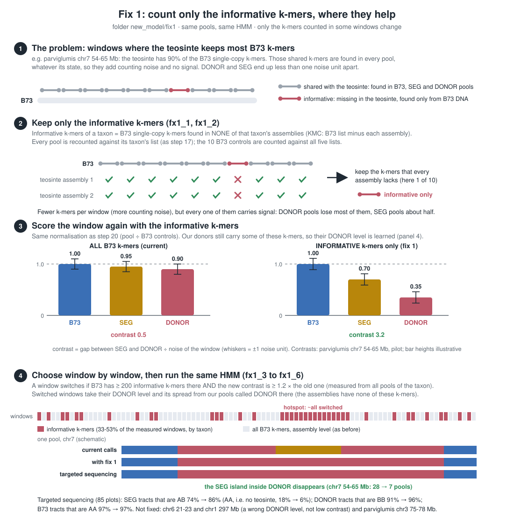

# fix1: count only informative k-mers, where it helps (full build)



(Drawing: `make_fix1_method_svg.py`.)

The pilot (`../pilot_fix1/`) showed that at *parviglumis* and *mexicana* chr7 54–65 Mb, counting only the **informative** k-mers (B73 single-copy k-mers missing from all of the taxon's assemblies) raises the DONOR-vs-SEG contrast from 0.5–1.3 to 1.9–3.2. With these counts the SEG islands there read as DONOR, as the targeted sequencing says. Away from the hotspots the contrast hardly changed, and at *parviglumis* chr3 75–78 Mb nothing changed. So this build switches to the new counts **only in the windows where they raise the contrast**, and keeps the old counts, assembly levels and everything else of the current run elsewhere. Nothing in `final_script/` or the current run is changed. All outputs go to `${KMER_DIR}/new_model/fix1` (`FX`).

| Step | Script | What it does |
|---|---|---|
| 1 | `fx1_1_sets.sh` (array 1–5: Zd Zh Zl Zv Zx) | informative k-mers per taxon (Zv, Zx copied from the pilot) and their count per window in B73 (denominator) |
| 2 | `fx1_2_pool_windows.sh` (2 pools per task, `%100`) | every pool, as step 17: count reads (KMC), keep its taxon's informative k-mers, windows on chr1–10. The 10 B73 controls are counted for all 5 taxa |
| 3 | `fx1_3_choose.sh` → `fx1_3_choose.py` (array 1–5) | per taxon and window: old and new scores of every pool (step 20's normalisation), noise from the controls and pools called B73, DONOR level from pools called DONOR (tracts ≥ 2 Mb), contrast old vs new. A window switches if B73 has ≥ 200 informative k-mers there and the new contrast is ≥ 1.2× the old one. For switched windows, the DONOR level and its spread between our donors come from our own pools (the assemblies have none of these k-mers by construction) |
| 4 | `fx1_4_run_hmm.sh` → `fx1_kmer_hmm.py` | the HMM (copy of `../20n_kmer_hmm.py` plus `--fix_dir`): in switched windows a pool and the controls use the new counts, level and spread; elsewhere it is exactly step 20 |
| 5 | `fx1_5_collect.sh` | rho and calls (`final_script/21_kmer_collect.py`, unchanged) → `${FX}/introgression/` |
| 6 | `fx1_6_checks.sh` | targeted sequencing (`34c`, `34d`, unchanged) and old vs new (`../compare_old_new.py`) → `${FX}/compare_old_new.txt` |

One difference from step 20, in switched windows only: step 20 drops a window when the controls see less than 20% of the genome-median count. Informative k-mers are few where the teosinte keeps most B73 k-mers, which is exactly at the hotspots, so that rule would drop the windows the fix is for. In switched windows the rule compares the **share** of the window's k-mers that the controls see with the typical share instead.

**Test on simulated pools** (40 *parviglumis*-like pools, 10 controls, chr3 + chr7):
- **The setup:** a chr7 hotspot where the assemblies keep 80% of the B73 k-mers and our donors keep 90%, with overdispersed counting noise. The current calls have a false SEG island there in half of the DONOR pools.
- **The old model** calls the hotspot SEG in all 10 DONOR pools tested (contrast 1.3).
- **This build** switches 118 of the 120 hotspot windows (contrast 4.7) and calls all 10 DONOR there.
- **No side effects:** SEG and B73 pools are unchanged, and the windows called correctly genome-wide rise from 97.1% to 100% in the DONOR pools.

## Run (one command, on the login node; each job loads its own env)

```bash
cd /share/maize/ntanduk/BZea_genotyping && git pull
cd new_model/fix1 && bash fx1_submit.sh
```

It prints the number of pools and the job ids (also in `logs/fx1_jobs.txt`). Expected time: step 1 is 1–3 h. Step 2 is about 1,400 pools at 30–60 min each, 100 at a time, so roughly 6–10 h. Steps 3–6 take about 1–2 h together. Step 2 needs about 25 GB of temporary disk per running pool in `${FX}/tmp`, so about 2.5 TB with 100 running.

Watch: `squeue -u $USER`; failed pools: `grep -l FAILED logs/fx1_2_pools.*.out`; resubmitting is safe (finished pieces are skipped): `bash fx1_submit.sh`.

**In the morning:** `cat ${FX}/compare_old_new.txt` (old vs new: genome shares, SEG-between-DONOR, hotspot counts, targeted-sequencing table) and `cat ${FX}/choice/summary_*.tsv` (windows switched per taxon, chromosome and hotspot; contrast before and after).

**What success looks like:** sandwiched SEG tracts that are BB in the targeted sequencing drop from 47%, the chr7 hotspot count drops, and B73 → AA, DONOR → BB and SEG → AB do not get worse. *parviglumis* chr3 75–78 Mb is not expected to change (pilot: the islands there read between DONOR and SEG in every count).

## Result, 20 Nov 2026

| Check | Current | fix1 |
|---|---|---|
| Genome share SEG / DONOR | 6.22% / 4.94% | 6.26% / 4.93% |
| SEG between two DONOR tracts (% of genome) | 0.38% | 0.33% |
| Hotspots: chr6 21–23 / chr1 297 / chr7 54–65 / chr3 75–78 Mb (pools) | 48 / 28 / 28 / 19 | 48 / 28 / **7** / **8** |
| Targeted seq.: B73 tracts that are AA | 97.1% (1,105) | 97.0% (969) |
| Targeted seq.: SEG tracts that are AA / AB / BB | 17.9 / 74.3 / 7.8% (374) | **5.7 / 86.4** / 7.9% (316) |
| Targeted seq.: DONOR tracts that are BB | 90.7% (375) | **95.5%** (353) |
| Targeted seq.: SEG between two DONOR tracts | 38 tracts, 47% BB | 28 tracts, 54% BB |

Windows switched to the informative k-mers: 33% (*diploperennis*) to 53% (*huehuetenangensis*) of the windows where both contrasts could be measured (≥ 5 pools called DONOR). Median contrast there rose from 3.3 to 3.8 (*parviglumis*) and 4.1 to 4.7 (*mexicana*). These gains are optimistic, because windows were chosen where the measured new contrast was higher; the targeted-sequencing table is the unbiased check. *parviglumis* chr7 54–65 Mb: 95% switched, contrast 1.16 → 2.63. *parviglumis* chr3 75–78 Mb: unchanged, as the pilot predicted. chr6 21–23 and chr1 297 Mb did not change: there the DONOR level is wrong rather than the contrast low, and 20c's learned levels fixed them (48 → 11, 28 → 14).

**Next:** `fx1_submit_levels.sh` reruns steps 4–6 (no recount) with fix 1 in the switched windows and 20c's taxon levels in the others. Outputs go to `${FX}/with_levels/`.

## Adopted (20 Nov 2026): rerun everything downstream on the new calls

`final_script/config.sh` has a switch, `MODEL=fix1`: with it, steps 22–34 read the calls in `${FX}/with_levels/introgression` and write next to them. The default (no `MODEL`) is still the old run, so nothing old is overwritten. Two small additions in `final_script/`, both off unless `MODEL=fix1`: `22b_seg_donor_copies` takes `--level_dir`/`--fix_dir`, because it needs the same DONOR levels the HMM used (tested on simulated pools: SEG donor share 0.49 with them, 0.62 without). New: `33a_qtl_gene_tables.py` builds `qtl_genes/<TRAIT>_qtl_genes.tsv` (made by hand until now; it reproduces the current tables: same genes, p values and names).

```bash
# 1. cluster (login node, GWAS env active): 22, 22b, 23, 24, GWAS + permutations + joint QTL (taxon, races, per year, N 2025)
conda activate /usr/local/usrapps/maize/ntanduk/bzea_gwas
cd /share/maize/ntanduk/BZea_genotyping && git pull && cd new_model/fix1 && bash fx1_7_downstream.sh
# 2. laptop, from the repo root, when all jobs are done
C=ntanduk@login.hpc.ncsu.edu:/share/maize/ntanduk/kmer/new_model/fix1
mkdir -p data/introgression_fix1/targseq data/introgression_fix1/model
rsync -av $C/with_levels/introgression/ data/introgression_fix1/
rsync -av $C/with_levels/targseq/ data/introgression_fix1/targseq/
rsync -av --exclude log.txt $C/with_levels/targseq_tracts/ data/introgression_fix1/targseq/
rsync -av "$C/choice/summary_*.tsv" $C/with_levels/compare_old_new.txt data/introgression_fix1/model/
bash new_model/fix1/fx1_8_laptop.sh     # GO, gene tables, SuSiE + PIP, figures, checks
```
